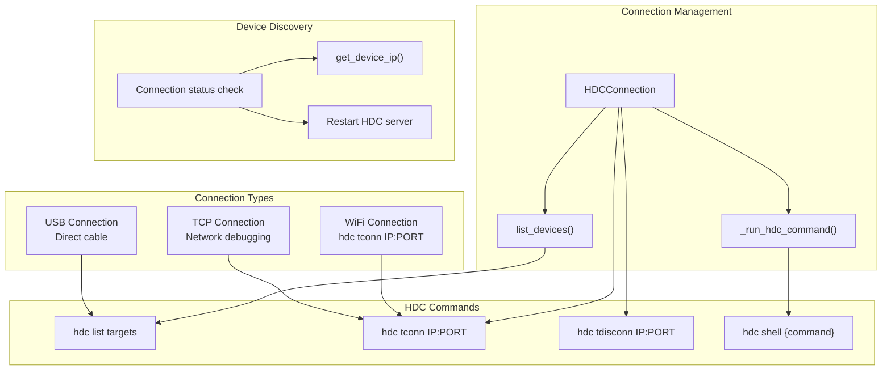
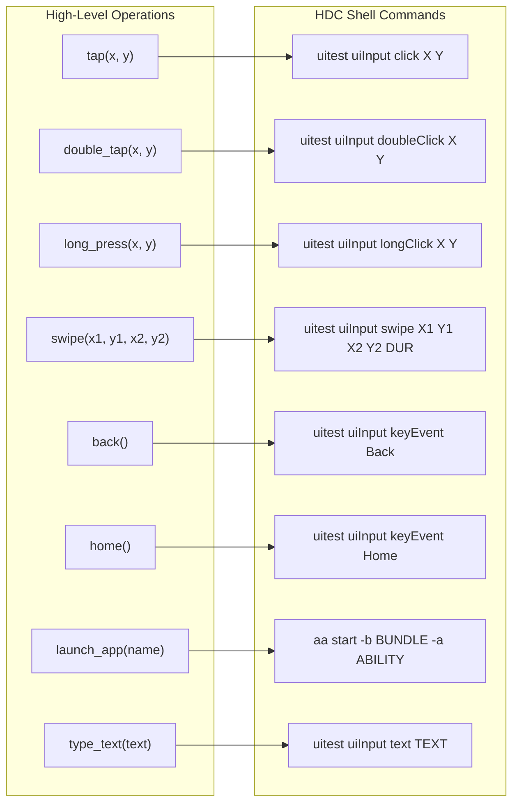
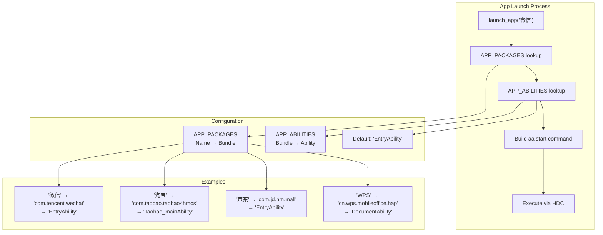
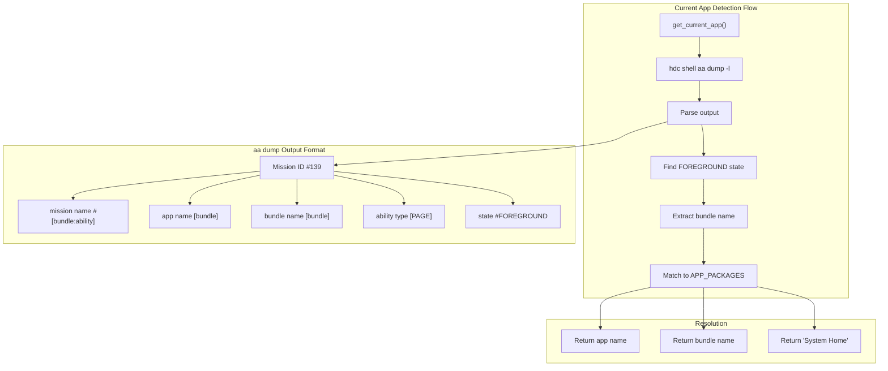
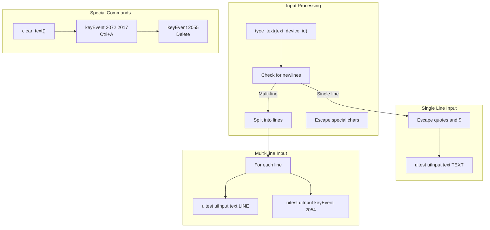
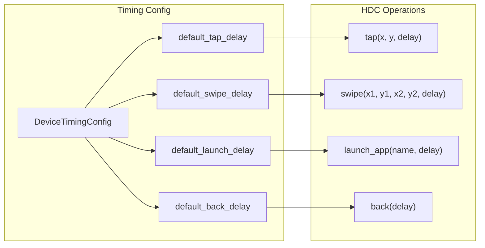

<!-- source: DeepWiki mcp.deepwiki.com · repo zai-org/Open-AutoGLM · page 4.2 HarmonyOS (HDC) · fetched 2026-10-29 -->

# HarmonyOS (HDC)

<details>
<summary>Relevant source files</summary>

The following files were used as context for generating this wiki page:

- [README.md](README.md)
- [README_coding_agent.md](README_coding_agent.md)
- [README_en.md](README_en.md)
- [phone_agent/config/apps_harmonyos.py](phone_agent/config/apps_harmonyos.py)
- [phone_agent/hdc/device.py](phone_agent/hdc/device.py)
- [phone_agent/hdc/input.py](phone_agent/hdc/input.py)

</details>


This page documents the HarmonyOS device control implementation using HDC (Huawei Device Connector), the device debugging tool for HarmonyOS devices. This implementation provides platform-specific device control for HarmonyOS NEXT and later versions.

**Scope**: This document covers HDC connection management, device operations, app launching with abilities, and native input handling for HarmonyOS devices. For Android device control, see [Android (ADB)](#4.1). For general device abstraction patterns, see [Device Communication Layer](#3.5).

## Overview

The HarmonyOS support in Open-AutoGLM is implemented through three core modules that parallel the Android implementation but use HarmonyOS-specific protocols:

| Module | Purpose | Key Difference from Android |
|--------|---------|----------------------------|
| `phone_agent/hdc/connection.py` | Device connection management | Uses `hdc` command instead of `adb` |
| `phone_agent/hdc/device.py` | Device control operations | Uses `uitest uiInput` instead of `input tap/swipe` |
| `phone_agent/hdc/input.py` | Text input handling | Native input, no ADB Keyboard required |
| `phone_agent/hdc/screenshot.py` | Screen capture | Uses `hdc shell snapshot_display` |
| `phone_agent/config/apps_harmonyos.py` | App configuration | Bundle + Ability architecture |

The implementation supports USB and WiFi connectivity, multi-device scenarios, and 60+ HarmonyOS native applications including system apps.

**Sources**: [phone_agent/hdc/device.py:1-311](), [phone_agent/hdc/input.py:1-150](), [phone_agent/config/apps_harmonyos.py:1-267](), [README.md:81-95]()

## HDC Connection Architecture

The HDC connection system manages device connectivity through both USB and network transports. Unlike ADB, HDC uses the `hdc list targets` command for device enumeration and `hdc tconn`/`hdc tdisconn` for network connections.



**HDC vs ADB Connection Differences**:

| Operation | Android (ADB) | HarmonyOS (HDC) |
|-----------|--------------|-----------------|
| List devices | `adb devices` | `hdc list targets` |
| Connect via WiFi | `adb connect IP:PORT` | `hdc tconn IP:PORT` |
| Disconnect | `adb disconnect IP:PORT` | `hdc tdisconn IP:PORT` |
| Device specifier | `adb -s DEVICE_ID` | `hdc -t DEVICE_ID` |
| Server restart | `adb kill-server` | `hdc kill` |

**Sources**: [README.md:151-163](), [README.md:377-383](), [README.md:404-417](), [phone_agent/hdc/connection.py]()

## Device Operation Commands

HarmonyOS uses the `uitest uiInput` command suite instead of Android's `input` commands. All operations are routed through the `hdc shell` interface.

### Command Translation Map



**Implementation Details**:

The `tap()` function demonstrates the pattern used throughout the HDC device module:

```python
# phone_agent/hdc/device.py:80-103
def tap(x: int, y: int, device_id: str | None = None, delay: float | None = None) -> None:
    hdc_prefix = _get_hdc_prefix(device_id)
    _run_hdc_command(
        hdc_prefix + ["shell", "uitest", "uiInput", "click", str(x), str(y)],
        capture_output=True
    )
    time.sleep(delay)
```

The `_get_hdc_prefix()` helper function builds device-specific command prefixes:

```python
# phone_agent/hdc/device.py:303-307
def _get_hdc_prefix(device_id: str | None) -> list:
    if device_id:
        return ["hdc", "-t", device_id]
    return ["hdc"]
```

**Sources**: [phone_agent/hdc/device.py:80-103](), [phone_agent/hdc/device.py:105-128](), [phone_agent/hdc/device.py:130-159](), [phone_agent/hdc/device.py:161-211](), [phone_agent/hdc/device.py:213-253](), [phone_agent/hdc/device.py:303-307]()

## Application Management and Abilities

HarmonyOS uses a two-part identification system for apps: **bundle names** (similar to Android package names) and **ability names** (entry points). This is a key architectural difference from Android.

### Bundle and Ability Architecture



The `launch_app()` function implements the bundle + ability resolution:

```python
# phone_agent/hdc/device.py:255-301
def launch_app(app_name: str, device_id: str | None = None, delay: float | None = None) -> bool:
    if app_name not in APP_PACKAGES:
        return False
    
    hdc_prefix = _get_hdc_prefix(device_id)
    bundle = APP_PACKAGES[app_name]
    
    # Get the ability name for this bundle
    # Default to "EntryAbility" if not specified in APP_ABILITIES
    ability = APP_ABILITIES.get(bundle, "EntryAbility")
    
    # HarmonyOS uses 'aa start' command to launch apps
    # Format: aa start -b {bundle} -a {ability}
    _run_hdc_command(
        hdc_prefix + [
            "shell", "aa", "start", "-b", bundle, "-a", ability,
        ],
        capture_output=True,
    )
    time.sleep(delay)
    return True
```

**APP_ABILITIES Dictionary Structure**:

The `APP_ABILITIES` dictionary maps bundle names to non-standard ability names. If a bundle is not in this dictionary, the default `"EntryAbility"` is used:

| Bundle | Ability | Notes |
|--------|---------|-------|
| `com.taobao.taobao4hmos` | `Taobao_mainAbility` | Custom naming |
| `cn.wps.mobileoffice.hap` | `DocumentAbility` | Document-focused entry |
| `com.huawei.hmos.browser` | `MainAbility` | System app pattern |
| `com.tencent.wechat` | `EntryAbility` (default) | Standard naming |

**Sources**: [phone_agent/hdc/device.py:255-301](), [phone_agent/config/apps_harmonyos.py:7-57](), [phone_agent/config/apps_harmonyos.py:59-227]()

## Current App Detection

HarmonyOS provides app state information through the `aa dump -l` command, which lists all running abilities and their states. The system parses this output to identify the foreground app.



The implementation uses regex parsing to extract bundle names from the structured output:

```python
# phone_agent/hdc/device.py:13-77
def get_current_app(device_id: str | None = None) -> str:
    hdc_prefix = _get_hdc_prefix(device_id)
    
    result = _run_hdc_command(
        hdc_prefix + ["shell", "aa", "dump", "-l"],
        capture_output=True, text=True, encoding="utf-8"
    )
    output = result.stdout
    
    lines = output.split("\n")
    foreground_bundle = None
    current_bundle = None
    
    for line in lines:
        # Track the current mission's bundle name
        if "app name [" in line:
            match = re.search(r'\[([^\]]+)\]', line)
            if match:
                current_bundle = match.group(1)
        
        # Check if this mission is in FOREGROUND state
        if "state #FOREGROUND" in line or "state #foreground" in line.lower():
            if current_bundle:
                foreground_bundle = current_bundle
                break
        
        # Reset current_bundle when starting a new mission
        if "Mission ID" in line:
            current_bundle = None
    
    # Match against known apps
    if foreground_bundle:
        for app_name, package in APP_PACKAGES.items():
            if package == foreground_bundle:
                return app_name
        return foreground_bundle
    return "System Home"
```

**Sources**: [phone_agent/hdc/device.py:13-77]()

## Native Input Handling

Unlike Android devices which require ADB Keyboard, HarmonyOS devices use native input methods through the `uitest uiInput text` command. This eliminates the need for third-party keyboard applications.

### Text Input Architecture



**Key Differences from Android**:

| Aspect | Android (ADB) | HarmonyOS (HDC) |
|--------|--------------|-----------------|
| Input method | ADB Keyboard app required | Native `uitest uiInput` |
| Installation | Must install APK | No installation needed |
| Keyboard switching | `ime set` commands | Not required |
| Multi-line support | Line-by-line with keyevent | Built-in newline handling |
| Special characters | UTF-8 via ADB Keyboard | Direct shell escaping |

The `type_text()` function handles both single-line and multi-line text with proper escaping:

```python
# phone_agent/hdc/input.py:10-64
def type_text(text: str, device_id: str | None = None) -> None:
    hdc_prefix = _get_hdc_prefix(device_id)
    
    # Handle multi-line text by splitting on newlines
    if '\n' in text:
        lines = text.split('\n')
        for i, line in enumerate(lines):
            if line:  # Only process non-empty lines
                escaped_line = line.replace('"', '\\"').replace("$", "\\$")
                _run_hdc_command(
                    hdc_prefix + ["shell", "uitest", "uiInput", "text", escaped_line],
                    capture_output=True, text=True,
                )
            
            # Send ENTER key event after each line except the last one
            if i < len(lines) - 1:
                _run_hdc_command(
                    hdc_prefix + ["shell", "uitest", "uiInput", "keyEvent", "2054"],
                    capture_output=True, text=True,
                )
    else:
        # Single line text
        escaped_text = text.replace('"', '\\"').replace("$", "\\$")
        _run_hdc_command(
            hdc_prefix + ["shell", "uitest", "uiInput", "text", escaped_text],
            capture_output=True, text=True,
        )
```

**HarmonyOS Key Event Codes**:

| Key | Code | Usage |
|-----|------|-------|
| Enter | 2054 | Multi-line text input |
| Delete | 2055 | Text deletion |
| Ctrl | 2072 | Modifier for shortcuts |
| A | 2017 | Select all (with Ctrl) |

**Sources**: [phone_agent/hdc/input.py:10-64](), [phone_agent/hdc/input.py:66-90](), [phone_agent/hdc/input.py:92-122]()

## Supported Applications

The HarmonyOS configuration includes 60+ applications across system apps, third-party apps, and Huawei services. The configuration distinguishes between mainstream Android apps ported to HarmonyOS and native HarmonyOS applications.

### Application Categories

```mermaid
graph TB
    subgraph "App Configuration Structure"
        AppPackages["APP_PACKAGES<br/>Dict[str, str]<br/>230+ entries"]
        AppAbilities["APP_ABILITIES<br/>Dict[str, str]<br/>45+ custom abilities"]
    end
    
    subgraph "Third-Party Apps"
        Social["Social & Messaging<br/>微信, QQ, 微博, 飞书"]
        Ecom["E-commerce<br/>淘宝, 京东, 拼多多"]
        Video["Video & Entertainment<br/>bilibili, 抖音, 快手"]
        Music["Music & Audio<br/>QQ音乐, 汽水音乐, 喜马拉雅"]
        Life["Lifestyle<br/>小红书, 知乎, 今日头条"]
    end
    
    subgraph "System Apps"
        Tools["Tools<br/>浏览器, 计算器, 日历"]
        Media["Media<br/>相机, 相册, 录音机"]
        Comm["Communication<br/>联系人, 短信, 电话"]
        Settings["System<br/>设置, 健康, 钱包"]
    end
    
    subgraph "Huawei Services"
        Store["应用市场<br/>AppGallery"]
        Content["音乐, 视频, 阅读<br/>Media services"]
        Util["主题, 天气, 搜索<br/>Utilities"]
    end
    
    AppPackages --> Social
    AppPackages --> Ecom
    AppPackages --> Video
    AppPackages --> Music
    AppPackages --> Life
    AppPackages --> Tools
    AppPackages --> Media
    AppPackages --> Comm
    AppPackages --> Settings
    AppPackages --> Store
    AppPackages --> Content
    AppPackages --> Util
```



**System App Naming Patterns**:

| Pattern | Example Bundle | Notes |
|---------|----------------|-------|
| `com.huawei.hmos.*` | `com.huawei.hmos.browser` | HarmonyOS system apps |
| `com.huawei.hmsapp.*` | `com.huawei.hmsapp.appgallery` | Huawei services |
| `com.ohos.*` | `com.ohos.contacts` | OpenHarmony base system |
| `*.hap` | `cn.wps.mobileoffice.hap` | HarmonyOS app package |
| `*.hos` | `com.dewu.hos` | HarmonyOS app suffix |

The configuration provides helper functions for app lookup:

```python
# phone_agent/config/apps_harmonyos.py:230-267
def get_package_name(app_name: str) -> str | None:
    """Get the package name for an app."""
    return APP_PACKAGES.get(app_name)

def get_app_name(package_name: str) -> str | None:
    """Get the app name from a package name."""
    for name, package in APP_PACKAGES.items():
        if package == package_name:
            return name
    return None

def list_supported_apps() -> list[str]:
    """Get a list of all supported app names."""
    return list(APP_PACKAGES.keys())
```

**Sources**: [phone_agent/config/apps_harmonyos.py:59-227](), [phone_agent/config/apps_harmonyos.py:230-267](), [README.md:597-614]()

## Command-Line Usage

The HDC device type is specified via the `--device-type hdc` flag. All other command-line options remain the same as the Android implementation.

### Basic Commands

```bash
# Interactive mode with HarmonyOS device
python main.py --device-type hdc --base-url http://localhost:8000/v1

# Execute specific task
python main.py --device-type hdc --base-url http://localhost:8000/v1 "打开美团搜索附近的火锅店"

# List supported HarmonyOS apps
python main.py --device-type hdc --list-apps

# Specify device by ID
python main.py --device-type hdc --device-id 192.168.1.100:5555 --base-url http://localhost:8000/v1 "打开抖音刷视频"
```

### Remote Debugging Setup

```bash
# List connected HarmonyOS devices
hdc list targets

# Connect to device via WiFi
hdc tconn 192.168.1.100:5555

# Verify connection
hdc list targets

# Disconnect device
hdc tdisconn 192.168.1.100:5555
```

**Sources**: [README.md:296-324](), [README.md:404-417]()

## Python API Usage

The HDC implementation is accessed through the same `PhoneAgent` API by setting the device type in the configuration or environment.

### Basic Usage

```python
from phone_agent import PhoneAgent
from phone_agent.model import ModelConfig
from phone_agent.device_factory import DeviceType

# Configure for HarmonyOS device
model_config = ModelConfig(
    base_url="http://localhost:8000/v1",
    model_name="autoglm-phone-9b"
)

# Create agent - device type can be set via environment
# or by using DeviceFactory.set_device_type(DeviceType.HDC)
agent = PhoneAgent(model_config=model_config)

# Execute task
result = agent.run("打开淘宝搜索无线耳机")
print(result)
```

### Connection Management API

```python
from phone_agent.hdc import HDCConnection, list_devices

# Create connection manager
conn = HDCConnection()

# Connect to remote device
success, message = conn.connect("192.168.1.100:5555")
print(f"连接状态: {message}")

# List connected devices
devices = list_devices()
for device in devices:
    print(f"{device.device_id} - {device.connection_type.value}")

# Disconnect
conn.disconnect("192.168.1.100:5555")
```

**Environment Variables for HDC**:

| Variable | Description | Value for HDC |
|----------|-------------|---------------|
| `PHONE_AGENT_DEVICE_TYPE` | Device platform | `hdc` |
| `PHONE_AGENT_DEVICE_ID` | Specific device ID | From `hdc list targets` |

**Sources**: [README.md:328-345](), [README.md:449-466]()

## Timing Configuration

The HDC device operations use the same timing configuration system as Android, with delays applied after each operation to ensure the device has time to respond.



All device operation functions accept an optional `delay` parameter that overrides the configured default:

```python
# Example from phone_agent/hdc/device.py:80-103
def tap(x: int, y: int, device_id: str | None = None, delay: float | None = None) -> None:
    if delay is None:
        delay = TIMING_CONFIG.device.default_tap_delay
    
    hdc_prefix = _get_hdc_prefix(device_id)
    _run_hdc_command(
        hdc_prefix + ["shell", "uitest", "uiInput", "click", str(x), str(y)],
        capture_output=True
    )
    time.sleep(delay)
```

**Sources**: [phone_agent/hdc/device.py:80-103](), [phone_agent/hdc/device.py:161-211](), [phone_agent/hdc/device.py:255-301]()

## Troubleshooting

### Device Not Detected

**Symptoms**: `hdc list targets` returns empty or device not found.

**Resolution**:
1. Verify USB debugging is enabled in Developer Options
2. Check that USB cable supports data transfer
3. Confirm device authorization popup was approved
4. Restart HDC server: `hdc kill` then retry
5. Some devices require "Wireless debugging" to be enabled even for USB

### App Launch Fails

**Symptoms**: App does not open or incorrect app opens.

**Resolution**:
1. Verify the app is in `APP_PACKAGES` dictionary: [phone_agent/config/apps_harmonyos.py:59-227]()
2. Check if app requires custom ability in `APP_ABILITIES`: [phone_agent/config/apps_harmonyos.py:7-57]()
3. Test manually: `hdc shell aa start -b {bundle} -a {ability}`
4. Use `hdc shell aa dump -l` to verify bundle name on device

### Text Input Not Working

**Symptoms**: Text does not appear in input fields.

**Resolution**:
1. Ensure input field has focus (tap it first)
2. Check for special characters that need escaping
3. Verify the field is not read-only
4. For multi-line text, verify ENTER key events (2054) are supported

### Remote Connection Drops

**Symptoms**: WiFi connection disconnects frequently.

**Resolution**:
1. Ensure device and computer remain on same network
2. Check WiFi power saving settings on device
3. Use static IP address if possible
4. Re-enable TCP mode after device restart
5. Monitor firewall rules for port 5555

**Sources**: [README.md:81-95](), [README.md:469-485](), [phone_agent/hdc/device.py:255-301](), [phone_agent/hdc/input.py:10-64]()

---

