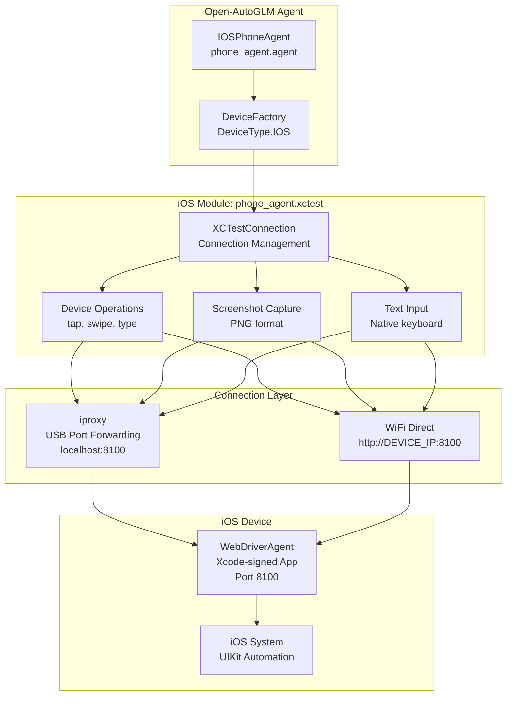
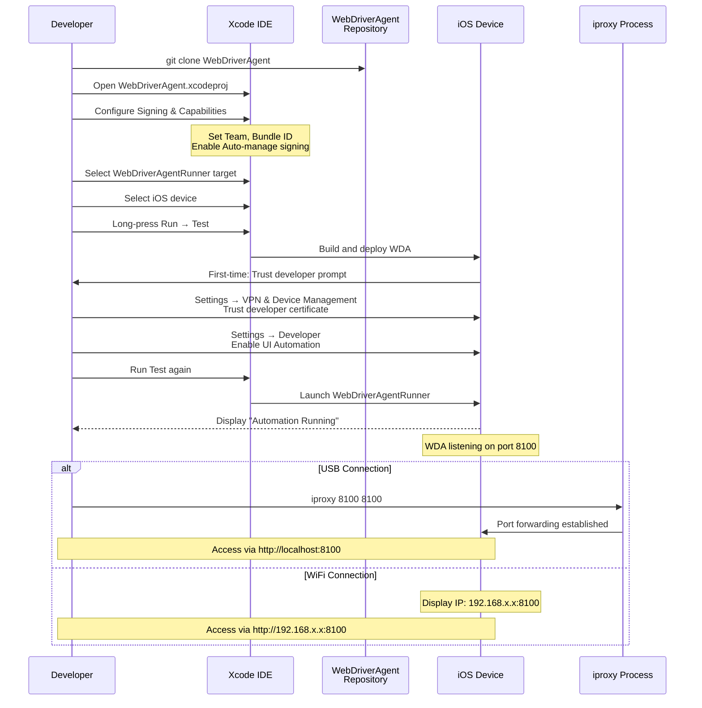
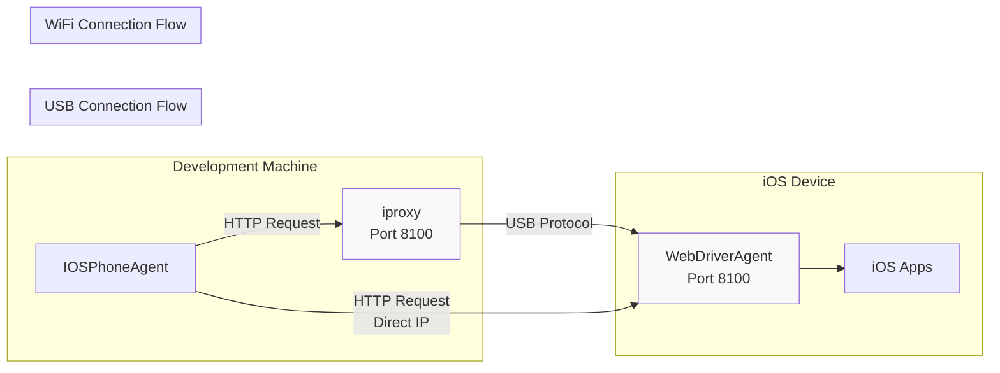
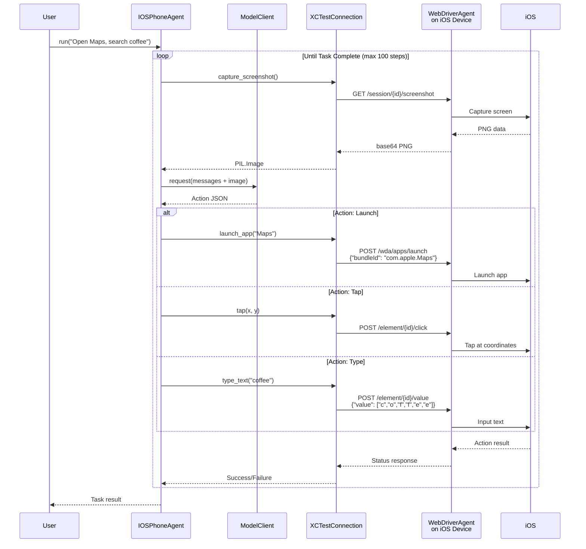

<!-- source: DeepWiki mcp.deepwiki.com · repo zai-org/Open-AutoGLM · page 4.3 iOS (WebDriverAgent) · fetched 2026-10-29 -->

# iOS (WebDriverAgent)

<details>
<summary>Relevant source files</summary>

The following files were used as context for generating this wiki page:

- [README_coding_agent.md](README_coding_agent.md)
- [README_en.md](README_en.md)
- [docs/ios_setup/resources/enable-ui-automation.jpg](docs/ios_setup/resources/enable-ui-automation.jpg)
- [main.py](main.py)
- [resources/enable-ui-automation.jpg](resources/enable-ui-automation.jpg)
- [resources/select-your-iphone-device.png](resources/select-your-iphone-device.png)
- [resources/setup-xcode-wda.png](resources/setup-xcode-wda.png)
- [resources/start-wda-testing.png](resources/start-wda-testing.png)
- [resources/trust-dev-app.jpg](resources/trust-dev-app.jpg)

</details>


## Purpose and Scope

This page covers iOS device support in Open-AutoGLM through WebDriverAgent integration. It documents the architecture of the iOS automation module, WebDriverAgent setup requirements, connection management, and available device operations. For Android device support, see [Android (ADB)](#4.1). For HarmonyOS support, see [HarmonyOS (HDC)](#4.2).

## System Architecture

The iOS implementation uses WebDriverAgent (WDA), an official Facebook-developed iOS test automation framework that runs on the iOS device and exposes a WebDriver-compatible HTTP API.



**Sources:** [README_en.md:1-923](), [docs/ios_setup/ios_setup.md:1-135]()

## Component Responsibilities

| Component | Module/File | Responsibility |
|-----------|-------------|----------------|
| `IOSPhoneAgent` | `phone_agent.agent` | Main agent class for iOS automation, inherits from base PhoneAgent |
| `XCTestConnection` | `phone_agent.xctest.connection` | Manages WebDriverAgent HTTP connections, session lifecycle |
| `DeviceOperations` | `phone_agent.xctest.device` | Executes tap, swipe, launch, back, home actions via WDA API |
| `ScreenshotCapture` | `phone_agent.xctest.screenshot` | Captures device screenshots in PNG format via WDA |
| `TextInput` | `phone_agent.xctest.input` | Sends text input using native iOS keyboard |
| `WebDriverAgent` | External iOS app | Test automation server running on iOS device, exposes HTTP API |

**Sources:** [README_en.md:607-624]()

## WebDriverAgent Setup Process

WebDriverAgent must be compiled, signed, and deployed to the iOS device before automation can begin. This is a one-time setup per device.



**Sources:** [docs/ios_setup/ios_setup.md:14-107](), [README_en.md:695-923]()

### Prerequisites

| Requirement | Details |
|-------------|---------|
| Operating System | macOS (Xcode requirement) |
| Xcode | Latest version from App Store |
| Apple Developer Account | Free account sufficient (no paid membership required) |
| iOS Device | iPhone or iPad |
| Connection | USB cable or same WiFi network |
| Tools | `libimobiledevice` for device communication: `brew install libimobiledevice` |

**Sources:** [docs/ios_setup/ios_setup.md:6-12]()

### Xcode Configuration Steps

1. **Clone WebDriverAgent repository:**
   ```bash
   git clone https://github.com/appium/WebDriverAgent.git
   cd WebDriverAgent
   ```

2. **Open project in Xcode:**
   - Double-click `WebDriverAgent.xcodeproj` to open in Xcode

3. **Configure Signing & Capabilities:**
   - Select `WebDriverAgent` in project navigator
   - Go to `Signing & Capabilities` tab
   - Check `Automatically manage signing`
   - Select your Team (Apple Developer Account)
   - Change Bundle ID to unique identifier (e.g., `com.yourname.WebDriverAgentRunner`)

4. **Configure all targets:**
   - Repeat signing configuration for:
     - `WebDriverAgentLib`
     - `WebDriverAgentRunner` (primary target)
     - `IntegrationApp`

**Sources:** [docs/ios_setup/ios_setup.md:18-37]()

### Device Trust Configuration

First-time deployment requires manual trust configuration on the iOS device:

1. **Trust Developer Certificate:**
   - Navigate to: `Settings → General → VPN & Device Management`
   - Under "Developer App", select your developer certificate
   - Tap "Trust [Certificate Name]"

2. **Enable UI Automation:**
   - Navigate to: `Settings → Developer`
   - Enable "UI Automation" toggle
   - This allows WebDriverAgent to control UI elements

3. **WiFi Connection Setup (Optional):**
   - Connect device via USB first
   - Open Finder, select iPhone
   - Under "General", check "Show this iPhone when on WiFi"
   - Ensure Mac and iPhone are on same WiFi network

**Sources:** [docs/ios_setup/ios_setup.md:62-78]()

## Connection Management

### USB Connection with iproxy

USB connection requires port forwarding from localhost to the device using `iproxy` (part of `libimobiledevice`):

```bash
# Install libimobiledevice
brew install libimobiledevice

# Verify device connection
idevice_id -l

# Start port forwarding (keeps running)
iproxy 8100 8100
```

The agent connects to `http://localhost:8100` while iproxy forwards requests to the device.

**Command-line usage:**
```bash
python ios.py --base-url "YOUR_BASE_URL" \
    --model "autoglm-phone" \
    --api-key "YOUR_API_KEY" \
    --wda-url http://localhost:8100 \
    "Open Safari and search for coffee shops"
```

**Sources:** [docs/ios_setup/ios_setup.md:81-116]()

### WiFi Connection

WiFi connection eliminates the need for iproxy by directly accessing the device's IP address:

1. **Enable Wireless Debugging:**
   - Ensure device and Mac are on same WiFi network
   - WebDriverAgent displays IP when running: `http://[DEVICE_IP]:8100`

2. **Verify connection:**
   ```bash
   # Check WebDriverAgent status
   curl http://192.168.x.x:8100/status
   ```

3. **Use in commands:**
   ```bash
   python ios.py --base-url "YOUR_BASE_URL" \
       --model "autoglm-phone" \
       --api-key "YOUR_API_KEY" \
       --wda-url http://192.168.x.x:8100 \
       "Open Calendar and create new event"
   ```

**Sources:** [docs/ios_setup/ios_setup.md:43-107]()

## Connection Architecture



**Sources:** [docs/ios_setup/ios_setup.md:110-116](), [README_en.md:1-923]()

## Device Operations

iOS device operations are implemented through WebDriverAgent's WebDriver-compatible HTTP API. The implementation differs from Android/HarmonyOS as iOS uses native UIKit automation.

### Available Actions

| Action | WebDriver Endpoint | Implementation Module | Description |
|--------|-------------------|----------------------|-------------|
| `Tap` | `POST /session/{id}/element/{id}/click` | `phone_agent.xctest.device` | Tap at coordinates or UI element |
| `Type` | `POST /session/{id}/element/{id}/value` | `phone_agent.xctest.input` | Input text using native keyboard |
| `Swipe` | `POST /session/{id}/actions` | `phone_agent.xctest.device` | Swipe gesture with start/end points |
| `Launch` | `POST /session/{id}/wda/apps/launch` | `phone_agent.xctest.device` | Launch app by bundle identifier |
| `Back` | Navigation via element tap | `phone_agent.xctest.device` | Tap back button in navigation bar |
| `Home` | `POST /session/{id}/wda/homescreen` | `phone_agent.xctest.device` | Return to home screen |
| `Screenshot` | `GET /session/{id}/screenshot` | `phone_agent.xctest.screenshot` | Capture PNG screenshot |

**Sources:** [README_en.md:541-557]()

### Screenshot Capture

iOS screenshots are captured via WebDriverAgent's screenshot endpoint, which returns base64-encoded PNG data:

```python
# Internal flow in phone_agent.xctest.screenshot
# GET http://WDA_URL/session/{session_id}/screenshot
# Response: {"value": "base64_png_data", "sessionId": "..."}
# Decode base64 → PIL.Image object
```

Unlike Android which uses `screencap` shell command, iOS screenshots maintain original device resolution and color accuracy through native APIs.

**Sources:** [README_en.md:607-624]()

### Text Input

iOS text input uses the native iOS keyboard through WebDriverAgent's element value API:

```python
# Internal flow in phone_agent.xctest.input
# 1. Focus on input element (tap)
# 2. POST /session/{id}/element/{element_id}/value
# 3. Send keys: {"value": ["text", "to", "type"]}
```

No additional keyboard app installation is required (unlike Android's ADB Keyboard requirement). The system keyboard handles all text input, including special characters and emoji.

**Sources:** [README_en.md:86-92]()

## Application Package Mapping

iOS apps are identified by bundle identifiers (e.g., `com.apple.mobilesafari`) rather than package names. The `APP_PACKAGES` configuration maps friendly names to bundle IDs:

```python
# Example from phone_agent/config/apps.py
IOS_APPS = {
    "Safari": "com.apple.mobilesafari",
    "Mail": "com.apple.mobilemail",
    "Calendar": "com.apple.mobilecal",
    "Maps": "com.apple.Maps",
    "Settings": "com.apple.Preferences",
    # ... 50+ apps
}
```

The agent uses these mappings when processing `Launch` actions to determine the correct bundle identifier for WebDriverAgent's launch API.

**Sources:** [README_en.md:506-540]()

## Usage Examples

### Command-Line Interface

The iOS implementation is accessed through the `ios.py` script (or `main.py` with `--device-type ios` flag):

```bash
# Interactive mode
python ios.py --base-url http://localhost:8000/v1 \
    --model "autoglm-phone-9b-multilingual" \
    --wda-url http://localhost:8100

# Single task execution
python ios.py --base-url http://localhost:8000/v1 \
    --wda-url http://localhost:8100 \
    "Open Safari and search for nearby restaurants"

# With API key authentication
python ios.py --apikey sk-xxxxx \
    --wda-url http://192.168.1.100:8100 \
    "Open Mail and compose new message"
```

**Sources:** [docs/ios_setup/ios_setup.md:108-124]()

### Python API

```python
from phone_agent import IOSPhoneAgent
from phone_agent.model import ModelConfig

# Configure model
model_config = ModelConfig(
    base_url="http://localhost:8000/v1",
    model_name="autoglm-phone-9b-multilingual",
)

# Create iOS agent with WDA URL
agent = IOSPhoneAgent(
    model_config=model_config,
    wda_url="http://localhost:8100"
)

# Execute task
result = agent.run("Open Calendar and create event for tomorrow at 2pm")
print(result)
```

**Sources:** [README_en.md:256-273]()

## Configuration Parameters

| Parameter | Environment Variable | Default | Description |
|-----------|---------------------|---------|-------------|
| `--wda-url` | `PHONE_AGENT_WDA_URL` | `http://localhost:8100` | WebDriverAgent base URL |
| `--device-type` | `PHONE_AGENT_DEVICE_TYPE` | `adb` | Set to `ios` for iOS devices |
| `--base-url` | `PHONE_AGENT_BASE_URL` | `http://localhost:8000/v1` | Model API endpoint |
| `--model` | `PHONE_AGENT_MODEL` | `autoglm-phone-9b` | Model name |
| `--apikey` | `PHONE_AGENT_API_KEY` | `EMPTY` | API authentication key |
| `--max-steps` | `PHONE_AGENT_MAX_STEPS` | `100` | Maximum automation steps |
| `--lang` | `PHONE_AGENT_LANG` | `en` | System prompt language (cn/en) |

**Sources:** [README_en.md:427-436]()

## Supported Applications

Open-AutoGLM includes pre-configured bundle identifiers for 50+ iOS apps across multiple categories:

| Category | Example Apps |
|----------|--------------|
| **Social & Messaging** | X, WhatsApp, Telegram, Facebook Messenger, Instagram |
| **Productivity** | Mail, Calendar, Notes, Files, Reminders |
| **E-commerce** | Amazon, eBay, Shopping apps |
| **Utilities** | Safari, Maps, Clock, Weather, Settings |
| **Entertainment** | Photos, Music, TV, Books, Podcasts |

To view the complete list of supported iOS apps:
```bash
python main.py --device-type ios --list-apps
```

**Sources:** [README_en.md:506-540]()

## Execution Flow



**Sources:** [README_en.md:1-923](), [docs/ios_setup/ios_setup.md:1-135]()

## Troubleshooting

### WebDriverAgent Build Failures

**Symptom:** Xcode build errors during WebDriverAgent compilation

**Common Causes:**
1. Code signing identity not selected
2. Bundle identifier conflicts
3. Provisioning profile issues

**Solutions:**
- Verify Team selection in Signing & Capabilities
- Use unique Bundle ID (e.g., `com.yourname.WebDriverAgentRunner`)
- Clean build folder: Xcode → Product → Clean Build Folder
- Delete derived data: `rm -rf ~/Library/Developer/Xcode/DerivedData/*`

### Device Trust Issues

**Symptom:** App installed but won't launch, shows "Untrusted Developer"

**Solution:**
1. Go to Settings → General → VPN & Device Management
2. Find developer certificate under "Developer App"
3. Tap certificate and select "Trust"
4. Return to Xcode and run Test again

### Connection Failures

**Symptom:** Agent cannot connect to WebDriverAgent URL

**USB Connection:**
```bash
# Verify iproxy is running
ps aux | grep iproxy

# Check device connection
idevice_id -l

# Restart iproxy if needed
killall iproxy
iproxy 8100 8100
```

**WiFi Connection:**
```bash
# Test WebDriverAgent availability
curl http://DEVICE_IP:8100/status

# Verify devices on same network
ping DEVICE_IP
```

### UI Automation Disabled

**Symptom:** Actions execute but have no effect on device

**Solution:**
- Navigate to Settings → Developer
- Enable "UI Automation" toggle
- Restart WebDriverAgent test in Xcode

### Session Timeout

**Symptom:** Long-running tasks fail with session errors

**Cause:** WebDriverAgent sessions expire after inactivity

**Solution:**
- Sessions are automatically recreated by `XCTestConnection`
- Adjust `max_steps` parameter if tasks require more steps
- Check device lock settings (auto-lock should be disabled during automation)

**Sources:** [README_en.md:626-673](), [docs/ios_setup/ios_setup.md:1-135]()

## Limitations and Considerations

1. **macOS Requirement:** WebDriverAgent compilation requires Xcode, which only runs on macOS
2. **Code Signing:** Each device requires WebDriverAgent to be signed with a developer certificate
3. **Certificate Expiration:** Free developer certificates expire after 7 days, requiring re-signing
4. **System Apps:** Some system-level operations may be restricted by iOS sandboxing
5. **Background Operation:** WebDriverAgent must remain in foreground; device cannot be locked during automation
6. **App Store Apps:** Some apps may detect and block automation frameworks
7. **WiFi Stability:** WiFi connections may be less stable than USB for long automation sessions

**Sources:** [docs/ios_setup/ios_setup.md:1-135](), [README_en.md:1-923]()

---

