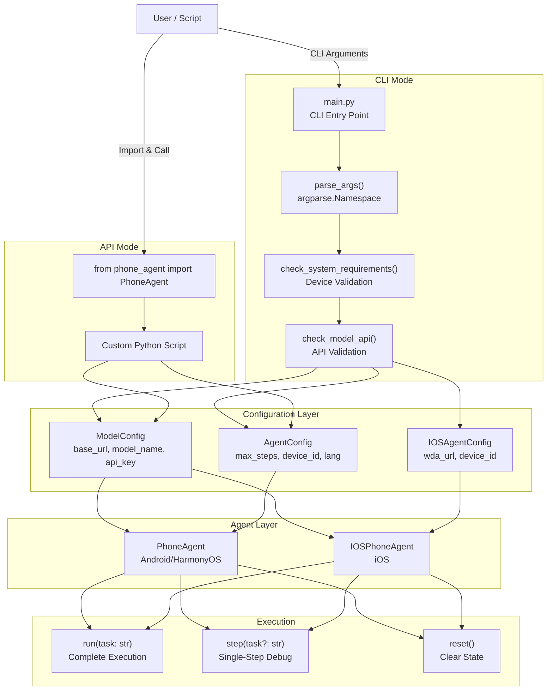
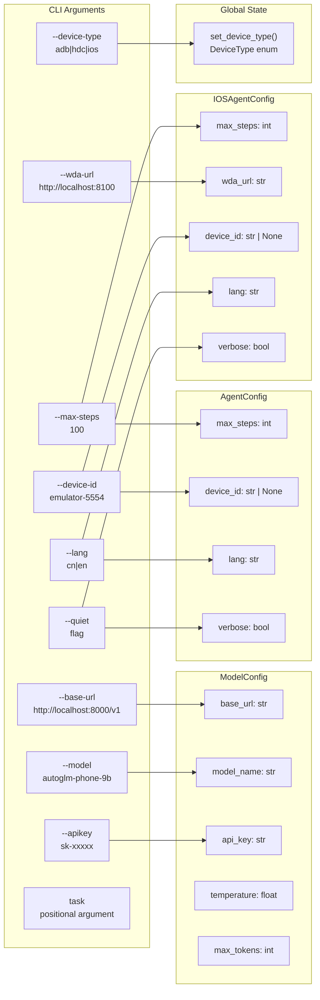

<!-- source: DeepWiki mcp.deepwiki.com · repo zai-org/Open-AutoGLM · page 5 User Guide · fetched 2026-10-29 -->

# User Guide

<details>
<summary>Relevant source files</summary>

The following files were used as context for generating this wiki page:

- [README_coding_agent.md](README_coding_agent.md)
- [README_en.md](README_en.md)
- [examples/basic_usage.py](examples/basic_usage.py)
- [examples/demo_thinking.py](examples/demo_thinking.py)
- [main.py](main.py)
- [phone_agent/config/prompts.py](phone_agent/config/prompts.py)

</details>


## Purpose and Scope

This User Guide provides practical documentation for end users on how to interact with Open-AutoGLM to automate phone tasks. It covers the two primary usage modes—command-line interface and Python API—along with configuration basics and common workflows.

For detailed information on specific topics:
- CLI command reference and arguments: see [Command-Line Interface](#5.1)
- Programmatic usage and API details: see [Python API](#5.2)
- Connecting devices over WiFi/network: see [Remote Device Connection](#5.3)
- Managing configurations and environment variables: see [Configuration Management](#5.4)
- Using the interactive CLI mode: see [Interactive Mode](#5.5)

For platform-specific device setup (ADB, HDC, iOS), see the [Device Support](#4) section.

---

## Usage Modes Overview

Open-AutoGLM supports two primary usage modes, both interacting with the same underlying system but through different interfaces:

| Mode | Entry Point | Use Case | Example |
|------|-------------|----------|---------|
| **Command-Line Interface** | `main.py` | Quick tasks, automation scripts, interactive exploration | `python main.py "Open Chrome"` |
| **Python API** | `PhoneAgent` class | Programmatic integration, custom workflows, batch processing | `agent.run("Open Chrome")` |

Both modes support:
- **Single-task execution**: Execute one task and exit
- **Interactive mode**: Continuous task execution with manual input (CLI only)
- **Step-by-step debugging**: Execute one action at a time

**Diagram: User Interaction Entry Points**



Sources: [main.py:1-853](), [examples/basic_usage.py:1-191]()

---

## CLI to Code Entity Mapping

Understanding how command-line arguments translate to code entities is essential for both CLI users and those transitioning to the API.

**Diagram: CLI Arguments to Configuration Objects**



Sources: [main.py:355-524](), [main.py:748-781](), [phone_agent/agent.py](), [phone_agent/model.py]()

**Environment Variable Equivalents**

All CLI arguments have environment variable equivalents defined in [main.py:8-13]():

| CLI Argument | Environment Variable | Default |
|--------------|---------------------|---------|
| `--base-url` | `PHONE_AGENT_BASE_URL` | `http://localhost:8000/v1` |
| `--model` | `PHONE_AGENT_MODEL` | `autoglm-phone-9b` |
| `--apikey` | `PHONE_AGENT_API_KEY` | `EMPTY` |
| `--max-steps` | `PHONE_AGENT_MAX_STEPS` | `100` |
| `--device-id` | `PHONE_AGENT_DEVICE_ID` | (auto-detect) |
| `--device-type` | `PHONE_AGENT_DEVICE_TYPE` | `adb` |
| `--lang` | `PHONE_AGENT_LANG` | `cn` |
| `--wda-url` | `PHONE_AGENT_WDA_URL` | `http://localhost:8100` |

Sources: [main.py:405-477](), [README_en.md:439-447]()

---

## Basic Execution Workflow

Both CLI and API modes follow the same underlying execution flow:

**Diagram: Task Execution Workflow**

```mermaid
sequenceDiagram
    participant User
    participant CLI as main.py
    participant Agent as PhoneAgent / IOSPhoneAgent
    participant Config as ModelConfig + AgentConfig
    participant Loop as run() method
    participant Step as step() method
    
    User->>CLI: python main.py "Open Chrome"
    activate CLI
    
    CLI->>CLI: parse_args()
    CLI->>CLI: check_system_requirements()
    CLI->>CLI: check_model_api()
    
    CLI->>Config: Create ModelConfig
    CLI->>Config: Create AgentConfig
    
    CLI->>Agent: PhoneAgent(model_config, agent_config)
    
    CLI->>Agent: run(task)
    activate Agent
    
    Agent->>Loop: Initialize task
    
    loop Until finished or max_steps
        Loop->>Step: step()
        Step->>Step: Screenshot + Model Inference
        Step->>Step: Parse & Execute Action
        Step-->>Loop: StepResult(finished, action, thinking)
    end
    
    Loop-->>Agent: Final message
    deactivate Agent
    
    Agent-->>CLI: Result string
    CLI-->>User: Print result
    deactivate CLI
```

Sources: [main.py:684-850](), [phone_agent/agent.py]()

**CLI Single-Task Example**

```bash
# Android device - specify task directly
python main.py --base-url http://localhost:8000/v1 \
               --model "autoglm-phone-9b-multilingual" \
               "Open Maps and search for nearby coffee shops"

# HarmonyOS device
python main.py --device-type hdc \
               --base-url http://localhost:8000/v1 \
               "Open Maps and search for nearby coffee shops"

# iOS device
python main.py --device-type ios \
               --wda-url http://localhost:8100 \
               "Open Safari and search for iPhone tips"
```

Sources: [README_en.md:240-257](), [main.py:821-824]()

**Python API Equivalent**

```python
from phone_agent import PhoneAgent
from phone_agent.model import ModelConfig
from phone_agent.agent import AgentConfig

# Configure model
model_config = ModelConfig(
    base_url="http://localhost:8000/v1",
    model_name="autoglm-phone-9b-multilingual"
)

# Configure agent behavior
agent_config = AgentConfig(
    max_steps=100,
    verbose=True,
    lang="en"
)

# Create and run
agent = PhoneAgent(
    model_config=model_config,
    agent_config=agent_config
)

result = agent.run("Open Maps and search for nearby coffee shops")
print(result)
```

Sources: [README_en.md:267-284](), [examples/basic_usage.py:15-42]()

---

## Common Usage Patterns

### Pattern 1: Interactive Mode

Interactive mode allows continuous task execution without restarting the program. Available only via CLI.

```bash
# Enter interactive mode
python main.py --base-url http://localhost:8000/v1

# System will prompt:
# > Enter your task:
```

Each task is executed independently. The agent state is automatically reset between tasks using `agent.reset()`.

Sources: [main.py:826-849](), [README_en.md:826-849]()

For detailed interactive mode usage, see [Interactive Mode](#5.5).

### Pattern 2: Batch Tasks via API

Execute multiple tasks programmatically with state management:

```python
from phone_agent import PhoneAgent
from phone_agent.agent import AgentConfig

agent = PhoneAgent(agent_config=AgentConfig())

tasks = [
    "Open Google Maps and check traffic",
    "Open Yelp and search for nearby cafes",
    "Open YouTube and search for Python tutorials"
]

for task in tasks:
    result = agent.run(task)
    print(f"Task: {task}\nResult: {result}\n")
    agent.reset()  # Clear state between tasks
```

Sources: [examples/basic_usage.py:93-116]()

### Pattern 3: Step-by-Step Debugging

Execute one action at a time for debugging or fine-grained control:

```python
from phone_agent import PhoneAgent

agent = PhoneAgent()

# Initialize task
result = agent.step("Open eBay and search for wireless earphones")
print(f"Step 1: {result.action}")

# Continue step-by-step
while not result.finished and agent.step_count < 10:
    result = agent.step()
    print(f"Step {agent.step_count}: {result.action}")
    print(f"  Thinking: {result.thinking[:100]}...")

print(f"Final result: {result.message}")
```

Sources: [examples/basic_usage.py:73-91]()

### Pattern 4: Custom Callbacks

Handle sensitive operations and manual takeover scenarios:

```python
def my_confirmation(message: str) -> bool:
    """Called before sensitive actions (payments, privacy)"""
    return input(f"Confirm: {message}? (y/n): ").lower() == "y"

def my_takeover(message: str) -> None:
    """Called when manual intervention needed (login, captcha)"""
    print(f"Please complete manually: {message}")
    input("Press Enter when done...")

agent = PhoneAgent(
    confirmation_callback=my_confirmation,
    takeover_callback=my_takeover
)

result = agent.run("Open Taobao and add wireless earphones to cart")
```

Sources: [README_en.md:573-589](), [examples/basic_usage.py:44-71]()

---

## Platform-Specific Considerations

### Device Type Selection

The system supports three device types, selected via `--device-type` or `set_device_type()`:

| Device Type | Enum Value | Communication | Input Method |
|-------------|------------|---------------|--------------|
| Android | `DeviceType.ADB` | ADB commands | ADB Keyboard required |
| HarmonyOS | `DeviceType.HDC` | HDC commands | Native input (no keyboard needed) |
| iOS | `DeviceType.IOS` | WebDriverAgent HTTP | Native input via WDA |

**CLI Device Type Selection**

```bash
# Android (default)
python main.py "Open Chrome"

# HarmonyOS
python main.py --device-type hdc "Open Browser"

# iOS
python main.py --device-type ios --wda-url http://localhost:8100 "Open Safari"
```

Sources: [main.py:509-515](), [main.py:689-704]()

**API Device Type Selection**

```python
from phone_agent.device_factory import DeviceType, set_device_type

# Set globally before creating agent
set_device_type(DeviceType.HDC)

agent = PhoneAgent()  # Will use HDC

# For iOS, use IOSPhoneAgent instead
from phone_agent.agent_ios import IOSPhoneAgent, IOSAgentConfig

ios_agent = IOSPhoneAgent(
    agent_config=IOSAgentConfig(wda_url="http://localhost:8100")
)
```

Sources: [phone_agent/device_factory.py](), [phone_agent/agent_ios.py]()

### Platform Differences

| Feature | Android (ADB) | HarmonyOS (HDC) | iOS |
|---------|---------------|-----------------|-----|
| Agent Class | `PhoneAgent` | `PhoneAgent` | `IOSPhoneAgent` |
| Screenshot | `adb exec-out screencap -p` | `hdc shell snapshot_display` | WDA `/screenshot` endpoint |
| Text Input | ADB Keyboard app required | Native `uitest uiInput text` | Native via WDA keyboard |
| Tap | `adb shell input tap` | `hdc shell uitest uiInput tap` | WDA `/session/xxx/element/xxx/click` |
| App Launch | `adb shell monkey -p` | `hdc shell aa start -b` | WDA `/session/xxx/wda/apps/launch` |

Sources: [phone_agent/adb/device.py](), [phone_agent/hdc/device.py](), [phone_agent/ios/device.py]()

---

## Verbose Mode Output

When `verbose=True` in `AgentConfig` or when not using `--quiet` in CLI, the system outputs detailed execution information at each step:

```
==================================================
💭 Thinking Process:
--------------------------------------------------
Currently on the system desktop, need to launch eBay app first
--------------------------------------------------
🎯 Executing Action:
{
  "_metadata": "do",
  "action": "Launch",
  "app": "eBay"
}
==================================================

==================================================
💭 Thinking Process:
--------------------------------------------------
eBay is now open, need to tap the search box
--------------------------------------------------
🎯 Executing Action:
{
  "_metadata": "do",
  "action": "Tap",
  "element": [499, 182]
}
==================================================
```

This output includes:
- **Thinking Process**: The AI model's reasoning (`<think>` tag content)
- **Executing Action**: The parsed action structure (`<answer>` tag content)
- **Action Results**: Success/failure messages from device operations

Sources: [README_en.md:477-514](), [phone_agent/agent.py]()

---

## Configuration Quick Reference

### ModelConfig Parameters

| Parameter | Type | Default | Description |
|-----------|------|---------|-------------|
| `base_url` | `str` | `http://localhost:8000/v1` | Model API endpoint |
| `model_name` | `str` | `autoglm-phone-9b` | Model identifier |
| `api_key` | `str` | `EMPTY` | Authentication key |
| `max_tokens` | `int` | `3000` | Maximum output tokens |
| `temperature` | `float` | `0.1` | Sampling temperature |
| `frequency_penalty` | `float` | `0.2` | Repetition penalty |

Sources: [README_en.md:452-462](), [phone_agent/model.py]()

### AgentConfig Parameters

| Parameter | Type | Default | Description |
|-----------|------|---------|-------------|
| `max_steps` | `int` | `100` | Maximum steps per task |
| `device_id` | `str \| None` | `None` | Specific device ID (auto-detect if None) |
| `lang` | `str` | `cn` | Language: `cn` or `en` |
| `verbose` | `bool` | `True` | Print thinking and actions |

Sources: [README_en.md:466-475](), [phone_agent/agent.py]()

For comprehensive configuration documentation, see [Configuration Management](#5.4).

---

## Device Commands Reference

### Listing Devices

```bash
# List connected devices
python main.py --list-devices

# Android output example:
# Connected devices:
# emulator-5554              [USB]
# 192.168.1.100:5555        [WiFi]

# iOS output example:
# Connected iOS devices:
# iPhone 15 Pro
#   UUID: 00008030-001234567890001E
#   Model: iPhone15,2
#   OS: iOS 17.1
```

Sources: [main.py:623-638](), [main.py:536-560]()

### Listing Supported Apps

```bash
# Android apps
python main.py --list-apps

# HarmonyOS apps
python main.py --device-type hdc --list-apps

# iOS apps
python main.py --device-type ios --list-apps
```

Sources: [main.py:707-728](), [README_en.md:259-263]()

### Remote Connection Commands

For detailed remote connection workflows, see [Remote Device Connection](#5.3).

```bash
# Connect to remote device
python main.py --connect 192.168.1.100:5555

# Disconnect from device
python main.py --disconnect 192.168.1.100:5555

# Enable TCP/IP mode on USB device
python main.py --enable-tcpip 5555
```

Sources: [main.py:640-680](), [README_en.md:309-323]()

---

## Next Steps

- **[Command-Line Interface](#5.1)**: Complete CLI reference with all arguments and usage patterns
- **[Python API](#5.2)**: In-depth programmatic usage guide with advanced examples
- **[Remote Device Connection](#5.3)**: WiFi/network connection setup and troubleshooting
- **[Configuration Management](#5.4)**: Detailed configuration options and precedence rules
- **[Interactive Mode](#5.5)**: Using the interactive CLI for continuous task execution

For action reference and system capabilities:
- **[Action System](#6)**: Complete documentation of available actions and execution system
- **[Configuration Reference](#7)**: Deep dive into configuration files (apps, prompts, timing)
- **[Model Deployment](#8)**: Setting up AI model services (third-party or self-hosted)

---

