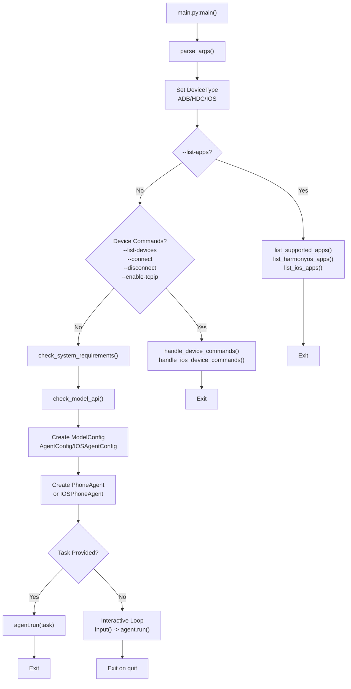
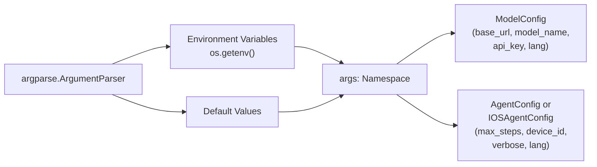
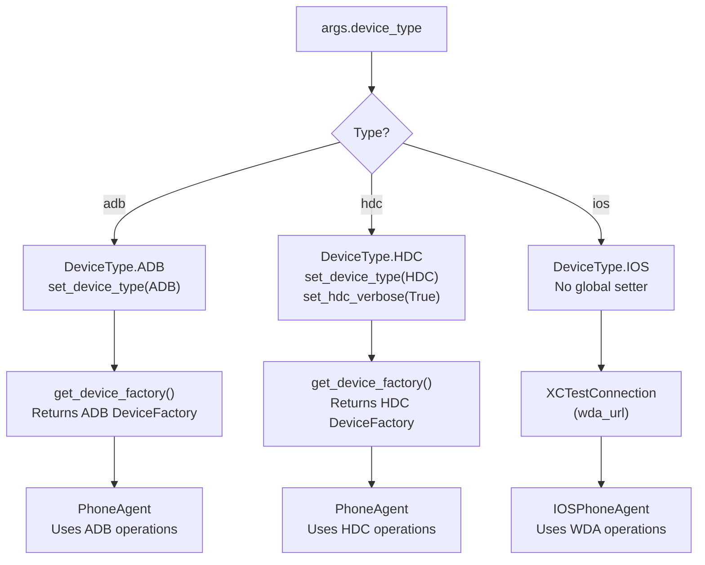
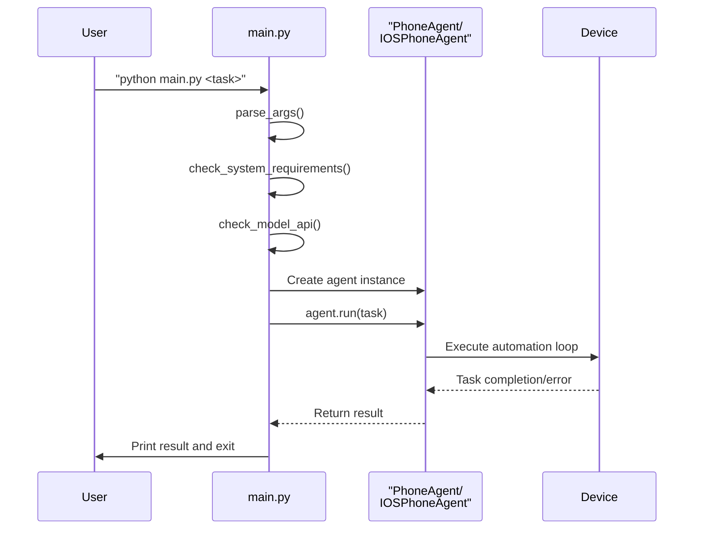
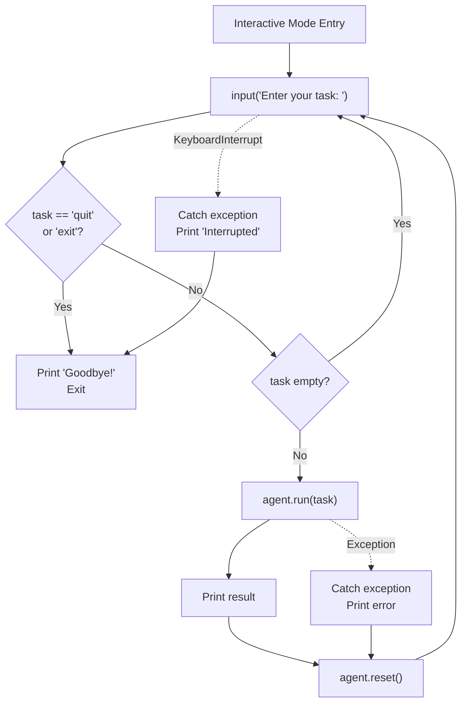
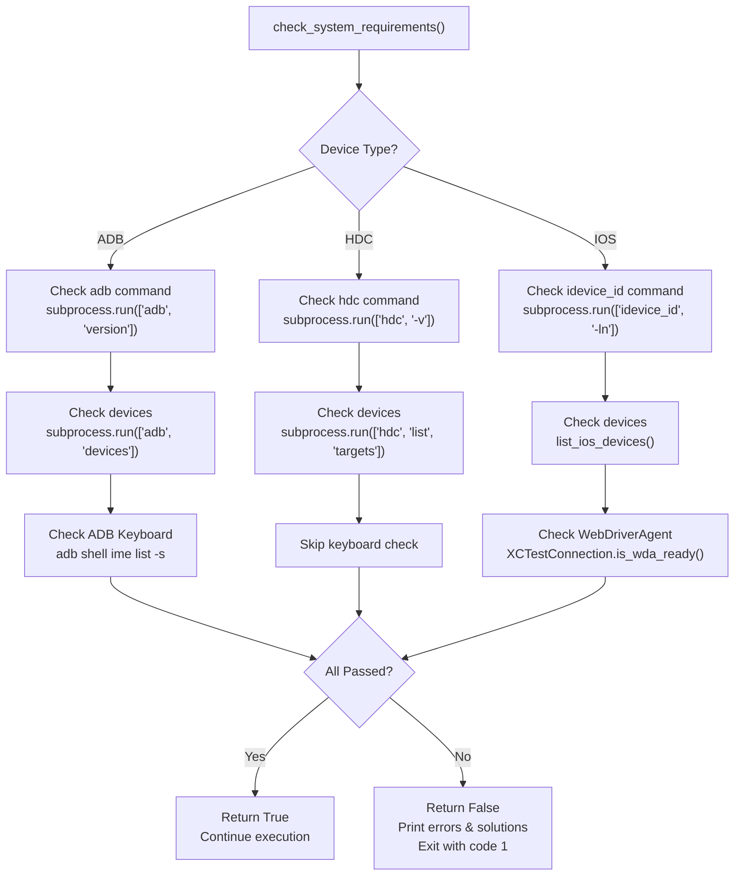
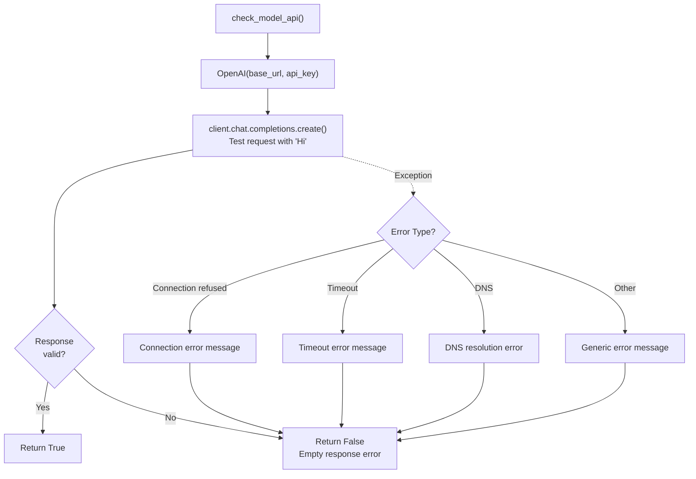
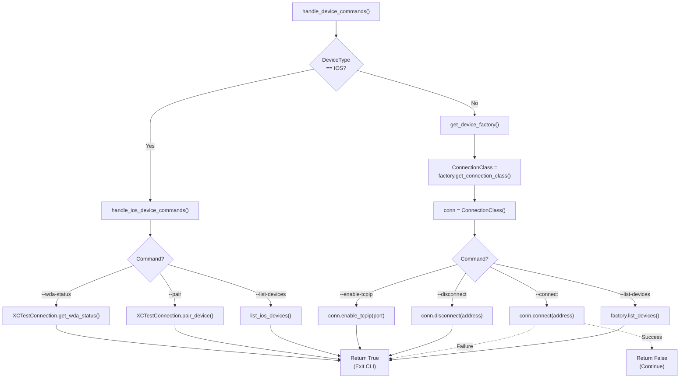
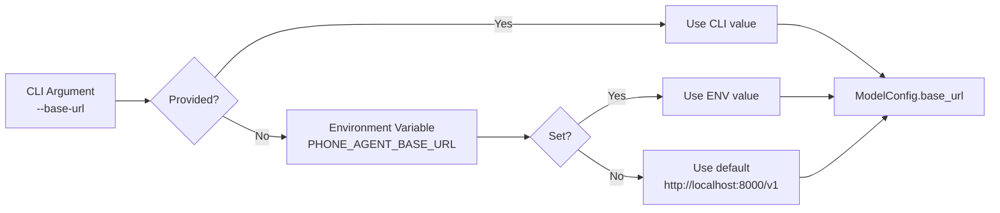

<!-- source: DeepWiki mcp.deepwiki.com · repo zai-org/Open-AutoGLM · page 5.1 Command-Line Interface · fetched 2026-10-29 -->

# Command-Line Interface

<details>
<summary>Relevant source files</summary>

The following files were used as context for generating this wiki page:

- [README.md](README.md)
- [README_coding_agent.md](README_coding_agent.md)
- [README_en.md](README_en.md)
- [main.py](main.py)

</details>


This document provides a complete reference for the `main.py` command-line interface, which serves as the primary entry point for running Open-AutoGLM automation tasks. The CLI supports both single-task execution and interactive mode, handles device management operations, and performs system validation checks before execution.

For programmatic control using the Python API, see [Python API](#5.2). For details on WiFi/network device connections, see [Remote Device Connection](#5.3). For environment variable configuration, see [Configuration Management](#5.4). For details on the interactive shell, see [Interactive Mode](#5.5).

## Overview

The CLI is implemented in `main.py` and provides a unified interface for:
- Executing automation tasks on Android, HarmonyOS, and iOS devices
- Managing device connections (USB and network)
- Validating system requirements and model API connectivity
- Listing supported applications and connected devices
- Configuring model endpoints, authentication, and agent behavior

**CLI Entry Point Flow**



Sources: [main.py:684-854]()

## Command-Line Arguments

The CLI accepts arguments organized into several categories: model configuration, device selection, iOS-specific options, and operational modes.

### Model Configuration Arguments

| Argument | Environment Variable | Default | Description |
|----------|---------------------|---------|-------------|
| `--base-url` | `PHONE_AGENT_BASE_URL` | `http://localhost:8000/v1` | Model API base URL (OpenAI-compatible endpoint) |
| `--model` | `PHONE_AGENT_MODEL` | `autoglm-phone-9b` | Model name to use for inference |
| `--apikey` | `PHONE_AGENT_API_KEY` | `EMPTY` | API key for authentication |
| `--max-steps` | `PHONE_AGENT_MAX_STEPS` | `100` | Maximum steps per task execution |
| `--lang` | `PHONE_AGENT_LANG` | `cn` | System prompt language (`cn` or `en`) |

**Argument Parsing Implementation**



Sources: [main.py:355-524](), [main.py:748-781]()

### Device Selection Arguments

| Argument | Environment Variable | Default | Description |
|----------|---------------------|---------|-------------|
| `--device-type` | `PHONE_AGENT_DEVICE_TYPE` | `adb` | Device platform: `adb` (Android), `hdc` (HarmonyOS), `ios` (iPhone) |
| `--device-id`, `-d` | `PHONE_AGENT_DEVICE_ID` | Auto-detect | Specific device identifier to use |
| `--connect`, `-c` | - | - | Connect to remote device at `ADDRESS` (e.g., `192.168.1.100:5555`) |
| `--disconnect` | - | - | Disconnect from remote device (`ADDRESS` or `all`) |
| `--enable-tcpip` | - | `5555` | Enable TCP/IP debugging on USB device |
| `--list-devices` | - | - | List all connected devices and exit |

**Device Type Selection**



Sources: [main.py:688-704](), [main.py:756-781]()

### iOS-Specific Arguments

| Argument | Environment Variable | Default | Description |
|----------|---------------------|---------|-------------|
| `--wda-url` | `PHONE_AGENT_WDA_URL` | `http://localhost:8100` | WebDriverAgent URL for iOS automation |
| `--pair` | - | - | Pair with iOS device (required for some operations) |
| `--wda-status` | - | - | Show WebDriverAgent status and exit |

Sources: [main.py:473-490]()

### Other Arguments

| Argument | Description |
|----------|-------------|
| `--quiet`, `-q` | Suppress verbose output (no thinking process display) |
| `--list-apps` | List supported applications for the selected device type and exit |
| `task` | Positional argument: task description for single-task mode |

Sources: [main.py:492-522]()

## Execution Modes

The CLI supports two primary execution modes: single-task mode and interactive mode.

### Single-Task Mode

When a task is provided as a positional argument, the CLI executes it once and exits:

```bash
python main.py "打开美团搜索附近的火锅店"
python main.py --device-type hdc "打开美团搜索附近的火锅店"
python main.py --device-type ios "Open Safari and search for iPhone tips"
```

**Single-Task Execution Flow**



Sources: [main.py:821-824]()

### Interactive Mode

When no task is provided, the CLI enters interactive mode with a continuous input loop:

```bash
python main.py
python main.py --device-type hdc
python main.py --device-type ios
```

In interactive mode:
- The agent persists between tasks
- Users can enter multiple tasks sequentially
- Type `quit`, `exit`, or `q` to terminate
- Press `Ctrl+C` to interrupt
- Agent state is reset between tasks via `agent.reset()`

**Interactive Mode Loop**



Sources: [main.py:826-849]()

## System Requirements Validation

Before executing tasks, the CLI performs comprehensive system checks via `check_system_requirements()`. This function validates the environment based on device type.

### Validation Checks by Device Type

**Android (ADB)**
1. ADB tool installation and version
2. At least one device connected
3. ADB Keyboard installed on device

**HarmonyOS (HDC)**
1. HDC tool installation and version
2. At least one device connected
3. Skip keyboard check (uses native input)

**iOS**
1. libimobiledevice tools installed
2. At least one device connected
3. WebDriverAgent accessible and running

**System Check Flow**



Sources: [main.py:37-269]()

### Model API Validation

The `check_model_api()` function validates model endpoint connectivity:

1. **Network Connectivity**: Attempts a test chat completion request to verify the endpoint is reachable
2. **Model Availability**: Validates the specified model responds correctly



Sources: [main.py:272-352]()

## Device Management Commands

The CLI provides commands for managing device connections without running automation tasks. These commands are handled by `handle_device_commands()` for Android/HarmonyOS and `handle_ios_device_commands()` for iOS.

### Common Device Commands

**List Connected Devices**

```bash
# Android
python main.py --list-devices

# HarmonyOS
python main.py --device-type hdc --list-devices

# iOS
python main.py --device-type ios --list-devices
```

Output includes device ID, connection type (USB/WiFi), model information, and status.

**Connect to Remote Device**

```bash
# Android
python main.py --connect 192.168.1.100:5555

# HarmonyOS
python main.py --device-type hdc --connect 192.168.1.100:5555

# iOS (via WiFi WDA)
python main.py --device-type ios --wda-url http://192.168.1.100:8100
```

Sources: [main.py:624-638](), [main.py:641-648]()

**Disconnect from Remote Device**

```bash
# Disconnect specific device
python main.py --disconnect 192.168.1.100:5555

# Disconnect all remote devices
python main.py --disconnect all
```

Sources: [main.py:651-659]()

**Enable TCP/IP Mode (Android/HarmonyOS)**

This command enables network debugging on a USB-connected device:

```bash
# Enable on default port 5555
python main.py --enable-tcpip

# Enable on custom port
python main.py --enable-tcpip 12345
```

The CLI automatically retrieves the device's IP address and displays the connection command.

Sources: [main.py:662-679]()

### iOS-Specific Commands

**Pair with iOS Device**

Required for certain operations on iOS devices:

```bash
python main.py --device-type ios --pair
python main.py --device-type ios --device-id <uuid> --pair
```

Sources: [main.py:563-567]()

**Check WebDriverAgent Status**

Verify WDA is running and accessible:

```bash
python main.py --device-type ios --wda-status
python main.py --device-type ios --wda-url http://192.168.1.100:8100 --wda-status
```

Displays session ID, build information, and current app details.

Sources: [main.py:569-597]()

**Device Command Dispatch**



Sources: [main.py:602-682]()

## Application Listing

The `--list-apps` command displays supported applications for the selected device type:

```bash
# Android apps
python main.py --list-apps

# HarmonyOS apps
python main.py --device-type hdc --list-apps

# iOS apps
python main.py --device-type ios --list-apps
```

This command calls device-specific functions:
- `list_supported_apps()` for Android
- `list_harmonyos_apps()` for HarmonyOS  
- `list_ios_apps()` for iOS

The output lists application names that can be used in `Launch` actions.

Sources: [main.py:707-728]()

## Configuration Priority

Configuration values are resolved in the following order (highest to lowest priority):

1. **Command-line arguments**: Explicitly provided via flags
2. **Environment variables**: Values from `PHONE_AGENT_*` variables
3. **Default values**: Hardcoded defaults in argument parser

**Configuration Resolution Flow**



Sources: [main.py:405-410](), [main.py:412-417](), [main.py:419-424]()

## Usage Examples

### Basic Usage

```bash
# Android device with local model
python main.py --base-url http://localhost:8000/v1 --model "autoglm-phone-9b" "打开微信"

# HarmonyOS device with remote API
python main.py --device-type hdc --base-url https://api.example.com/v1 --apikey sk-xxx "打开微信"

# iOS device with third-party API
python main.py --device-type ios --base-url https://open.bigmodel.cn/api/paas/v4 --model "autoglm-phone" --apikey sk-xxx "Open Safari"
```

### Multi-Device Setup

```bash
# List devices
python main.py --list-devices

# Use specific device
python main.py --device-id emulator-5554 "打开淘宝"

# Connect remote device then run task
python main.py --connect 192.168.1.100:5555 "打开美团"
```

### Interactive Mode with Custom Configuration

```bash
# Start interactive mode with English prompts
python main.py --lang en --base-url http://localhost:8000/v1

# Quiet mode (no verbose output)
python main.py --quiet
```

### iOS Device Setup and Usage

```bash
# Check WebDriverAgent status
python main.py --device-type ios --wda-status

# Pair device (if needed)
python main.py --device-type ios --pair

# Run task via USB (with port forwarding: iproxy 8100 8100)
python main.py --device-type ios "Open Settings"

# Run task via WiFi
python main.py --device-type ios --wda-url http://192.168.1.100:8100 "Open Safari"
```

Sources: [main.py:360-401]()

## Error Handling

The CLI performs early validation and provides actionable error messages:

### System Check Failures

When system requirements are not met, the CLI:
1. Prints a detailed error message
2. Provides step-by-step solution instructions
3. Exits with status code 1

Common failures include:
- ADB/HDC/libimobiledevice not installed
- No devices connected
- ADB Keyboard not installed (Android)
- WebDriverAgent not running (iOS)

Sources: [main.py:734-741]()

### Model API Failures

When model API checks fail, the CLI:
1. Identifies the specific error (connection refused, timeout, DNS failure)
2. Suggests troubleshooting steps
3. Exits with status code 1

Sources: [main.py:744-745]()

### Interactive Mode Exceptions

During interactive mode:
- `KeyboardInterrupt` (Ctrl+C): Gracefully exits with "Interrupted" message
- Task execution exceptions: Prints error and continues to next input
- Empty input: Re-prompts without error

Sources: [main.py:845-849]()

## Exit Codes

| Exit Code | Meaning |
|-----------|---------|
| `0` | Successful execution |
| `1` | System requirements check failed |
| `1` | Model API check failed |
| `1` (implicit) | Unhandled exception |

The CLI uses `sys.exit(1)` for validation failures and relies on Python's default behavior for other errors.

Sources: [main.py:741](), [main.py:745]()

---

