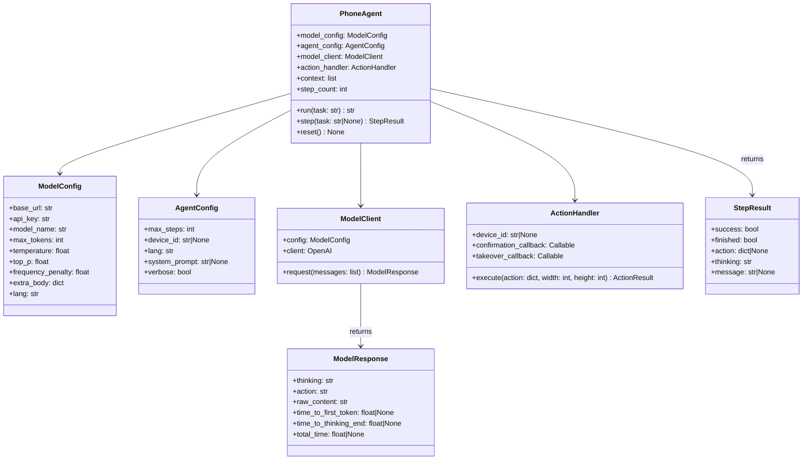
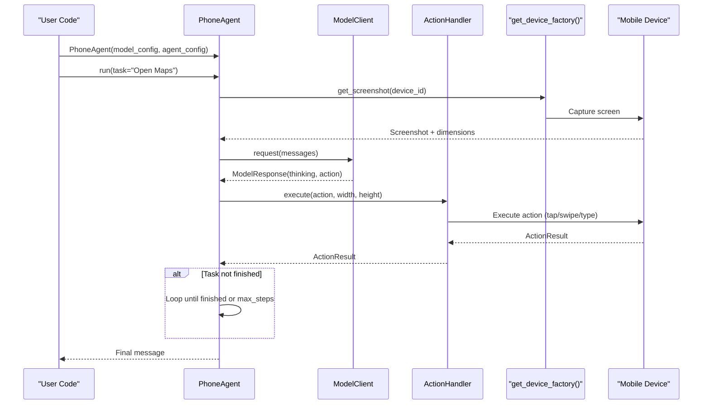
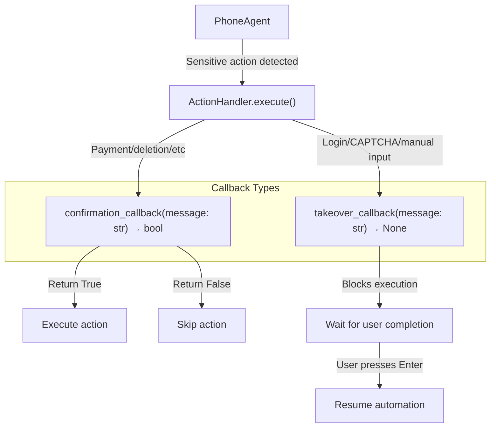

<!-- source: DeepWiki mcp.deepwiki.com · repo zai-org/Open-AutoGLM · page 5.2 Python API · fetched 2026-10-29 -->

# Python API

<details>
<summary>Relevant source files</summary>

The following files were used as context for generating this wiki page:

- [README_coding_agent.md](README_coding_agent.md)
- [README_en.md](README_en.md)
- [examples/basic_usage.py](examples/basic_usage.py)
- [examples/demo_thinking.py](examples/demo_thinking.py)
- [phone_agent/agent.py](phone_agent/agent.py)
- [phone_agent/config/prompts.py](phone_agent/config/prompts.py)

</details>


This page documents the programmatic Python API for Open-AutoGLM, focusing on the `PhoneAgent` class and related components for building automated mobile phone interactions in Python code. For command-line usage, see [Command-Line Interface](#5.1). For configuration details, see [Configuration Management](#5.4).

## Purpose and Scope

The Python API provides direct programmatic access to Open-AutoGLM's agent capabilities. It is designed for:
- Integrating phone automation into Python applications
- Building custom automation workflows
- Batch task execution
- Fine-grained control over agent behavior
- Custom callback implementations for user confirmation and manual takeover scenarios

## Core Classes and Architecture

The Python API centers around several key classes that work together to provide phone automation capabilities.



**Sources:** [phone_agent/agent.py:1-254](), [phone_agent/model/client.py:1-291]()

## Basic Execution Flow

The following diagram illustrates how user code interacts with the API to execute tasks on mobile devices:



**Sources:** [phone_agent/agent.py:84-110](), [phone_agent/agent.py:136-243]()

## Creating and Configuring an Agent

### Basic Agent Creation

The simplest way to create an agent requires only model configuration:

```python
from phone_agent import PhoneAgent
from phone_agent.model import ModelConfig

model_config = ModelConfig(
    base_url="http://localhost:8000/v1",
    model_name="autoglm-phone-9b"
)

agent = PhoneAgent(model_config=model_config)
```

**Sources:** [README.md:315-333](), [phone_agent/agent.py:64-79]()

### Full Configuration

For complete control over agent behavior, provide both `ModelConfig` and `AgentConfig`:

```python
from phone_agent import PhoneAgent
from phone_agent.model import ModelConfig
from phone_agent.agent import AgentConfig

model_config = ModelConfig(
    base_url="http://localhost:8000/v1",
    api_key="EMPTY",
    model_name="autoglm-phone-9b",
    max_tokens=3000,
    temperature=0.1,
    frequency_penalty=0.2
)

agent_config = AgentConfig(
    max_steps=100,
    device_id=None,  # Auto-detect device
    lang="cn",       # Chinese prompts
    verbose=True     # Print debug info
)

agent = PhoneAgent(
    model_config=model_config,
    agent_config=agent_config
)
```

**Sources:** [phone_agent/agent.py:16-28](), [phone_agent/model/client.py:14-26]()

### Configuration Parameters

#### ModelConfig Parameters

| Parameter | Type | Default | Description |
|-----------|------|---------|-------------|
| `base_url` | `str` | `"http://localhost:8000/v1"` | Model API endpoint URL |
| `api_key` | `str` | `"EMPTY"` | API key for authentication |
| `model_name` | `str` | `"autoglm-phone-9b"` | Model identifier |
| `max_tokens` | `int` | `3000` | Maximum output tokens per request |
| `temperature` | `float` | `0.0` | Sampling temperature (0.0-1.0) |
| `top_p` | `float` | `0.85` | Nucleus sampling threshold |
| `frequency_penalty` | `float` | `0.2` | Penalty for token repetition |
| `extra_body` | `dict` | `{}` | Additional request parameters |
| `lang` | `str` | `"cn"` | Language for UI messages (`"cn"` or `"en"`) |

**Sources:** [phone_agent/model/client.py:14-26]()

#### AgentConfig Parameters

| Parameter | Type | Default | Description |
|-----------|------|---------|-------------|
| `max_steps` | `int` | `100` | Maximum steps per task before timeout |
| `device_id` | `str \| None` | `None` | Device identifier (None for auto-detect) |
| `lang` | `str` | `"cn"` | Language for system prompts (`"cn"` or `"en"`) |
| `system_prompt` | `str \| None` | `None` | Custom system prompt (overrides `lang`) |
| `verbose` | `bool` | `True` | Print thinking process and actions |

**Sources:** [phone_agent/agent.py:16-28]()

## Running Tasks

### Complete Task Execution

The `run()` method executes a complete task from start to finish:

```python
agent = PhoneAgent(model_config=model_config)

# Run task - blocks until completion or max_steps
result = agent.run("Open WeChat and send a message to John")
print(result)  # "Task completed" or final message
```

The `run()` method:
1. Resets agent state (clears context and step count)
2. Captures initial screenshot
3. Sends task to model
4. Executes actions iteratively
5. Continues until task completion or `max_steps` reached
6. Returns final status message

**Sources:** [phone_agent/agent.py:84-110](), [README.md:329-333]()

### Return Values

The `run()` method returns a string containing:
- Success message: The completion message from the model
- Timeout message: `"Max steps reached"` if `max_steps` exceeded
- Error message: Description if an unrecoverable error occurs

## Step-by-Step Execution

For fine-grained control, use the `step()` method to execute individual agent steps:

```python
from phone_agent import PhoneAgent
from phone_agent.model import ModelConfig

agent = PhoneAgent(model_config=model_config)

# First step requires task description
result = agent.step("Open Settings app")

print(f"Step {agent.step_count}:")
print(f"  Success: {result.success}")
print(f"  Finished: {result.finished}")
print(f"  Action: {result.action}")
print(f"  Thinking: {result.thinking}")

# Continue with subsequent steps (no task needed)
while not result.finished and agent.step_count < 10:
    result = agent.step()
    print(f"Step {agent.step_count}: {result.action}")

# Reset for new task
agent.reset()
```

**Sources:** [phone_agent/agent.py:112-134]()

### StepResult Object

Each `step()` call returns a `StepResult` dataclass:

| Field | Type | Description |
|-------|------|-------------|
| `success` | `bool` | Whether the action executed successfully |
| `finished` | `bool` | Whether the task is complete |
| `action` | `dict \| None` | Parsed action dictionary |
| `thinking` | `str` | Model's reasoning process |
| `message` | `str \| None` | Status or completion message |

**Sources:** [phone_agent/agent.py:31-40]()

## Custom Callbacks

The agent supports two callback types for user interaction during sensitive operations:



**Sources:** [phone_agent/agent.py:64-79](), [phone_agent/actions/handler.py:1-300]()

### Implementing Confirmation Callback

The confirmation callback is invoked before executing sensitive actions (payments, deletions, etc.):

```python
def my_confirmation(message: str) -> bool:
    """
    Called before sensitive operations.
    
    Args:
        message: Description of the operation requiring confirmation
        
    Returns:
        True to proceed, False to cancel
    """
    print(f"⚠️  Confirmation required: {message}")
    response = input("Proceed? (y/n): ")
    return response.lower() == "y"


agent = PhoneAgent(
    model_config=model_config,
    confirmation_callback=my_confirmation
)
```

**Sources:** [README.md:623-642](), [README_en.md:559-578]()

### Implementing Takeover Callback

The takeover callback is invoked when manual intervention is required:

```python
def my_takeover(message: str) -> None:
    """
    Called when manual intervention is needed.
    
    Args:
        message: Description of what the user should do manually
    """
    print(f"🖐️  Manual takeover requested")
    print(f"📝 Please: {message}")
    input("Press Enter when you've completed this step...")


agent = PhoneAgent(
    model_config=model_config,
    takeover_callback=my_takeover
)
```

**Sources:** [README.md:623-642](), [README_en.md:559-578]()

### Default Callback Behavior

If no callbacks are provided:
- **Confirmation callback**: Defaults to terminal input prompting user for y/n
- **Takeover callback**: Defaults to terminal input pausing execution until Enter is pressed

## Working with Device Connections

### Specifying Target Device

Control which device the agent operates on using the `device_id` parameter:

```python
# Auto-detect connected device (default)
agent = PhoneAgent(
    model_config=model_config,
    agent_config=AgentConfig(device_id=None)
)

# Target specific device by ID
agent = PhoneAgent(
    model_config=model_config,
    agent_config=AgentConfig(device_id="192.168.1.100:5555")
)
```

**Sources:** [phone_agent/agent.py:76-79]()

### Remote Device Management via API

For Android devices, use `ADBConnection` for programmatic device management:

```python
from phone_agent.adb import ADBConnection, list_devices

# Create connection manager
conn = ADBConnection()

# Connect to remote device
success, message = conn.connect("192.168.1.100:5555")
print(f"Connection status: {message}")

# List connected devices
devices = list_devices()
for device in devices:
    print(f"{device.device_id} - {device.connection_type.value}")

# Enable TCP/IP on USB device
success, message = conn.enable_tcpip(5555)
ip = conn.get_device_ip()
print(f"Device IP: {ip}")

# Disconnect
conn.disconnect("192.168.1.100:5555")
```

For HarmonyOS devices, use `HDCConnection`:

```python
from phone_agent.hdc import HDCConnection, list_devices

# Create connection manager
conn = HDCConnection()

# Connect to remote device
success, message = conn.connect("192.168.1.100:5555")
print(f"Connection status: {message}")

# List connected devices
devices = list_devices()
for device in devices:
    print(f"{device.device_id} - {device.connection_type.value}")

# Disconnect
conn.disconnect("192.168.1.100:5555")
```

**Sources:** [README.md:408-456](), [README_en.md:348-395]()

## Context and State Management

### Accessing Conversation Context

The agent maintains a conversation context (message history) that can be accessed programmatically:

```python
agent = PhoneAgent(model_config=model_config)

# Execute some steps
agent.run("Open Settings")

# Access context (returns a copy)
context = agent.context
print(f"Context has {len(context)} messages")

# Inspect messages
for i, message in enumerate(context):
    print(f"Message {i}: {message['role']}")
```

The context contains:
- System prompt message
- User messages with screenshots (images removed after processing to save space)
- Assistant responses with thinking and actions

**Sources:** [phone_agent/agent.py:245-253]()

### Monitoring Step Count

Track execution progress using the `step_count` property:

```python
agent = PhoneAgent(model_config=model_config)

print(f"Steps taken: {agent.step_count}")  # 0

agent.step("Open Calculator")
print(f"Steps taken: {agent.step_count}")  # 1

agent.step()
print(f"Steps taken: {agent.step_count}")  # 2
```

**Sources:** [phone_agent/agent.py:250-253]()

### Resetting Agent State

Reset the agent to prepare for a new task:

```python
agent = PhoneAgent(model_config=model_config)

# Run first task
agent.run("Open WeChat")
print(f"Steps: {agent.step_count}, Context: {len(agent.context)}")

# Reset before new task
agent.reset()
print(f"Steps: {agent.step_count}, Context: {len(agent.context)}")  # Both 0

# Run new task with clean state
agent.run("Open Settings")
```

The `reset()` method:
- Clears conversation context
- Resets step counter to 0
- Does not affect configuration or callbacks

**Sources:** [phone_agent/agent.py:131-134]()

## Device Type Selection

The agent automatically determines device type through the device factory pattern. The device type (ADB for Android, HDC for HarmonyOS, or iOS) is selected based on:

1. Environment variable `PHONE_AGENT_DEVICE_TYPE` 
2. Connected device detection
3. Device ID format (e.g., iOS device IDs are handled specially)

To explicitly control device type, set it via environment variable before creating the agent:

```python
import os
os.environ['PHONE_AGENT_DEVICE_TYPE'] = 'hdc'  # For HarmonyOS devices

agent = PhoneAgent(model_config=model_config)
```

**Sources:** [phone_agent/device_factory.py:1-100]() (referenced in architecture diagrams)

## Error Handling

### Model Request Errors

If the model service is unreachable or returns an error:

```python
try:
    result = agent.run("Open Maps")
except Exception as e:
    print(f"Agent execution failed: {e}")
```

When `verbose=True` (default), the agent prints error tracebacks. When `verbose=False`, errors are captured in the `StepResult`:

```python
agent = PhoneAgent(
    model_config=model_config,
    agent_config=AgentConfig(verbose=False)
)

result = agent.step("Open Maps")
if not result.success:
    print(f"Step failed: {result.message}")
```

**Sources:** [phone_agent/agent.py:172-187]()

### Action Execution Errors

If an action fails to execute (e.g., device disconnected):

- With `verbose=True`: Traceback is printed, execution converts error to `finish()` action
- With `verbose=False`: Error is captured silently in `StepResult`

```python
result = agent.step()
if not result.success:
    print(f"Action failed: {result.message}")
    print(f"Failed action: {result.action}")
```

**Sources:** [phone_agent/agent.py:208-217]()

### Device Connection Errors

Device connection errors typically occur during screenshot capture or action execution. The agent handles these by:

1. Attempting to capture the error message
2. Converting to a `finish()` action with error description
3. Marking the task as finished with failure status

To handle device connection errors explicitly:

```python
from phone_agent.device_factory import get_device_factory

# Test device connection before creating agent
factory = get_device_factory()
try:
    screenshot = factory.get_screenshot(device_id=None)
    print("Device connected successfully")
except Exception as e:
    print(f"Device connection failed: {e}")
```

**Sources:** [phone_agent/agent.py:143-146]()

## Advanced Configuration

### Custom System Prompts

Override the default system prompt with custom instructions:

```python
custom_prompt = """
You are a phone automation assistant specialized in e-commerce tasks.
When searching for products, always filter by price from low to high.
Always verify product ratings before adding to cart.
"""

agent_config = AgentConfig(
    lang="en",  # Ignored when system_prompt is provided
    system_prompt=custom_prompt
)

agent = PhoneAgent(
    model_config=model_config,
    agent_config=agent_config
)
```

**Sources:** [phone_agent/agent.py:26-28]()

### Model-Specific Parameters

Pass additional parameters to the model API using `extra_body`:

```python
model_config = ModelConfig(
    base_url="http://localhost:8000/v1",
    model_name="autoglm-phone-9b",
    extra_body={
        "custom_parameter": "value",
        "another_option": 123
    }
)
```

The `extra_body` dictionary is passed directly to the OpenAI client's request.

**Sources:** [phone_agent/model/client.py:24](), [phone_agent/model/client.py:78]()

## Complete Usage Example

A comprehensive example demonstrating key API features:

```python
from phone_agent import PhoneAgent
from phone_agent.model import ModelConfig
from phone_agent.agent import AgentConfig

# Custom callbacks
def confirm_action(message: str) -> bool:
    print(f"⚠️  Confirm: {message}")
    return input("Proceed? (y/n): ").lower() == "y"

def handle_takeover(message: str) -> None:
    print(f"🖐️  Please: {message}")
    input("Press Enter when done...")

# Configure
model_config = ModelConfig(
    base_url="http://localhost:8000/v1",
    model_name="autoglm-phone-9b",
    temperature=0.1
)

agent_config = AgentConfig(
    max_steps=50,
    device_id=None,
    lang="en",
    verbose=True
)

# Create agent
agent = PhoneAgent(
    model_config=model_config,
    agent_config=agent_config,
    confirmation_callback=confirm_action,
    takeover_callback=handle_takeover
)

# Execute task
try:
    result = agent.run("Open Maps and search for nearby restaurants")
    print(f"\n✅ Result: {result}")
    print(f"📊 Steps taken: {agent.step_count}")
except Exception as e:
    print(f"\n❌ Error: {e}")
```

**Sources:** [README.md:315-333](), [README.md:623-642](), [phone_agent/agent.py:42-254]()

---

