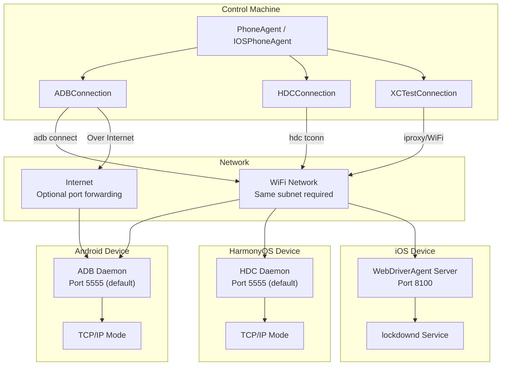
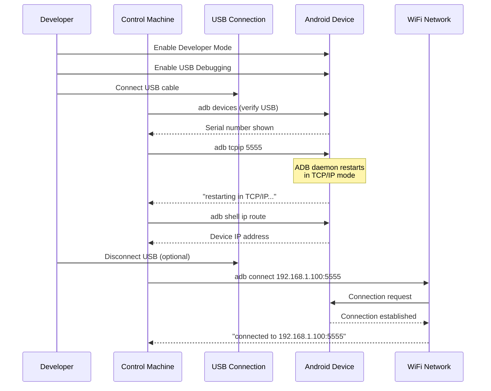
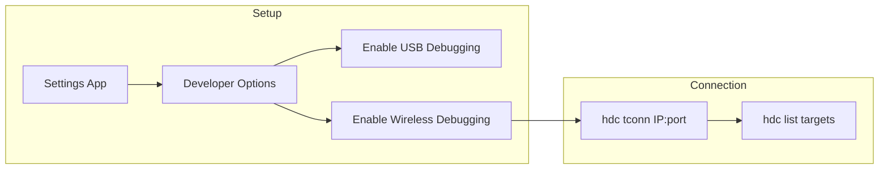
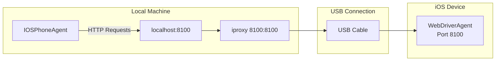
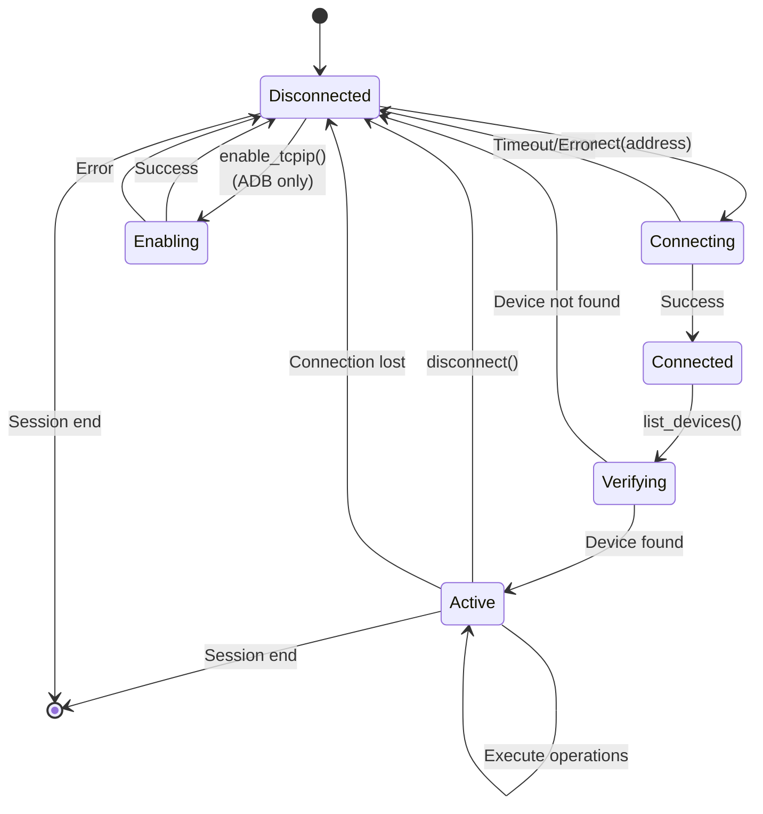

<!-- source: DeepWiki mcp.deepwiki.com · repo zai-org/Open-AutoGLM · page 5.3 Remote Device Connection · fetched 2026-10-29 -->

# Remote Device Connection

<details>
<summary>Relevant source files</summary>

The following files were used as context for generating this wiki page:

- [README.md](README.md)
- [README_coding_agent.md](README_coding_agent.md)
- [README_en.md](README_en.md)
- [main.py](main.py)
- [phone_agent/adb/connection.py](phone_agent/adb/connection.py)
- [phone_agent/adb/device.py](phone_agent/adb/device.py)
- [phone_agent/config/timing.py](phone_agent/config/timing.py)

</details>


## Purpose and Scope

This document describes how to set up and manage remote connections to Android, HarmonyOS, and iOS devices over WiFi or network connections. Remote connections enable device control without USB cables, allowing for flexible deployment scenarios including remote servers and development machines in different locations.

For device-specific setup instructions including USB connections, see [Android (ADB)](#4.1), [HarmonyOS (HDC)](#4.2), and [iOS (WebDriverAgent)](#4.3). For using devices with the CLI or Python API, see [Command-Line Interface](#5.1) and [Python API](#5.2).

## Connection Architecture

The system supports three distinct remote connection protocols, each tailored to its target platform:



**Sources:** [README.md:335-474](), [README_en.md:275-414](), [phone_agent/adb/connection.py:1-354]()

## Android Remote Connection (ADB)

### Connection Types

Android devices support three connection types, each identified by the `ConnectionType` enum:

| Connection Type | Identifier Format | Use Case |
|----------------|-------------------|----------|
| USB | Serial number (e.g., `emulator-5554`) | Direct connection, initial setup |
| WIFI | IP address with colon | Same network wireless connection |
| REMOTE | IP:port (e.g., `192.168.1.100:5555`) | Remote network connection |

**Sources:** [phone_agent/adb/connection.py:12-18]()

### Enabling WiFi Debugging on Android

Before establishing a remote connection, the device must be configured for TCP/IP mode:



**Sources:** [README.md:339-373](), [README_en.md:279-312]()

### Using ADBConnection Class

The `ADBConnection` class provides programmatic access to connection management:

```python
from phone_agent.adb import ADBConnection, list_devices

# Initialize connection manager
conn = ADBConnection()

# Enable TCP/IP mode on USB-connected device
success, message = conn.enable_tcpip(5555)
print(f"TCP/IP mode: {message}")

# Get device IP address
ip = conn.get_device_ip()
print(f"Device IP: {ip}")

# Connect to remote device
success, message = conn.connect(f"{ip}:5555")
print(f"Connection: {message}")

# Verify connection
devices = list_devices()
for device in devices:
    print(f"{device.device_id} - {device.connection_type.value}")

# Disconnect when done
conn.disconnect(f"{ip}:5555")
```

#### Key Methods

**`connect(address: str, timeout: int = 10) -> tuple[bool, str]`**

Establishes a TCP/IP connection to a remote device. Accepts addresses in format `host:port` or just `host` (defaults to port 5555). Returns tuple of success status and message.

**Sources:** [phone_agent/adb/connection.py:56-96]()

**`enable_tcpip(port: int = 5555, device_id: str | None = None) -> tuple[bool, str]`**

Enables TCP/IP debugging mode on a USB-connected device. The device must be connected via USB first. After enabling, waits for `TIMING_CONFIG.connection.adb_restart_delay` seconds (default 2.0s) for the daemon to restart.

**Sources:** [phone_agent/adb/connection.py:219-256](), [phone_agent/config/timing.py:83-97]()

**`get_device_ip(device_id: str | None = None) -> str | None`**

Retrieves the device's IP address by executing `adb shell ip route` and parsing the output. Falls back to checking the `wlan0` interface if needed.

**Sources:** [phone_agent/adb/connection.py:257-303]()

**`disconnect(address: str | None = None) -> tuple[bool, str]`**

Disconnects from a remote device. If `address` is None, disconnects from all remote devices.

**Sources:** [phone_agent/adb/connection.py:97-118]()

**`list_devices() -> list[DeviceInfo]`**

Returns a list of all connected devices with their connection type, status, and model information.

**Sources:** [phone_agent/adb/connection.py:120-173]()

### DeviceInfo Structure

Connection information is represented by the `DeviceInfo` dataclass:

```python
@dataclass
class DeviceInfo:
    device_id: str              # Device identifier or IP:port
    status: str                 # "device", "offline", "unauthorized"
    connection_type: ConnectionType  # USB, WIFI, or REMOTE
    model: str | None           # Device model name
    android_version: str | None # Android version (optional)
```

**Sources:** [phone_agent/adb/connection.py:20-29]()

### CLI Usage for Remote Android Devices

```bash
# List all connected devices
adb devices

# Connect to remote device
adb connect 192.168.1.100:5555

# Disconnect specific device
adb disconnect 192.168.1.100:5555

# Execute task on specific remote device
python main.py --device-id 192.168.1.100:5555 --base-url http://localhost:8000/v1 "Open Chrome"
```

**Sources:** [README.md:376-406](), [README_en.md:314-346]()

## HarmonyOS Remote Connection (HDC)

### Enabling WiFi Debugging on HarmonyOS

HarmonyOS uses the HDC (HarmonyOS Device Connector) protocol, which is similar to ADB but with different commands:

1. Navigate to `Settings > System & Updates > Developer Options`
2. Enable both `USB Debugging` and `Wireless Debugging`
3. Note the IP address and port displayed in the developer options



**Sources:** [README.md:349-372](), [README_en.md:289-312]()

### Using HDCConnection Class

The `HDCConnection` class provides similar functionality to `ADBConnection` but for HarmonyOS devices:

```python
from phone_agent.hdc import HDCConnection, list_devices

# Create connection manager
conn = HDCConnection()

# Connect to remote device
success, message = conn.connect("192.168.1.100:5555")
print(f"Connection status: {message}")

# List connected devices
devices = list_devices()
for device in devices:
    print(f"{device.device_id} - {device.connection_type.value}")

# Disconnect
conn.disconnect("192.168.1.100:5555")
```

**Sources:** [README.md:436-455](), [README_en.md:376-395]()

### CLI Usage for Remote HarmonyOS Devices

```bash
# List all connected devices
hdc list targets

# Connect to remote device
hdc tconn 192.168.1.100:5555

# Disconnect specific device
hdc tdisconn 192.168.1.100:5555

# Execute task on specific device
python main.py --device-type hdc --device-id 192.168.1.100:5555 --base-url http://localhost:8000/v1 "Open browser"
```

**Sources:** [README.md:392-406](), [README_en.md:332-346]()

## iOS Remote Connection

iOS devices use WebDriverAgent (WDA) for automation and support two remote connection methods:

### USB Connection via iproxy

For USB connections, `iproxy` forwards the WebDriverAgent port from the device to the local machine:



### WiFi Connection

For WiFi connections, the device and control machine must be on the same network, and the device's IP address must be obtained:

```bash
# Device IP can be found in Settings > WiFi > (i) icon
# Connect directly to device IP
python main.py --device-type ios --device-id 192.168.1.100:8100 --base-url http://localhost:8000/v1 "Open Safari"
```

**Sources:** [README.md:106-113](), [README_en.md:106-113]()

## Connection Management Flow

The following diagram illustrates the connection lifecycle for all platforms:



**Sources:** [phone_agent/adb/connection.py:31-329]()

## Connection Timing Configuration

All connection-related delays are configurable through the `TIMING_CONFIG.connection` object:

| Parameter | Default | Environment Variable | Description |
|-----------|---------|---------------------|-------------|
| `adb_restart_delay` | 2.0s | `PHONE_AGENT_ADB_RESTART_DELAY` | Wait time after enabling TCP/IP mode |
| `server_restart_delay` | 1.0s | `PHONE_AGENT_SERVER_RESTART_DELAY` | Wait time between killing and starting ADB server |

```python
from phone_agent.config.timing import update_timing_config, ConnectionTimingConfig

# Customize connection timing
custom_timing = ConnectionTimingConfig(
    adb_restart_delay=3.0,
    server_restart_delay=2.0
)
update_timing_config(connection=custom_timing)
```

**Sources:** [phone_agent/config/timing.py:79-97]()

## Connection Troubleshooting

### Connection Refused

**Symptoms:** `adb connect` returns "Connection refused" or times out.

**Resolution:**
1. Verify device and computer are on same WiFi network
2. Check firewall settings on both device and computer
3. Ensure TCP/IP mode is enabled: `adb tcpip 5555`
4. Verify device IP address hasn't changed (DHCP reassignment)

**Sources:** [README.md:457-474](), [README_en.md:397-414]()

### Connection Dropped

**Symptoms:** Connection works initially but drops after some time.

**Resolution:**
1. WiFi may have disconnected - reconnect using `adb connect`
2. Some devices disable TCP/IP mode after restart - re-enable via USB
3. Check device power saving settings that may disable WiFi

**Sources:** [README.md:465-469]()

### Unauthorized Device

**Symptoms:** Device shows as "unauthorized" in `adb devices` output.

**Resolution:**
1. Check device screen for authorization prompt
2. Tap "Allow" on the device
3. Enable "Always allow from this computer" if prompted
4. Restart ADB server: `adb kill-server && adb start-server`

### Multiple Devices

When multiple devices are connected, operations must specify which device to target:

```bash
# List all devices with IDs
adb devices

# Use --device-id flag
python main.py --device-id 192.168.1.100:5555 --base-url http://localhost:8000/v1 "task"

# Or in Python API
from phone_agent import PhoneAgent
from phone_agent.agent import AgentConfig

config = AgentConfig(device_id="192.168.1.100:5555")
agent = PhoneAgent(config=config)
```

**Sources:** [README.md:470-474](), [README_en.md:410-414]()

## Advanced: Restarting ADB Server

The `ADBConnection.restart_server()` method provides a programmatic way to restart the ADB server, which can resolve various connection issues:

```python
from phone_agent.adb import ADBConnection

conn = ADBConnection()
success, message = conn.restart_server()
print(message)  # "ADB server restarted"
```

This method:
1. Executes `adb kill-server`
2. Waits for `TIMING_CONFIG.connection.server_restart_delay` seconds
3. Executes `adb start-server`

**Sources:** [phone_agent/adb/connection.py:305-328]()

## Helper Functions

The module provides convenience functions for quick operations without instantiating connection objects:

**`quick_connect(address: str) -> tuple[bool, str]`**

Quickly connect to a remote device without creating an ADBConnection instance.

**`list_devices() -> list[DeviceInfo]`**

Quickly list all connected devices without creating an ADBConnection instance.

```python
from phone_agent.adb import quick_connect, list_devices

# Quick connect
success, msg = quick_connect("192.168.1.100:5555")

# Quick list
devices = list_devices()
```

**Sources:** [phone_agent/adb/connection.py:331-353]()

---

