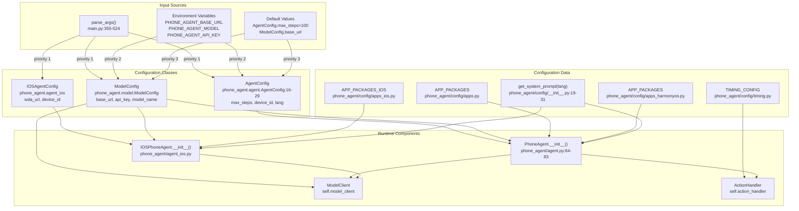
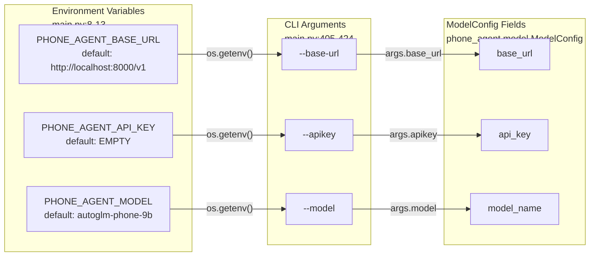
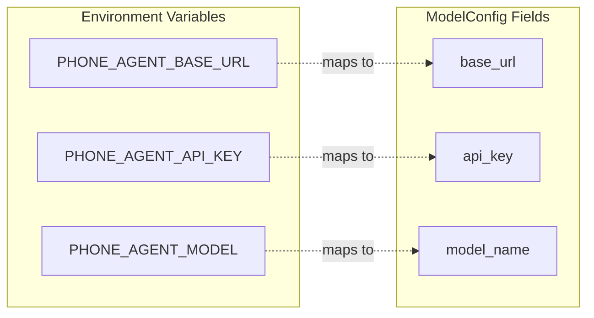
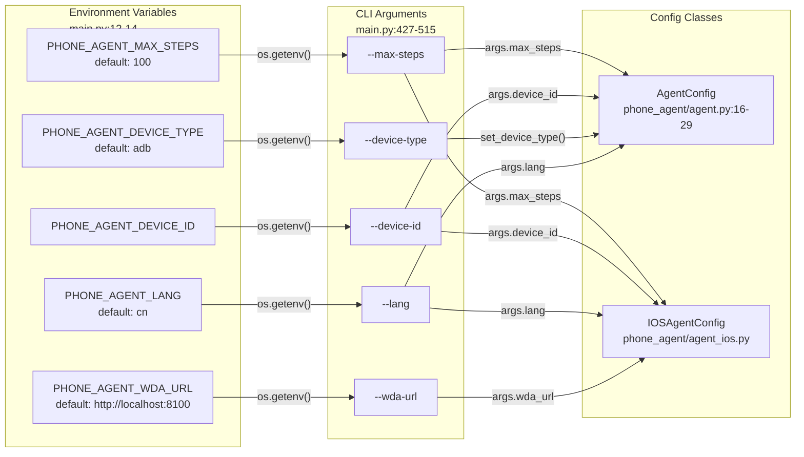
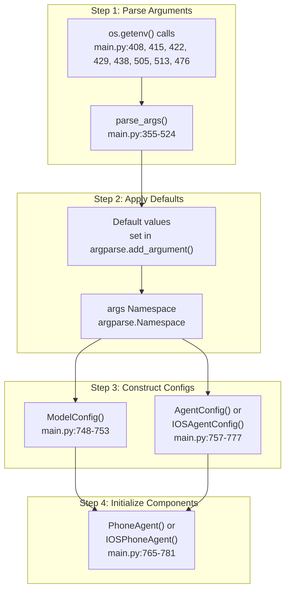
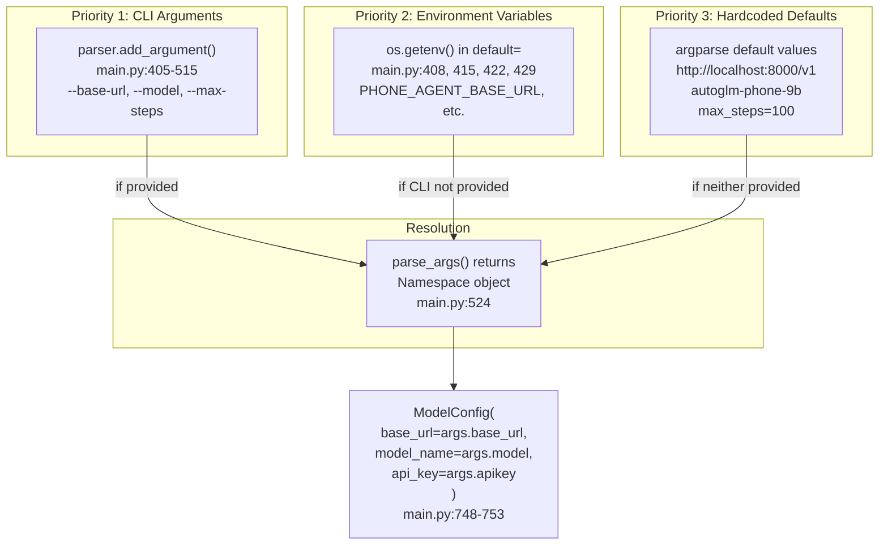
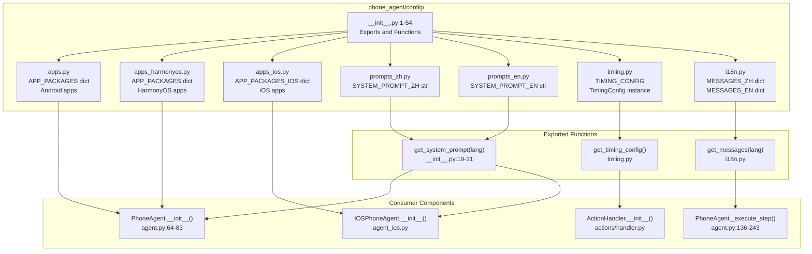
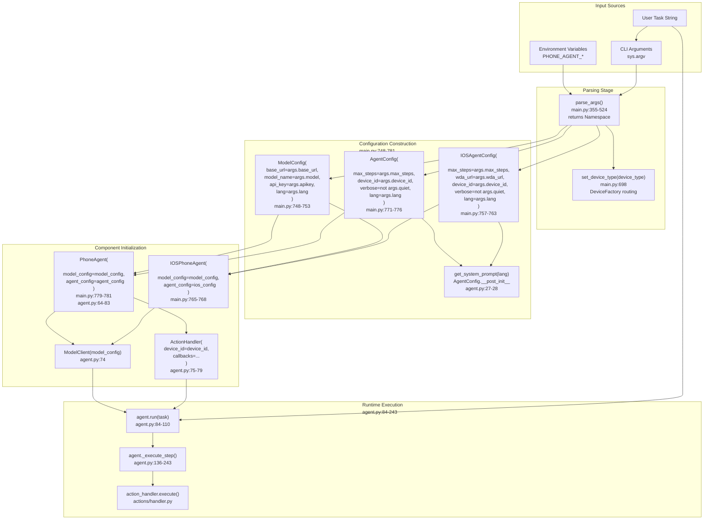

<!-- source: DeepWiki mcp.deepwiki.com · repo zai-org/Open-AutoGLM · page 5.4 Configuration Management · fetched 2026-10-29 -->

# Configuration Management

<details>
<summary>Relevant source files</summary>

The following files were used as context for generating this wiki page:

- [main.py](main.py)
- [phone_agent/agent.py](phone_agent/agent.py)
- [phone_agent/config/__init__.py](phone_agent/config/__init__.py)

</details>


## Purpose and Scope

This page documents the configuration management system in Open-AutoGLM, covering how to configure the AI model client, agent behavior, and operational parameters. It explains the `ModelConfig` and `AgentConfig` classes, environment variable integration, and configuration precedence rules.

For initial setup guidance, see [Configuration Basics](#2.3). For detailed reference on specific configuration files (application packages, system prompts, timing parameters), see [Configuration Reference](#7) and its subsections.

## Configuration Architecture Overview

Open-AutoGLM uses a layered configuration system where settings can be specified through multiple sources with defined precedence rules. Configuration flows from external sources (environment variables, CLI arguments) into structured configuration objects that control different aspects of the system.

**Configuration Architecture Diagram**



**Sources:** [main.py:355-524](), [main.py:748-781](), [phone_agent/agent.py:16-29](), [phone_agent/agent.py:64-83](), [phone_agent/config/__init__.py:1-54]()
</thinking>

## ModelConfig

The `ModelConfig` class controls all AI model interaction parameters. It configures the OpenAI-compatible API client used to communicate with vision-language models.

### Configuration Parameters

| Parameter | Type | Default | Description |
|-----------|------|---------|-------------|
| `base_url` | str | `http://localhost:8000/v1` | Model service endpoint URL |
| `api_key` | str | `EMPTY` | Authentication API key |
| `model_name` | str | `autoglm-phone-9b` | Model identifier |
| `max_tokens` | int | `3000` | Maximum output tokens per request |
| `temperature` | float | `0.1` | Sampling temperature (0.0-2.0) |
| `frequency_penalty` | float | `0.2` | Frequency penalty for repetition |
| `lang` | str | `cn` | Language for system prompt |

### Environment Variable Mapping

**ModelConfig Environment Variables**



**Sources:** [main.py:8-13](), [main.py:405-424](), [main.py:748-753]()

## ModelConfig

The `ModelConfig` class controls all AI model interaction parameters. It configures the OpenAI-compatible API client used to communicate with vision-language models.

### Configuration Parameters

| Parameter | Type | Default | Description |
|-----------|------|---------|-------------|
| `base_url` | str | `http://localhost:8000/v1` | Model service endpoint URL |
| `api_key` | str | `EMPTY` | Authentication API key |
| `model_name` | str | `autoglm-phone-9b` | Model identifier |
| `max_tokens` | int | `3000` | Maximum output tokens per request |
| `temperature` | float | `0.1` | Sampling temperature (0.0-2.0) |
| `frequency_penalty` | float | `0.2` | Frequency penalty for repetition |

### Environment Variable Mapping



### Usage Examples

**Via Python API:**

```python
from phone_agent.model import ModelConfig

# Basic configuration
config = ModelConfig(
    base_url="http://localhost:8000/v1",
    model_name="autoglm-phone-9b"
)

# With authentication
config = ModelConfig(
    base_url="https://api.z.ai/v1",
    api_key="sk-xxxxx",
    model_name="autoglm-phone-9b"
)

# Advanced tuning
config = ModelConfig(
    base_url="http://localhost:8000/v1",
    model_name="autoglm-phone-9b",
    max_tokens=5000,
    temperature=0.05,  # More deterministic
    frequency_penalty=0.5  # Stronger repetition penalty
)
```

**Via CLI Arguments:**

```bash
# Basic usage
python main.py --base-url http://localhost:8000/v1 --model autoglm-phone-9b

# With API key
python main.py --base-url https://api.z.ai/v1 --apikey sk-xxxxx

# Using third-party service
python main.py --base-url https://open.bigmodel.cn/api/paas/v4 \
               --model autoglm-phone \
               --apikey your-key
```

**Via Environment Variables:**

```bash
export PHONE_AGENT_BASE_URL="http://localhost:8000/v1"
export PHONE_AGENT_MODEL="autoglm-phone-9b"
export PHONE_AGENT_API_KEY="sk-xxxxx"

# Now run without arguments
python main.py "打开微信"
```

**Sources:** [README.md:498-511](), [README.md:488-496]()

## AgentConfig

The `AgentConfig` class controls agent operational behavior, including execution limits, device selection, language settings, and output verbosity. There are two variants: `AgentConfig` for Android/HarmonyOS and `IOSAgentConfig` for iOS devices.

### AgentConfig (Android/HarmonyOS)

Defined in [phone_agent/agent.py:16-29](), this dataclass controls Android and HarmonyOS agent behavior.

| Parameter | Type | Default | Description |
|-----------|------|---------|-------------|
| `max_steps` | int | `100` | Maximum steps per task before timeout |
| `device_id` | str \| None | `None` | Specific device ID (auto-detect if None) |
| `lang` | str | `cn` | System prompt language: `cn` or `en` |
| `system_prompt` | str \| None | `None` | Custom system prompt (auto-selected if None) |
| `verbose` | bool | `True` | Enable detailed logging output |

### IOSAgentConfig

Defined in [phone_agent/agent_ios.py](), this dataclass extends configuration for iOS devices with WebDriverAgent-specific settings.

| Parameter | Type | Default | Description |
|-----------|------|---------|-------------|
| `max_steps` | int | `100` | Maximum steps per task before timeout |
| `wda_url` | str | `http://localhost:8100` | WebDriverAgent URL |
| `device_id` | str \| None | `None` | iOS device UUID (auto-detect if None) |
| `lang` | str | `cn` | System prompt language: `cn` or `en` |
| `system_prompt` | str \| None | `None` | Custom system prompt (auto-selected if None) |
| `verbose` | bool | `True` | Enable detailed logging output |

### Environment Variable Mapping

**AgentConfig Environment Variables**



**Sources:** [main.py:12-14](), [main.py:427-515](), [main.py:755-781](), [phone_agent/agent.py:16-29]()

### Usage Examples

**Via Python API (Android/HarmonyOS):**

```python
from phone_agent import PhoneAgent
from phone_agent.agent import AgentConfig
from phone_agent.model import ModelConfig

# Basic agent configuration
agent_config = AgentConfig(
    max_steps=50,  # Stop after 50 steps
    lang="cn",
    verbose=True
)

model_config = ModelConfig(
    base_url="http://localhost:8000/v1",
    model_name="autoglm-phone-9b"
)

agent = PhoneAgent(
    model_config=model_config,
    agent_config=agent_config
)

# Specific device configuration
agent_config = AgentConfig(
    device_id="192.168.1.100:5555",  # Remote device
    lang="en",
    verbose=False  # Suppress detailed output
)
```

**Via Python API (iOS):**

```python
from phone_agent.agent_ios import IOSPhoneAgent, IOSAgentConfig
from phone_agent.model import ModelConfig

# iOS agent configuration
ios_config = IOSAgentConfig(
    max_steps=100,
    wda_url="http://localhost:8100",
    device_id="00008030-001234567890401E",
    lang="en",
    verbose=True
)

model_config = ModelConfig(
    base_url="http://localhost:8000/v1",
    model_name="autoglm-phone-9b"
)

agent = IOSPhoneAgent(
    model_config=model_config,
    agent_config=ios_config
)
```

**Via CLI Arguments:**

```bash
# Android with specific options
python main.py --max-steps 50 --lang en --device-type adb

# Specific device
python main.py --device-id 192.168.1.100:5555 --device-type adb

# HarmonyOS device
python main.py --device-type hdc

# iOS device with WebDriverAgent
python main.py --device-type ios \
               --wda-url http://localhost:8100 \
               --device-id 00008030-001234567890401E
```

**Via Environment Variables:**

```bash
# Set environment variables
export PHONE_AGENT_MAX_STEPS=50
export PHONE_AGENT_DEVICE_TYPE=adb
export PHONE_AGENT_LANG=en

# Run without arguments
python main.py "Open Settings"

# For iOS
export PHONE_AGENT_DEVICE_TYPE=ios
export PHONE_AGENT_WDA_URL=http://localhost:8100
python main.py "Open Safari"
```

**Sources:** [main.py:355-524](), [main.py:748-781](), [phone_agent/agent.py:64-83]()

## Environment Variables Reference

The following table documents all environment variables recognized by Open-AutoGLM, as defined in [main.py:8-14]():

| Variable | Target Config | Type | Default | Line Reference | Description |
|----------|---------------|------|---------|----------------|-------------|
| `PHONE_AGENT_BASE_URL` | ModelConfig | string | `http://localhost:8000/v1` | [main.py:9]() | Model API endpoint |
| `PHONE_AGENT_MODEL` | ModelConfig | string | `autoglm-phone-9b` | [main.py:10]() | Model name/identifier |
| `PHONE_AGENT_API_KEY` | ModelConfig | string | `EMPTY` | [main.py:11]() | API authentication key |
| `PHONE_AGENT_MAX_STEPS` | AgentConfig | integer | `100` | [main.py:12]() | Maximum steps per task |
| `PHONE_AGENT_DEVICE_ID` | AgentConfig | string | (auto) | [main.py:13]() | Specific device identifier |
| `PHONE_AGENT_DEVICE_TYPE` | CLI routing | enum | `adb` | [main.py:513]() | Device type: `adb`, `hdc`, `ios` |
| `PHONE_AGENT_LANG` | AgentConfig | enum | `cn` | [main.py:505]() | Prompt language: `cn`, `en` |
| `PHONE_AGENT_WDA_URL` | IOSAgentConfig | string | `http://localhost:8100` | [main.py:476]() | WebDriverAgent URL for iOS |

### Environment Variable Loading Sequence

**Configuration Loading Flow**



**Sources:** [main.py:8-14](), [main.py:355-524](), [main.py:748-781]()

## Configuration Precedence

When configuration values are specified through multiple sources, they are resolved using the following precedence order (highest to lowest priority). The implementation follows standard argparse behavior where CLI arguments override environment variable defaults.

**Configuration Precedence Flow**



### Precedence Example

The precedence is implemented through argparse's `default` parameter in [main.py:405-515]():

```python
# From main.py
parser.add_argument(
    "--base-url",
    type=str,
    default=os.getenv("PHONE_AGENT_BASE_URL", "http://localhost:8000/v1"),
    help="Model API base URL",
)
```

This creates the precedence: CLI arg > Environment Variable > Hardcoded default.

**Practical Example:**

```bash
# Environment variables set
export PHONE_AGENT_BASE_URL="http://env-server:8000/v1"
export PHONE_AGENT_MODEL="env-model"

# CLI execution with arguments
python main.py \
    --base-url http://cli-server:9000/v1 \
    --model cli-model \
    "Open WeChat"

# Effective configuration:
# base_url = "http://cli-server:9000/v1"  (CLI arg wins over env var)
# model_name = "cli-model"                (CLI arg wins over env var)
# api_key = "EMPTY"                       (default, neither CLI nor env set)
# max_steps = 100                         (default, neither CLI nor env set)
```

**Sources:** [main.py:405-515](), [main.py:748-753]()

## Configuration Module Structure

The `phone_agent/config/` module provides structured configuration data used throughout the system. This data is separate from operational configuration (ModelConfig, AgentConfig) and includes application definitions, prompts, and timing parameters.

**Configuration Module Architecture**



### Configuration Module Functions

The `phone_agent/config/__init__.py` module exports key functions defined in [phone_agent/config/__init__.py:1-54]():

| Function | File Location | Purpose | Returns | Usage |
|----------|---------------|---------|---------|-------|
| `get_system_prompt(lang)` | [__init__.py:19-31]() | Get system prompt by language | `str` | Agent initialization |
| `get_message(key, lang)` | [i18n.py]() | Get single translated UI message | `str` | Runtime UI text |
| `get_messages(lang)` | [i18n.py]() | Get all messages for language | `dict` | Batch UI text |
| `get_timing_config()` | [timing.py]() | Get current timing configuration | `TimingConfig` | Action delays |
| `update_timing_config(config)` | [timing.py]() | Update timing configuration | `None` | Runtime tuning |

**Example Usage:**

```python
from phone_agent.config import (
    get_system_prompt,
    get_timing_config,
    get_messages
)

# Get system prompt - used in AgentConfig.__post_init__()
prompt_cn = get_system_prompt("cn")  # Returns SYSTEM_PROMPT_ZH
prompt_en = get_system_prompt("en")  # Returns SYSTEM_PROMPT_EN

# Get UI messages - used in PhoneAgent._execute_step()
msgs = get_messages("cn")
print(msgs['thinking'])  # "思考中..."
print(msgs['action'])    # "执行动作"

# Get timing configuration - used in ActionHandler
timing = get_timing_config()
print(f"Tap delay: {timing.device.tap_delay}s")
print(f"Text input delay: {timing.action.text_input_delay}s")
```

**Sources:** [phone_agent/config/__init__.py:1-54](), [phone_agent/agent.py:26-28](), [phone_agent/agent.py:173]()

## Complete Configuration Flow

This diagram shows the complete configuration flow from initial input sources through to runtime component configuration, with specific code references.

**End-to-End Configuration Flow**



**Configuration Loading Sequence:**

1. **Parse Stage** [main.py:684-698](): CLI arguments parsed, environment variables read, device type set globally
2. **Build Stage** [main.py:748-781](): `ModelConfig` and `AgentConfig`/`IOSAgentConfig` constructed from parsed args
3. **Post-Init Stage** [phone_agent/agent.py:26-28](): `system_prompt` loaded via `get_system_prompt(lang)` if not provided
4. **Agent Init** [phone_agent/agent.py:64-83](): `PhoneAgent` initializes `ModelClient` and `ActionHandler`
5. **Runtime** [phone_agent/agent.py:84-243](): Agent executes task using all configured components

**Sources:** [main.py:684-781](), [phone_agent/agent.py:16-29](), [phone_agent/agent.py:64-83](), [phone_agent/agent.py:84-243]()

## Configuration Best Practices

### Development Environment

For development and testing, use environment variables to set base configuration. This allows quick iteration without modifying code.

```bash
# Add to ~/.bashrc or ~/.zshrc
export PHONE_AGENT_BASE_URL="http://localhost:8000/v1"
export PHONE_AGENT_MODEL="autoglm-phone-9b"
export PHONE_AGENT_LANG="cn"
export PHONE_AGENT_MAX_STEPS=50  # Lower for testing
export PHONE_AGENT_DEVICE_TYPE=adb

# Then run without arguments
python main.py "Open WeChat"
```

### Production Deployment

For production systems, prefer explicit configuration through Python API to avoid environment variable dependencies and ensure reproducibility.

```python
from phone_agent import PhoneAgent
from phone_agent.model import ModelConfig
from phone_agent.agent import AgentConfig

# Explicit configuration following main.py:748-781 pattern
model_config = ModelConfig(
    base_url="https://production-api.example.com/v1",
    api_key=get_secret("PHONE_AGENT_API_KEY"),  # From secure store
    model_name="autoglm-phone-9b",
    max_tokens=3000,
    temperature=0.1
)

agent_config = AgentConfig(
    max_steps=100,
    lang="cn",
    verbose=False  # Production: disable verbose logging
)

agent = PhoneAgent(
    model_config=model_config,
    agent_config=agent_config
)
```

### Multi-Environment Configuration

For managing multiple environments (dev, staging, production), use configuration modules following the pattern in `phone_agent/config/`:

```python
# config/development.py
MODEL_CONFIG = {
    "base_url": "http://localhost:8000/v1",
    "model_name": "autoglm-phone-9b",
    "api_key": "EMPTY",
    "max_tokens": 3000,
    "temperature": 0.1
}

AGENT_CONFIG = {
    "max_steps": 50,
    "lang": "cn",
    "verbose": True
}

# config/production.py
import os

MODEL_CONFIG = {
    "base_url": "https://api.production.com/v1",
    "model_name": "autoglm-phone-9b",
    "api_key": os.environ.get("PROD_API_KEY", ""),
    "max_tokens": 3000,
    "temperature": 0.1
}

AGENT_CONFIG = {
    "max_steps": 100,
    "lang": "cn",
    "verbose": False
}

# Application entry point
import config.development as config  # or config.production
from phone_agent import PhoneAgent
from phone_agent.model import ModelConfig
from phone_agent.agent import AgentConfig

# Construct configs from dictionary (kwargs unpacking)
model_config = ModelConfig(**config.MODEL_CONFIG)
agent_config = AgentConfig(**config.AGENT_CONFIG)

agent = PhoneAgent(
    model_config=model_config,
    agent_config=agent_config
)
```

### Timing Configuration Overrides

For performance tuning, override timing configurations using environment variables. The timing module supports environment-based overrides for all delay parameters.

```bash
# Override specific timing values
export PHONE_AGENT_TAP_DELAY=0.5          # Reduce tap delay
export PHONE_AGENT_TEXT_INPUT_DELAY=0.05  # Faster typing
export PHONE_AGENT_LAUNCH_DELAY=2.0       # Wait longer for app launch

python main.py "Send message"
```

Alternatively, update timing configuration programmatically:

```python
from phone_agent.config import get_timing_config, update_timing_config

# Get current config
timing = get_timing_config()

# Modify for your use case
timing.device.tap_delay = 0.3
timing.action.text_input_delay = 0.05

# Apply changes
update_timing_config(timing)

# Now create agent with updated timing
agent = PhoneAgent(model_config, agent_config)
```

**Sources:** [main.py:8-14](), [main.py:748-781](), [phone_agent/config/__init__.py:8-16]()

## Related Configuration Pages

For detailed information on specific configuration aspects:

- **Application Packages**: See [Application Packages](#7.1) for `APP_PACKAGES` structure and customization
- **System Prompts**: See [System Prompts](#7.2) for prompt customization and language support
- **Timing Configuration**: See [Timing Configuration](#7.3) for delay and timeout settings
- **Remote Device Connection**: See [Remote Device Connection](#5.3) for device connection configuration
- **Interactive Mode**: See [Interactive Mode](#5.5) for interactive session configuration

---

