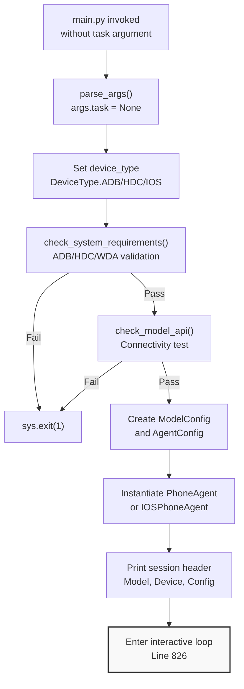
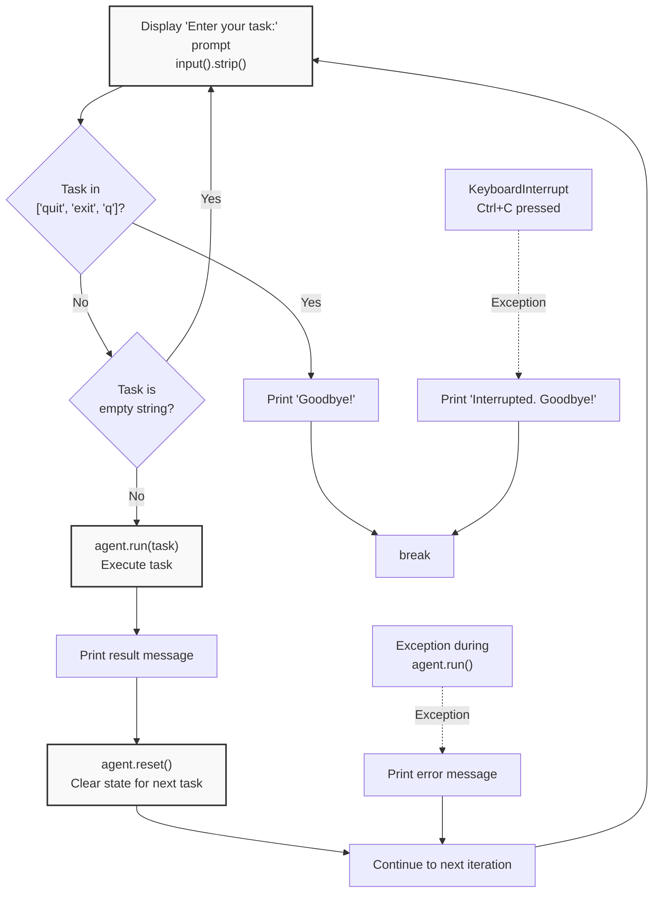
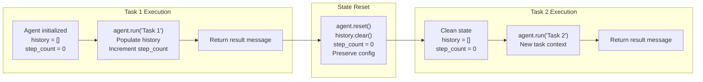
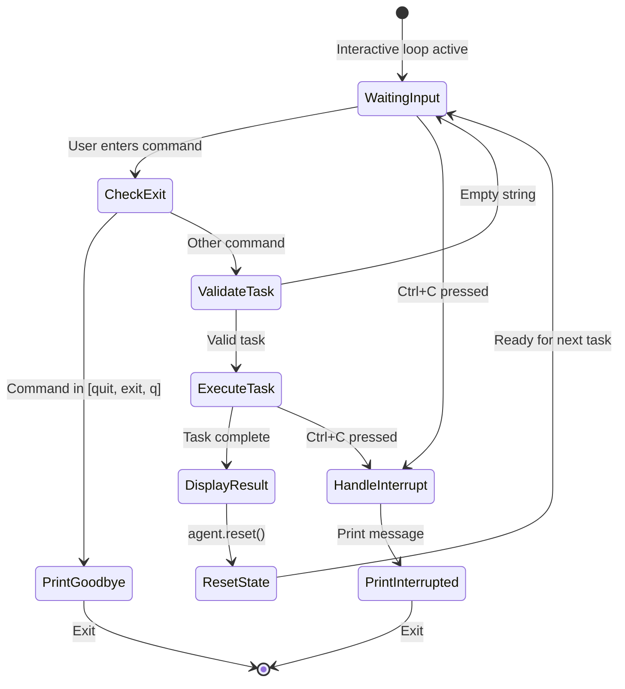

<!-- source: DeepWiki mcp.deepwiki.com · repo zai-org/Open-AutoGLM · page 5.5 Interactive Mode · fetched 2026-10-29 -->

# Interactive Mode

<details>
<summary>Relevant source files</summary>

The following files were used as context for generating this wiki page:

- [README_coding_agent.md](README_coding_agent.md)
- [README_en.md](README_en.md)
- [examples/basic_usage.py](examples/basic_usage.py)
- [examples/demo_thinking.py](examples/demo_thinking.py)
- [main.py](main.py)
- [phone_agent/config/prompts.py](phone_agent/config/prompts.py)

</details>


**Purpose and Scope**: This document covers the interactive CLI mode of Open-AutoGLM, which enables continuous task execution through a REPL-style interface. Interactive mode is designed for exploratory usage, debugging, and executing multiple tasks in a single session without restarting the agent.

For information about command-line arguments and configuration, see [Command-Line Interface](#5.1). For programmatic task execution, see [Python API](#5.2).

---

## Overview

Interactive mode provides a Read-Eval-Print Loop (REPL) interface for executing multiple phone automation tasks sequentially within a single agent session. When launched without a task argument, the agent enters an interactive prompt where users can input tasks one at a time, observe results, and continue with new tasks without reinitialization overhead.

**Key Characteristics**:
- Persistent agent instance across multiple tasks
- Automatic state reset between tasks
- Real-time feedback and error handling
- Support for graceful exit commands
- Full compatibility with all agent configuration options

Interactive mode is particularly useful for:
- **Exploration**: Testing different task formulations and observing agent behavior
- **Debugging**: Iteratively refining tasks and inspecting intermediate results
- **Multi-task workflows**: Executing related tasks in sequence without process restart
- **Development**: Testing configuration changes or new app integrations

Sources: [main.py:820-850](), [README_en.md:241-264]()

---

## Entry Point and Initialization

### Launching Interactive Mode

Interactive mode is triggered by omitting the `task` positional argument when invoking `main.py`:

```bash
# Android device - Interactive mode
python main.py --base-url http://localhost:8000/v1 --model "autoglm-phone-9b-multilingual"

# HarmonyOS device - Interactive mode
python main.py --device-type hdc --base-url http://localhost:8000/v1 --model "autoglm-phone-9b-multilingual"

# iOS device - Interactive mode
python main.py --device-type ios --wda-url http://localhost:8100
```

The interactive mode performs full system initialization before entering the prompt loop, including:
1. System requirements validation via `check_system_requirements()` [main.py:735-741]()
2. Model API connectivity check via `check_model_api()` [main.py:744-745]()
3. Agent instantiation with configured `ModelConfig` and `AgentConfig` [main.py:748-781]()
4. Device detection and connection status display [main.py:800-817]()

### Initialization Flow



**Initialization Output Example**:
```
==================================================
Phone Agent - AI-powered phone automation
==================================================
Model: autoglm-phone-9b-multilingual
Base URL: http://localhost:8000/v1
Max Steps: 100
Language: cn
Device Type: ADB
Device: emulator-5554 (auto-detected)
==================================================

Entering interactive mode. Type 'quit' to exit.
```

Sources: [main.py:684-828](), [main.py:355-524]()

---

## Interactive Loop Architecture

### Core Loop Implementation

The interactive mode operates through a continuous `while True` loop that handles task input, execution, result display, and state management:



### Task Execution Cycle

Each task execution follows this sequence:

| Step | Operation | Code Reference | Purpose |
|------|-----------|----------------|---------|
| 1 | Input prompt | `task = input("Enter your task: ").strip()` | Capture user task description |
| 2 | Exit check | `if task.lower() in ("quit", "exit", "q")` | Allow graceful exit |
| 3 | Empty check | `if not task: continue` | Skip empty inputs |
| 4 | Execute task | `result = agent.run(task)` | Run agent perception-action loop |
| 5 | Display result | `print(f"\nResult: {result}\n")` | Show task completion message |
| 6 | Reset state | `agent.reset()` | Clear history for next task |

Sources: [main.py:826-850]()

---

## State Management and Agent Reset

### Agent State Lifecycle

In interactive mode, the `PhoneAgent` instance persists across multiple tasks, but its internal state is reset between executions to prevent context contamination:



### What Persists vs. What Resets

**Persistent State** (survives `agent.reset()`):
- `ModelConfig`: Model endpoint, API key, temperature, max_tokens
- `AgentConfig`: max_steps, device_id, language, verbose flag
- Device connection: ADB/HDC/WDA session
- Callback functions: `confirmation_callback`, `takeover_callback`

**Reset State** (cleared by `agent.reset()`):
- Task execution history (conversation messages)
- Step counter (`step_count`)
- Current task string
- Execution metadata

The `reset()` method is implemented in `PhoneAgent` and ensures each task starts with a clean slate while maintaining the configured agent capabilities.

Sources: [main.py:843](), [examples/basic_usage.py:113-115]()

---

## Exit Commands and Termination

### Graceful Exit Mechanisms

Interactive mode supports multiple exit pathways:

**Command-based Exit**:
```python
if task.lower() in ("quit", "exit", "q"):
    print("Goodbye!")
    break
```

Accepted exit commands (case-insensitive):
- `quit`
- `exit`
- `q`

**Keyboard Interrupt (Ctrl+C)**:
```python
except KeyboardInterrupt:
    print("\n\nInterrupted. Goodbye!")
    break
```

Pressing `Ctrl+C` during task input or execution safely terminates the interactive session.

### Termination Flow



Sources: [main.py:829-850]()

---

## Error Handling and Recovery

### Exception Handling Strategy

Interactive mode implements robust error handling to maintain session stability even when individual tasks fail:

**General Exception Handling**:
```python
try:
    result = agent.run(task)
    print(f"\nResult: {result}\n")
    agent.reset()
except KeyboardInterrupt:
    print("\n\nInterrupted. Goodbye!")
    break
except Exception as e:
    print(f"\nError: {e}\n")
    # Loop continues, allowing retry
```

### Error Recovery Behavior

| Error Type | Handling | Session Impact | User Action |
|------------|----------|----------------|-------------|
| Task execution failure | Print error message | Continue session | Retry or modify task |
| Model API timeout | Exception caught | Continue session | Check model service |
| Device disconnect | Exception caught | Continue session | Reconnect device |
| Keyboard interrupt | Graceful exit | Terminate session | N/A |
| Empty input | Ignore, re-prompt | Continue session | Enter valid task |

**Recovery Example Session**:
```
Enter your task: Open invalid_app_name
Error: App 'invalid_app_name' not found in supported apps

Enter your task: Open Chrome
Result: Successfully opened Chrome and navigated to homepage

Enter your task: quit
Goodbye!
```

The error handling ensures that a single failed task does not terminate the entire interactive session, enabling users to correct mistakes and continue working.

Sources: [main.py:845-849]()

---

## Interactive Mode vs. Single-Task Mode

### Comparison Matrix

| Aspect | Interactive Mode | Single-Task Mode |
|--------|-----------------|------------------|
| **Invocation** | `python main.py` (no task argument) | `python main.py "task description"` |
| **Agent Lifecycle** | Persistent across tasks | Created and destroyed per task |
| **State Management** | Manual reset between tasks | Automatic cleanup on exit |
| **Overhead** | One-time initialization | Initialization per invocation |
| **Use Case** | Exploration, debugging, multi-task | Automation scripts, single operations |
| **Exit Behavior** | Interactive commands or Ctrl+C | Automatic on task completion |
| **Error Recovery** | Continue session after errors | Exit on error |
| **Session Logging** | Cumulative across tasks | Single task log |

### Execution Flow Comparison

```mermaid
graph TB
    subgraph "Single-Task Mode"
        ST1["Parse args with task"]
        ST2["Initialize agent"]
        ST3["Execute single task"]
        ST4["Print result"]
        ST5["Exit process"]
        
        ST1 --> ST2 --> ST3 --> ST4 --> ST5
    end
    
    subgraph "Interactive Mode"
        IT1["Parse args without task"]
        IT2["Initialize agent once"]
        IT3["Enter infinite loop"]
        IT4["Prompt for task"]
        IT5["Execute task"]
        IT6["Reset state"]
        IT7["Loop or exit"]
        
        IT1 --> IT2 --> IT3
        IT3 --> IT4 --> IT5 --> IT6 --> IT7
        IT7 -->|Continue| IT4
        IT7 -->|quit| IT8["Exit process"]
    end
```



**Performance Consideration**: Interactive mode amortizes the initialization cost (system checks, model validation, device connection) across multiple tasks, making it more efficient for multi-task workflows than repeated single-task invocations.

Sources: [main.py:820-850](), [README_en.md:240-264]()

---

## Use Cases and Best Practices

### When to Use Interactive Mode

**Recommended Scenarios**:

1. **Task Development and Testing**
   - Iteratively refine task descriptions
   - Test different phrasings for the same goal
   - Verify app compatibility and action sequences

2. **Debugging Agent Behavior**
   - Enable verbose mode for detailed execution logs
   - Execute tasks step-by-step with observation
   - Identify failure points in multi-step workflows

3. **Device Exploration**
   - Discover available apps on connected devices
   - Test device responsiveness and timing
   - Experiment with different action types

4. **Training and Demonstrations**
   - Show live agent capabilities to stakeholders
   - Demonstrate task execution and reasoning
   - Provide interactive Q&A sessions

5. **Multi-Task User Sessions**
   - Execute related tasks in sequence (e.g., research → purchase → message)
   - Maintain consistent device state across operations
   - Avoid repeated connection overhead

**Not Recommended For**:
- Automated scripts or CI/CD pipelines (use single-task mode or Python API)
- Batch processing of identical tasks (use programmatic loops)
- Non-interactive environments (Docker containers, SSH without TTY)

Sources: [README_en.md:681-683](), [examples/basic_usage.py:93-116]()

---

## Advanced Interactive Usage

### Combining Interactive Mode with Verbose Output

Enable detailed thinking and action logging for debugging:

```bash
# Interactive mode with verbose output
python main.py --base-url http://localhost:8000/v1 --model "autoglm-phone-9b-multilingual"

# Verbose is enabled by default; disable with --quiet
python main.py --base-url http://localhost:8000/v1 --quiet
```

**Verbose Mode Output in Interactive Session**:
```
Enter your task: Open eBay and search for wireless earphones

==================================================
💭 Thinking Process:
--------------------------------------------------
Currently on the system desktop, need to launch eBay app first
--------------------------------------------------
🎯 Executing Action:
{
  "_metadata": "do",
  "action": "Launch",
  "app": "eBay"
}
==================================================

==================================================
💭 Thinking Process:
--------------------------------------------------
eBay is now open, need to tap the search box
--------------------------------------------------
🎯 Executing Action:
{
  "_metadata": "do",
  "action": "Tap",
  "element": [499, 182]
}
==================================================

Result: Successfully opened eBay and searched for wireless earphones

Enter your task: _
```

Sources: [README_en.md:477-516](), [main.py:773-774]()

### Using Callbacks in Interactive Sessions

Custom callbacks for sensitive operations and manual takeover work seamlessly in interactive mode:

```python
# Not applicable for CLI interactive mode - use Python API with interactive sessions
# See examples/basic_usage.py for callback implementation
```

Interactive CLI mode uses default callbacks that prompt for user input via the terminal. For custom callback behavior, use the Python API with an interactive loop.

Sources: [examples/basic_usage.py:44-71](), [README_en.md:569-589]()

---

## Interactive Mode with Different Device Types

### Android (ADB)

```bash
# Default device type
python main.py --base-url http://localhost:8000/v1 --model "autoglm-phone-9b-multilingual"

# Explicit device type
python main.py --device-type adb --base-url http://localhost:8000/v1

# Specify device ID in multi-device setup
python main.py --device-id emulator-5554 --base-url http://localhost:8000/v1
```

### HarmonyOS (HDC)

```bash
# HarmonyOS interactive mode
python main.py --device-type hdc --base-url http://localhost:8000/v1 --model "autoglm-phone-9b-multilingual"

# With specific device
python main.py --device-type hdc --device-id 192.168.1.100:5555 --base-url http://localhost:8000/v1
```

### iOS (WebDriverAgent)

```bash
# iOS interactive mode (USB)
python main.py --device-type ios --wda-url http://localhost:8100

# iOS via WiFi
python main.py --device-type ios --wda-url http://192.168.1.100:8100
```

### Device Management During Interactive Sessions

Device connections persist throughout the interactive session. Users can manage devices before entering interactive mode:

```bash
# List available devices
python main.py --list-devices

# Connect to remote device before interactive session
python main.py --connect 192.168.1.100:5555
python main.py --device-id 192.168.1.100:5555  # Now use in interactive mode
```

Sources: [main.py:602-682](), [README_en.md:236-264](), [README_en.md:386-406]()

---

## Troubleshooting Interactive Mode

### Common Issues and Solutions

| Issue | Symptom | Solution |
|-------|---------|----------|
| **EOF Error in Non-TTY** | `EOF when reading a line` | Run in terminal with TTY support or use single-task mode |
| **Task Hangs** | No response after task submission | Press Ctrl+C to interrupt, check model service connectivity |
| **Device Disconnects** | Device not found errors mid-session | Exit interactive mode, reconnect device, restart session |
| **State Contamination** | Unexpected behavior across tasks | Ensure `agent.reset()` is called (automatic in CLI mode) |
| **Encoding Errors (Windows)** | `UnicodeEncodeError gbk codec` | Set `PYTHONIOENCODING=utf-8` before launching |

### Non-TTY Environment Limitation

Interactive mode requires a TTY (terminal) environment for the `input()` function. In non-TTY contexts (e.g., piped input, Docker without `-it`, SSH without pseudo-terminal), the following error occurs:

```
Enter your task: Traceback (most recent call last):
  File "main.py", line 831, in <module>
    task = input("Enter your task: ").strip()
EOFError: EOF when reading a line
```

**Solution**: Use single-task mode for non-TTY environments:
```bash
# Instead of interactive mode
python main.py --base-url http://localhost:8000/v1 "Open Chrome"
```

Sources: [README_en.md:679-683](), [main.py:826-850]()

---

## Summary

Interactive mode provides a powerful REPL interface for continuous task execution with the following capabilities:

**Core Features**:
- Persistent agent instance with automatic state reset between tasks
- Multiple exit mechanisms (commands and keyboard interrupt)
- Robust error handling with session continuation
- Support for all device types (Android, HarmonyOS, iOS)
- Full configuration compatibility (verbose mode, language, callbacks)

**Key Methods and Classes**:
- Entry point: [main.py:820-850]()
- Task execution: `agent.run(task)`
- State reset: `agent.reset()`
- Exit check: `task.lower() in ("quit", "exit", "q")`

**Ideal For**: Task exploration, debugging, multi-task workflows, demonstrations, and iterative development.

**Not Suitable For**: Automated scripts, batch processing, non-TTY environments.

For automated task execution, see [Python API](#5.2). For understanding available command-line options, see [Command-Line Interface](#5.1).

---

