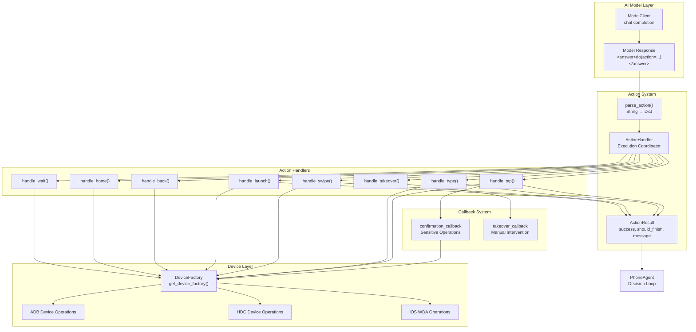
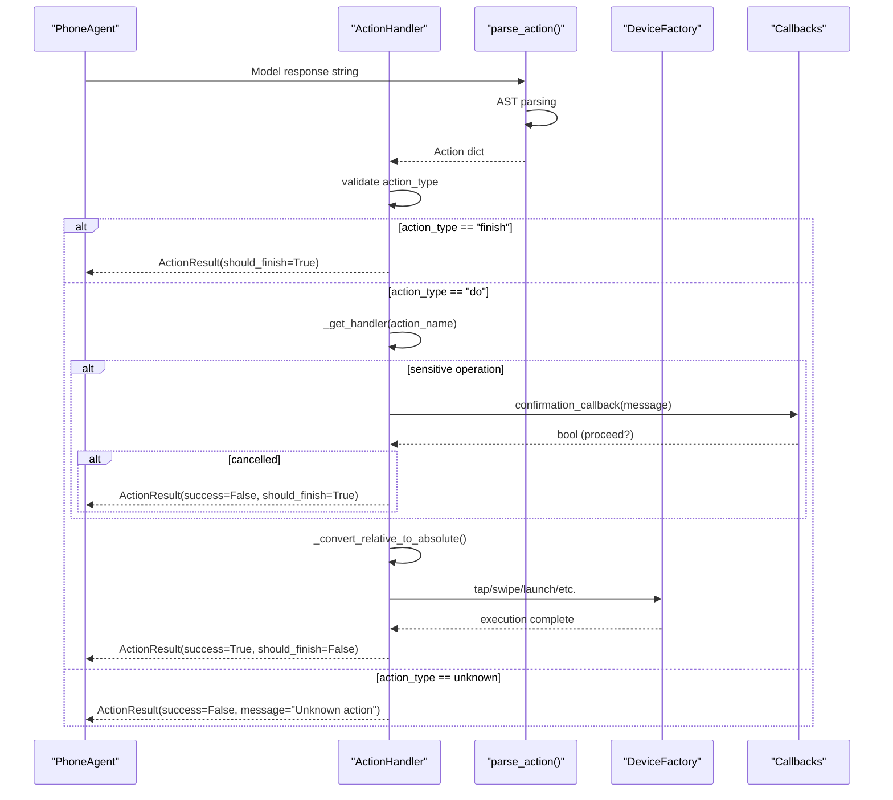
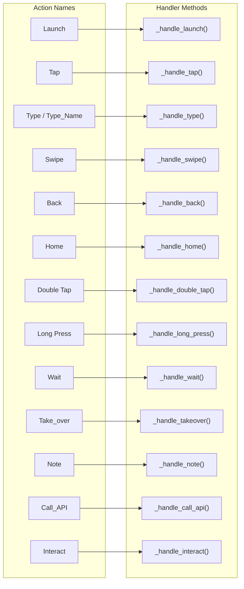
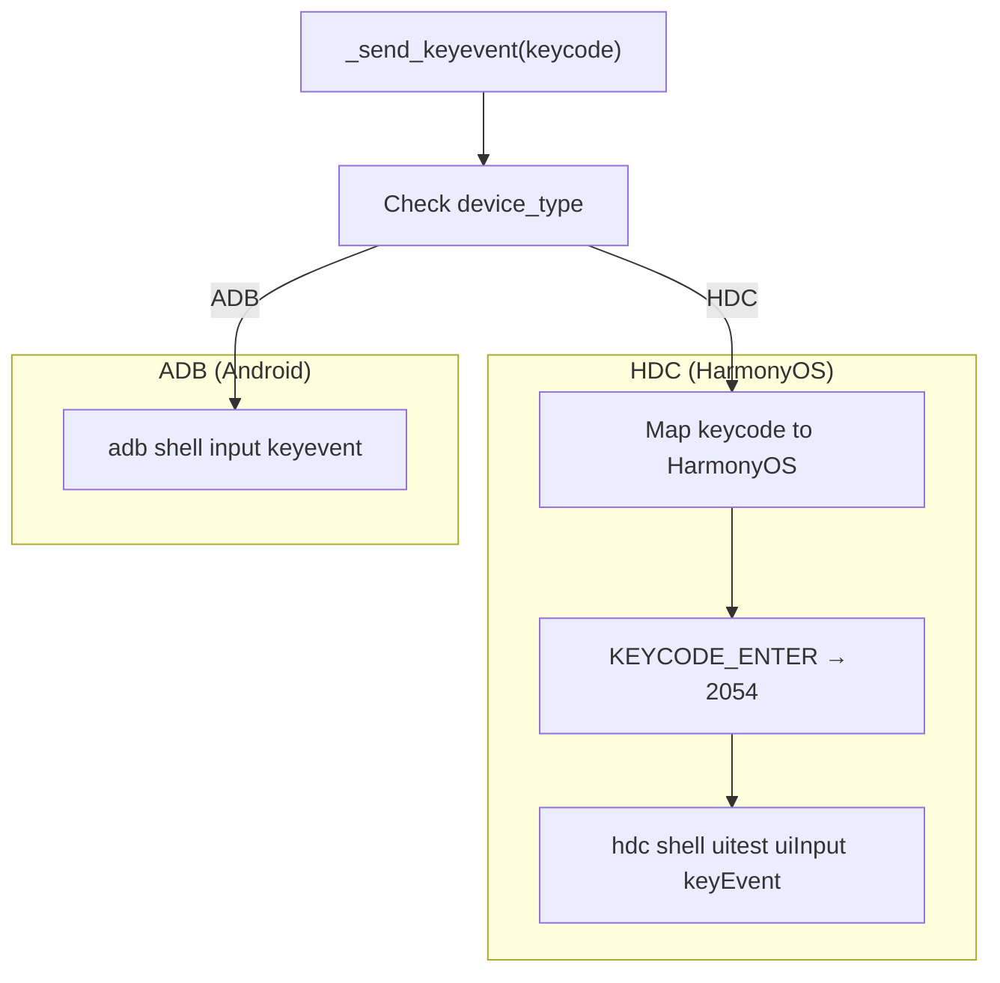
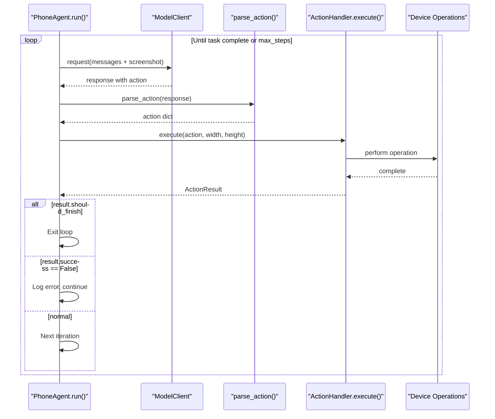

<!-- source: DeepWiki mcp.deepwiki.com · repo zai-org/Open-AutoGLM · page 6 Action System · fetched 2026-10-29 -->

# Action System

<details>
<summary>Relevant source files</summary>

The following files were used as context for generating this wiki page:

- [README_coding_agent.md](README_coding_agent.md)
- [README_en.md](README_en.md)
- [phone_agent/actions/handler.py](phone_agent/actions/handler.py)
- [phone_agent/config/prompts_en.py](phone_agent/config/prompts_en.py)
- [phone_agent/config/prompts_zh.py](phone_agent/config/prompts_zh.py)

</details>


The Action System is responsible for parsing, validating, and executing device actions based on AI model responses. This system converts the model's high-level decisions (expressed as structured text) into concrete device operations through ADB, HDC, or WebDriverAgent protocols. The system includes safety mechanisms for sensitive operations and supports manual intervention when needed.

For information about the AI model integration that generates actions, see [AI Model Integration](#3.4). For details on specific device protocols used by actions, see [Device Communication Layer](#3.5).

## Purpose and Scope

This document describes:
- How actions are parsed from model output strings into structured data
- The `ActionHandler` class that executes actions on devices
- All supported action types and their parameters
- Confirmation and takeover callback mechanisms for sensitive operations
- Coordinate conversion from relative (0-1000) to absolute pixel coordinates

## Architecture Overview

The Action System sits between the agent's decision-making layer and the device communication layer, translating model outputs into device commands.



**Sources:** [phone_agent/actions/handler.py:1-400](), [README.md:604-619]()

## Action Parsing

### parse_action() Function

The `parse_action()` function converts raw model response strings into structured action dictionaries. It handles multiple formats and includes safety measures to prevent code injection.

**Input Format:** Model responses contain actions wrapped in `<answer>` tags:
- `do(action="Tap", element=[500, 300])`
- `do(action="Type", text="search query")`
- `finish(message="Task completed")`

**Output Format:** Python dictionary with `_metadata` field:
```python
{
    "_metadata": "do",
    "action": "Tap",
    "element": [500, 300]
}
```

### Parsing Implementation

The parser uses AST (Abstract Syntax Tree) evaluation instead of `eval()` for security:

| Step | Implementation | Code Location |
|------|----------------|---------------|
| Extract action string | Strip whitespace, identify format | [phone_agent/actions/handler.py:347-354]() |
| Escape special chars | Replace `\n`, `\r`, `\t` | [phone_agent/actions/handler.py:358-360]() |
| Parse with AST | `ast.parse()` and `ast.literal_eval()` | [phone_agent/actions/handler.py:362-376]() |
| Build action dict | Extract keyword arguments | [phone_agent/actions/handler.py:367-372]() |

**Sources:** [phone_agent/actions/handler.py:332-388]()

## ActionHandler Class

The `ActionHandler` class coordinates action execution across different device types.

### Initialization

```python
ActionHandler(
    device_id: str | None = None,
    confirmation_callback: Callable[[str], bool] | None = None,
    takeover_callback: Callable[[str], None] | None = None
)
```

**Parameters:**
- `device_id`: ADB/HDC device identifier for multi-device setups
- `confirmation_callback`: Function called before executing sensitive operations (returns bool)
- `takeover_callback`: Function called when manual user intervention is needed

**Default Callbacks:**
- `_default_confirmation()`: Console-based confirmation prompt
- `_default_takeover()`: Console-based pause for manual operation

**Sources:** [phone_agent/actions/handler.py:24-43]()

### Action Execution Flow



**Sources:** [phone_agent/actions/handler.py:45-88]()

### ActionResult Dataclass

Every action execution returns an `ActionResult` with these fields:

| Field | Type | Description |
|-------|------|-------------|
| `success` | `bool` | Whether the action executed successfully |
| `should_finish` | `bool` | Whether the task is complete |
| `message` | `str \| None` | Optional message (errors, completion notes) |
| `requires_confirmation` | `bool` | Whether confirmation was required |

**Sources:** [phone_agent/actions/handler.py:14-22]()

## Coordinate Conversion

Actions use a relative coordinate system (0-1000) that is device-independent. The `_convert_relative_to_absolute()` method translates these to pixel coordinates.

### Conversion Formula

```
absolute_x = (relative_x / 1000) * screen_width
absolute_y = (relative_y / 1000) * screen_height
```

**Example:**
- Screen: 1080x1920 pixels
- Relative: [500, 300] (center-left region)
- Absolute: [540, 576] pixels

**Implementation:** [phone_agent/actions/handler.py:110-116]()

**Rationale:** Relative coordinates allow the AI model to reason about screen positions independently of device resolution. The model outputs coordinates in the 0-1000 range regardless of whether the device is 720p, 1080p, or 4K.

**Sources:** [phone_agent/actions/handler.py:110-116]()

## Action Type Reference

### Handler Method Mapping

The `_get_handler()` method maps action names to handler methods:



**Sources:** [phone_agent/actions/handler.py:90-108]()

### Launch Action

Launches an application by name using the `APP_PACKAGES` mapping.

**Format:** `do(action="Launch", app="应用名称")`

**Parameters:**
- `app` (string): Application name (e.g., "微信", "淘宝")

**Implementation Flow:**
1. Extract app name from action dict
2. Call `DeviceFactory.launch_app(app_name, device_id)`
3. DeviceFactory looks up package ID in `APP_PACKAGES`
4. Executes platform-specific launch command

**Sources:** [phone_agent/actions/handler.py:118-128]()

### Tap Action

Taps a specific screen coordinate. Supports confirmation for sensitive operations.

**Format:** `do(action="Tap", element=[x, y], message="optional confirmation")`

**Parameters:**
- `element` (list[int]): Relative coordinates [x, y] in 0-1000 range
- `message` (string, optional): If present, triggers confirmation callback

**Implementation Flow:**
1. Convert relative coordinates to absolute pixels
2. If `message` field exists, call `confirmation_callback(message)`
3. If confirmed or no confirmation needed, call `DeviceFactory.tap(x, y, device_id)`

**Sources:** [phone_agent/actions/handler.py:130-149]()

### Type Action

Inputs text into the active text field. Handles keyboard switching and multi-line text.

**Format:** `do(action="Type", text="content to type")`

**Parameters:**
- `text` (string): Text to input (can include newlines)

**Implementation Flow:**
1. Detect current input method via `DeviceFactory.detect_and_set_adb_keyboard()`
2. Switch to ADB Keyboard (Android) or use native input (HarmonyOS/iOS)
3. Clear existing text with `DeviceFactory.clear_text()`
4. Type new text with `DeviceFactory.type_text(text, device_id)`
5. Restore original keyboard with `DeviceFactory.restore_keyboard()`

**Timing Configuration:**
- Keyboard switch delay: `TIMING_CONFIG.action.keyboard_switch_delay`
- Text clear delay: `TIMING_CONFIG.action.text_clear_delay`
- Text input delay: `TIMING_CONFIG.action.text_input_delay`
- Keyboard restore delay: `TIMING_CONFIG.action.keyboard_restore_delay`

**Sources:** [phone_agent/actions/handler.py:151-173](), [phone_agent/config/timing.py]()

### Swipe Action

Performs a swipe gesture from start to end coordinates.

**Format:** `do(action="Swipe", start=[x1, y1], end=[x2, y2])`

**Parameters:**
- `start` (list[int]): Starting coordinates in 0-1000 range
- `end` (list[int]): Ending coordinates in 0-1000 range

**Implementation Flow:**
1. Convert both start and end to absolute coordinates
2. Call `DeviceFactory.swipe(start_x, start_y, end_x, end_y, device_id)`

**Common Usage:**
- Scroll down: `start=[500, 800], end=[500, 200]`
- Scroll up: `start=[500, 200], end=[500, 800]`
- Swipe left: `start=[800, 500], end=[200, 500]`

**Sources:** [phone_agent/actions/handler.py:175-188]()

### Back Action

Presses the system back button.

**Format:** `do(action="Back")`

**Parameters:** None

**Implementation:** Calls `DeviceFactory.back(device_id)`

**Sources:** [phone_agent/actions/handler.py:190-194]()

### Home Action

Presses the system home button.

**Format:** `do(action="Home")`

**Parameters:** None

**Implementation:** Calls `DeviceFactory.home(device_id)`

**Sources:** [phone_agent/actions/handler.py:196-200]()

### Double Tap Action

Performs a double-tap at specified coordinates.

**Format:** `do(action="Double Tap", element=[x, y])`

**Parameters:**
- `element` (list[int]): Relative coordinates in 0-1000 range

**Implementation:** Converts coordinates and calls `DeviceFactory.double_tap(x, y, device_id)`

**Sources:** [phone_agent/actions/handler.py:202-211]()

### Long Press Action

Performs a long press at specified coordinates.

**Format:** `do(action="Long Press", element=[x, y])`

**Parameters:**
- `element` (list[int]): Relative coordinates in 0-1000 range

**Implementation:** Converts coordinates and calls `DeviceFactory.long_press(x, y, device_id)`

**Sources:** [phone_agent/actions/handler.py:213-222]()

### Wait Action

Pauses execution for a specified duration.

**Format:** `do(action="Wait", duration="N seconds")`

**Parameters:**
- `duration` (string): Time to wait (e.g., "1 seconds", "3 seconds")

**Implementation:**
1. Parse numeric value from duration string
2. Call `time.sleep(duration)`
3. Default to 1.0 seconds if parsing fails

**Sources:** [phone_agent/actions/handler.py:224-233]()

### Take_over Action

Requests manual user intervention for tasks the AI cannot complete (login, captcha, payment).

**Format:** `do(action="Take_over", message="description of needed action")`

**Parameters:**
- `message` (string): Description of what user needs to do

**Implementation:**
1. Call `takeover_callback(message)`
2. Execution pauses until callback returns
3. Continue with next action

**Use Cases:**
- Login pages requiring password input
- CAPTCHA verification
- Payment confirmation
- Account verification codes

**Sources:** [phone_agent/actions/handler.py:235-239]()

### Note Action

Placeholder action for recording page content (not currently implemented with specific behavior).

**Format:** `do(action="Note", content="...")`

**Sources:** [phone_agent/actions/handler.py:241-245]()

### Call_API Action

Placeholder action for content summarization or external API calls (not currently implemented with specific behavior).

**Format:** `do(action="Call_API", ...)`

**Sources:** [phone_agent/actions/handler.py:247-251]()

### Interact Action

Signals that user input or choice is needed.

**Format:** `do(action="Interact")`

**Implementation:** Returns success with message "User interaction required"

**Sources:** [phone_agent/actions/handler.py:253-256]()

## Callback System

The Action System provides two callback mechanisms for handling special situations.

### Confirmation Callback

Called before executing sensitive operations to get user approval.

**Signature:** `(message: str) -> bool`

**Usage Example:**
```python
def custom_confirmation(message: str) -> bool:
    # Custom logic: check whitelist, show GUI, etc.
    return True  # or False to cancel

handler = ActionHandler(confirmation_callback=custom_confirmation)
```

**Default Implementation:** [phone_agent/actions/handler.py:321-324]()
- Prompts user via console: `"Sensitive operation: {message}\nConfirm? (Y/N): "`
- Returns `True` if user enters "Y"

**Trigger:** Actions with `message` field in the action dictionary

**Sources:** [phone_agent/actions/handler.py:35-43](), [phone_agent/actions/handler.py:321-324]()

### Takeover Callback

Called when the AI requests manual user intervention.

**Signature:** `(message: str) -> None`

**Usage Example:**
```python
def custom_takeover(message: str) -> None:
    # Custom logic: send notification, show dialog, etc.
    print(f"Manual action needed: {message}")
    # Wait for user to complete action

handler = ActionHandler(takeover_callback=custom_takeover)
```

**Default Implementation:** [phone_agent/actions/handler.py:327-329]()
- Displays message and pauses: `"{message}\nPress Enter after completing manual operation..."`
- Blocks until user presses Enter

**Common Scenarios:**
- Login pages
- SMS verification codes
- Payment screens
- Biometric authentication

**Sources:** [phone_agent/actions/handler.py:35-43](), [phone_agent/actions/handler.py:327-329]()

## Platform-Specific Behaviors

### Keyevent Handling

The `_send_keyevent()` method demonstrates platform-specific action implementation:



**Key Differences:**
- **Android (ADB)**: Uses standard `input keyevent` command with Android keycodes
- **HarmonyOS (HDC)**: Uses `uitest uiInput keyEvent` with HarmonyOS-specific codes
  - Enter key: Android code 66 → HarmonyOS code 2054

**Sources:** [phone_agent/actions/handler.py:258-318]()

### Text Input Methods

| Platform | Method | Tool |
|----------|--------|------|
| Android | ADB Keyboard switching | External APK required |
| HarmonyOS | Native input | Built-in `uitest` commands |
| iOS | Native input | WebDriverAgent API |

**Sources:** [phone_agent/actions/handler.py:151-173](), [README.md:98-104]()

## Error Handling

### Action Execution Errors

The `execute()` method wraps handler calls in try-except to catch all exceptions:

```python
try:
    return handler_method(action, screen_width, screen_height)
except Exception as e:
    return ActionResult(
        success=False, 
        should_finish=False, 
        message=f"Action failed: {e}"
    )
```

**Error Types:**
- **Unknown action type**: Returns `should_finish=True` to halt execution
- **Unknown action name**: Returns `should_finish=False` to continue
- **Handler exceptions**: Returns `should_finish=False` with error message

**Sources:** [phone_agent/actions/handler.py:83-88]()

### Parsing Errors

The `parse_action()` function raises `ValueError` for unparseable responses:

```python
raise ValueError(f"Failed to parse action: {e}")
```

**Common Causes:**
- Malformed syntax
- Invalid Python literals in action parameters
- Missing required fields

**Sources:** [phone_agent/actions/handler.py:383-387]()

## Integration with Agent Loop

The Action System integrates with the main agent execution loop:



**Sources:** High-level system diagrams, [phone_agent/agent.py]()

## Related Pages

- For the complete list of action types with examples, see [Action Types Reference](#6.1)
- For internal handler implementation details, see [ActionHandler Architecture](#6.2)
- For implementing custom callbacks, see [Custom Callbacks](#6.3)
- For device-specific operation details, see [Device Communication Layer](#3.5)
- For application package mappings used by Launch action, see [Application Packages](#7.1)
- For timing configurations used in actions, see [Timing Configuration](#7.3)

---

