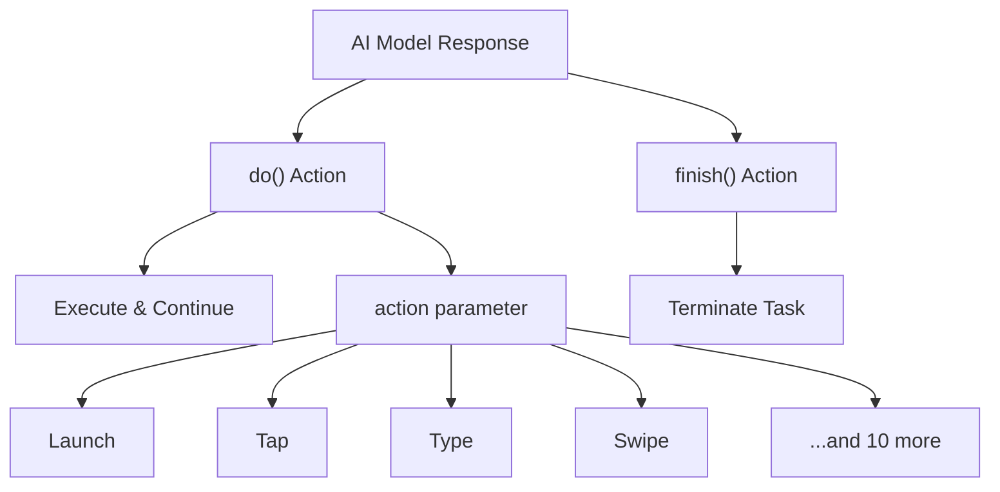
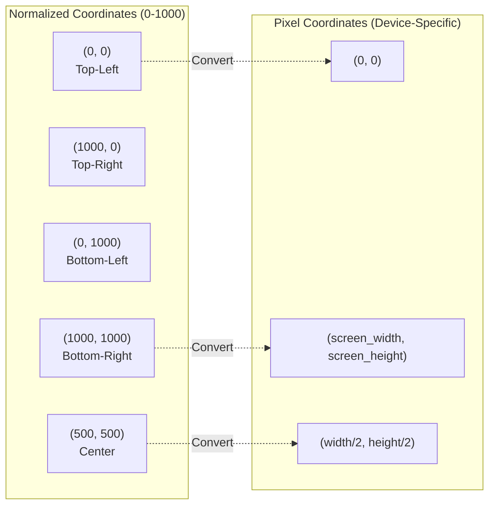
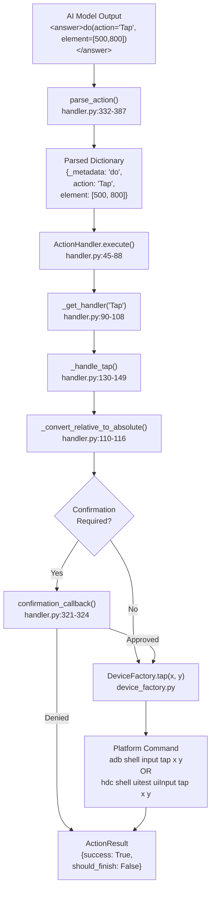
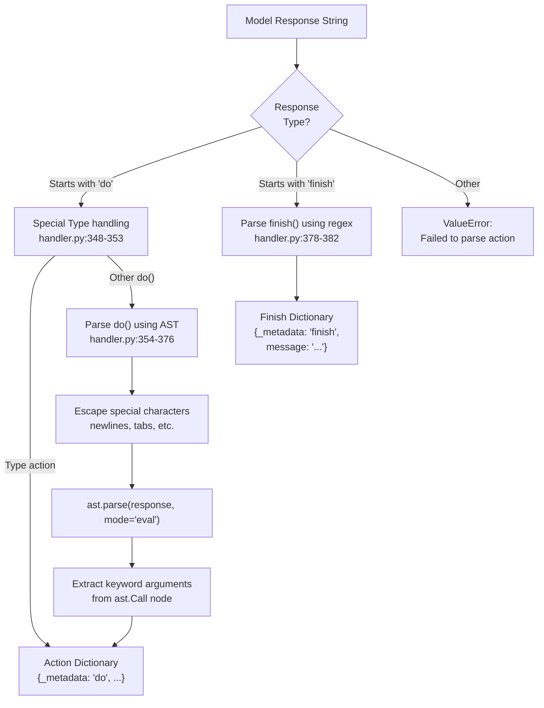
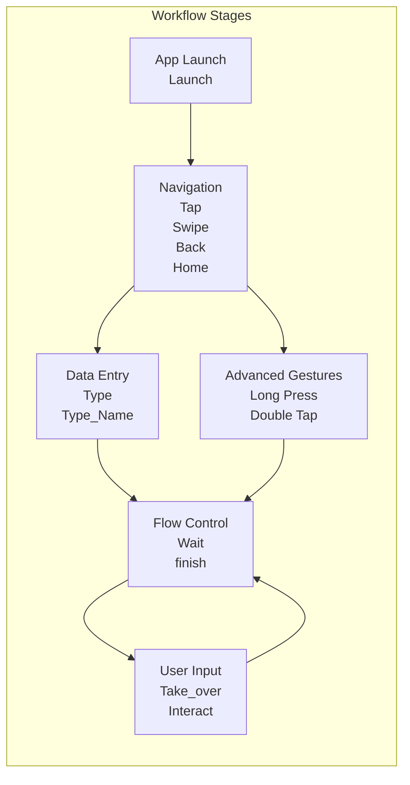
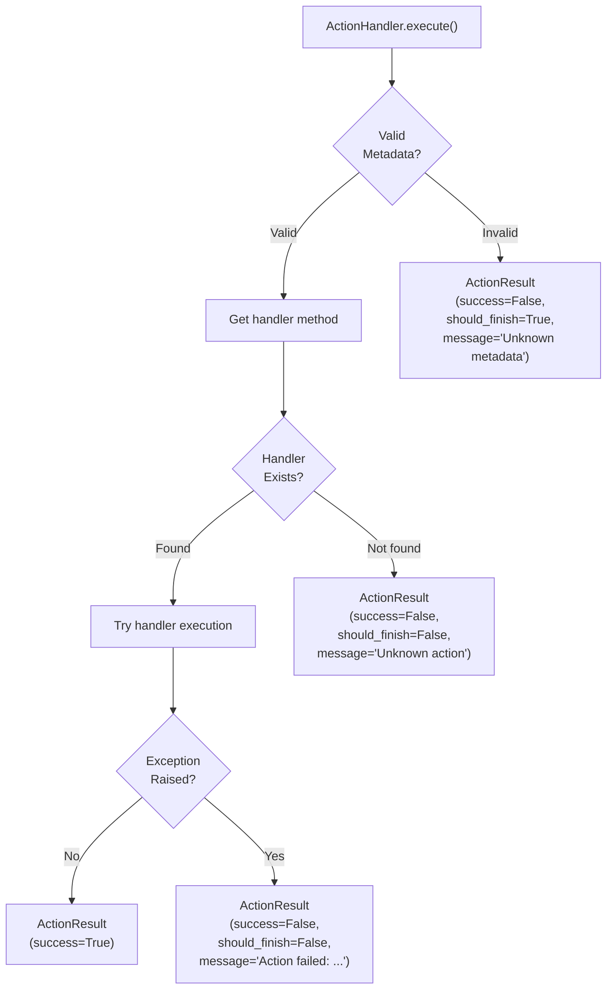

<!-- source: DeepWiki mcp.deepwiki.com · repo zai-org/Open-AutoGLM · page 6.1 Action Types Reference · fetched 2026-10-29 -->

# Action Types Reference

<details>
<summary>Relevant source files</summary>

The following files were used as context for generating this wiki page:

- [README_coding_agent.md](README_coding_agent.md)
- [README_en.md](README_en.md)
- [phone_agent/actions/handler.py](phone_agent/actions/handler.py)
- [phone_agent/config/prompts_en.py](phone_agent/config/prompts_en.py)
- [phone_agent/config/prompts_zh.py](phone_agent/config/prompts_zh.py)

</details>


## Purpose and Scope

This page provides a complete reference of all action types supported by the Open-AutoGLM action system. It documents the syntax, parameters, behavior, and implementation details for each action that the AI model can generate and the ActionHandler can execute.

For information about how these actions are executed and dispatched, see [ActionHandler Architecture](#6.2). For implementing custom callbacks that intercept certain actions, see [Custom Callbacks](#6.3).

**Sources:** [phone_agent/actions/handler.py:1-400](), [README_en.md:552-568]()

---

## Action Categories and Overview

The system supports 15+ distinct action types, organized into six functional categories:

| Category | Actions | Purpose |
|----------|---------|---------|
| **App Control** | `Launch`, `Back`, `Home` | Application navigation and lifecycle management |
| **Touch Gestures** | `Tap`, `Double Tap`, `Long Press`, `Swipe` | Direct screen interaction via touch events |
| **Text Input** | `Type`, `Type_Name` | Keyboard input and text entry |
| **Flow Control** | `Wait`, `finish` | Execution timing and task completion |
| **User Interaction** | `Take_over`, `Interact` | Manual intervention and user choice |
| **Content Operations** | `Note`, `Call_API` | Content recording and summarization |

**Sources:** [phone_agent/actions/handler.py:92-108](), [phone_agent/config/prompts_en.py:29-72]()

---

## Action Structure

All actions follow a structured format with two possible metadata types:

### Action Metadata Types



**`do()` Actions** - Execute an operation and continue the agent loop:
- Structure: `do(action="ActionType", param1=value1, param2=value2, ...)`
- Metadata: `{"_metadata": "do", "action": "ActionType", ...}`
- Result: Action is executed, screenshot captured, and agent continues to next step

**`finish()` Actions** - Signal task completion and terminate:
- Structure: `finish(message="completion message")`
- Metadata: `{"_metadata": "finish", "message": "..."}`
- Result: Agent loop terminates with success message

**Sources:** [phone_agent/actions/handler.py:59-71](), [phone_agent/actions/handler.py:390-399]()

---

## Coordinate System

Actions that reference screen positions use a **normalized coordinate system** where the screen spans from `(0, 0)` at the top-left corner to `(1000, 1000)` at the bottom-right corner. These coordinates are automatically converted to actual pixel coordinates based on the device's screen resolution.



**Conversion Formula:**
- `pixel_x = (normalized_x / 1000) * screen_width`
- `pixel_y = (normalized_y / 1000) * screen_height`

**Implementation:** [phone_agent/actions/handler.py:110-116]()

**Sources:** [phone_agent/actions/handler.py:110-116](), [phone_agent/config/prompts_zh.py:27-28]()

---

## Action Type Reference

### App Control Actions

#### `Launch`

Launches an application by name. This action uses the application package mappings defined in the configuration to resolve app names to platform-specific package identifiers.

**Parameters:**
- `app` (string, required): Application name as defined in `APP_PACKAGES` configuration

**Syntax:**
```python
do(action="Launch", app="Chrome")
do(action="Launch", app="WeChat")
```

**Handler Implementation:** [phone_agent/actions/handler.py:118-128]()

**Behavior:**
1. Resolves app name to package identifier via `DeviceFactory`
2. Calls platform-specific app launch command (e.g., `adb shell monkey -p <package>`)
3. Waits for app to initialize (timing configured in `TIMING_CONFIG.device.launch_delay`)
4. Returns failure if app name is not found in package mappings

**Related Configuration:** See [Application Packages](#7.1) for app name mappings.

**Sources:** [phone_agent/actions/handler.py:118-128](), [phone_agent/config/prompts_en.py:54-59]()

---

#### `Back`

Simulates pressing the Android/HarmonyOS back button, navigating to the previous screen or closing the current dialog.

**Parameters:** None

**Syntax:**
```python
do(action="Back")
```

**Handler Implementation:** [phone_agent/actions/handler.py:190-194]()

**Behavior:**
1. Sends platform-specific back button command
2. Android: `adb shell input keyevent KEYCODE_BACK`
3. HarmonyOS: `hdc shell input keyevent KEYCODE_BACK`
4. Screenshots the resulting state automatically

**Use Cases:**
- Navigate back from deeper screens
- Close popup dialogs or modal windows
- Exit current context without closing the app

**Sources:** [phone_agent/actions/handler.py:190-194](), [phone_agent/config/prompts_zh.py:48-49]()

---

#### `Home`

Returns to the device home screen by simulating the home button press.

**Parameters:** None

**Syntax:**
```python
do(action="Home")
```

**Handler Implementation:** [phone_agent/actions/handler.py:196-200]()

**Behavior:**
1. Sends platform-specific home button command
2. Android: `adb shell input keyevent KEYCODE_HOME`
3. HarmonyOS: `hdc shell input keyevent KEYCODE_HOME`
4. Exits current app and returns to launcher

**Use Cases:**
- Reset to known state (home screen)
- Exit current app completely
- Start new task from home screen

**Sources:** [phone_agent/actions/handler.py:196-200](), [phone_agent/config/prompts_zh.py:50-51]()

---

### Touch Gesture Actions

#### `Tap`

Performs a single tap at the specified screen coordinates. Optionally includes a confirmation message for sensitive operations.

**Parameters:**
- `element` (list[int, int], required): Normalized coordinates `[x, y]` where `0 ≤ x, y ≤ 1000`
- `message` (string, optional): If present, triggers confirmation callback before execution

**Syntax:**
```python
do(action="Tap", element=[500, 800])
do(action="Tap", element=[250, 150], message="Confirm payment")
```

**Handler Implementation:** [phone_agent/actions/handler.py:130-149]()

**Behavior:**
1. Converts normalized coordinates to pixel coordinates
2. If `message` parameter exists, invokes `confirmation_callback`
3. If user denies confirmation, returns failure and terminates task
4. Otherwise, executes platform-specific tap command
5. Android: `adb shell input tap <x> <y>`
6. HarmonyOS: `hdc shell uitest uiInput tap <x> <y>`

**Sensitive Operations:**
The AI model includes a `message` parameter when tapping buttons related to payments, privacy settings, account deletion, or other sensitive actions. This triggers the confirmation callback, allowing users to approve or deny the operation.

**Sources:** [phone_agent/actions/handler.py:130-149](), [phone_agent/config/prompts_zh.py:27-29]()

---

#### `Double Tap`

Performs two rapid consecutive taps at the specified coordinates, useful for zoom, selection, or special gestures.

**Parameters:**
- `element` (list[int, int], required): Normalized coordinates `[x, y]`

**Syntax:**
```python
do(action="Double Tap", element=[500, 500])
```

**Handler Implementation:** [phone_agent/actions/handler.py:202-211]()

**Behavior:**
1. Converts normalized coordinates to pixel coordinates
2. Calls `DeviceFactory.double_tap(x, y)`
3. Executes two taps with minimal delay between them

**Use Cases:**
- Zoom in on images or maps
- Select text by double-tapping words
- Activate special UI interactions that require double-tap

**Sources:** [phone_agent/actions/handler.py:202-211](), [phone_agent/config/prompts_zh.py:44-45]()

---

#### `Long Press`

Performs a long press (press and hold) at the specified coordinates for a fixed duration.

**Parameters:**
- `element` (list[int, int], required): Normalized coordinates `[x, y]`

**Syntax:**
```python
do(action="Long Press", element=[500, 300])
```

**Handler Implementation:** [phone_agent/actions/handler.py:213-222]()

**Behavior:**
1. Converts normalized coordinates to pixel coordinates
2. Calls `DeviceFactory.long_press(x, y)`
3. Holds touch at specified position for configured duration
4. Android: Uses `adb shell input swipe <x> <y> <x> <y> <duration>`
5. HarmonyOS: Uses equivalent HDC command

**Use Cases:**
- Trigger context menus
- Select text or items for editing
- Activate long-press-specific features
- Enter selection/edit mode in lists

**Sources:** [phone_agent/actions/handler.py:213-222](), [phone_agent/config/prompts_zh.py:42-43]()

---

#### `Swipe`

Performs a swipe gesture from a start point to an end point, useful for scrolling and navigation.

**Parameters:**
- `start` (list[int, int], required): Starting coordinates `[x1, y1]` in normalized space
- `end` (list[int, int], required): Ending coordinates `[x2, y2]` in normalized space

**Syntax:**
```python
do(action="Swipe", start=[500, 700], end=[500, 300])  # Swipe up
do(action="Swipe", start=[800, 500], end=[200, 500])  # Swipe left
```

**Handler Implementation:** [phone_agent/actions/handler.py:175-188]()

**Behavior:**
1. Converts both start and end coordinates to pixel coordinates
2. Calls `DeviceFactory.swipe(start_x, start_y, end_x, end_y)`
3. Duration automatically calculated based on distance
4. Android: `adb shell input swipe <x1> <y1> <x2> <y2> <duration>`
5. HarmonyOS: `hdc shell uitest uiInput swipe <x1> <y1> <x2> <y2> <duration>`

**Common Swipe Patterns:**
- **Scroll Down**: `start=[500, 300], end=[500, 700]`
- **Scroll Up**: `start=[500, 700], end=[500, 300]`
- **Scroll Right**: `start=[200, 500], end=[800, 500]`
- **Scroll Left**: `start=[800, 500], end=[200, 500]`

**Sources:** [phone_agent/actions/handler.py:175-188](), [phone_agent/config/prompts_zh.py:36-37]()

---

### Text Input Actions

#### `Type`

Inputs text into the currently focused input field. The system automatically switches to ADB Keyboard (Android) or native input (HarmonyOS), clears existing text, types new text, and restores the original keyboard.

**Parameters:**
- `text` (string, required): Text to input

**Syntax:**
```python
do(action="Type", text="Hello World")
do(action="Type", text="user@example.com")
```

**Handler Implementation:** [phone_agent/actions/handler.py:151-173]()

**Behavior:**
1. Detects current input method and switches to ADB Keyboard (Android only)
2. Waits for keyboard switch delay (`TIMING_CONFIG.action.keyboard_switch_delay`)
3. Clears existing text in the focused input field
4. Waits for text clear delay (`TIMING_CONFIG.action.text_clear_delay`)
5. Types the new text character by character
6. Waits for text input delay (`TIMING_CONFIG.action.text_input_delay`)
7. Restores original keyboard
8. Waits for keyboard restore delay (`TIMING_CONFIG.action.keyboard_restore_delay`)

**Platform Differences:**
- **Android**: Uses ADB Keyboard app for reliable text input via `adb shell am broadcast`
- **HarmonyOS**: Uses native input method via `hdc shell uitest uiInput text`

**Important Notes:**
- Input field must be focused before calling this action (tap it first)
- Existing text is automatically cleared; no need to manually delete
- Multiline text is supported (preserves newline characters)
- ADB Keyboard may not display visually but is active (look for "ADB Keyboard {ON}" indicator)

**Sources:** [phone_agent/actions/handler.py:151-173](), [phone_agent/config/prompts_zh.py:30-31]()

---

#### `Type_Name`

Specialized variant of `Type` action specifically for entering person names. Functionally identical to `Type` but signals to the AI model that this is a name input.

**Parameters:**
- `text` (string, required): Name to input

**Syntax:**
```python
do(action="Type_Name", text="John Doe")
```

**Handler Implementation:** [phone_agent/actions/handler.py:96]() (maps to `_handle_type`)

**Behavior:** Same as `Type` action

**Sources:** [phone_agent/actions/handler.py:96](), [phone_agent/config/prompts_zh.py:32-33]()

---

### Flow Control Actions

#### `Wait`

Pauses execution for a specified duration, allowing pages to load or animations to complete.

**Parameters:**
- `duration` (string, required): Wait time in format `"X seconds"` where X is a number

**Syntax:**
```python
do(action="Wait", duration="2 seconds")
do(action="Wait", duration="0.5 seconds")
```

**Handler Implementation:** [phone_agent/actions/handler.py:224-233]()

**Behavior:**
1. Parses duration string to extract numeric value
2. Calls `time.sleep(duration)`
3. If parsing fails, defaults to 1.0 seconds
4. Does not capture screenshot (agent loop handles this after action completes)

**Use Cases:**
- Wait for page content to load
- Allow animations to complete
- Give network requests time to finish
- Delay before retrying failed actions

**Sources:** [phone_agent/actions/handler.py:224-233](), [phone_agent/config/prompts_zh.py:52-53]()

---

#### `finish`

Signals task completion and terminates the agent execution loop. This is the only action with `_metadata: "finish"` instead of `"do"`.

**Parameters:**
- `message` (string, required): Completion message describing what was accomplished

**Syntax:**
```python
finish(message="Successfully opened Chrome and navigated to website")
finish(message="Task completed: Email sent to recipient")
```

**Handler Implementation:** [phone_agent/actions/handler.py:61-64]()

**Behavior:**
1. Sets `should_finish=True` in ActionResult
2. Agent loop terminates immediately
3. Message is returned to user as final result
4. No further actions are executed

**When to Use:**
- Task has been completed successfully
- All user requirements have been fulfilled
- No further actions are needed

**Sources:** [phone_agent/actions/handler.py:61-64](), [phone_agent/config/prompts_zh.py:54-55]()

---

### User Interaction Actions

#### `Take_over`

Requests manual user intervention for operations that cannot be automated, such as login, CAPTCHA solving, or verification code entry.

**Parameters:**
- `message` (string, optional): Description of what manual action is needed

**Syntax:**
```python
do(action="Take_over", message="Please log in manually")
do(action="Take_over", message="Please enter verification code")
```

**Handler Implementation:** [phone_agent/actions/handler.py:235-239]()

**Behavior:**
1. Invokes `takeover_callback(message)` with the provided message
2. Callback blocks until user completes manual operation and presses Enter
3. Agent resumes execution from next step
4. Default callback: prints message and waits for Enter key

**Use Cases:**
- Login screens requiring credentials
- CAPTCHA or verification code entry
- Biometric authentication (fingerprint, face recognition)
- Payment confirmation requiring hardware token
- Any security-sensitive operation not automatable

**Custom Callbacks:** See [Custom Callbacks](#6.3) for implementing custom takeover handlers.

**Sources:** [phone_agent/actions/handler.py:235-239](), [phone_agent/config/prompts_zh.py:46-47]()

---

#### `Interact`

Signals that user input is required to make a choice when multiple valid options exist. Used when the AI model cannot determine which option to select without user guidance.

**Parameters:** None

**Syntax:**
```python
do(action="Interact")
```

**Handler Implementation:** [phone_agent/actions/handler.py:253-256]()

**Behavior:**
1. Returns success with message "User interaction required"
2. Does not invoke any callbacks by default
3. Serves as a signal for custom agent implementations to prompt user

**Use Cases:**
- Multiple contacts with same name (which one to message?)
- Multiple restaurants matching criteria (which one to order from?)
- Ambiguous search results requiring user choice
- Preference-based decisions the AI cannot make

**Sources:** [phone_agent/actions/handler.py:253-256](), [phone_agent/config/prompts_zh.py:34-35]()

---

### Content Operation Actions

#### `Note`

Records or marks current page content for later summarization or reference. This is a placeholder action used in content aggregation workflows.

**Parameters:**
- `message` (string, optional): Annotation or note about the content

**Syntax:**
```python
do(action="Note", message="True")
```

**Handler Implementation:** [phone_agent/actions/handler.py:241-245]()

**Behavior:**
1. Returns success immediately
2. Does not perform any default action
3. Intended for custom implementations to store page content
4. Could be used to capture screenshots, extract text, or mark items

**Use Cases:**
- Mark pages for later summarization
- Record content during multi-page browsing
- Flag items for aggregation
- Build list of visited content

**Sources:** [phone_agent/actions/handler.py:241-245](), [phone_agent/config/prompts_zh.py:38-39]()

---

#### `Call_API`

Triggers content summarization or processing on recorded content. This is a placeholder action for custom processing workflows.

**Parameters:**
- `instruction` (string, optional): Processing instruction

**Syntax:**
```python
do(action="Call_API", instruction="Summarize the recorded articles")
```

**Handler Implementation:** [phone_agent/actions/handler.py:247-251]()

**Behavior:**
1. Returns success immediately
2. Does not perform any default action
3. Intended for custom implementations to process accumulated content
4. Could trigger LLM summarization, API calls, or data aggregation

**Use Cases:**
- Summarize multiple articles or posts
- Aggregate information from multiple screens
- Process and analyze recorded content
- Generate reports from collected data

**Sources:** [phone_agent/actions/handler.py:247-251](), [phone_agent/config/prompts_zh.py:40-41]()

---

## Action Processing Pipeline

The following diagram shows how actions flow from AI model output to device execution:



**Processing Steps:**

1. **Parsing** ([phone_agent/actions/handler.py:332-387]()): Raw model output string is parsed into a dictionary
2. **Dispatch** ([phone_agent/actions/handler.py:45-88]()): ActionHandler.execute() validates metadata and dispatches to handler
3. **Handler Lookup** ([phone_agent/actions/handler.py:90-108]()): Action name mapped to specific handler method
4. **Coordinate Conversion** ([phone_agent/actions/handler.py:110-116]()): Normalized coordinates converted to pixels
5. **Confirmation Check**: If action has `message` parameter, confirmation callback invoked
6. **Device Execution**: Platform-specific command sent via DeviceFactory
7. **Result Return**: ActionResult returned to agent loop with success status

**Sources:** [phone_agent/actions/handler.py:1-400]()

---

## Action Parsing

The `parse_action()` function converts raw model output strings into structured dictionaries that ActionHandler can process.

### Parsing Rules



**Parsing Implementation Details:**

1. **Type Actions** ([handler.py:348-353]()): Special handling for `Type` and `Type_Name` actions to preserve exact text content including special characters

2. **AST Parsing** ([handler.py:362-376]()): Uses Python's Abstract Syntax Tree parser for safe evaluation instead of `eval()`. Escapes newlines, tabs, and special characters before parsing.

3. **Finish Actions** ([handler.py:378-382]()): Simple regex-based extraction of message parameter

4. **Error Handling** ([handler.py:384-387]()): Raises `ValueError` with descriptive message if parsing fails

**Sources:** [phone_agent/actions/handler.py:332-387]()

---

## Action Handler Mapping

The ActionHandler maintains a mapping from action names to handler methods:

| Action Name | Handler Method | Lines |
|-------------|---------------|-------|
| `Launch` | `_handle_launch` | [118-128]() |
| `Tap` | `_handle_tap` | [130-149]() |
| `Type` | `_handle_type` | [151-173]() |
| `Type_Name` | `_handle_type` | [151-173]() |
| `Swipe` | `_handle_swipe` | [175-188]() |
| `Back` | `_handle_back` | [190-194]() |
| `Home` | `_handle_home` | [196-200]() |
| `Double Tap` | `_handle_double_tap` | [202-211]() |
| `Long Press` | `_handle_long_press` | [213-222]() |
| `Wait` | `_handle_wait` | [224-233]() |
| `Take_over` | `_handle_takeover` | [235-239]() |
| `Note` | `_handle_note` | [241-245]() |
| `Call_API` | `_handle_call_api` | [247-251]() |
| `Interact` | `_handle_interact` | [253-256]() |

**Handler Registration:** [phone_agent/actions/handler.py:92-108]()

**Sources:** [phone_agent/actions/handler.py:92-108]()

---

## Action Categorization by Use Case



**Typical Task Flow:**

1. **Launch** app if not already open
2. **Navigate** to desired screen using Tap, Swipe, Back
3. **Enter data** using Type for form fields
4. **Advanced interactions** using Long Press or Double Tap when needed
5. **Wait** for loading or animations
6. **Request user input** via Take_over for authentication
7. **Finish** task when complete

**Sources:** [phone_agent/config/prompts_zh.py:23-76]()

---

## Platform-Specific Command Mapping

Different platforms execute the same logical action using different underlying commands:

| Action | Android (ADB) | HarmonyOS (HDC) |
|--------|---------------|-----------------|
| **Launch** | `adb shell monkey -p <package>` | `hdc shell aa start -b <bundle>` |
| **Tap** | `adb shell input tap <x> <y>` | `hdc shell uitest uiInput tap <x> <y>` |
| **Type** | `adb shell am broadcast` (ADB Keyboard) | `hdc shell uitest uiInput text "<text>"` |
| **Swipe** | `adb shell input swipe <x1> <y1> <x2> <y2>` | `hdc shell uitest uiInput swipe <x1> <y1> <x2> <y2>` |
| **Back** | `adb shell input keyevent KEYCODE_BACK` | `hdc shell input keyevent KEYCODE_BACK` |
| **Home** | `adb shell input keyevent KEYCODE_HOME` | `hdc shell input keyevent KEYCODE_HOME` |
| **Long Press** | `adb shell input swipe <x> <y> <x> <y> <duration>` | `hdc shell uitest uiInput swipe <x> <y> <x> <y> <duration>` |

**Platform Selection:** Determined by `DeviceFactory.device_type` which is set via `--device-type` CLI argument or `PHONE_AGENT_DEVICE_TYPE` environment variable.

**Sources:** [phone_agent/adb/device.py](), [phone_agent/hdc/device.py]()

---

## Error Handling

ActionHandler provides comprehensive error handling at multiple levels:



**Error Scenarios:**

1. **Unknown Metadata** ([handler.py:66-71]()): Action has invalid `_metadata` field → terminates task
2. **Unknown Action** ([handler.py:76-81]()): Action type not in handler mapping → continues but logs error
3. **Handler Exception** ([handler.py:83-88]()): Handler method raises exception → continues but logs error
4. **Parsing Failure** ([handler.py:384-387]()): `parse_action()` raises `ValueError` → propagated to agent

**Sources:** [phone_agent/actions/handler.py:45-88]()

---

## Related Pages

- [ActionHandler Architecture](#6.2) - Deep dive into handler dispatch mechanism and timing
- [Custom Callbacks](#6.3) - Implementing confirmation and takeover callbacks
- [System Prompts](#7.2) - How actions are defined in AI model prompts
- [Agent Execution Loop](#3.3) - How actions fit into the overall agent workflow

**Sources:** [phone_agent/actions/handler.py:1-400](), [phone_agent/config/prompts_zh.py:1-78](), [phone_agent/config/prompts_en.py:1-80]()

---

