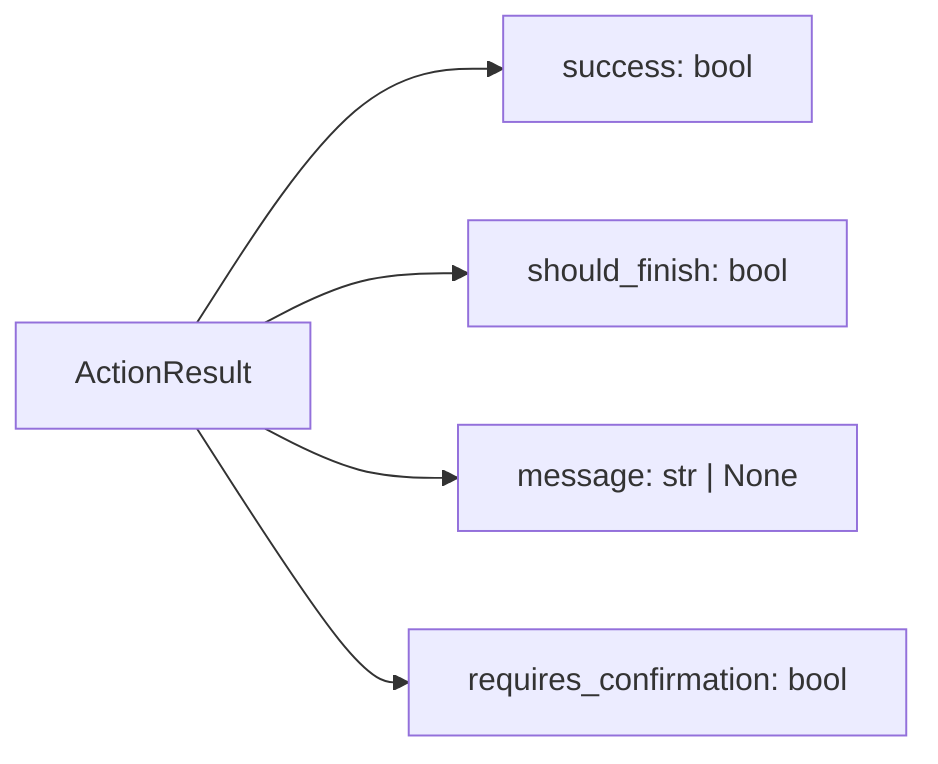
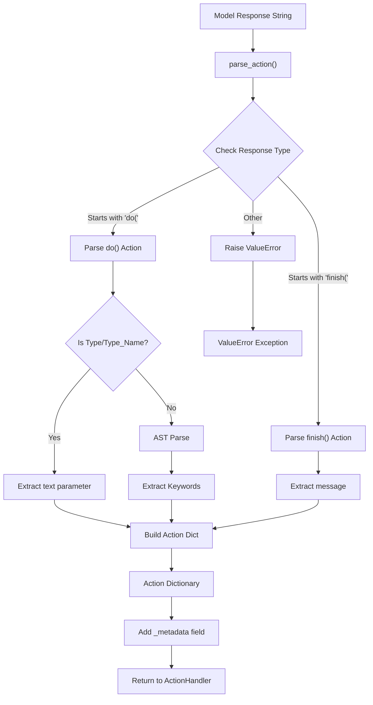
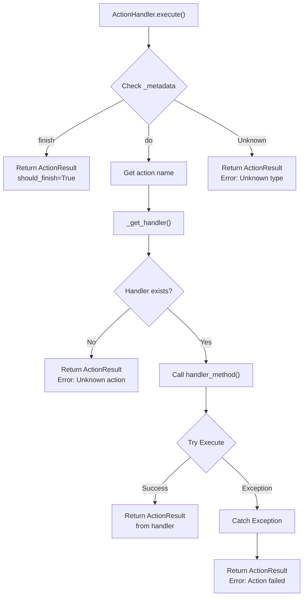
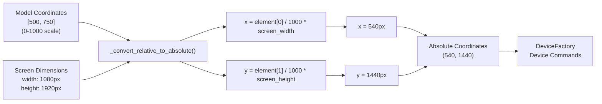
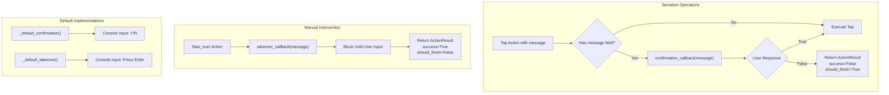
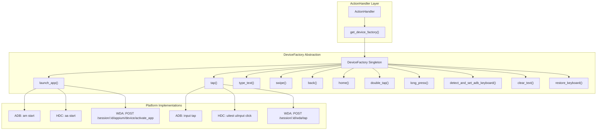
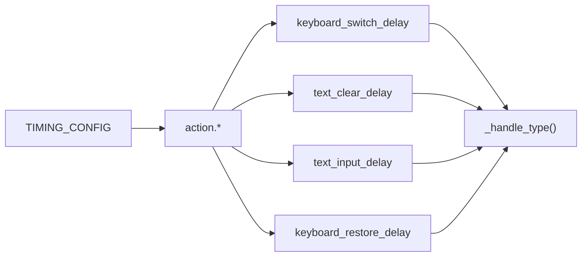
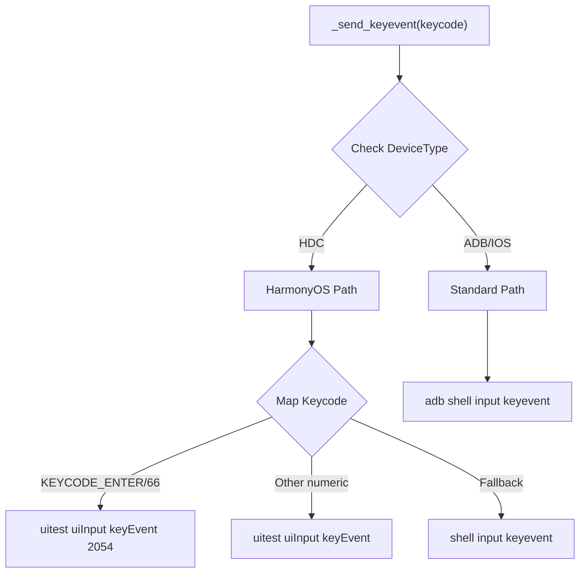
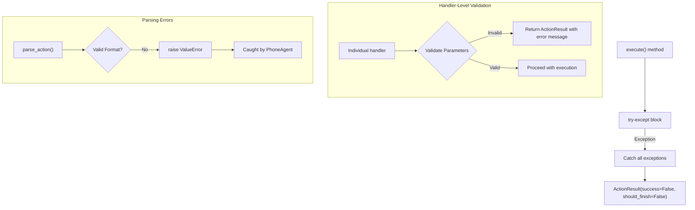

<!-- source: DeepWiki mcp.deepwiki.com · repo zai-org/Open-AutoGLM · page 6.2 ActionHandler Architecture · fetched 2026-10-29 -->

# ActionHandler Architecture

<details>
<summary>Relevant source files</summary>

The following files were used as context for generating this wiki page:

- [phone_agent/actions/handler.py](phone_agent/actions/handler.py)
- [phone_agent/device_factory.py](phone_agent/device_factory.py)

</details>


This document describes the internal architecture of the action parsing, validation, and execution system in Open-AutoGLM. The `ActionHandler` class serves as the bridge between AI model outputs and device operations, transforming natural language decisions into concrete device commands.

For information about available action types and their usage, see [Action Types Reference](#6.1). For implementing custom callbacks, see [Custom Callbacks](#6.3).

## Purpose and Scope

The ActionHandler subsystem is responsible for three primary functions:

1. **Parsing** - Converting raw AI model responses (strings) into structured action dictionaries
2. **Validation** - Ensuring actions contain required parameters and handling safety checks
3. **Execution** - Dispatching actions to the appropriate device operations via the DeviceFactory

This architecture enables the AI model to control mobile devices through a well-defined action interface while maintaining safety through confirmation callbacks and error handling.

## Core Components

The ActionHandler system consists of three main code entities defined in [phone_agent/actions/handler.py]():

| Component | Type | Purpose |
|-----------|------|---------|
| `ActionResult` | Dataclass | Encapsulates the outcome of action execution |
| `ActionHandler` | Class | Orchestrates parsing, validation, and execution |
| `parse_action()` | Function | Parses raw model responses into action dictionaries |

### ActionResult Dataclass

```
ActionResult Architecture (Lines 14-22)
```



The `ActionResult` dataclass [phone_agent/actions/handler.py:14-22]() contains four fields that communicate execution status back to the agent:

- **success** - Whether the action executed without errors
- **should_finish** - Whether the task should terminate (for `finish` actions or fatal errors)
- **message** - Optional human-readable message about the result
- **requires_confirmation** - Reserved for future sensitive operation flagging

**Sources:** [phone_agent/actions/handler.py:14-22]()

### ActionHandler Class

The `ActionHandler` class [phone_agent/actions/handler.py:24-330]() is instantiated once per agent session and maintains state for device communication and callback configuration.

#### Constructor Parameters

```
ActionHandler Initialization (Lines 35-43)
```

| Parameter | Type | Purpose |
|-----------|------|---------|
| `device_id` | `str \| None` | ADB/HDC/WDA device identifier for multi-device setups |
| `confirmation_callback` | `Callable[[str], bool] \| None` | User confirmation for sensitive operations |
| `takeover_callback` | `Callable[[str], None] \| None` | User intervention for manual operations |

If callbacks are not provided, default implementations using console input are used [phone_agent/actions/handler.py:321-329]().

**Sources:** [phone_agent/actions/handler.py:35-43](), [phone_agent/actions/handler.py:321-329]()

## Action Parsing Pipeline

The parsing pipeline transforms raw AI model responses into structured action dictionaries that can be executed.

```
Action Parsing Flow
```



### Parsing Implementation Details

The `parse_action()` function [phone_agent/actions/handler.py:332-387]() handles three response patterns:

**Pattern 1: Type Actions** [phone_agent/actions/handler.py:348-353]()
```
do(action="Type", text="Hello World")
```
Special handling because text may contain special characters that break AST parsing.

**Pattern 2: Standard do() Actions** [phone_agent/actions/handler.py:354-376]()
```
do(action="Tap", element=[500, 500])
```
Uses Abstract Syntax Tree (AST) parsing for safe evaluation without `eval()`.

**Pattern 3: finish() Actions** [phone_agent/actions/handler.py:378-382]()
```
finish(message="Task completed successfully")
```
Signals task completion with optional message.

**Sources:** [phone_agent/actions/handler.py:332-387]()

## Action Execution Flow

Once parsed, actions flow through validation and execution stages coordinated by the `execute()` method.

```
Action Execution Architecture
```



The `execute()` method [phone_agent/actions/handler.py:45-88]() takes three parameters:

- **action** - Parsed action dictionary
- **screen_width** - Current device screen width in pixels
- **screen_height** - Current device screen height in pixels

Screen dimensions are required for coordinate conversion from the model's relative coordinate system (0-1000) to absolute pixel coordinates.

**Sources:** [phone_agent/actions/handler.py:45-88]()

## Action Type Registry

The ActionHandler maintains a registry mapping action names to handler methods via the `_get_handler()` method [phone_agent/actions/handler.py:90-108]().

```
Action Handler Registry
```



```mermaid
graph TB
    subgraph "Action Types to Handler Methods"
        Launch["Launch"] --> HandleLaunch["_handle_launch()"]
        Tap["Tap"] --> HandleTap["_handle_tap()"]
        Type["Type / Type_Name"] --> HandleType["_handle_type()"]
        Swipe["Swipe"] --> HandleSwipe["_handle_swipe()"]
        Back["Back"] --> HandleBack["_handle_back()"]
        Home["Home"] --> HandleHome["_handle_home()"]
        DoubleTap["Double Tap"] --> HandleDoubleTap["_handle_double_tap()"]
        LongPress["Long Press"] --> HandleLongPress["_handle_long_press()"]
        Wait["Wait"] --> HandleWait["_handle_wait()"]
        Takeover["Take_over"] --> HandleTakeover["_handle_takeover()"]
        Note["Note"] --> HandleNote["_handle_note()"]
        CallAPI["Call_API"] --> HandleCallAPI["_handle_call_api()"]
        Interact["Interact"] --> HandleInteract["_handle_interact()"]
    end
    
    subgraph "Handler Method Categories"
        HandleLaunch --> AppLaunch["App Management"]
        HandleTap --> Gestures["Touch Gestures"]
        HandleDoubleTap --> Gestures
        HandleLongPress --> Gestures
        HandleType --> TextInput["Text Input"]
        HandleSwipe --> Gestures
        HandleBack --> Navigation["Navigation"]
        HandleHome --> Navigation
        HandleWait --> Timing["Timing Control"]
        HandleTakeover --> UserControl["User Intervention"]
        HandleNote --> ContentOps["Content Operations"]
        HandleCallAPI --> ContentOps
        HandleInteract --> UserControl
    end
```

### Handler Registry Implementation

The registry is defined as a dictionary [phone_agent/actions/handler.py:92-107]() mapping string action names to method references:

| Action Name | Handler Method | Lines |
|-------------|---------------|-------|
| `"Launch"` | `_handle_launch()` | 118-128 |
| `"Tap"` | `_handle_tap()` | 130-149 |
| `"Type"` / `"Type_Name"` | `_handle_type()` | 151-173 |
| `"Swipe"` | `_handle_swipe()` | 175-188 |
| `"Back"` | `_handle_back()` | 190-194 |
| `"Home"` | `_handle_home()` | 196-200 |
| `"Double Tap"` | `_handle_double_tap()` | 202-211 |
| `"Long Press"` | `_handle_long_press()` | 213-222 |
| `"Wait"` | `_handle_wait()` | 224-233 |
| `"Take_over"` | `_handle_takeover()` | 235-239 |
| `"Note"` | `_handle_note()` | 241-245 |
| `"Call_API"` | `_handle_call_api()` | 247-251 |
| `"Interact"` | `_handle_interact()` | 253-256 |

**Sources:** [phone_agent/actions/handler.py:90-108]()

## Coordinate Conversion System

The AI model outputs coordinates in a normalized system (0-1000 scale) to maintain device independence. The ActionHandler converts these to absolute pixel coordinates.

```
Coordinate Conversion Process
```



### Implementation

The `_convert_relative_to_absolute()` method [phone_agent/actions/handler.py:110-116]() implements the conversion:

```python
x = int(element[0] / 1000 * screen_width)
y = int(element[1] / 1000 * screen_height)
```

This conversion is used by all coordinate-based handlers:
- `_handle_tap()` [phone_agent/actions/handler.py:136]()
- `_handle_double_tap()` [phone_agent/actions/handler.py:208]()
- `_handle_long_press()` [phone_agent/actions/handler.py:219]()
- `_handle_swipe()` [phone_agent/actions/handler.py:183-184]() (for both start and end points)

**Sources:** [phone_agent/actions/handler.py:110-116](), [phone_agent/actions/handler.py:136](), [phone_agent/actions/handler.py:183-184](), [phone_agent/actions/handler.py:208](), [phone_agent/actions/handler.py:219]()

## Safety Mechanisms

The ActionHandler implements two safety mechanisms to prevent unintended operations and handle scenarios requiring human intervention.

```
Safety Callback Architecture
```



### Confirmation Callback

The confirmation callback [phone_agent/actions/handler.py:139-145]() is invoked when a `Tap` action includes a `message` field, indicating a sensitive operation (e.g., payment confirmation, data deletion).

**Default Implementation** [phone_agent/actions/handler.py:321-324]():
```python
response = input(f"Sensitive operation: {message}\nConfirm? (Y/N): ")
return response.upper() == "Y"
```

### Takeover Callback

The takeover callback [phone_agent/actions/handler.py:237-239]() is invoked for the `Take_over` action when the AI determines manual intervention is required (e.g., login, CAPTCHA, complex form).

**Default Implementation** [phone_agent/actions/handler.py:327-329]():
```python
input(f"{message}\nPress Enter after completing manual operation...")
```

Custom implementations can be provided during ActionHandler instantiation to integrate with different UI frameworks or automation workflows.

**Sources:** [phone_agent/actions/handler.py:35-43](), [phone_agent/actions/handler.py:139-145](), [phone_agent/actions/handler.py:237-239](), [phone_agent/actions/handler.py:321-329]()

## Device Integration

The ActionHandler does not directly communicate with devices. Instead, it uses the DeviceFactory abstraction layer to maintain platform independence.

```
ActionHandler to Device Communication Flow
```



### Device Factory Usage Pattern

All handler methods follow this pattern [phone_agent/actions/handler.py:124-128]():

```python
device_factory = get_device_factory()
success = device_factory.launch_app(app_name, self.device_id)
```

The `device_id` is passed to each DeviceFactory method to support multi-device scenarios.

### Special Case: Text Input

The text input handler [phone_agent/actions/handler.py:151-173]() has a complex workflow requiring multiple DeviceFactory calls:

1. **Save current keyboard** - `detect_and_set_adb_keyboard()` [phone_agent/actions/handler.py:158]()
2. **Wait for keyboard switch** - Uses `TIMING_CONFIG.action.keyboard_switch_delay` [phone_agent/actions/handler.py:159]()
3. **Clear existing text** - `clear_text()` [phone_agent/actions/handler.py:162]()
4. **Wait after clear** - Uses `TIMING_CONFIG.action.text_clear_delay` [phone_agent/actions/handler.py:163]()
5. **Type new text** - `type_text()` [phone_agent/actions/handler.py:166]()
6. **Wait after typing** - Uses `TIMING_CONFIG.action.text_input_delay` [phone_agent/actions/handler.py:167]()
7. **Restore original keyboard** - `restore_keyboard()` [phone_agent/actions/handler.py:170]()
8. **Wait after restore** - Uses `TIMING_CONFIG.action.keyboard_restore_delay` [phone_agent/actions/handler.py:171]()

This multi-step process ensures reliable text input across different keyboard implementations and device states.

**Sources:** [phone_agent/actions/handler.py:124](), [phone_agent/actions/handler.py:147-148](), [phone_agent/actions/handler.py:151-173](), [phone_agent/actions/handler.py:186-187]()

## Timing Configuration Integration

The ActionHandler integrates with the global timing configuration system defined in `phone_agent/config/timing.py`. This allows for consistent delays across all actions without hardcoding values.

```
Timing Configuration Usage
```



### Timing Values Used

| Configuration Key | Usage | Handler |
|-------------------|-------|---------|
| `TIMING_CONFIG.action.keyboard_switch_delay` | After switching to ADB keyboard | `_handle_type()` line 159 |
| `TIMING_CONFIG.action.text_clear_delay` | After clearing existing text | `_handle_type()` line 163 |
| `TIMING_CONFIG.action.text_input_delay` | After typing text | `_handle_type()` line 167 |
| `TIMING_CONFIG.action.keyboard_restore_delay` | After restoring keyboard | `_handle_type()` line 171 |

These timing values ensure reliable operation across devices with different performance characteristics. For more information about timing configuration, see [Timing Configuration](#7.3).

**Sources:** [phone_agent/actions/handler.py:10](), [phone_agent/actions/handler.py:159](), [phone_agent/actions/handler.py:163](), [phone_agent/actions/handler.py:167](), [phone_agent/actions/handler.py:171]()

## Platform-Specific Handling

While most device operations are abstracted through the DeviceFactory, the ActionHandler contains one platform-specific method for sending key events.

### _send_keyevent() Method

The `_send_keyevent()` method [phone_agent/actions/handler.py:258-318]() demonstrates platform-specific handling, particularly for HarmonyOS devices:

```
Platform-Specific Key Event Routing
```



HarmonyOS uses different key code values than Android:
- Android `KEYCODE_ENTER` (66) → HarmonyOS keyEvent 2054 [phone_agent/actions/handler.py:269-276]()

This method is currently internal but could be exposed for future action types requiring keyboard input (e.g., volume controls, media keys).

**Sources:** [phone_agent/actions/handler.py:258-318]()

## Helper Functions

The module provides two helper functions for programmatic action creation [phone_agent/actions/handler.py:390-399]():

```python
def do(**kwargs) -> dict[str, Any]:
    """Helper function for creating 'do' actions."""
    kwargs["_metadata"] = "do"
    return kwargs

def finish(**kwargs) -> dict[str, Any]:
    """Helper function for creating 'finish' actions."""
    kwargs["_metadata"] = "finish"
    return kwargs
```

These functions are useful when creating actions programmatically rather than parsing from model output:

```python
# Create a tap action
action = do(action="Tap", element=[500, 500])

# Create a finish action
action = finish(message="Task completed successfully")
```

**Sources:** [phone_agent/actions/handler.py:390-399]()

## Error Handling

The ActionHandler implements a layered error handling strategy:

```
Error Handling Hierarchy
```



### Error Handling Levels

**1. Parsing Level** [phone_agent/actions/handler.py:387]()
- `ValueError` exceptions for unparseable responses
- Propagated to calling agent for retry logic

**2. Validation Level** (within handlers)
- Missing required parameters (e.g., `element` for Tap) [phone_agent/actions/handler.py:133-134]()
- Invalid parameter values
- Returns `ActionResult(success=False, should_finish=False)` with descriptive message

**3. Execution Level** [phone_agent/actions/handler.py:83-88]()
- Catches all exceptions from handler methods
- Prevents crashes, allows task continuation
- Returns `ActionResult(success=False, should_finish=False, message=f"Action failed: {e}")`

This layered approach ensures graceful degradation and provides the agent with enough information to attempt recovery or alternative approaches.

**Sources:** [phone_agent/actions/handler.py:83-88](), [phone_agent/actions/handler.py:133-134](), [phone_agent/actions/handler.py:387]()

---

