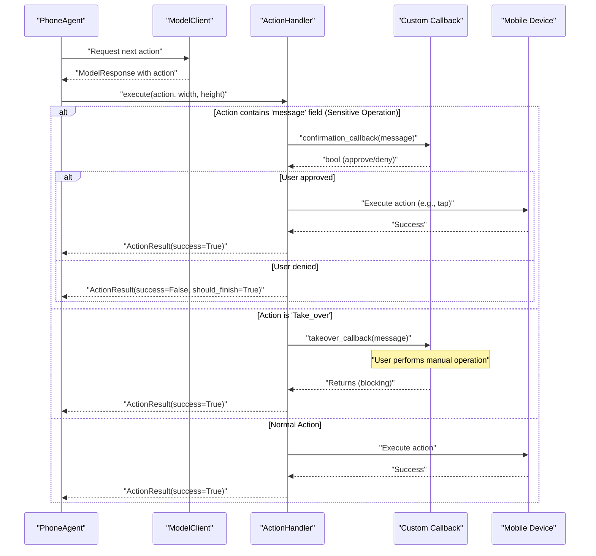
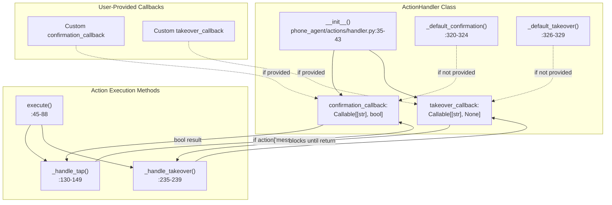

<!-- source: DeepWiki mcp.deepwiki.com · repo zai-org/Open-AutoGLM · page 6.3 Custom Callbacks · fetched 2026-10-29 -->

# Custom Callbacks

<details>
<summary>Relevant source files</summary>

The following files were used as context for generating this wiki page:

- [README_coding_agent.md](README_coding_agent.md)
- [README_en.md](README_en.md)
- [examples/basic_usage.py](examples/basic_usage.py)
- [examples/demo_thinking.py](examples/demo_thinking.py)
- [phone_agent/actions/handler.py](phone_agent/actions/handler.py)
- [phone_agent/config/prompts.py](phone_agent/config/prompts.py)

</details>


This page explains how to implement and use custom callback functions for handling sensitive operations and manual intervention scenarios. Custom callbacks allow you to control how the agent interacts with users during task execution when human input or approval is required.

For information about the action types that may trigger callbacks, see [Action Types Reference](#6.1). For details on the action execution architecture, see [ActionHandler Architecture](#6.2).

---

## Overview

The Open-AutoGLM framework provides two callback mechanisms to handle situations requiring human interaction:

1. **Confirmation Callback**: Requests user approval before executing sensitive operations (e.g., payment confirmations, data deletion)
2. **Takeover Callback**: Pauses execution for manual intervention (e.g., login screens, CAPTCHA challenges)

Both callbacks are optional. If not provided, the system uses default console-based implementations that prompt for user input via stdin.

**Sources:** [README.md:621-641](), [phone_agent/actions/handler.py:35-43]()

---

## Callback Types

### Confirmation Callback

The confirmation callback is invoked when the AI model requests approval before executing a potentially sensitive action. The model identifies sensitive operations and includes a `message` field in the action to trigger confirmation.

**Function Signature:**
```python
def confirmation_callback(message: str) -> bool:
    """
    Args:
        message: Description of the sensitive operation to confirm
    
    Returns:
        True to proceed with the operation, False to cancel
    """
```

**When It's Triggered:**
- Actions with a `message` field in the parsed action dictionary
- Typically for Tap actions near payment buttons, delete buttons, or other destructive operations
- The model determines what is "sensitive" based on its understanding of the UI

**Default Implementation:**

The default confirmation callback uses console input:

```python
@staticmethod
def _default_confirmation(message: str) -> bool:
    """Default confirmation callback using console input."""
    response = input(f"Sensitive operation: {message}\nConfirm? (Y/N): ")
    return response.upper() == "Y"
```

**Sources:** [phone_agent/actions/handler.py:138-145](), [phone_agent/actions/handler.py:320-324]()

---

### Takeover Callback

The takeover callback is invoked when the AI model determines it cannot proceed without human assistance. This typically occurs during login flows, CAPTCHA verification, or other scenarios requiring manual interaction.

**Function Signature:**
```python
def takeover_callback(message: str) -> None:
    """
    Args:
        message: Description of why manual intervention is needed
    
    Returns:
        None (execution continues after callback returns)
    """
```

**When It's Triggered:**
- Model outputs a `Take_over` action
- Login screens requiring credentials
- CAPTCHA challenges
- Two-factor authentication prompts
- Any scenario where the AI cannot autonomously complete the task

**Default Implementation:**

The default takeover callback pauses execution until the user presses Enter:

```python
@staticmethod
def _default_takeover(message: str) -> None:
    """Default takeover callback using console input."""
    input(f"{message}\nPress Enter after completing manual operation...")
```

**Sources:** [phone_agent/actions/handler.py:235-239](), [phone_agent/actions/handler.py:326-329]()

---

## Callback Registration

### During ActionHandler Initialization

Callbacks are registered when creating an `ActionHandler` instance:

```python
from phone_agent.actions.handler import ActionHandler

def my_confirmation(message: str) -> bool:
    # Custom confirmation logic
    return True

def my_takeover(message: str) -> None:
    # Custom takeover logic
    pass

handler = ActionHandler(
    device_id="device123",
    confirmation_callback=my_confirmation,
    takeover_callback=my_takeover
)
```

**Sources:** [phone_agent/actions/handler.py:35-43]()

---

### Through PhoneAgent/IOSPhoneAgent

For typical usage, callbacks are passed directly to the agent constructor:

```python
from phone_agent import PhoneAgent
from phone_agent.model import ModelConfig

def my_confirmation(message: str) -> bool:
    # Custom confirmation logic
    print(f"⚠️  Confirmation Required: {message}")
    return input("Proceed? (yes/no): ").lower() == "yes"

def my_takeover(message: str) -> None:
    # Custom takeover logic
    print(f"🛑 Manual Intervention Required")
    print(f"📋 Task: {message}")
    input("Press Enter when done...")

model_config = ModelConfig(
    base_url="http://localhost:8000/v1",
    model_name="autoglm-phone-9b"
)

agent = PhoneAgent(
    model_config=model_config,
    confirmation_callback=my_confirmation,
    takeover_callback=my_takeover
)

# Execute task with custom callbacks
agent.run("打开淘宝购买商品")
```

**Sources:** [README.md:625-641]()

---

## Callback Execution Flow

The following diagram shows how callbacks integrate into the agent's execution loop:



**Sources:** [phone_agent/actions/handler.py:45-88](), [phone_agent/actions/handler.py:130-149](), [phone_agent/actions/handler.py:235-239]()

---

## Implementation Examples

### GUI-Based Confirmation

Example using a graphical dialog instead of console input:

```python
import tkinter as tk
from tkinter import messagebox

def gui_confirmation(message: str) -> bool:
    """Display a GUI confirmation dialog."""
    root = tk.Tk()
    root.withdraw()  # Hide main window
    result = messagebox.askyesno(
        "Confirm Sensitive Operation",
        message
    )
    root.destroy()
    return result

agent = PhoneAgent(
    model_config=model_config,
    confirmation_callback=gui_confirmation
)
```

---

### Logging Takeover Events

Example that logs all takeover requests to a file:

```python
import logging
from datetime import datetime

logging.basicConfig(
    filename='takeover_log.txt',
    level=logging.INFO,
    format='%(asctime)s - %(message)s'
)

def logged_takeover(message: str) -> None:
    """Log takeover events and pause for manual intervention."""
    timestamp = datetime.now().isoformat()
    logging.info(f"Takeover requested: {message}")
    
    print(f"\n{'='*50}")
    print(f"🛑 MANUAL INTERVENTION REQUIRED")
    print(f"📅 Time: {timestamp}")
    print(f"📋 Reason: {message}")
    print(f"{'='*50}\n")
    
    input("Complete the manual operation, then press Enter...")
    logging.info(f"Takeover completed: {message}")

agent = PhoneAgent(
    model_config=model_config,
    takeover_callback=logged_takeover
)
```

---

### Automated Approval for Testing

Example that automatically approves all confirmations (useful for automated testing):

```python
def auto_approve_confirmation(message: str) -> bool:
    """Automatically approve all confirmations (for testing only)."""
    print(f"⚠️  Auto-approving: {message}")
    return True

def no_takeover(message: str) -> None:
    """Fail immediately on takeover requests (for testing only)."""
    raise RuntimeError(f"Takeover required but not supported: {message}")

# WARNING: Only use in controlled test environments
agent = PhoneAgent(
    model_config=model_config,
    confirmation_callback=auto_approve_confirmation,
    takeover_callback=no_takeover
)
```

---

### Remote Callback Service

Example that delegates callback decisions to a remote service:

```python
import requests

def remote_confirmation(message: str) -> bool:
    """Send confirmation request to remote approval service."""
    response = requests.post(
        "https://approval-service.example.com/confirm",
        json={"message": message, "task_id": current_task_id},
        timeout=300  # Wait up to 5 minutes for approval
    )
    return response.json().get("approved", False)

def remote_takeover(message: str) -> None:
    """Notify remote service of takeover requirement."""
    requests.post(
        "https://approval-service.example.com/takeover",
        json={"message": message, "task_id": current_task_id}
    )
    
    # Poll for completion
    while True:
        response = requests.get(
            f"https://approval-service.example.com/status/{current_task_id}"
        )
        if response.json().get("completed"):
            break
        time.sleep(5)
```

---

## Action Handler Integration

The following diagram shows how callbacks are integrated into the `ActionHandler` class:



**Sources:** [phone_agent/actions/handler.py:24-43](), [phone_agent/actions/handler.py:130-149](), [phone_agent/actions/handler.py:235-239]()

---

## Callback Behavior Details

### Confirmation Callback Return Values

| Return Value | Behavior | ActionResult |
|--------------|----------|--------------|
| `True` | Action proceeds normally | `ActionResult(success=True, should_finish=False)` |
| `False` | Action cancelled, task terminates | `ActionResult(success=False, should_finish=True, message="User cancelled...")` |

The `should_finish=True` flag when returning `False` causes the entire task execution to stop, not just the current action.

**Sources:** [phone_agent/actions/handler.py:138-145]()

---

### Takeover Callback Blocking

The takeover callback is **synchronous and blocking**. The agent execution pauses until the callback function returns. During this time:

- No screenshots are captured
- No AI model calls are made
- The device remains in its current state
- The user has full control to manually complete the required operation

After the callback returns, the agent captures a fresh screenshot and continues the execution loop.

**Sources:** [phone_agent/actions/handler.py:235-239]()

---

## Action Types That Trigger Callbacks

### Confirmation-Triggering Actions

Only actions with a `message` field trigger the confirmation callback:

```python
# Example action from model that triggers confirmation
{
    "_metadata": "do",
    "action": "Tap",
    "element": [500, 800],
    "message": "确认支付 ¥299.00"  # Presence of 'message' triggers callback
}
```

Currently, only `Tap` actions check for the `message` field, though the pattern could be extended to other action types.

**Sources:** [phone_agent/actions/handler.py:138-145]()

---

### Takeover-Triggering Actions

The `Take_over` action explicitly requests manual intervention:

```python
# Example Take_over action from model
{
    "_metadata": "do",
    "action": "Take_over",
    "message": "请手动完成登录并输入验证码"
}
```

**Sources:** [phone_agent/actions/handler.py:102-103](), [phone_agent/actions/handler.py:235-239]()

---

## Best Practices

### 1. Provide Clear Messages

Always display the full message to users:

```python
def good_confirmation(message: str) -> bool:
    print(f"\n{'='*60}")
    print(f"⚠️  CONFIRMATION REQUIRED")
    print(f"{'='*60}")
    print(f"\n{message}\n")
    print(f"{'='*60}")
    response = input("Type 'yes' to confirm, 'no' to cancel: ")
    return response.lower() == 'yes'
```

---

### 2. Handle Exceptions Gracefully

Protect against exceptions in callback implementations:

```python
def safe_confirmation(message: str) -> bool:
    try:
        return custom_confirmation_logic(message)
    except Exception as e:
        print(f"Error in confirmation callback: {e}")
        # Default to safe behavior (deny)
        return False

def safe_takeover(message: str) -> None:
    try:
        custom_takeover_logic(message)
    except Exception as e:
        print(f"Error in takeover callback: {e}")
        # Still need to pause for user
        input("Press Enter to continue...")
```

---

### 3. Support Non-Interactive Environments

For automated execution or non-TTY environments, provide appropriate fallbacks:

```python
import sys

def smart_confirmation(message: str) -> bool:
    if not sys.stdin.isatty():
        # Non-interactive environment: log and auto-deny
        logging.warning(f"Confirmation required but no TTY: {message}")
        return False
    return input(f"Confirm: {message} (y/n): ").lower() == 'y'
```

---

### 4. Implement Timeouts

For long-running takeover operations, consider implementing timeouts:

```python
import signal
from contextlib import contextmanager

@contextmanager
def timeout(seconds):
    def timeout_handler(signum, frame):
        raise TimeoutError()
    
    signal.signal(signal.SIGALRM, timeout_handler)
    signal.alarm(seconds)
    try:
        yield
    finally:
        signal.alarm(0)

def timeout_takeover(message: str) -> None:
    print(f"Manual intervention required: {message}")
    print("You have 5 minutes to complete this operation.")
    
    try:
        with timeout(300):  # 5 minutes
            input("Press Enter when done...")
    except TimeoutError:
        print("Timeout! Operation considered incomplete.")
        raise
```

---

### 5. Maintain State Across Callbacks

For complex workflows, track callback history:

```python
class CallbackTracker:
    def __init__(self):
        self.confirmations = []
        self.takeovers = []
    
    def confirmation_callback(self, message: str) -> bool:
        self.confirmations.append({
            'message': message,
            'timestamp': datetime.now(),
            'approved': None
        })
        
        # Get user decision
        approved = input(f"Confirm: {message} (y/n): ").lower() == 'y'
        
        # Record decision
        self.confirmations[-1]['approved'] = approved
        return approved
    
    def takeover_callback(self, message: str) -> None:
        self.takeovers.append({
            'message': message,
            'timestamp': datetime.now()
        })
        input(f"{message}\nPress Enter when done...")
    
    def get_summary(self):
        return {
            'total_confirmations': len(self.confirmations),
            'approved_confirmations': sum(1 for c in self.confirmations if c['approved']),
            'total_takeovers': len(self.takeovers)
        }

# Usage
tracker = CallbackTracker()
agent = PhoneAgent(
    model_config=model_config,
    confirmation_callback=tracker.confirmation_callback,
    takeover_callback=tracker.takeover_callback
)
agent.run("完成任务")
print(tracker.get_summary())
```

---

## Callback Execution Context

The following table shows the execution context when callbacks are invoked:

| Context Property | Value | Notes |
|-----------------|-------|-------|
| Thread | Main execution thread | Callbacks run synchronously |
| Device State | Frozen at last action | No new screenshots during callback |
| Model State | Idle | No model calls during callback |
| Action Queue | Paused | Next action awaits callback return |
| User Control | Full manual access | User can interact with device |

**Sources:** [phone_agent/actions/handler.py:45-88]()

---

## Testing Callbacks

### Unit Testing Confirmation Logic

```python
def test_confirmation_approved():
    # Mock user approving
    def mock_confirm(message: str) -> bool:
        assert "sensitive" in message.lower()
        return True
    
    handler = ActionHandler(confirmation_callback=mock_confirm)
    action = {
        "_metadata": "do",
        "action": "Tap",
        "element": [500, 500],
        "message": "Sensitive operation"
    }
    
    result = handler.execute(action, 1080, 1920)
    assert result.success == True
    assert result.should_finish == False

def test_confirmation_denied():
    # Mock user denying
    def mock_confirm(message: str) -> bool:
        return False
    
    handler = ActionHandler(confirmation_callback=mock_confirm)
    action = {
        "_metadata": "do",
        "action": "Tap",
        "element": [500, 500],
        "message": "Sensitive operation"
    }
    
    result = handler.execute(action, 1080, 1920)
    assert result.success == False
    assert result.should_finish == True  # Task terminates
```

---

### Unit Testing Takeover Logic

```python
def test_takeover_callback_invoked():
    takeover_called = False
    takeover_message = None
    
    def mock_takeover(message: str) -> None:
        nonlocal takeover_called, takeover_message
        takeover_called = True
        takeover_message = message
    
    handler = ActionHandler(takeover_callback=mock_takeover)
    action = {
        "_metadata": "do",
        "action": "Take_over",
        "message": "Please login manually"
    }
    
    result = handler.execute(action, 1080, 1920)
    
    assert takeover_called == True
    assert takeover_message == "Please login manually"
    assert result.success == True
    assert result.should_finish == False  # Execution continues
```

**Sources:** [phone_agent/actions/handler.py:45-88]()

---

## Common Pitfalls

### 1. Forgetting to Return Values

**Incorrect:**
```python
def bad_confirmation(message: str):
    input(f"{message} - OK? ")
    # Missing return statement!
```

The callback must return `True` or `False`. Without a return, the function returns `None`, which is falsy and cancels the operation.

---

### 2. Blocking Forever in Takeover

**Incorrect:**
```python
def bad_takeover(message: str) -> None:
    while True:
        if some_condition_that_never_happens:
            break
    # Never returns!
```

Ensure takeover callbacks always return eventually. Use timeouts if necessary.

---

### 3. Modifying Device State in Callbacks

**Incorrect:**
```python
def bad_takeover(message: str) -> None:
    # Don't send device commands from within callback!
    device_factory.tap(100, 100)
    input("Press Enter...")
```

Callbacks should only handle user interaction. Device commands should come from the main execution loop.

---

### 4. Raising Exceptions

**Incorrect:**
```python
def bad_confirmation(message: str) -> bool:
    if "dangerous" in message:
        raise ValueError("Too dangerous!")  # Will break execution
    return True
```

Handle errors within the callback and return appropriate boolean values instead of raising exceptions.

**Sources:** [phone_agent/actions/handler.py:83-88]()

---

## Summary

Custom callbacks provide a flexible mechanism for handling human-in-the-loop scenarios:

- **Confirmation callbacks** enable user approval for sensitive operations
- **Takeover callbacks** pause execution for manual intervention
- Both callbacks are optional with console-based defaults
- Callbacks run synchronously on the main execution thread
- Proper error handling and timeouts are essential for robust implementations

**Sources:** [README.md:621-641](), [phone_agent/actions/handler.py:24-330]()

---

