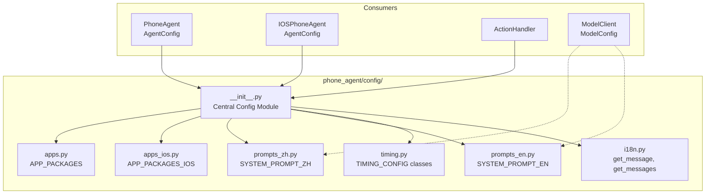
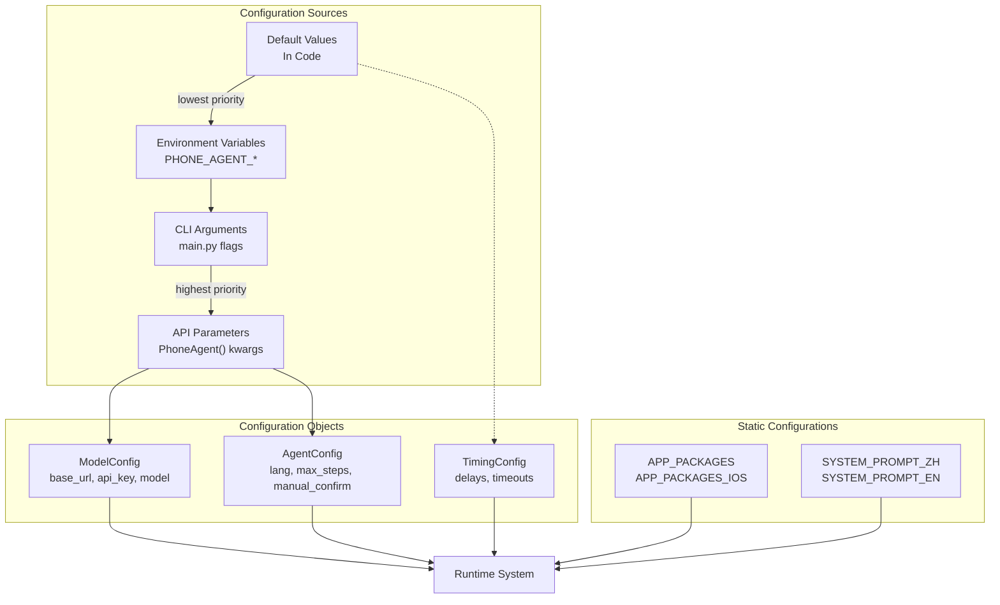
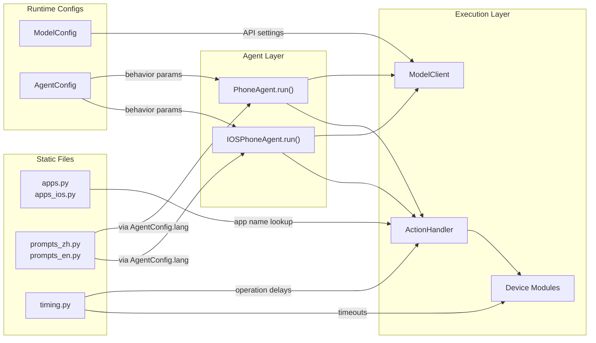

<!-- source: DeepWiki mcp.deepwiki.com · repo zai-org/Open-AutoGLM · page 7 Configuration Reference · fetched 2026-10-29 -->

# Configuration Reference

<details>
<summary>Relevant source files</summary>

The following files were used as context for generating this wiki page:

- [phone_agent/config/__init__.py](phone_agent/config/__init__.py)
- [phone_agent/config/apps.py](phone_agent/config/apps.py)
- [phone_agent/config/prompts_en.py](phone_agent/config/prompts_en.py)
- [phone_agent/config/prompts_zh.py](phone_agent/config/prompts_zh.py)

</details>


This page provides a comprehensive reference for all configuration files, modules, and options in Open-AutoGLM. It covers the structure of the configuration system, the types of configurations available, and how they are loaded and used at runtime.

For basic configuration setup and environment variables, see [Configuration Basics](#2.3). For practical configuration management in different usage scenarios, see [Configuration Management](#5.4). This page focuses on the technical structure and available configuration options.

## Purpose and Scope

The Open-AutoGLM configuration system provides structured settings for:

- **Application Packages**: Mappings from application names to platform-specific package identifiers (detailed in [Application Packages](#7.1))
- **System Prompts**: Multilingual prompts that guide the AI model's behavior (detailed in [System Prompts](#7.2))
- **Timing Parameters**: Delays and timeouts for device operations (detailed in [Timing Configuration](#7.3))
- **Internationalization**: User-facing messages in multiple languages

All configuration modules are located in [phone_agent/config/]() and are imported through the central configuration module.

## Configuration Module Structure

The configuration system is organized into specialized modules, each responsible for a specific aspect of system behavior.



**Configuration Module Exports**

The central module [phone_agent/config/__init__.py:1-54]() exports the following public interfaces:

| Export | Type | Description | Source Module |
|--------|------|-------------|---------------|
| `APP_PACKAGES` | `dict[str, str]` | Android/HarmonyOS app name to package ID mappings | `apps.py` |
| `APP_PACKAGES_IOS` | `dict[str, str]` | iOS app name to bundle ID mappings | `apps_ios.py` |
| `SYSTEM_PROMPT_ZH` | `str` | Chinese system prompt template | `prompts_zh.py` |
| `SYSTEM_PROMPT_EN` | `str` | English system prompt template | `prompts_en.py` |
| `get_system_prompt()` | `function` | Retrieves prompt by language code | `__init__.py` |
| `TIMING_CONFIG` | `TimingConfig` | Global timing configuration instance | `timing.py` |
| `TimingConfig` | `class` | Container for all timing parameters | `timing.py` |
| `ActionTimingConfig` | `class` | Action-specific timing parameters | `timing.py` |
| `DeviceTimingConfig` | `class` | Device operation timing parameters | `timing.py` |
| `ConnectionTimingConfig` | `class` | Connection management timing parameters | `timing.py` |
| `get_timing_config()` | `function` | Retrieves current timing configuration | `timing.py` |
| `update_timing_config()` | `function` | Updates timing configuration at runtime | `timing.py` |
| `get_message()` | `function` | Retrieves single i18n message | `i18n.py` |
| `get_messages()` | `function` | Retrieves multiple i18n messages | `i18n.py` |

Sources: [phone_agent/config/__init__.py:1-54]()

## Configuration Loading Hierarchy

Configurations are loaded and applied in a hierarchical manner, with each source potentially overriding previous values.



**Priority Order** (highest to lowest):
1. API parameters passed to `PhoneAgent()` or `IOSPhoneAgent()` constructors
2. CLI arguments from `main.py` (e.g., `--base-url`, `--model`, `--lang`)
3. Environment variables (e.g., `PHONE_AGENT_BASE_URL`, `PHONE_AGENT_API_KEY`)
4. Default values defined in code

**Note**: Static configurations like `APP_PACKAGES` and system prompts are typically not overridden at runtime, though the system prompt language is selected via the `lang` parameter in `AgentConfig`.

Sources: [phone_agent/config/__init__.py:1-54]()

## Configuration Categories

### Application Packages

Maps human-readable application names to platform-specific identifiers:

- **Android/HarmonyOS**: Package names (e.g., `"com.android.chrome"`)
- **iOS**: Bundle identifiers (e.g., `"com.apple.mobilesafari"`)

The `APP_PACKAGES` dictionary contains 130+ Android mappings and 60+ HarmonyOS mappings, while `APP_PACKAGES_IOS` contains 50+ iOS mappings. These are used by the `Launch` action to translate user commands like "open Chrome" into device-specific launch commands.

**Code References**:
- [phone_agent/config/apps.py]() - Android/HarmonyOS packages
- [phone_agent/config/apps_ios.py]() - iOS bundles

For detailed documentation, see [Application Packages](#7.1).

### System Prompts

Template strings that provide instructions to the vision-language model. The prompts define:

- Available action types and their syntax
- Output format requirements
- Behavioral guidelines (e.g., when to confirm sensitive actions)
- Task completion criteria

The system provides two prompt variants accessed via `get_system_prompt(lang)`:

```python
# From phone_agent/config/__init__.py:19-31
def get_system_prompt(lang: str = "cn") -> str:
    """Get system prompt by language."""
    if lang == "en":
        return SYSTEM_PROMPT_EN
    return SYSTEM_PROMPT_ZH
```

**Code References**:
- [phone_agent/config/prompts_zh.py]() - Chinese prompt
- [phone_agent/config/prompts_en.py]() - English prompt
- [phone_agent/config/__init__.py:19-31]() - Selection function

For detailed documentation, see [System Prompts](#7.2).

### Timing Configuration

Controls delays and timeouts throughout the system using structured configuration classes:

| Configuration Class | Purpose | Key Parameters |
|---------------------|---------|----------------|
| `TimingConfig` | Root container | `action`, `device`, `connection` |
| `ActionTimingConfig` | Action execution delays | `default_delay`, `swipe_duration` |
| `DeviceTimingConfig` | Device operation timeouts | `screenshot_timeout`, `install_timeout` |
| `ConnectionTimingConfig` | Connection management | `connect_timeout`, `retry_delay` |

The global `TIMING_CONFIG` instance can be accessed and modified at runtime:

```python
from phone_agent.config import get_timing_config, update_timing_config

# Get current config
config = get_timing_config()

# Modify specific values
update_timing_config(action_default_delay=2.0)
```

**Code References**:
- [phone_agent/config/timing.py]() - All timing classes and defaults
- [phone_agent/config/__init__.py:8-16]() - Public timing API

For detailed documentation, see [Timing Configuration](#7.3).

### Internationalization Messages

Provides user-facing messages in multiple languages through `get_message()` and `get_messages()` functions. These are used for:

- CLI output messages
- Error messages
- Confirmation prompts
- Status updates

**Code References**:
- [phone_agent/config/i18n.py]() - Message definitions and retrieval functions
- [phone_agent/config/__init__.py:5]() - Public i18n API

## Configuration Data Flow

This diagram illustrates how different configuration types flow from their sources to the runtime components that consume them.



Sources: [phone_agent/config/__init__.py:1-54]()

## Usage Patterns

### Importing Configuration Elements

```python
# Import all config elements
from phone_agent.config import (
    APP_PACKAGES,
    APP_PACKAGES_IOS,
    SYSTEM_PROMPT_ZH,
    SYSTEM_PROMPT_EN,
    get_system_prompt,
    TIMING_CONFIG,
    get_timing_config,
    update_timing_config,
)

# Get system prompt by language
prompt = get_system_prompt(lang="en")

# Access app package mapping
chrome_package = APP_PACKAGES.get("Chrome")

# Access timing parameters
action_delay = TIMING_CONFIG.action.default_delay
```

### Runtime Configuration Access

Configuration objects are typically passed through the `AgentConfig` and `ModelConfig` classes rather than accessed directly. However, timing configuration can be queried and modified at runtime:

```python
from phone_agent.config import update_timing_config

# Increase delays for slower devices
update_timing_config(
    action_default_delay=3.0,
    screenshot_timeout=10.0
)
```

Sources: [phone_agent/config/__init__.py:1-54]()

## Related Pages

- [Configuration Basics](#2.3) - Initial setup and environment variables
- [Configuration Management](#5.4) - Practical configuration in different usage scenarios
- [Application Packages](#7.1) - Complete app package mapping reference
- [System Prompts](#7.2) - System prompt templates and customization
- [Timing Configuration](#7.3) - Detailed timing parameters and tuning

---

