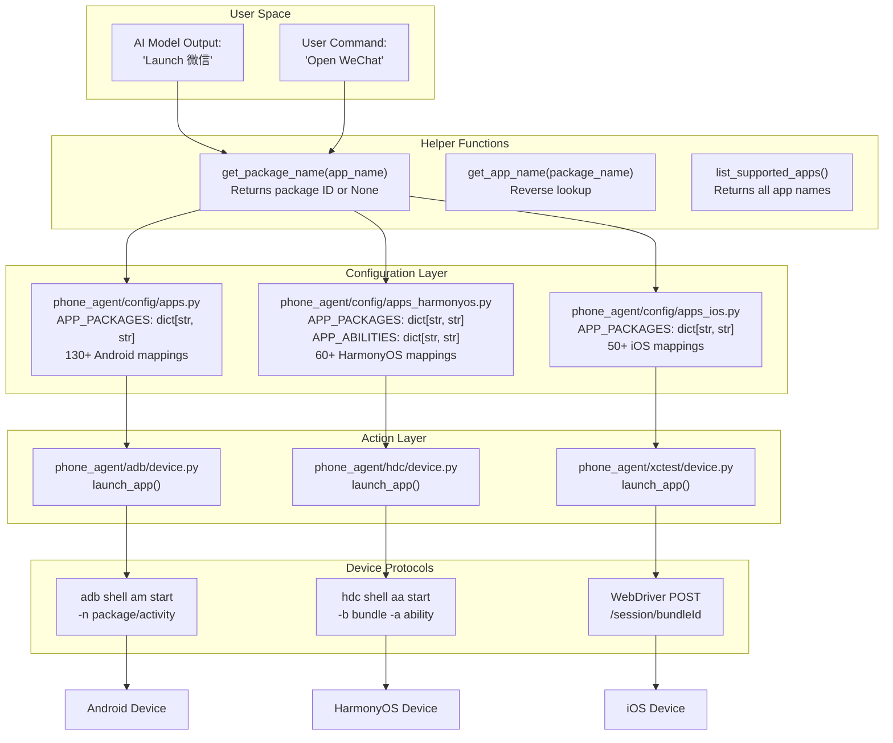
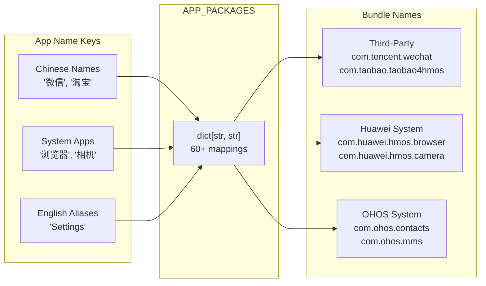
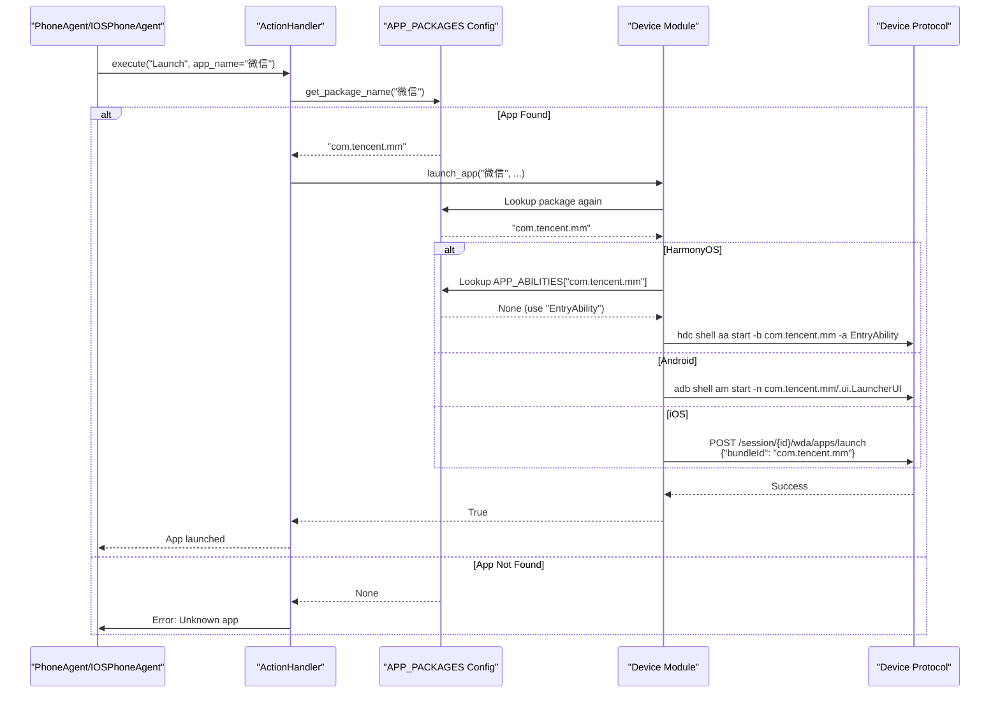
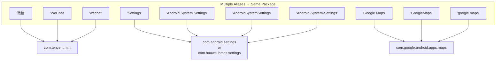
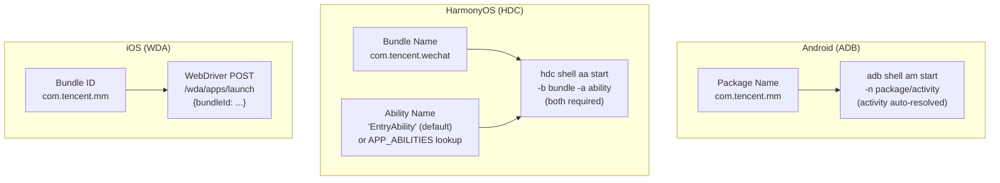

<!-- source: DeepWiki mcp.deepwiki.com · repo zai-org/Open-AutoGLM · page 7.1 Application Packages · fetched 2026-10-29 -->

# Application Packages

<details>
<summary>Relevant source files</summary>

The following files were used as context for generating this wiki page:

- [README_coding_agent.md](README_coding_agent.md)
- [README_en.md](README_en.md)
- [phone_agent/config/apps.py](phone_agent/config/apps.py)
- [phone_agent/config/apps_harmonyos.py](phone_agent/config/apps_harmonyos.py)
- [phone_agent/hdc/device.py](phone_agent/hdc/device.py)

</details>


This document describes how Open-AutoGLM maps user-friendly application names to platform-specific package identifiers. The `APP_PACKAGES` configuration enables the system to launch applications by name across Android, HarmonyOS, and iOS platforms using their respective debug protocols.

For information about launching apps via actions, see [Action Types Reference](#6.1). For timing configuration of launch operations, see [Timing Configuration](#7.3).

## Overview

Mobile operating systems identify applications using unique package identifiers rather than display names. Open-AutoGLM maintains dictionaries that map natural language app names (e.g., "微信", "WeChat") to their platform-specific identifiers:

- **Android**: Package names (e.g., `com.tencent.mm`)
- **HarmonyOS**: Bundle names (e.g., `com.tencent.wechat`) and ability names
- **iOS**: Bundle identifiers (similar to Android package names)

These mappings enable the AI model to reference applications by common names while the system translates them to the technical identifiers required by device protocols.

## Architecture



**Sources:** [phone_agent/config/apps.py:1-227](), [phone_agent/config/apps_harmonyos.py:1-267](), [phone_agent/hdc/device.py:220-266]()

## Platform-Specific Configurations

### Android Package Mappings

The Android configuration maps app names to Java-style package names used by the Android Package Manager. The dictionary is defined in `phone_agent/config/apps.py`.

**Key characteristics:**
- Package names follow reverse-domain notation (e.g., `com.company.appname`)
- Supports both Chinese and English app names as keys
- Case-sensitive with multiple aliases for common variations
- Used with `adb shell am start` commands

**Example entries:**

| App Name | Package Name | Category |
|----------|-------------|----------|
| 微信 | com.tencent.mm | Social |
| WeChat | com.tencent.mm | Social |
| 淘宝 | com.taobao.taobao | E-commerce |
| bilibili | tv.danmaku.bili | Video |
| Settings | com.android.settings | System |
| Google Maps | com.google.android.apps.maps | Navigation |

**Sources:** [phone_agent/config/apps.py:3-188]()

### HarmonyOS Bundle Mappings

HarmonyOS uses a two-part identification system: bundle names and ability names. The configuration is split across two dictionaries in `phone_agent/config/apps_harmonyos.py`.

#### APP_PACKAGES Dictionary

Maps app names to HarmonyOS bundle names (similar to Android packages):



**Sources:** [phone_agent/config/apps_harmonyos.py:59-227]()

#### APP_ABILITIES Dictionary

Maps bundle names to their entry ability names. HarmonyOS requires specifying which "ability" (entry point) to launch within a bundle:

```python
# Default ability: "EntryAbility" (used if not in APP_ABILITIES)
# Custom abilities for specific apps:
APP_ABILITIES = {
    "com.taobao.taobao4hmos": "Taobao_mainAbility",
    "com.huawei.hmos.browser": "MainAbility",
    "com.huawei.hmos.settings": "com.huawei.hmos.settings.MainAbility",
    # ... more custom abilities
}
```

**Common ability patterns:**

| Ability Name | Usage |
|--------------|-------|
| EntryAbility | Default for most apps (implicit) |
| MainAbility | Common for Huawei system apps |
| {package}.MainAbility | Fully-qualified ability name |
| {Custom}Ability | App-specific entry point |

The launch process queries `APP_ABILITIES` for the bundle name, falling back to `"EntryAbility"` if not found:

[phone_agent/hdc/device.py:245-248]()

**Sources:** [phone_agent/config/apps_harmonyos.py:7-57](), [phone_agent/hdc/device.py:220-266]()

### iOS Bundle Identifiers

iOS uses bundle identifiers similar to Android package names. While the configuration file is not shown in the provided sources, the architecture diagrams indicate approximately 50+ iOS app mappings following the same pattern as Android.

**Expected structure:**
- Dictionary in `phone_agent/config/apps_ios.py`
- Same helper functions: `get_package_name()`, `get_app_name()`, `list_supported_apps()`
- Bundle IDs used with WebDriverAgent API

## Data Flow: Name Resolution to Launch



**Sources:** [phone_agent/config/apps.py:191-201](), [phone_agent/config/apps_harmonyos.py:230-240](), [phone_agent/hdc/device.py:220-266]()

## Helper Functions

All three platform configurations provide identical helper functions for package name lookup and management.

### get_package_name()

Retrieves the package/bundle identifier for a given app name.

```python
def get_package_name(app_name: str) -> str | None:
    """
    Get the package name for an app.

    Args:
        app_name: The display name of the app.

    Returns:
        The package name, or None if not found.
    """
    return APP_PACKAGES.get(app_name)
```

**Usage:**
```python
# Returns: "com.tencent.mm"
package = get_package_name("微信")

# Returns: None (app not configured)
package = get_package_name("UnknownApp")
```

**Sources:** [phone_agent/config/apps.py:191-201](), [phone_agent/config/apps_harmonyos.py:230-240]()

### get_app_name()

Performs reverse lookup to find the display name for a package identifier.

```python
def get_app_name(package_name: str) -> str | None:
    """
    Get the app name from a package name.

    Args:
        package_name: The package identifier.

    Returns:
        The display name of the app, or None if not found.
    """
    for name, package in APP_PACKAGES.items():
        if package == package_name:
            return name
    return None
```

**Note:** When multiple app names map to the same package, this returns the first match found during dictionary iteration.

**Sources:** [phone_agent/config/apps.py:204-217](), [phone_agent/config/apps_harmonyos.py:243-256]()

### list_supported_apps()

Returns all configured app names for a platform.

```python
def list_supported_apps() -> list[str]:
    """
    Get a list of all supported app names.

    Returns:
        List of app names.
    """
    return list(APP_PACKAGES.keys())
```

**Sources:** [phone_agent/config/apps.py:220-227](), [phone_agent/config/apps_harmonyos.py:259-266]()

## Application Categories

The configurations organize apps by functional category for maintainability. This table shows the distribution across platforms:

| Category | Example Apps | Android | HarmonyOS | iOS (est.) |
|----------|-------------|---------|-----------|------------|
| Social & Messaging | 微信, QQ, 微博 | ✓ | ✓ | ✓ |
| E-commerce | 淘宝, 京东, 拼多多 | ✓ | ✓ | ✓ |
| Maps & Navigation | 高德地图, 百度地图 | ✓ | ✓ | ✓ |
| Video & Entertainment | bilibili, 抖音, 腾讯视频 | ✓ | ✓ | ✓ |
| Music & Audio | 网易云音乐, QQ音乐 | ✓ | Partial | ✓ |
| Food & Services | 美团, 饿了么 | ✓ | Partial | ✓ |
| System Apps | Settings, Files, Camera | ✓ | ✓ | ✓ |
| Productivity | 飞书, Gmail, Google Drive | ✓ | Limited | ✓ |
| Games | 星穹铁道, 恋与深空 | ✓ | Limited | ✓ |

**Platform coverage:**
- **Android**: 130+ apps, comprehensive coverage including international apps
- **HarmonyOS**: 60+ apps, focused on Chinese market and Huawei ecosystem
- **iOS**: 50+ apps (estimated), international focus

**Sources:** [phone_agent/config/apps.py:4-188](), [phone_agent/config/apps_harmonyos.py:60-227]()

## Name Aliases and Case Sensitivity

Both configurations support multiple name variations for the same application:



**Common alias patterns:**
- **Language variants**: "微信" and "WeChat" for the same app
- **Spacing variations**: "Google Maps", "google maps", "GoogleMaps"
- **Punctuation variants**: "Google-Clock", "Google Clock", "GoogleClock"
- **Case variations**: "gmail", "Gmail", "GoogleMail"

**Lookup is case-sensitive**: The exact string must match a dictionary key. The AI model is trained to output names that match the dictionary keys.

**Sources:** [phone_agent/config/apps.py:71-188](), [phone_agent/config/apps_harmonyos.py:189-194]()

## Extending the Configuration

### Adding New Android Apps

1. Identify the package name using `adb shell pm list packages | grep <keyword>`
2. Add entry to [phone_agent/config/apps.py]():

```python
APP_PACKAGES: dict[str, str] = {
    # ... existing entries ...
    "App Display Name": "com.example.package",
    "应用名称": "com.example.package",  # Add Chinese if applicable
    # ... more entries ...
}
```

3. Test with: `python -m phone_agent.config.apps` (if test code exists)

### Adding New HarmonyOS Apps

1. List installed apps: `hdc shell bm dump -a`
2. Identify bundle name and locate ability using `hdc shell aa dump -a <bundle>`
3. Add to [phone_agent/config/apps_harmonyos.py]():

```python
# If using default "EntryAbility", only add to APP_PACKAGES:
APP_PACKAGES: dict[str, str] = {
    # ... existing entries ...
    "应用名称": "com.example.bundle.hmos",
}

# If using custom ability, also add to APP_ABILITIES:
APP_ABILITIES: dict[str, str] = {
    # ... existing entries ...
    "com.example.bundle.hmos": "CustomAbility",
}
```

4. Test: `python main.py --device-type hdc --prompt "Launch 应用名称"`

**Sources:** [phone_agent/config/apps.py:1-188](), [phone_agent/config/apps_harmonyos.py:7-227]()

## Platform Differences Summary



| Aspect | Android | HarmonyOS | iOS |
|--------|---------|-----------|-----|
| **Identifier Type** | Package name | Bundle name | Bundle ID |
| **Additional Info** | Activity (auto-resolved) | Ability (required) | None |
| **Config Files** | 1 (APP_PACKAGES) | 2 (APP_PACKAGES + APP_ABILITIES) | 1 (APP_PACKAGES) |
| **Default Behavior** | Launch main activity | Use "EntryAbility" | Launch default scene |
| **Protocol Command** | `adb shell am start` | `hdc shell aa start` | WebDriver HTTP API |

**Sources:** [phone_agent/hdc/device.py:220-266]()

## Error Handling

When an app name is not found in the configuration:

1. **get_package_name()** returns `None`
2. **Device launch_app()** checks for None and prints available apps:

```python
# From phone_agent/hdc/device.py
if app_name not in APP_PACKAGES:
    print(f"[HDC] App '{app_name}' not found in HarmonyOS app list")
    print(f"[HDC] Available apps: {', '.join(sorted(APP_PACKAGES.keys())[:10])}...")
    return False
```

3. **Agent** logs the failure and may attempt recovery or request user intervention

The system gracefully handles missing apps rather than crashing, allowing the automation to continue with alternate strategies.

**Sources:** [phone_agent/hdc/device.py:237-240]()

## Usage in Action Execution

The `Launch` action uses these configurations during execution:

1. **Action parsing**: AI model outputs `Launch(app_name="微信")`
2. **Package lookup**: `ActionHandler` calls `get_package_name("微信")`
3. **Platform dispatch**: Routes to appropriate device module
4. **Command construction**: Device module builds platform-specific command
5. **Execution**: Command sent via ADB/HDC/WDA protocol

For details on action syntax and execution, see [Action Types Reference](#6.1).

**Sources:** [phone_agent/hdc/device.py:220-266]()

---

