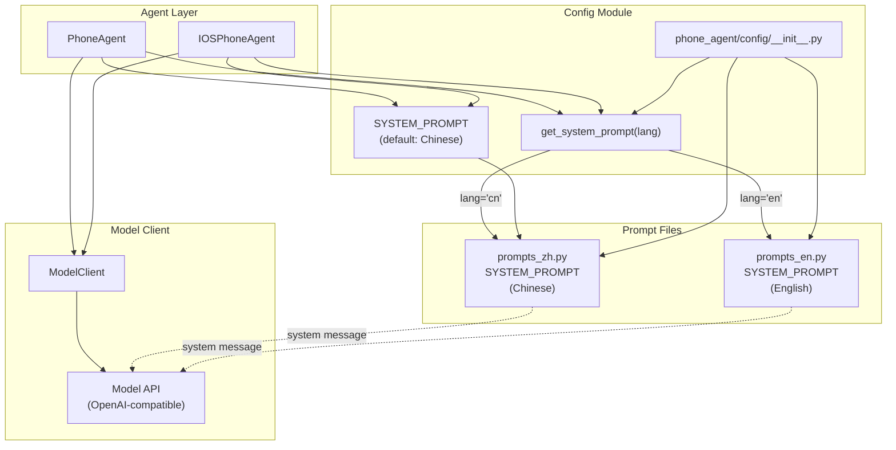
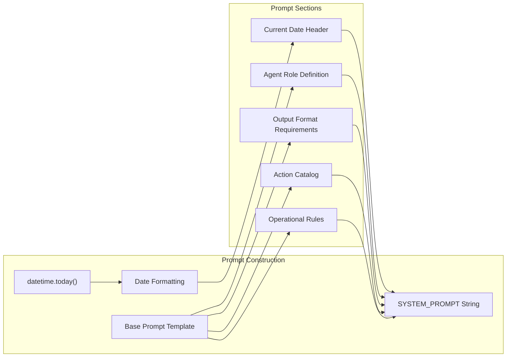

<!-- source: DeepWiki mcp.deepwiki.com · repo zai-org/Open-AutoGLM · page 7.2 System Prompts · fetched 2026-10-29 -->

# System Prompts

<details>
<summary>Relevant source files</summary>

The following files were used as context for generating this wiki page:

- [README_coding_agent.md](README_coding_agent.md)
- [README_en.md](README_en.md)
- [phone_agent/config/__init__.py](phone_agent/config/__init__.py)
- [phone_agent/config/prompts_en.py](phone_agent/config/prompts_en.py)
- [phone_agent/config/prompts_zh.py](phone_agent/config/prompts_zh.py)

</details>


## Purpose and Scope

System prompts are pre-defined instruction sets that guide the AI model's behavior when controlling mobile devices. They define the agent's role, available actions, output format requirements, and operational rules. The system prompts are critical components that shape how the vision-language model interprets screenshots and generates device control commands.

This document covers the structure, content, and usage of system prompts in Open-AutoGLM. For information about other configuration components, see [Application Packages](#7.1) and [Timing Configuration](#7.3). For details on how the agent uses these prompts during execution, see [Agent Execution Loop](#3.3).

**Sources:** [phone_agent/config/__init__.py:1-54](), [phone_agent/config/prompts_en.py:1-80](), [phone_agent/config/prompts_zh.py:1-78]()

## System Prompt Architecture

System prompts are organized in the `phone_agent.config` module with separate files for each supported language. The architecture provides a clean interface for accessing language-specific prompts while maintaining backward compatibility.



**Prompt Access Methods**

| Method | Description | Usage |
|--------|-------------|-------|
| `get_system_prompt(lang)` | Retrieves prompt by language code | `get_system_prompt("en")` for English |
| `SYSTEM_PROMPT` | Default prompt (Chinese) | Legacy/backward compatibility |
| `SYSTEM_PROMPT_ZH` | Direct Chinese prompt access | Explicit Chinese prompt |
| `SYSTEM_PROMPT_EN` | Direct English prompt access | Explicit English prompt |

The `get_system_prompt()` function [phone_agent/config/__init__.py:19-31]() serves as the primary interface, accepting language codes `"cn"` for Chinese (default) or `"en"` for English.

**Sources:** [phone_agent/config/__init__.py:1-54]()

## Prompt Structure and Components

Both language versions follow a consistent structural pattern with dynamic date injection and section-based organization. The prompts are constructed at module import time to include the current date.



### Date Injection

Both prompt files dynamically inject the current date at construction time:

- **English**: Format `YYYY-MM-DD, Weekday` [phone_agent/config/prompts_en.py:5-6]()
- **Chinese**: Format `YYYY年MM月DD日 星期X` [phone_agent/config/prompts_zh.py:5-8]()

This temporal context helps the model understand time-sensitive operations like scheduling or date selection.

### Core Sections

#### 1. Agent Role Definition

**English Version** [phone_agent/config/prompts_en.py:13]():
> "You are a professional Android operation agent assistant that can fulfill the user's high-level instructions."

**Chinese Version** [phone_agent/config/prompts_zh.py:14]():
> "你是一个智能体分析专家，可以根据操作历史和当前状态图执行一系列操作来完成任务。"

The Chinese version emphasizes the agent as an "intelligent analysis expert" while the English version focuses on being a "professional Android operation assistant."

#### 2. Output Format Requirements

Both versions strictly enforce a two-part response structure:

```

<answer>
[Single action command]
</answer>
```

This format enables the system to parse the model's reasoning separately from its executable action. The `<answer>...</answer>
        Agent->>Messages: Add assistant response
    end
```

### Message History Structure

The typical message flow in the agent's execution loop:

1. **System Message**: Contains the full system prompt (set once per task)
2. **User Message**: Initial task instruction
3. **User Messages**: Screenshots with current app info (each iteration)
4. **Assistant Messages**: Model's `` and `<answer>...</answer>` structure is parsed by the agent's response processing logic
2. **Action Syntax**: Action commands must match the patterns expected by `ActionHandler` [phone_agent/action_handler.py]()
3. **Coordinate System**: The (0,0) to (999,999) coordinate space is normalized by the system
4. **Single Action Rule**: Enforcing one action per response prevents parsing ambiguity

### Testing Custom Prompts

After modifying prompts, verify behavior with:

```python
from phone_agent.config import get_system_prompt

# Check prompt content
custom_prompt = get_system_prompt("en")
print(f"Prompt length: {len(custom_prompt)}")
print(f"Actions defined: {custom_prompt.count('do(action=')}")

# Test with agent
agent = PhoneAgent(device_name="emulator-5554")
result = agent.run(task="Open Settings", lang="en")
```

Monitor the `<think>` sections in model responses to understand how the modified prompt affects the agent's reasoning.

**Sources:** [phone_agent/config/__init__.py:1-54](), [phone_agent/config/prompts_en.py:1-80](), [phone_agent/config/prompts_zh.py:1-78]()

---

## Summary

System prompts are structured instruction sets that define the AI agent's role, available actions, and operational rules. Open-AutoGLM provides two primary language versions (Chinese and English) with significant differences in action catalogs and rule complexity. The Chinese version offers 15 actions and 18 detailed rules for complex scenarios, while the English version provides 7 core actions with general principles. Both versions enforce a strict `<think>`/`<answer>` output format that enables reliable parsing and execution. The prompt system integrates with the agent execution loop through the `get_system_prompt()` function, maintaining consistent behavioral guidelines throughout task execution.

---

