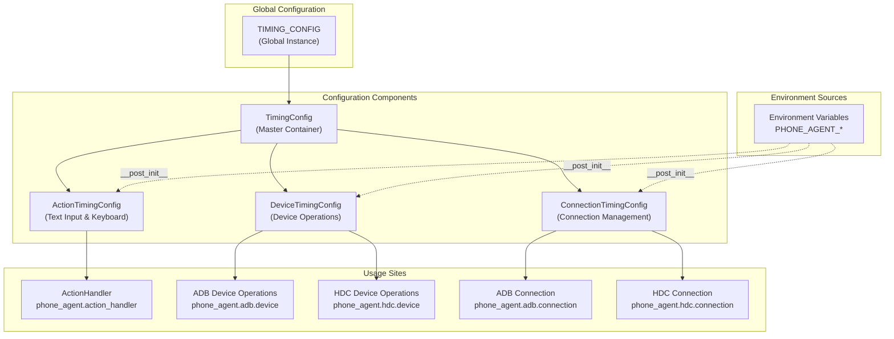
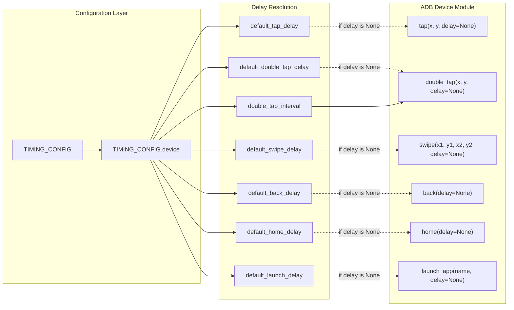
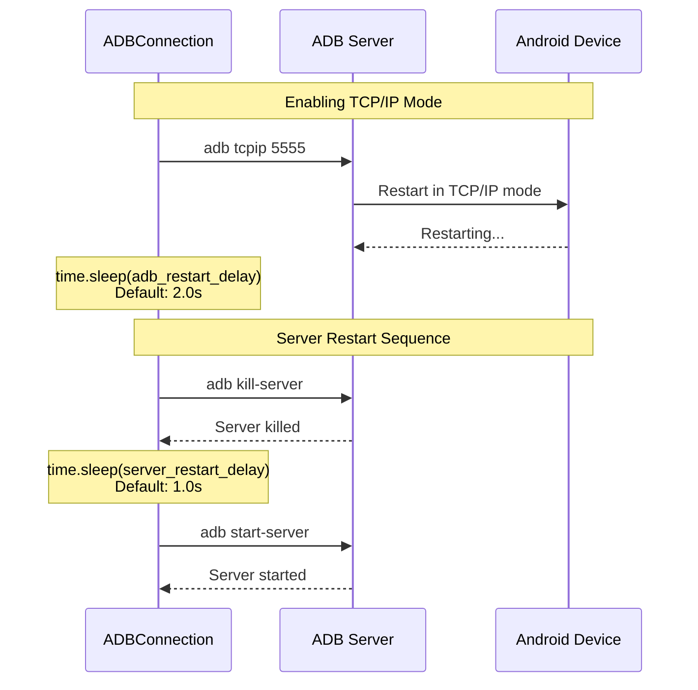

<!-- source: DeepWiki mcp.deepwiki.com · repo zai-org/Open-AutoGLM · page 7.3 Timing Configuration · fetched 2026-10-29 -->

# Timing Configuration

<details>
<summary>Relevant source files</summary>

The following files were used as context for generating this wiki page:

- [phone_agent/adb/connection.py](phone_agent/adb/connection.py)
- [phone_agent/adb/device.py](phone_agent/adb/device.py)
- [phone_agent/config/__init__.py](phone_agent/config/__init__.py)
- [phone_agent/config/timing.py](phone_agent/config/timing.py)

</details>


This page documents the timing configuration system that controls delays and timeouts for device operations, actions, and connections in Open-AutoGLM. The timing system ensures proper synchronization between the AI agent and physical device operations by introducing configurable wait times after various operations.

For general configuration management including model and agent settings, see [Configuration Management](#5.4). For action execution details, see [ActionHandler Architecture](#6.2).

## Purpose and Scope

The timing configuration system provides centralized control over all wait times and delays used throughout the framework. These delays ensure that:
- Device operations complete before the next action begins
- UI animations finish rendering before screenshots are captured
- Keyboard switches complete before text input begins
- Connection state changes stabilize before proceeding

All timing values are configurable via environment variables or programmatic API calls, allowing customization for different device speeds and network conditions.

**Sources:** [phone_agent/config/timing.py:1-11]()

## Timing Configuration Architecture

The timing system is organized into a three-tier hierarchy that groups related timing parameters by functional area.



**Diagram: Timing Configuration Structure and Data Flow**

The `TimingConfig` class [phone_agent/config/timing.py:99-111]() serves as the master container, holding instances of three specialized configuration classes. Each configuration class loads its default values from the dataclass definition and then overrides them with environment variables if present during `__post_init__`.

**Sources:** [phone_agent/config/timing.py:99-116](), [phone_agent/config/__init__.py:8-16]()

## Configuration Classes and Parameters

### ActionTimingConfig

Controls delays related to text input operations, particularly keyboard switching and text manipulation. These delays are critical for proper text entry on Android devices using the ADB keyboard method.

| Parameter | Default | Environment Variable | Description |
|-----------|---------|---------------------|-------------|
| `keyboard_switch_delay` | 1.0s | `PHONE_AGENT_KEYBOARD_SWITCH_DELAY` | Wait time after switching to ADB keyboard |
| `text_clear_delay` | 1.0s | `PHONE_AGENT_TEXT_CLEAR_DELAY` | Wait time after clearing existing text |
| `text_input_delay` | 1.0s | `PHONE_AGENT_TEXT_INPUT_DELAY` | Wait time after typing text |
| `keyboard_restore_delay` | 1.0s | `PHONE_AGENT_KEYBOARD_RESTORE_DELAY` | Wait time after restoring original keyboard |

**Implementation:**
```python
@dataclass
class ActionTimingConfig:
    """Configuration for action handler timing delays."""
    keyboard_switch_delay: float = 1.0
    text_clear_delay: float = 1.0
    text_input_delay: float = 1.0
    keyboard_restore_delay: float = 1.0
```

These parameters are referenced in the action handler's text input logic where keyboard switching is required for Android devices.

**Sources:** [phone_agent/config/timing.py:11-34]()

### DeviceTimingConfig

Controls delays after device operations such as taps, swipes, and button presses. These delays ensure that UI transitions and animations complete before the agent captures the next screenshot or executes the next action.

| Parameter | Default | Environment Variable | Description |
|-----------|---------|---------------------|-------------|
| `default_tap_delay` | 1.0s | `PHONE_AGENT_TAP_DELAY` | Wait after single tap |
| `default_double_tap_delay` | 1.0s | `PHONE_AGENT_DOUBLE_TAP_DELAY` | Wait after double tap completes |
| `double_tap_interval` | 0.1s | `PHONE_AGENT_DOUBLE_TAP_INTERVAL` | Time between two taps in double tap |
| `default_long_press_delay` | 1.0s | `PHONE_AGENT_LONG_PRESS_DELAY` | Wait after long press |
| `default_swipe_delay` | 1.0s | `PHONE_AGENT_SWIPE_DELAY` | Wait after swipe gesture |
| `default_back_delay` | 1.0s | `PHONE_AGENT_BACK_DELAY` | Wait after back button |
| `default_home_delay` | 1.0s | `PHONE_AGENT_HOME_DELAY` | Wait after home button |
| `default_launch_delay` | 1.0s | `PHONE_AGENT_LAUNCH_DELAY` | Wait after launching app |

**Implementation:**
```python
@dataclass
class DeviceTimingConfig:
    """Configuration for device operation timing delays."""
    default_tap_delay: float = 1.0
    default_double_tap_delay: float = 1.0
    double_tap_interval: float = 0.1
    default_long_press_delay: float = 1.0
    default_swipe_delay: float = 1.0
    default_back_delay: float = 1.0
    default_home_delay: float = 1.0
    default_launch_delay: float = 1.0
```

**Sources:** [phone_agent/config/timing.py:37-76]()

### ConnectionTimingConfig

Controls delays related to ADB/HDC connection management, particularly during server restarts and connection state changes.

| Parameter | Default | Environment Variable | Description |
|-----------|---------|---------------------|-------------|
| `adb_restart_delay` | 2.0s | `PHONE_AGENT_ADB_RESTART_DELAY` | Wait after enabling TCP/IP mode |
| `server_restart_delay` | 1.0s | `PHONE_AGENT_SERVER_RESTART_DELAY` | Wait between killing and starting server |

**Implementation:**
```python
@dataclass
class ConnectionTimingConfig:
    """Configuration for ADB connection timing delays."""
    adb_restart_delay: float = 2.0
    server_restart_delay: float = 1.0
```

**Sources:** [phone_agent/config/timing.py:79-96]()

## Timing Usage in Device Operations

The following diagram shows how timing parameters flow from configuration to actual device operations.



**Diagram: Timing Parameter Flow in Device Operations**

Each device operation function accepts an optional `delay` parameter. If not provided, the function uses the corresponding default from `TIMING_CONFIG.device`. This pattern is consistent across all device operations.

**Example from ADB tap implementation:**
```python
def tap(x: int, y: int, device_id: str | None = None, delay: float | None = None) -> None:
    if delay is None:
        delay = TIMING_CONFIG.device.default_tap_delay
    
    adb_prefix = _get_adb_prefix(device_id)
    subprocess.run(adb_prefix + ["shell", "input", "tap", str(x), str(y)], capture_output=True)
    time.sleep(delay)
```

**Sources:** [phone_agent/adb/device.py:41-61](), [phone_agent/adb/device.py:64-88](), [phone_agent/adb/device.py:121-167](), [phone_agent/adb/device.py:170-186](), [phone_agent/adb/device.py:189-205](), [phone_agent/adb/device.py:208-245]()

## Connection Timing Usage

Connection timing parameters are used during ADB/HDC connection management operations, particularly when establishing remote connections or restarting servers.



**Diagram: Connection Timing in ADB Operations**

**Example from enable_tcpip implementation:**
```python
def enable_tcpip(self, port: int = 5555, device_id: str | None = None) -> tuple[bool, str]:
    cmd = [self.adb_path]
    if device_id:
        cmd.extend(["-s", device_id])
    cmd.extend(["tcpip", str(port)])
    
    result = subprocess.run(cmd, capture_output=True, text=True, encoding="utf-8", timeout=10)
    output = result.stdout + result.stderr
    
    if "restarting" in output.lower() or result.returncode == 0:
        time.sleep(TIMING_CONFIG.connection.adb_restart_delay)
        return True, f"TCP/IP mode enabled on port {port}"
    else:
        return False, output.strip()
```

**Sources:** [phone_agent/adb/connection.py:219-255](), [phone_agent/adb/connection.py:305-328]()

## Configuration Methods

### Method 1: Environment Variables

Set environment variables before starting the application. This is the recommended method for deployment scenarios.

```bash
# Set device operation delays
export PHONE_AGENT_TAP_DELAY=0.5
export PHONE_AGENT_SWIPE_DELAY=1.5
export PHONE_AGENT_LAUNCH_DELAY=2.0

# Set text input delays
export PHONE_AGENT_KEYBOARD_SWITCH_DELAY=0.8
export PHONE_AGENT_TEXT_INPUT_DELAY=0.5

# Set connection delays
export PHONE_AGENT_ADB_RESTART_DELAY=3.0

# Run the agent
python main.py --task "Open Maps"
```

Environment variables are loaded during dataclass initialization via the `__post_init__` method of each configuration class [phone_agent/config/timing.py:21-34](), [phone_agent/config/timing.py:51-76](), [phone_agent/config/timing.py:89-96]().

**Sources:** [phone_agent/config/timing.py:21-34](), [phone_agent/config/timing.py:51-76](), [phone_agent/config/timing.py:89-96]()

### Method 2: Programmatic Configuration

Modify timing configuration at runtime using the `update_timing_config` function or by directly modifying the `TIMING_CONFIG` global instance.

```python
from phone_agent.config.timing import (
    update_timing_config,
    ActionTimingConfig,
    DeviceTimingConfig,
    ConnectionTimingConfig
)

# Create custom configurations
custom_device = DeviceTimingConfig(
    default_tap_delay=0.5,
    default_swipe_delay=1.5,
    default_launch_delay=2.0
)

custom_action = ActionTimingConfig(
    keyboard_switch_delay=0.8,
    text_input_delay=0.5
)

# Update global configuration
update_timing_config(device=custom_device, action=custom_action)

# Now use the agent with custom timing
from phone_agent import PhoneAgent

agent = PhoneAgent()
agent.run("Open Maps and search for coffee")
```

Alternatively, modify the global instance directly:

```python
from phone_agent.config.timing import TIMING_CONFIG

# Direct modification
TIMING_CONFIG.device.default_tap_delay = 0.5
TIMING_CONFIG.device.default_launch_delay = 2.0
TIMING_CONFIG.action.text_input_delay = 0.5
```

**Sources:** [phone_agent/config/timing.py:129-156](), [phone_agent/config/timing.py:114-126]()

## Accessing Timing Configuration

### From Application Code

Import the global configuration instance:

```python
from phone_agent.config.timing import TIMING_CONFIG

# Access specific timing values
tap_delay = TIMING_CONFIG.device.default_tap_delay
keyboard_delay = TIMING_CONFIG.action.keyboard_switch_delay
restart_delay = TIMING_CONFIG.connection.adb_restart_delay
```

### From Configuration Module

The timing configuration is also exported from the main config module for convenience:

```python
from phone_agent.config import TIMING_CONFIG

# Access the same global instance
print(TIMING_CONFIG.device.default_tap_delay)
```

**Sources:** [phone_agent/config/__init__.py:8-16](), [phone_agent/config/__init__.py:46-52]()

## Timing Configuration Reference Table

This table provides a complete reference of all timing parameters, their defaults, environment variable names, and typical use cases.

| Category | Parameter | Default | Env Variable | Use Case |
|----------|-----------|---------|--------------|----------|
| **Action** | `keyboard_switch_delay` | 1.0s | `PHONE_AGENT_KEYBOARD_SWITCH_DELAY` | Wait for ADB keyboard to become active |
| **Action** | `text_clear_delay` | 1.0s | `PHONE_AGENT_TEXT_CLEAR_DELAY` | Wait after clearing text field |
| **Action** | `text_input_delay` | 1.0s | `PHONE_AGENT_TEXT_INPUT_DELAY` | Wait after typing text |
| **Action** | `keyboard_restore_delay` | 1.0s | `PHONE_AGENT_KEYBOARD_RESTORE_DELAY` | Wait after restoring original keyboard |
| **Device** | `default_tap_delay` | 1.0s | `PHONE_AGENT_TAP_DELAY` | Wait after tap for UI response |
| **Device** | `default_double_tap_delay` | 1.0s | `PHONE_AGENT_DOUBLE_TAP_DELAY` | Wait after double tap completes |
| **Device** | `double_tap_interval` | 0.1s | `PHONE_AGENT_DOUBLE_TAP_INTERVAL` | Time between taps in double tap |
| **Device** | `default_long_press_delay` | 1.0s | `PHONE_AGENT_LONG_PRESS_DELAY` | Wait after long press |
| **Device** | `default_swipe_delay` | 1.0s | `PHONE_AGENT_SWIPE_DELAY` | Wait after swipe for animation |
| **Device** | `default_back_delay` | 1.0s | `PHONE_AGENT_BACK_DELAY` | Wait after back navigation |
| **Device** | `default_home_delay` | 1.0s | `PHONE_AGENT_HOME_DELAY` | Wait after returning to home |
| **Device** | `default_launch_delay` | 1.0s | `PHONE_AGENT_LAUNCH_DELAY` | Wait for app to fully launch |
| **Connection** | `adb_restart_delay` | 2.0s | `PHONE_AGENT_ADB_RESTART_DELAY` | Wait after enabling TCP/IP mode |
| **Connection** | `server_restart_delay` | 1.0s | `PHONE_AGENT_SERVER_RESTART_DELAY` | Wait between server restart steps |

**Sources:** [phone_agent/config/timing.py:11-96]()

## Tuning Guidelines

### Fast Devices and Networks

For fast devices with good network connectivity, reduce delays to speed up automation:

```bash
export PHONE_AGENT_TAP_DELAY=0.3
export PHONE_AGENT_SWIPE_DELAY=0.5
export PHONE_AGENT_LAUNCH_DELAY=1.0
export PHONE_AGENT_TEXT_INPUT_DELAY=0.5
```

### Slow Devices or Networks

For slower devices or unstable connections, increase delays to improve reliability:

```bash
export PHONE_AGENT_TAP_DELAY=1.5
export PHONE_AGENT_SWIPE_DELAY=2.0
export PHONE_AGENT_LAUNCH_DELAY=3.0
export PHONE_AGENT_ADB_RESTART_DELAY=4.0
```

### Remote Devices

When using WiFi debugging or remote connections, increase connection-related delays:

```bash
export PHONE_AGENT_ADB_RESTART_DELAY=3.0
export PHONE_AGENT_SERVER_RESTART_DELAY=2.0
```

**Sources:** [phone_agent/config/timing.py:1-11]()

## Related Configuration

- **Application Packages**: See [Application Packages](#7.1) for app-to-package mappings
- **System Prompts**: See [System Prompts](#7.2) for AI model prompt configuration
- **Configuration Management**: See [Configuration Management](#5.4) for ModelConfig and AgentConfig
- **Device Setup**: See [Android (ADB)](#4.1), [HarmonyOS (HDC)](#4.2), and [iOS (WebDriverAgent)](#4.3) for platform-specific timing considerations

**Sources:** [phone_agent/config/__init__.py:1-53]()

---

