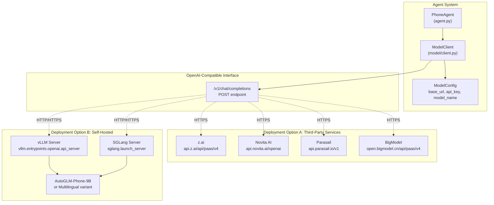
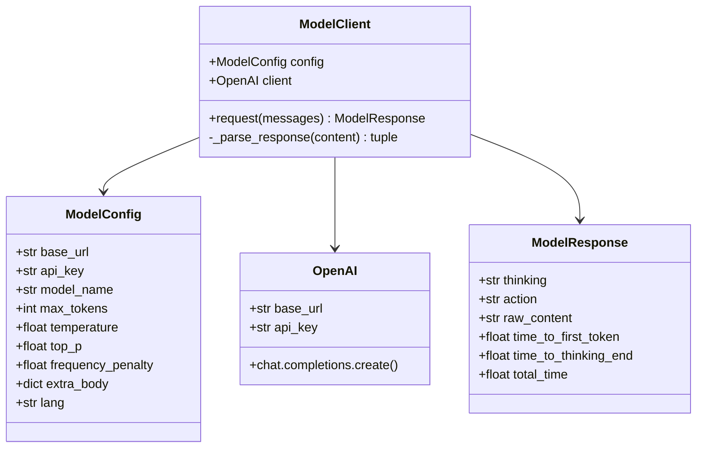
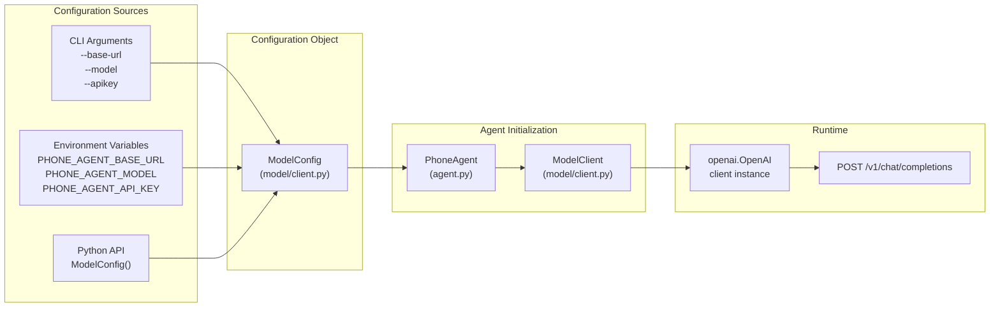
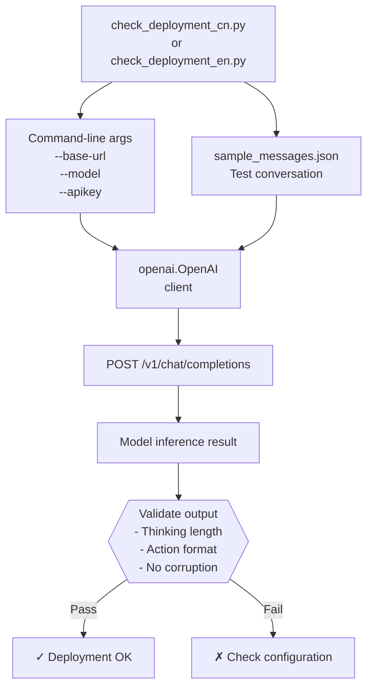
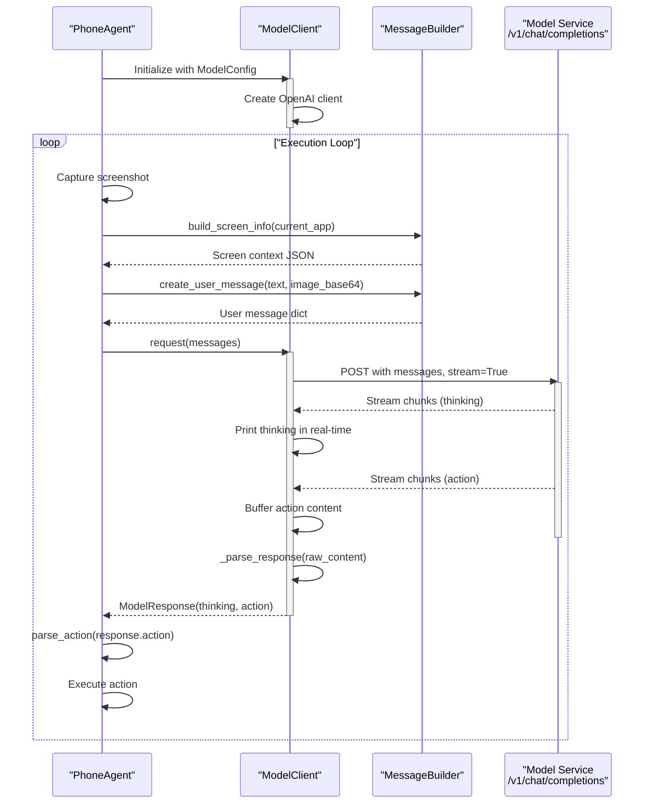

<!-- source: DeepWiki mcp.deepwiki.com · repo zai-org/Open-AutoGLM · page 8 Model Deployment · fetched 2026-10-29 -->

# Model Deployment

<details>
<summary>Relevant source files</summary>

The following files were used as context for generating this wiki page:

- [README.md](README.md)
- [README_coding_agent.md](README_coding_agent.md)
- [README_en.md](README_en.md)
- [phone_agent/model/client.py](phone_agent/model/client.py)
- [scripts/check_deployment_cn.py](scripts/check_deployment_cn.py)
- [scripts/sample_messages.json](scripts/sample_messages.json)

</details>


This document provides an overview of model deployment options for Open-AutoGLM. It covers the architecture of model integration, comparison of deployment strategies, and guidance on selecting the appropriate model variant. The AutoGLM system uses vision-language models to understand phone screens and generate actions, requiring either third-party hosted services or self-hosted inference servers.

For detailed configuration of specific third-party services, see [Using Third-Party APIs](#8.1). For self-hosting with vLLM or SGLang, see [Self-Hosting Models](#8.2). For testing your deployment, see [Deployment Verification](#8.3).

---

## Deployment Architecture

Open-AutoGLM separates the agent execution logic from the AI model service, communicating via an OpenAI-compatible HTTP API. This architecture enables flexible deployment without modifying agent code.

### System Integration Flow



**Sources:** [phone_agent/model/client.py:1-51](), [README.md:165-196](), [README_en.md:146-232]()

### ModelClient and OpenAI Integration

The `ModelClient` class provides a unified interface to any OpenAI-compatible model service. It handles request formatting, streaming responses, and response parsing.



**Sources:** [phone_agent/model/client.py:14-51]()

The `ModelClient.request()` method sends messages to the model service and streams the response, separating the thinking process from the action output.

**Sources:** [phone_agent/model/client.py:53-174]()

---

## Deployment Options Comparison

Open-AutoGLM supports two deployment strategies with distinct trade-offs:

| Aspect | Third-Party Services | Self-Hosted |
|--------|---------------------|-------------|
| **Setup Time** | Minutes (API key only) | Hours (GPU setup, model download) |
| **Hardware Requirements** | None | NVIDIA GPU with 24GB+ VRAM |
| **Cost Model** | Pay-per-token | Infrastructure + electricity |
| **Latency** | Network-dependent | LAN/localhost (lower) |
| **Privacy** | Data sent to provider | Fully local |
| **Maintenance** | Provider-managed | Self-managed |
| **Scalability** | Provider-limited | Hardware-limited |
| **Availability** | Provider uptime | Self-managed |

**Sources:** [README.md:167-261](), [README_en.md:149-213]()

### When to Use Third-Party Services

Choose third-party services when:
- You want immediate deployment without GPU infrastructure
- You prioritize ease of setup over control
- You have reliable internet connectivity
- Your use case allows data to be processed by external providers
- You prefer predictable per-token pricing

**Available third-party providers:**
- **z.ai** - Hosted AutoGLM-Phone-Multilingual model
- **Novita AI** - `zai-org/autoglm-phone-9b-multilingual` endpoint
- **Parasail** - Serverless inference with `parasail-auto-glm-9b-multilingual`
- **BigModel (China)** - `autoglm-phone` model via Zhipu AI

**Sources:** [README_en.md:153-185](), [README.md:173-195]()

### When to Use Self-Hosted Deployment

Choose self-hosting when:
- You have GPU infrastructure (NVIDIA GPU with 24GB+ VRAM)
- You require full data privacy and local processing
- You need minimum latency (localhost/LAN deployment)
- You want control over model versions and configurations
- You have long-term usage that justifies infrastructure costs

**Supported inference engines:**
- **vLLM** - High-performance inference server with tensor parallelism
- **SGLang** - Alternative inference engine with multimodal support

**Sources:** [README.md:198-261](), [requirements.txt:13-21]()

---

## Model Variants

AutoGLM provides two model variants optimized for different language scenarios:

### AutoGLM-Phone-9B

**Use case:** Chinese mobile applications

- **Model path:** `zai-org/AutoGLM-Phone-9B`
- **Download:** [Hugging Face](https://huggingface.co/zai-org/AutoGLM-Phone-9B) | [ModelScope](https://modelscope.cn/models/ZhipuAI/AutoGLM-Phone-9B)
- **Size:** ~20GB
- **Optimizations:** Chinese UI understanding, Chinese app workflows
- **Prompt compatibility:** `prompts_zh.py` (default with `--lang cn`)

**Sources:** [README.md:48-55]()

### AutoGLM-Phone-9B-Multilingual

**Use case:** English and multilingual applications

- **Model path:** `zai-org/AutoGLM-Phone-9B-Multilingual`
- **Download:** [Hugging Face](https://huggingface.co/zai-org/AutoGLM-Phone-9B-Multilingual) | [ModelScope](https://modelscope.cn/models/ZhipuAI/AutoGLM-Phone-9B-Multilingual)
- **Size:** ~20GB
- **Optimizations:** English UI understanding, multilingual app support
- **Prompt compatibility:** `prompts_en.py` (use with `--lang en`)

**Sources:** [README.md:48-55](), [README_en.md:40-45]()

### Model Architecture

Both variants share the same architecture as `GLM-4.1V-9B-Thinking`, featuring:
- Vision-language multimodal processing
- Step-by-step reasoning (thinking) before action generation
- Optimized for mobile UI screenshots (up to 5,000,000 pixels)
- Context length: 25,480 tokens

**Sources:** [README.md:258-259]()

---

## Configuration Flow

The model deployment configuration flows through the system as follows:



**Sources:** [phone_agent/model/client.py:14-26](), [README.md:499-522](), [main.py:1-150]()

### Configuration Precedence

Configuration values follow this precedence order (highest to lowest):

1. **CLI arguments** - `--base-url`, `--model`, `--apikey`
2. **Environment variables** - `PHONE_AGENT_BASE_URL`, `PHONE_AGENT_MODEL`, `PHONE_AGENT_API_KEY`
3. **Default values** - `http://localhost:8000/v1`, `autoglm-phone-9b`, `EMPTY`

**Environment variable reference:**

| Variable | Description | Default Value |
|----------|-------------|---------------|
| `PHONE_AGENT_BASE_URL` | Model API endpoint URL | `http://localhost:8000/v1` |
| `PHONE_AGENT_MODEL` | Model identifier | `autoglm-phone-9b` |
| `PHONE_AGENT_API_KEY` | Authentication key | `EMPTY` |

**Sources:** [README.md:497-507](), [README_en.md:437-448]()

---

## Deployment Validation

After deploying a model service, validate it using the deployment check scripts:

### Check Scripts



**Sources:** [scripts/check_deployment_cn.py:1-116](), [README.md:263-293]()

### Expected Output

A successful deployment produces:
- A detailed thinking process (reasoning chain)
- A properly formatted action (`do(action=...)` or `finish(message=...)`)
- Token usage statistics (prompt tokens, completion tokens, total)

**Failure indicators:**
- Very short thinking chain (deployment configuration error)
- Corrupted/garbled output (encoding or model loading issue)
- Connection errors (network/URL configuration)

**Sources:** [README.md:273-287]()

### Validation Commands

```bash
# Validate self-hosted deployment
python scripts/check_deployment_cn.py \
  --base-url http://localhost:8000/v1 \
  --model autoglm-phone-9b

# Validate third-party service (Novita AI example)
python scripts/check_deployment_en.py \
  --base-url https://api.novita.ai/openai \
  --model zai-org/autoglm-phone-9b-multilingual \
  --apikey your-api-key
```

**Sources:** [README_en.md:216-230]()

---

## Integration with PhoneAgent

The deployed model service integrates with `PhoneAgent` through the `ModelClient` interface:



**Sources:** [phone_agent/agent.py:1-300](), [phone_agent/model/client.py:53-174]()

### MessageBuilder Usage

The `MessageBuilder` class constructs OpenAI-compatible messages with screen context:

| Method | Purpose | Returns |
|--------|---------|---------|
| `create_system_message(content)` | System prompt with action definitions | `{"role": "system", "content": str}` |
| `create_user_message(text, image_base64)` | User message with screenshot | `{"role": "user", "content": list}` |
| `create_assistant_message(content)` | Assistant response for history | `{"role": "assistant", "content": str}` |
| `build_screen_info(current_app, **extra)` | Screen metadata JSON | JSON string with app info |
| `remove_images_from_message(message)` | Strip images to save context | Message dict without images |

**Sources:** [phone_agent/model/client.py:219-291]()

---

## Hardware Requirements

For self-hosted deployments, hardware requirements depend on the model variant and inference engine:

### Minimum Requirements

| Component | Requirement |
|-----------|-------------|
| **GPU** | NVIDIA GPU with CUDA support |
| **VRAM** | 24GB minimum (e.g., RTX 3090, RTX 4090, A100) |
| **RAM** | 32GB system memory recommended |
| **Storage** | 30GB free space (20GB model + cache) |
| **CUDA** | CUDA 11.8+ or CUDA 12.1+ |

### Model Loading Configuration

Both vLLM and SGLang require specific startup parameters for AutoGLM models:

**Key parameters:**
- `--max-model-len 25480` - Context window size
- `--mm_processor_kwargs '{"max_pixels":5000000}'` - Maximum image resolution
- `--chat-template-content-format string` - Response format handling
- `--limit-mm-per-prompt '{"image":10}'` - Maximum images per request

**Sources:** [README.md:229-256](), [README_en.md:196-208]()

---

## Summary

Model deployment for Open-AutoGLM follows a flexible architecture:

1. **Choose deployment strategy** based on infrastructure, privacy, and cost requirements
2. **Select model variant** (Chinese vs Multilingual) based on target applications
3. **Configure endpoint** via CLI arguments, environment variables, or Python API
4. **Validate deployment** using check scripts before production use
5. **Integrate with PhoneAgent** through the OpenAI-compatible ModelClient

For specific implementation details, consult the child pages: [Using Third-Party APIs](#8.1), [Self-Hosting Models](#8.2), and [Deployment Verification](#8.3).

**Sources:** [README.md:165-293](), [README_en.md:146-232](), [phone_agent/model/client.py:1-291]()

---

