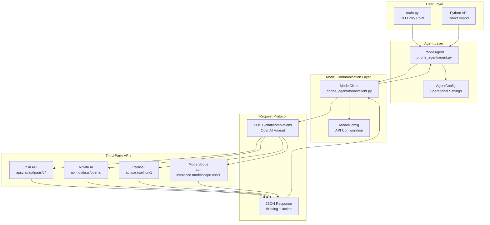
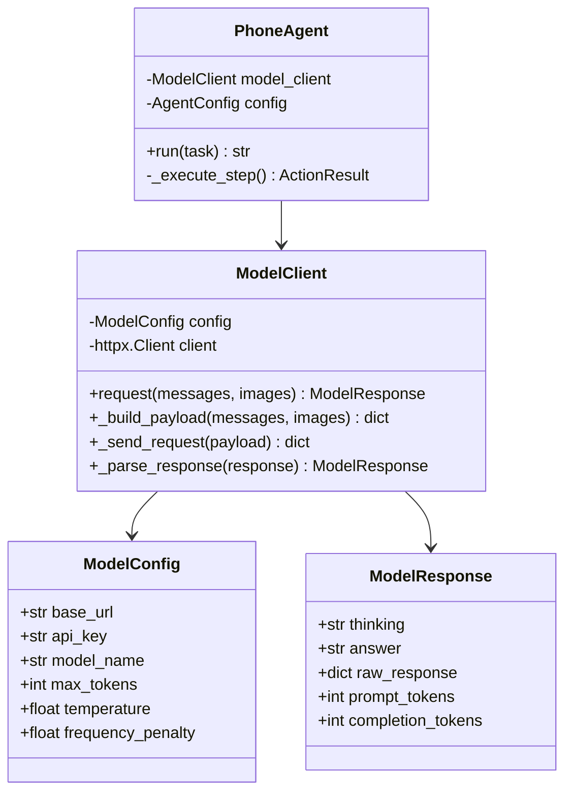
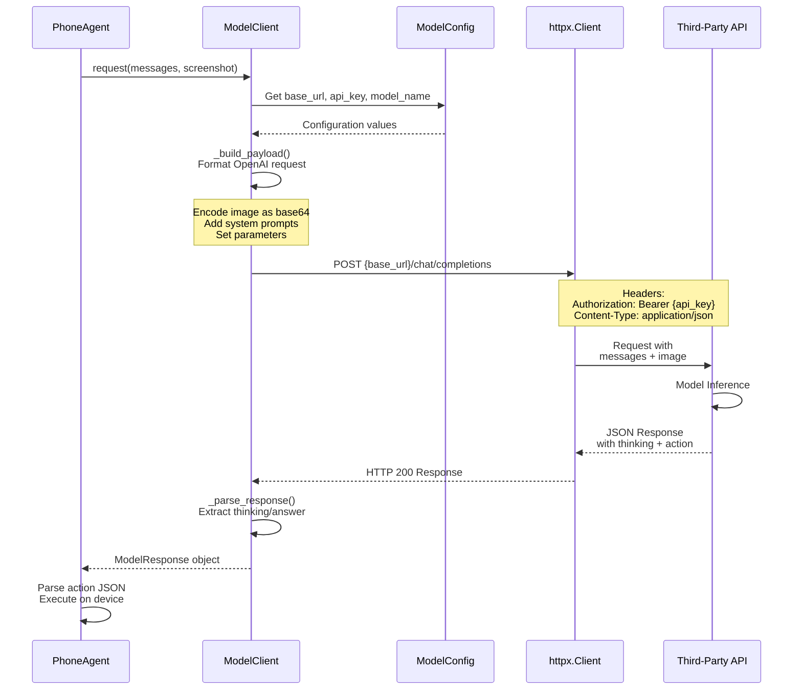
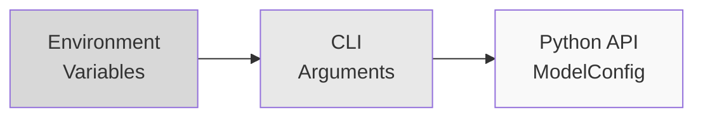

<!-- source: DeepWiki mcp.deepwiki.com · repo zai-org/Open-AutoGLM · page 8.1 Using Third-Party APIs · fetched 2026-10-29 -->

# Using Third-Party APIs

<details>
<summary>Relevant source files</summary>

The following files were used as context for generating this wiki page:

- [README.md](README.md)
- [README_coding_agent.md](README_coding_agent.md)
- [README_en.md](README_en.md)
- [phone_agent/model/client.py](phone_agent/model/client.py)
- [scripts/check_deployment_cn.py](scripts/check_deployment_cn.py)
- [scripts/sample_messages.json](scripts/sample_messages.json)

</details>


## Purpose and Scope

This page describes how to configure Open-AutoGLM to use third-party hosted API services for the AutoGLM vision-language model. This approach allows you to run the agent framework without deploying the model yourself, requiring only API credentials and network connectivity.

For information about deploying models on your own infrastructure, see [Self-Hosting Models](#8.2). For verifying that your API connection is working correctly, see [Deployment Verification](#8.3).

---

## Overview

Open-AutoGLM separates the agent logic from the model service, allowing flexibility in deployment. Third-party APIs provide:

**Advantages:**
- No local GPU requirements (24GB+ VRAM saved)
- No model download (~20GB storage saved)
- Immediate availability without setup time
- Managed scaling and maintenance
- Pay-per-use pricing model

**Requirements:**
- API key from a supported provider
- Network connectivity from agent to API endpoint
- OpenAI-compatible API format

The agent communicates with model services through the `ModelClient` class [phone_agent/model/client.py:1-200](), which implements the OpenAI-compatible chat completions API protocol.

Sources: [README.md:155-184](), [README_en.md:138-174]()

---

## Supported API Providers

The following third-party services currently host AutoGLM models:

| Provider | Model Name | Base URL | Documentation |
|----------|-----------|----------|---------------|
| **z.ai** | `autoglm-phone-multilingual`<br/>`autoglm-phone` (CN) | `https://api.z.ai/api/paas/v4` | [docs.z.ai](https://docs.z.ai/api-reference/introduction) |
| **Novita AI** | `zai-org/autoglm-phone-9b-multilingual` | `https://api.novita.ai/openai` | [novita.ai](https://novita.ai/models/model-detail/zai-org-autoglm-phone-9b-multilingual) |
| **Parasail** | `parasail-auto-glm-9b-multilingual` | `https://api.parasail.io/v1` | [parasail.io](https://www.saas.parasail.io/serverless?name=auto-glm-9b-multilingual) |
| **ModelScope** | `ZhipuAI/AutoGLM-Phone-9B` | `https://api-inference.modelscope.cn/v1` | [modelscope.cn](https://modelscope.cn/models/ZhipuAI/AutoGLM-Phone-9B) |

**Model Variants:**
- **Multilingual models** (`autoglm-phone-multilingual`): Optimized for English and other languages
- **Chinese models** (`autoglm-phone`): Optimized specifically for Chinese mobile applications

Sources: [README.md:162-174](), [README_en.md:142-162]()

---

## Configuration Methods

### CLI Arguments

The command-line interface accepts three primary parameters for API configuration:

```bash
# Basic usage with third-party API
python main.py \
  --base-url https://api.z.ai/api/paas/v4 \
  --model autoglm-phone-multilingual \
  --apikey your-api-key-here \
  "Open Chrome browser"

# Interactive mode
python main.py \
  --base-url https://api.novita.ai/openai \
  --model zai-org/autoglm-phone-9b-multilingual \
  --apikey sk-xxxxx
```

**Parameter Descriptions:**
- `--base-url`: API endpoint URL (must end with `/v1` for OpenAI-compatible APIs)
- `--model`: Model identifier as specified by the provider
- `--apikey`: Authentication token from the provider

Sources: [README.md:176-184](), [README_en.md:163-174](), [main.py:1-100]()

### Python API

Configure model services programmatically using the `ModelConfig` class:

```python
from phone_agent import PhoneAgent
from phone_agent.model import ModelConfig

# Configure API connection
model_config = ModelConfig(
    base_url="https://api.z.ai/api/paas/v4",
    model_name="autoglm-phone-multilingual",
    api_key="your-api-key-here",
    max_tokens=3000,
    temperature=0.1,
    frequency_penalty=0.2,
)

# Create agent with API configuration
agent = PhoneAgent(model_config=model_config)

# Execute task
result = agent.run("Open Maps and search for coffee shops")
```

The `ModelConfig` class [phone_agent/model/client.py:1-50]() encapsulates all model service parameters:

| Parameter | Type | Default | Description |
|-----------|------|---------|-------------|
| `base_url` | `str` | `http://localhost:8000/v1` | API endpoint URL |
| `api_key` | `str` | `"EMPTY"` | Authentication token |
| `model_name` | `str` | `"autoglm-phone-9b"` | Model identifier |
| `max_tokens` | `int` | `3000` | Maximum response tokens |
| `temperature` | `float` | `0.1` | Sampling temperature |
| `frequency_penalty` | `float` | `0.2` | Repetition penalty |

Sources: [README.md:317-333](), [README_en.md:257-273](), [phone_agent/model/client.py:1-100]()

### Environment Variables

Configure default API settings using environment variables:

```bash
# Set environment variables
export PHONE_AGENT_BASE_URL="https://api.z.ai/api/paas/v4"
export PHONE_AGENT_MODEL="autoglm-phone-multilingual"
export PHONE_AGENT_API_KEY="your-api-key-here"

# Run agent (uses environment defaults)
python main.py "Open Chrome browser"
```

**Environment Variable Reference:**

| Variable | Description | Example |
|----------|-------------|---------|
| `PHONE_AGENT_BASE_URL` | Model API endpoint | `https://api.z.ai/api/paas/v4` |
| `PHONE_AGENT_MODEL` | Model name | `autoglm-phone-multilingual` |
| `PHONE_AGENT_API_KEY` | Authentication key | `sk-xxxxxxxxxxxxx` |

Environment variables are loaded by the CLI [main.py:1-100]() and provide defaults that can be overridden by command-line arguments.

Sources: [README.md:486-496](), [README_en.md:426-436]()

---

## Architecture and Code Entities

### Component Diagram



Sources: [phone_agent/agent.py:1-100](), [phone_agent/model/client.py:1-200](), [main.py:1-150]()

### ModelClient Class Structure



The `ModelClient` class [phone_agent/model/client.py:1-200]() handles:
- HTTP connection management using `httpx`
- Request payload construction with images and text
- Response parsing and token counting
- Error handling and retries

Sources: [phone_agent/model/client.py:1-300]()

---

## Request-Response Flow

### API Communication Sequence



### Request Payload Structure

The `ModelClient` constructs OpenAI-compatible chat completion requests [phone_agent/model/client.py:50-150]():

```json
{
  "model": "autoglm-phone-multilingual",
  "messages": [
    {
      "role": "system",
      "content": "You are a phone operation assistant..."
    },
    {
      "role": "user",
      "content": [
        {
          "type": "text",
          "text": "Current task: Open Chrome browser\nCurrent app: com.android.launcher"
        },
        {
          "type": "image_url",
          "image_url": {
            "url": "data:image/png;base64,iVBORw0KG..."
          }
        }
      ]
    }
  ],
  "max_tokens": 3000,
  "temperature": 0.1,
  "frequency_penalty": 0.2
}
```

### Response Payload Structure

API responses follow the OpenAI format [phone_agent/model/client.py:150-200]():

```json
{
  "id": "chatcmpl-123",
  "object": "chat.completion",
  "created": 1677652288,
  "model": "autoglm-phone-multilingual",
  "choices": [
    {
      "index": 0,
      "message": {
        "role": "assistant",
        "content": "\n<answer>do(action=\"Launch\", app=\"Chrome\")"
      },
      "finish_reason": "stop"
    }
  ],
  "usage": {
    "prompt_tokens": 1234,
    "completion_tokens": 56,
    "total_tokens": 1290
  }
}
```

The `ModelClient` extracts the thinking process and action from the response content, then returns a `ModelResponse` object.

Sources: [phone_agent/model/client.py:1-300]()

---

## Provider-Specific Examples

### z.ai (Multilingual)

```bash
# CLI usage
python main.py \
  --base-url https://api.z.ai/api/paas/v4 \
  --model autoglm-phone-multilingual \
  --apikey "your-z-ai-api-key" \
  "Open Gmail and compose email"
```

```python
# Python API usage
from phone_agent import PhoneAgent
from phone_agent.model import ModelConfig

config = ModelConfig(
    base_url="https://api.z.ai/api/paas/v4",
    model_name="autoglm-phone-multilingual",
    api_key="your-z-ai-api-key",
)
agent = PhoneAgent(model_config=config)
agent.run("Open Gmail and compose email")
```

### Novita AI

```bash
# CLI usage
python main.py \
  --base-url https://api.novita.ai/openai \
  --model zai-org/autoglm-phone-9b-multilingual \
  --apikey "your-novita-api-key" \
  "Search for coffee shops"
```

```python
# Python API usage
config = ModelConfig(
    base_url="https://api.novita.ai/openai",
    model_name="zai-org/autoglm-phone-9b-multilingual",
    api_key="your-novita-api-key",
)
agent = PhoneAgent(model_config=config)
```

### Parasail

```bash
# CLI usage
python main.py \
  --base-url https://api.parasail.io/v1 \
  --model parasail-auto-glm-9b-multilingual \
  --apikey "your-parasail-api-key" \
  "Open Maps"
```

```python
# Python API usage
config = ModelConfig(
    base_url="https://api.parasail.io/v1",
    model_name="parasail-auto-glm-9b-multilingual",
    api_key="your-parasail-api-key",
)
agent = PhoneAgent(model_config=config)
```

### ModelScope (Chinese)

```bash
# CLI usage - Chinese optimized model
python main.py \
  --base-url https://api-inference.modelscope.cn/v1 \
  --model ZhipuAI/AutoGLM-Phone-9B \
  --apikey "your-modelscope-api-key" \
  --lang cn \
  "打开美团搜索火锅店"
```

```python
# Python API usage
config = ModelConfig(
    base_url="https://api-inference.modelscope.cn/v1",
    model_name="ZhipuAI/AutoGLM-Phone-9B",
    api_key="your-modelscope-api-key",
)
agent = PhoneAgent(model_config=config, agent_config=AgentConfig(lang="cn"))
```

Sources: [README.md:176-184](), [README_en.md:163-174]()

---

## Verification and Troubleshooting

### Testing API Connection

Use the deployment verification script to test your API configuration:

```bash
# Test z.ai connection
python scripts/check_deployment_en.py \
  --base-url https://api.z.ai/api/paas/v4 \
  --model autoglm-phone-multilingual \
  --apikey your-api-key

# Test Novita AI connection
python scripts/check_deployment_en.py \
  --base-url https://api.novita.ai/openai \
  --model zai-org/autoglm-phone-9b-multilingual \
  --apikey your-api-key
```

The verification script [scripts/check_deployment_en.py:1-100]() sends a test request with a sample screenshot and validates the response format.

**Expected output:**
```
Testing model deployment...
Model: autoglm-phone-multilingual
Base URL: https://api.z.ai/api/paas/v4

Sending test request...
Response received successfully!

Thinking: User wants to compare washing liquid prices...
Answer: do(action="Launch", app="JD.com")

Token usage:
- Prompt tokens: 1234
- Completion tokens: 56
- Total tokens: 1290
```

Sources: [README.md:252-282](), [README_en.md:203-221](), [scripts/check_deployment_en.py:1-150]()

### Common Issues

| Issue | Cause | Solution |
|-------|-------|----------|
| **401 Unauthorized** | Invalid API key | Verify key from provider dashboard |
| **403 Forbidden** | API key lacks permissions | Check account quota/permissions |
| **404 Not Found** | Incorrect base URL or model name | Verify provider documentation |
| **429 Rate Limited** | Too many requests | Implement retry logic or upgrade plan |
| **500 Server Error** | Provider service issue | Check provider status page |
| **Connection timeout** | Network connectivity | Check firewall, proxy settings |
| **SSL certificate error** | Certificate validation failed | Update `certifi` package |

### Error Handling in Code

The `ModelClient` implements error handling [phone_agent/model/client.py:200-250]():

```python
try:
    response = self.client.post(
        f"{self.config.base_url}/chat/completions",
        json=payload,
        timeout=60.0
    )
    response.raise_for_status()
except httpx.HTTPStatusError as e:
    # Handle HTTP errors (4xx, 5xx)
    raise ModelAPIError(f"API request failed: {e.response.status_code}")
except httpx.TimeoutException:
    # Handle timeout
    raise ModelAPIError("Request timed out")
except httpx.RequestError as e:
    # Handle connection errors
    raise ModelAPIError(f"Connection failed: {str(e)}")
```

Sources: [phone_agent/model/client.py:1-300]()

---

## Comparison with Self-Hosting

### Decision Matrix

| Factor | Third-Party APIs | Self-Hosting |
|--------|-----------------|--------------|
| **Hardware Requirements** | None (cloud-based) | NVIDIA GPU with 24GB+ VRAM |
| **Setup Time** | Minutes (get API key) | Hours (install dependencies, download model) |
| **Storage Requirements** | None | ~20GB for model files |
| **Operational Cost** | Pay-per-use | Electricity + hardware depreciation |
| **Latency** | Network-dependent (100-500ms) | Local (50-200ms) |
| **Privacy** | Data sent to third party | Data stays local |
| **Scalability** | Provider-managed | Manual scaling required |
| **Customization** | Limited to provider options | Full control over parameters |
| **Maintenance** | Provider-managed updates | Manual updates required |

### Cost Considerations

**Third-Party API Pricing (Approximate):**
- z.ai: ~$0.001-0.005 per request
- Novita AI: ~$0.002-0.008 per request
- Parasail: ~$0.003-0.010 per request

**Self-Hosting Costs:**
- Hardware: $2,000-10,000 (one-time)
- Electricity: $50-200/month (varies by usage)
- Maintenance: Developer time

**Break-even analysis:** Self-hosting becomes cost-effective after approximately 50,000-100,000 requests, depending on usage patterns and hardware costs.

Sources: [README.md:155-250](), [README_en.md:138-202]()

---

## Configuration Precedence

When multiple configuration sources are present, the following precedence order applies:



**Precedence Order (highest to lowest):**
1. **Python API** (`ModelConfig` parameters)
2. **CLI Arguments** (`--base-url`, `--model`, `--apikey`)
3. **Environment Variables** (`PHONE_AGENT_*`)

This allows for flexible configuration: set defaults via environment, override for specific runs via CLI, or programmatically control via Python API.

Example:
```bash
# Environment provides defaults
export PHONE_AGENT_BASE_URL="https://api.z.ai/api/paas/v4"
export PHONE_AGENT_MODEL="autoglm-phone-multilingual"

# CLI overrides for this run
python main.py --base-url https://api.novita.ai/openai --model zai-org/autoglm-phone-9b-multilingual "Open Maps"
```

Sources: [main.py:1-150](), [phone_agent/agent.py:1-100]()

---

## Best Practices

### Security

1. **Never commit API keys to version control**
   ```bash
   # Use environment variables
   export PHONE_AGENT_API_KEY="sk-xxxxx"
   
   # Or use .env file (add to .gitignore)
   echo "PHONE_AGENT_API_KEY=sk-xxxxx" > .env
   ```

2. **Rotate API keys periodically**
   - Generate new keys every 90 days
   - Revoke old keys after rotation

3. **Use least-privilege principles**
   - Request only necessary API permissions
   - Monitor usage for anomalies

### Performance Optimization

1. **Request batching** (not currently supported but recommended for future):
   ```python
   # Future enhancement: batch multiple steps
   responses = client.batch_request([step1, step2, step3])
   ```

2. **Caching strategy**:
   - Cache system prompts locally
   - Reuse HTTP connections (handled by `httpx.Client`)

3. **Timeout configuration**:
   ```python
   config = ModelConfig(
       base_url="https://api.z.ai/api/paas/v4",
       # Add custom timeout if needed
   )
   ```

### Monitoring

Track API usage for cost management:
```python
# Log token usage after each request
response = model_client.request(messages, images)
print(f"Tokens used: {response.prompt_tokens + response.completion_tokens}")
```

Sources: [phone_agent/model/client.py:1-300]()

---

## Integration Examples

### Multi-Provider Fallback

Implement fallback logic for high availability:

```python
from phone_agent import PhoneAgent
from phone_agent.model import ModelConfig

providers = [
    ModelConfig(
        base_url="https://api.z.ai/api/paas/v4",
        model_name="autoglm-phone-multilingual",
        api_key="z-ai-key"
    ),
    ModelConfig(
        base_url="https://api.novita.ai/openai",
        model_name="zai-org/autoglm-phone-9b-multilingual",
        api_key="novita-key"
    ),
]

for config in providers:
    try:
        agent = PhoneAgent(model_config=config)
        result = agent.run("Open Chrome")
        break  # Success
    except Exception as e:
        print(f"Provider failed: {e}")
        continue  # Try next provider
```

### Custom Request Headers

Extend `ModelClient` for provider-specific requirements:

```python
from phone_agent.model import ModelClient

class CustomModelClient(ModelClient):
    def _build_headers(self):
        headers = super()._build_headers()
        headers["X-Custom-Header"] = "value"
        return headers
```

Sources: [phone_agent/model/client.py:1-300](), [phone_agent/agent.py:1-200]()

---

