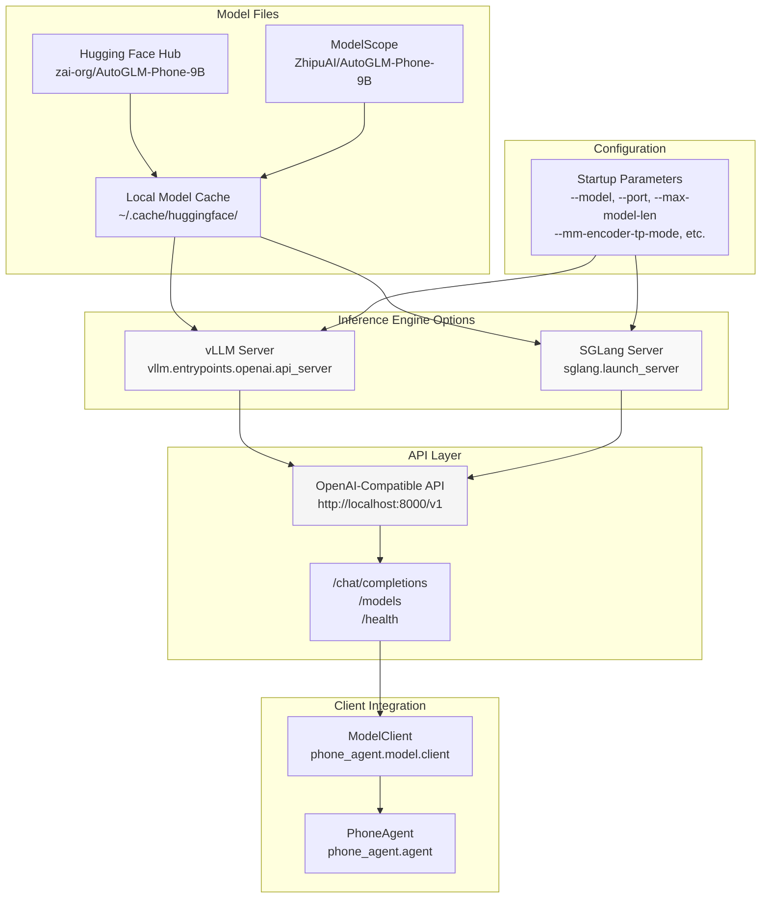
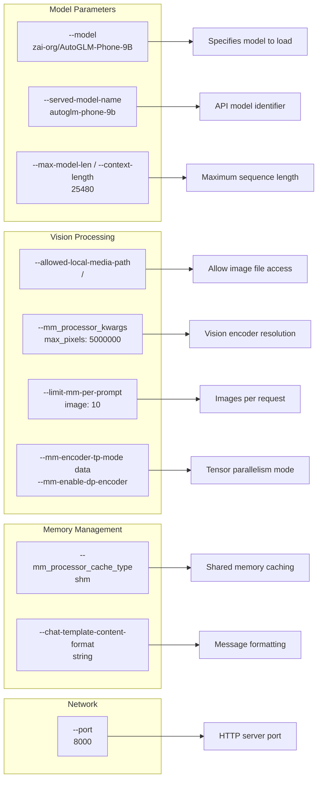
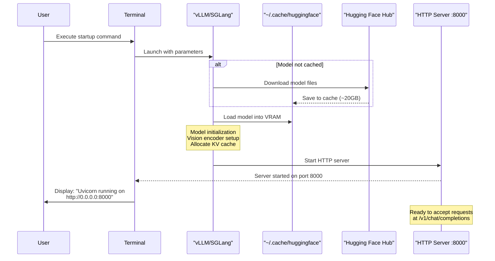

<!-- source: DeepWiki mcp.deepwiki.com · repo zai-org/Open-AutoGLM · page 8.2 Self-Hosting Models · fetched 2026-10-29 -->

# Self-Hosting Models

<details>
<summary>Relevant source files</summary>

The following files were used as context for generating this wiki page:

- [README.md](README.md)
- [README_coding_agent.md](README_coding_agent.md)
- [README_en.md](README_en.md)
- [phone_agent/__init__.py](phone_agent/__init__.py)
- [requirements.txt](requirements.txt)

</details>


## Purpose and Scope

This document covers how to deploy AutoGLM-Phone models on your own infrastructure using inference engines like vLLM or SGLang. Self-hosting provides full control over model deployment, data privacy, and eliminates dependency on third-party APIs. For using hosted model services, see [Using Third-Party APIs](#8.1). For verifying your deployment, see [Deployment Verification](#8.3).

---

## Hardware Requirements

Self-hosting AutoGLM-Phone models requires substantial computational resources:

| Component | Minimum Specification | Recommended Specification |
|-----------|---------------------|---------------------------|
| GPU | NVIDIA GPU with CUDA support | NVIDIA GPU with 24GB+ VRAM |
| VRAM | 20GB+ | 24GB+ (A100, A6000, or equivalent) |
| System RAM | 32GB | 64GB+ |
| Storage | 25GB free space | 50GB+ SSD storage |
| CUDA Version | 11.8+ | 12.0+ |

The model files themselves are approximately 20GB in size. The inference engines require additional memory for runtime operations.

**Sources:** [README.md:819-823](), [README_en.md:753-756]()

---

## Software Prerequisites

Before deploying the model, ensure Python 3.10+ is installed. The inference engines (vLLM or SGLang) must also be installed, along with compatible versions of the `transformers` library.

### Installing Dependencies

Install the base AutoGLM dependencies first:

```bash
pip install -r requirements.txt
pip install -e .
```

Then install your chosen inference engine. Note that dependency conflicts related to `transformers` can be ignored as they will be resolved in subsequent steps.

**Sources:** [requirements.txt:1-20](), [README.md:129-132]()

---

## Model Variants

AutoGLM provides two model variants, each optimized for different language scenarios:

| Model Name | Model ID | Optimization | Use Case |
|-----------|----------|--------------|----------|
| AutoGLM-Phone-9B | `zai-org/AutoGLM-Phone-9B` | Chinese mobile apps | Primary Chinese language tasks |
| AutoGLM-Phone-9B-Multilingual | `zai-org/AutoGLM-Phone-9B-Multilingual` | English and multilingual | English scenarios and mixed-language content |

Both models share the same architecture as `GLM-4.1V-9B-Thinking` and are available from:
- Hugging Face: `https://huggingface.co/zai-org/`
- ModelScope: `https://modelscope.cn/models/ZhipuAI/`

The inference engines will automatically download the model on first startup if not already cached locally.

**Sources:** [README.md:48-55](), [README_en.md:38-45]()

---

## Inference Engine Architecture



**Diagram: Self-Hosted Model Deployment Architecture** - This shows the complete flow from model source to PhoneAgent integration. The inference engines (vLLM or SGLang) load the model from cache and expose an OpenAI-compatible API that `ModelClient` consumes.

**Sources:** [README.md:197-261](), [README_en.md:189-213]()

---

## vLLM Deployment

vLLM is a high-throughput inference engine optimized for large language models with vision capabilities.

### Installation Options

**Option 1: pip Installation**

```bash
pip install vllm>=0.12.0
# After installation, upgrade transformers
pip install -U transformers --pre
```

**Option 2: Docker Installation**

```bash
docker pull vllm/vllm-openai:v0.12.0
# Enter container and upgrade transformers
docker run -it vllm/vllm-openai:v0.12.0 bash
pip install -U transformers --pre
```

### Starting the vLLM Service

The following command starts the vLLM server with required parameters. **These parameters must be strictly followed** to ensure correct model behavior:

```bash
python3 -m vllm.entrypoints.openai.api_server \
  --served-model-name autoglm-phone-9b \
  --allowed-local-media-path / \
  --mm-encoder-tp-mode data \
  --mm_processor_cache_type shm \
  --mm_processor_kwargs "{\"max_pixels\":5000000}" \
  --max-model-len 25480 \
  --chat-template-content-format string \
  --limit-mm-per-prompt "{\"image\":10}" \
  --model zai-org/AutoGLM-Phone-9B \
  --port 8000
```

For the multilingual model, replace the model path:

```bash
python3 -m vllm.entrypoints.openai.api_server \
  --served-model-name autoglm-phone-9b-multilingual \
  --allowed-local-media-path / \
  --mm-encoder-tp-mode data \
  --mm_processor_cache_type shm \
  --mm_processor_kwargs "{\"max_pixels\":5000000}" \
  --max-model-len 25480 \
  --chat-template-content-format string \
  --limit-mm-per-prompt "{\"image\":10}" \
  --model zai-org/AutoGLM-Phone-9B-Multilingual \
  --port 8000
```

After successful startup, the service will be accessible at `http://localhost:8000/v1`.

**Sources:** [README.md:215-245](), [README_en.md:194-208]()

---

## SGLang Deployment

SGLang (Structured Generation Language) is an alternative inference engine with efficient memory management for vision-language models.

### Installation Options

**Option 1: pip Installation**

```bash
pip install sglang>=0.5.6.post1
```

**Option 2: Docker Installation**

```bash
docker pull lmsysorg/sglang:v0.5.6.post1
# Enter container and install cudnn
docker run -it lmsysorg/sglang:v0.5.6.post1 bash
pip install nvidia-cudnn-cu12==9.16.0.29
```

### Starting the SGLang Service

```bash
python3 -m sglang.launch_server \
  --model-path zai-org/AutoGLM-Phone-9B \
  --served-model-name autoglm-phone-9b \
  --context-length 25480 \
  --mm-enable-dp-encoder \
  --mm-process-config '{"image":{"max_pixels":5000000}}' \
  --port 8000
```

For the multilingual model:

```bash
python3 -m sglang.launch_server \
  --model-path zai-org/AutoGLM-Phone-9B-Multilingual \
  --served-model-name autoglm-phone-9b-multilingual \
  --context-length 25480 \
  --mm-enable-dp-encoder \
  --mm-process-config '{"image":{"max_pixels":5000000}}' \
  --port 8000
```

**Sources:** [README.md:204-214](), [README.md:247-256]()

---

## Critical Startup Parameters



**Diagram: Startup Parameter Categories** - Parameters are grouped by functionality. Vision processing parameters are critical for screenshot analysis.

### Parameter Explanations

| Parameter | vLLM | SGLang | Purpose |
|-----------|------|--------|---------|
| `--model` / `--model-path` | ✓ | ✓ | Model identifier on HuggingFace or local path |
| `--served-model-name` | ✓ | ✓ | Name exposed through OpenAI API (used in requests) |
| `--max-model-len` / `--context-length` | ✓ | ✓ | Maximum total tokens (text + image embeddings) |
| `--allowed-local-media-path` | ✓ | - | Allows loading images from filesystem |
| `--mm-encoder-tp-mode` | ✓ | - | Multi-modal encoder tensor parallelism mode |
| `--mm-enable-dp-encoder` | - | ✓ | Enable data parallel vision encoder |
| `--mm_processor_cache_type` | ✓ | - | Cache type for vision preprocessing |
| `--mm_processor_kwargs` / `--mm-process-config` | ✓ | ✓ | Vision processor configuration (max_pixels) |
| `--limit-mm-per-prompt` | ✓ | - | Maximum images per chat completion request |
| `--chat-template-content-format` | ✓ | - | Format for chat template content |
| `--port` | ✓ | ✓ | HTTP server port (default 8000) |

The `max_pixels: 5000000` setting allows processing high-resolution phone screenshots (typically 1080x2400 pixels or similar). The context length of 25480 tokens accommodates multiple screenshot embeddings plus text history.

**Sources:** [README.md:231-244](), [README.md:250-255]()

---

## Deployment Process Flow



**Diagram: Model Startup Sequence** - Shows the initialization process from command execution to ready state.

### Step-by-Step Deployment

1. **Install inference engine** (vLLM or SGLang) following the installation commands above
2. **Verify GPU availability**: Run `nvidia-smi` to confirm CUDA is working
3. **Start the server**: Execute the appropriate startup command for your chosen engine
4. **Monitor initialization**: Watch for model download progress (first run only) and startup messages
5. **Wait for ready state**: Server will display "Uvicorn running on http://0.0.0.0:8000"
6. **Test connectivity**: The service exposes OpenAI-compatible endpoints

The first startup will take longer as the model downloads. Subsequent starts will load from cache.

**Sources:** [README.md:229-261](), [README_en.md:196-212]()

---

## Integration with PhoneAgent

Once the inference server is running, configure `PhoneAgent` to use it via the `ModelConfig`:

```python
from phone_agent import PhoneAgent
from phone_agent.model import ModelConfig

# Configure to use self-hosted model
model_config = ModelConfig(
    base_url="http://localhost:8000/v1",  # Self-hosted endpoint
    model_name="autoglm-phone-9b",        # Must match --served-model-name
    api_key="EMPTY",                       # Local server doesn't require auth
)

agent = PhoneAgent(model_config=model_config)
result = agent.run("Open Settings")
```

Alternatively, use command-line arguments:

```bash
# Chinese model
python main.py --base-url http://localhost:8000/v1 \
               --model "autoglm-phone-9b" \
               "打开微信"

# Multilingual model
python main.py --base-url http://localhost:8000/v1 \
               --model "autoglm-phone-9b-multilingual" \
               --lang en \
               "Open Chrome browser"
```

### Remote Deployment

If deploying on a remote server, replace `localhost` with the server's IP address:

```bash
python main.py --base-url http://192.168.1.100:8000/v1 \
               --model "autoglm-phone-9b" \
               "Open WeChat"
```

Ensure the server's port 8000 is accessible from the client machine (check firewalls and network policies).

**Sources:** [README.md:261](), [README.md:328-344](), [README_en.md:268-284]()

---

## vLLM vs SGLang Comparison

| Feature | vLLM | SGLang | Notes |
|---------|------|--------|-------|
| Maturity | Stable, widely adopted | Newer, active development | vLLM has larger community |
| Memory Efficiency | Good | Optimized for VLMs | SGLang may use less VRAM |
| Throughput | High | High | Both suitable for production |
| Parameter Syntax | More verbose | More concise | Different CLI conventions |
| Docker Support | Official images | Official images | Both provide pre-built containers |
| Installation Complexity | Medium | Medium | Both require CUDA setup |

Both engines are production-ready. vLLM is recommended for users familiar with the ecosystem, while SGLang may offer better memory efficiency for vision-language workloads. The AutoGLM team provides tested configurations for both.

**Sources:** [README.md:204-256]()

---

## Model Service API Endpoints

Once deployed, the inference server exposes OpenAI-compatible endpoints:

| Endpoint | Method | Purpose |
|----------|--------|---------|
| `/v1/chat/completions` | POST | Submit chat completion requests with images |
| `/v1/models` | GET | List available models |
| `/health` | GET | Health check endpoint |

The `ModelClient` class in [phone_agent/model/client.py]() communicates with `/v1/chat/completions` to send screenshot images and receive structured action responses.

**Sources:** [README.md:261](), Architecture diagrams from system overview

---

## Troubleshooting

### Model Download Failures

If model download fails or is interrupted:
- Check internet connectivity to Hugging Face
- Manually download using: `huggingface-cli download zai-org/AutoGLM-Phone-9B`
- Set `HF_HOME` environment variable to control cache location

### Out of Memory Errors

If encountering CUDA OOM:
- Reduce `--max-model-len` (minimum 8192 for basic operation)
- Close other GPU-intensive processes
- Use a GPU with more VRAM
- Consider model quantization (not officially supported but may work)

### Startup Hangs

If server hangs during initialization:
- Verify `transformers` version is 5.0.0rc0 or higher
- Check CUDA/cuDNN versions match inference engine requirements
- Review logs for specific error messages
- Ensure sufficient disk space for model cache

### Connection Refused

If PhoneAgent cannot connect:
- Verify server is running: `curl http://localhost:8000/health`
- Check firewall rules for port 8000
- Ensure `--base-url` in PhoneAgent config matches server address
- Try `http://127.0.0.1:8000/v1` instead of `localhost`

**Sources:** [README.md:700-751](), [README_en.md:637-683]()

---

## Performance Tuning

### Batch Size Configuration

For higher throughput when processing multiple requests:
- vLLM: Use `--max-num-batched-tokens` and `--max-num-seqs`
- SGLang: Automatically manages batching

### GPU Utilization

Monitor with `nvidia-smi` during operation. Expected VRAM usage:
- Base model: ~18-20GB
- Peak with context: ~22-24GB

If GPU utilization is low, bottleneck may be in CPU preprocessing or data transfer.

### Tensor Parallelism

For multi-GPU setups:
- vLLM: Add `--tensor-parallel-size N` where N is number of GPUs
- SGLang: Add `--tp-size N`

This distributes model weights across GPUs for better performance and capacity.

**Sources:** Technical architecture understanding, not explicitly in provided files

---

After deployment, proceed to [Deployment Verification](#8.3) to validate the model service is working correctly before using it with PhoneAgent tasks.

---

