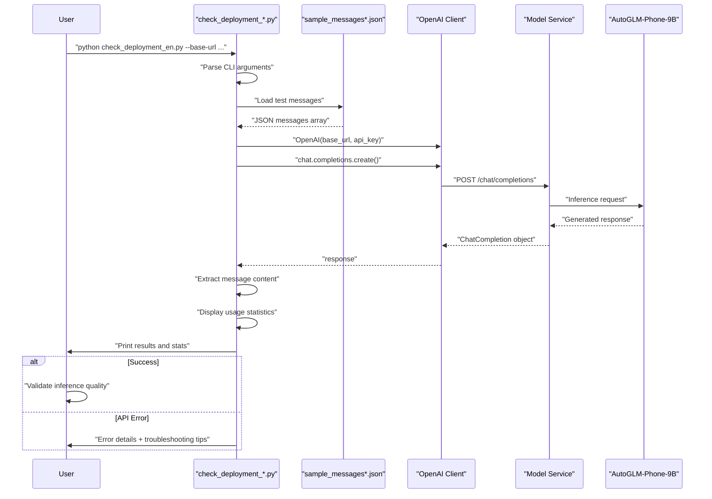
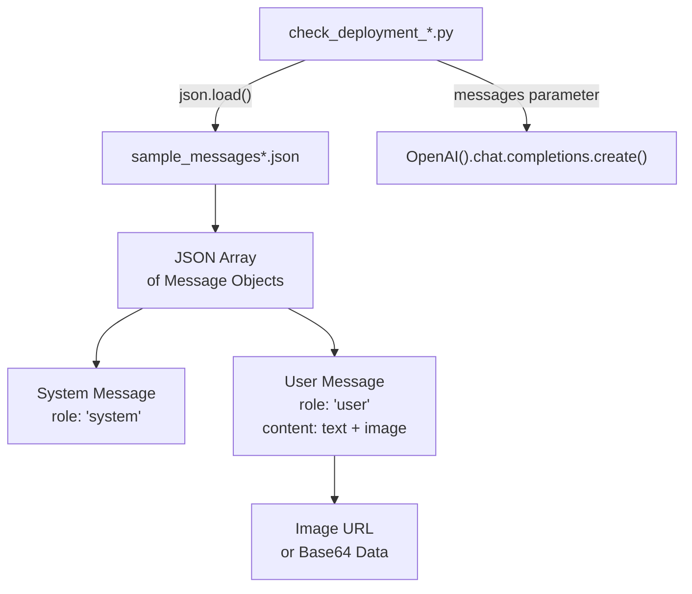
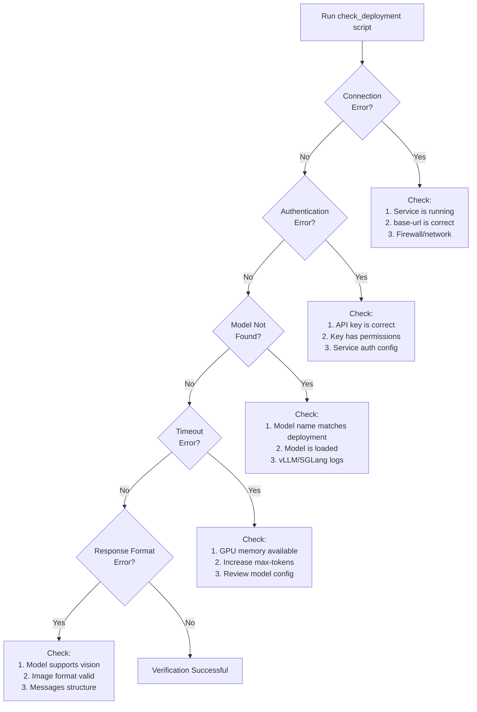

<!-- source: DeepWiki mcp.deepwiki.com · repo zai-org/Open-AutoGLM · page 8.3 Deployment Verification · fetched 2026-10-29 -->

# Deployment Verification

<details>
<summary>Relevant source files</summary>

The following files were used as context for generating this wiki page:

- [README_coding_agent.md](README_coding_agent.md)
- [README_en.md](README_en.md)
- [phone_agent/config/i18n.py](phone_agent/config/i18n.py)
- [phone_agent/model/client.py](phone_agent/model/client.py)
- [scripts/check_deployment_cn.py](scripts/check_deployment_cn.py)
- [scripts/check_deployment_en.py](scripts/check_deployment_en.py)
- [scripts/sample_messages.json](scripts/sample_messages.json)
- [scripts/sample_messages_en.json](scripts/sample_messages_en.json)

</details>


This document explains how to verify that a model service deployment is working correctly using the provided deployment check scripts. After setting up a model service (see [Using Third-Party APIs](#8.1) or [Self-Hosting Models](#8.2)), these tools validate API connectivity, model availability, and inference quality.

## Purpose and Scope

The deployment verification scripts test whether:
- The model API endpoint is accessible
- Authentication credentials are valid
- The specified model is available and responsive
- The model produces valid inference results for mobile automation tasks
- Token usage statistics are correctly reported

These scripts do not test the full Open-AutoGLM agent execution loop. For end-to-end testing with actual device operations, see [Quick Start](#2.2).

## Available Verification Scripts

Open-AutoGLM provides two functionally identical verification scripts in different languages:

| Script | Language | Default Messages File | Purpose |
|--------|----------|----------------------|---------|
| `scripts/check_deployment_en.py` | English | `scripts/sample_messages_en.json` | Verify deployment with English test prompts |
| `scripts/check_deployment_cn.py` | Chinese | `scripts/sample_messages.json` | Verify deployment with Chinese test prompts |

Both scripts use the OpenAI Python client to send test requests to the model service and validate responses [scripts/check_deployment_en.py:5]().

**Sources:** scripts/check_deployment_en.py, scripts/check_deployment_cn.py

## Verification Workflow



**Verification Flow Diagram**

The script follows this sequence:
1. Parse command-line arguments for API configuration [scripts/check_deployment_en.py:8-71]()
2. Load test messages from JSON file [scripts/check_deployment_en.py:74-79]()
3. Initialize OpenAI client with provided credentials [scripts/check_deployment_en.py:92-95]()
4. Send chat completion request with test messages [scripts/check_deployment_en.py:97-105]()
5. Display inference result and token usage statistics [scripts/check_deployment_en.py:107-120]()
6. Handle connection or API errors with diagnostic information [scripts/check_deployment_en.py:122-129]()

**Sources:** scripts/check_deployment_en.py

## Command-Line Options

Both scripts accept identical command-line arguments:

| Argument | Type | Required | Default | Description |
|----------|------|----------|---------|-------------|
| `--base-url` | string | Yes | - | Base URL of the API service (e.g., `http://localhost:8000/v1`) [scripts/check_deployment_en.py:18-23]() |
| `--apikey` | string | No | `"EMPTY"` | API authentication key [scripts/check_deployment_en.py:25-27]() |
| `--model` | string | Yes | - | Model name to test (e.g., `autoglm-phone-9b`) [scripts/check_deployment_en.py:29-34]() |
| `--messages-file` | string | No | `scripts/sample_messages_en.json` (EN) / `scripts/sample_messages.json` (CN) | Path to JSON file containing test messages [scripts/check_deployment_en.py:36-41]() |
| `--max-tokens` | integer | No | `3000` | Maximum generation tokens [scripts/check_deployment_en.py:43-48]() |
| `--temperature` | float | No | `0.0` | Sampling temperature for deterministic output [scripts/check_deployment_en.py:50-55]() |
| `--top_p` | float | No | `0.85` | Nucleus sampling parameter [scripts/check_deployment_en.py:57-62]() |
| `--frequency_penalty` | float | No | `0.2` | Frequency penalty to reduce repetition [scripts/check_deployment_en.py:64-69]() |

### Usage Examples

**Test local vLLM deployment:**
```bash
python scripts/check_deployment_en.py \
  --base-url http://localhost:8000/v1 \
  --apikey EMPTY \
  --model autoglm-phone-9b
```

**Test third-party API service:**
```bash
python scripts/check_deployment_en.py \
  --base-url https://api.z.ai/v1 \
  --apikey your-api-key \
  --model autoglm-phone-9b
```

**Use custom test messages:**
```bash
python scripts/check_deployment_cn.py \
  --base-url http://localhost:8000/v1 \
  --apikey EMPTY \
  --model autoglm-phone-9b \
  --messages-file my_test_messages.json
```

**Sources:** scripts/check_deployment_en.py, scripts/check_deployment_cn.py

## Test Messages Structure



**Test Messages Structure Diagram**

The messages file contains a JSON array conforming to the OpenAI chat completions format:

```json
[
  {
    "role": "system",
    "content": "System prompt defining the agent's capabilities..."
  },
  {
    "role": "user",
    "content": [
      {"type": "text", "text": "Task description..."},
      {"type": "image_url", "image_url": {"url": "data:image/jpeg;base64,..."}}
    ]
  }
]
```

The default sample messages simulate a real mobile automation scenario with:
- System prompt describing the agent's role and available actions
- User task requiring screen analysis and action planning
- Screenshot image (base64-encoded) for visual context

Scripts load these messages and pass them directly to the OpenAI client [scripts/check_deployment_en.py:78-79](), [scripts/check_deployment_en.py:98]().

**Sources:** scripts/check_deployment_en.py

## Interpreting Results

### Successful Verification

A successful verification produces output like:

```
Starting model inference test...
Base URL: http://localhost:8000/v1
Model: autoglm-phone-9b
Messages file: scripts/sample_messages_en.json
================================================================================

Model inference result:
================================================================================
Thinking: I can see a mobile screen showing... [reasoning about the image]
Action: Tap(0.5, 0.3)
================================================================================

Statistics:
  - Prompt tokens: 1245
  - Completion tokens: 156
  - Total tokens: 1401

Please evaluate the above inference result to determine if the model 
deployment meets expectations.
```

The script displays:
1. **Configuration summary:** Confirms the API endpoint, model name, and messages file used [scripts/check_deployment_en.py:85-89]()
2. **Inference result:** The model's complete response, which should contain reasoning and an action [scripts/check_deployment_en.py:107-110]()
3. **Usage statistics:** Token counts for prompt, completion, and total [scripts/check_deployment_en.py:112-116]()

**Validation criteria:**
- Response contains structured thinking and action components
- Action format matches expected syntax (e.g., `Tap(x, y)`, `Type(text)`)
- Response is relevant to the test scenario
- Token usage is within expected ranges

### Error Conditions

The script catches and reports errors with diagnostic information [scripts/check_deployment_en.py:122-129]():

```
Error occurred while calling API:
Error type: ConnectionError
Error message: HTTPConnectionPool(host='localhost', port=8000): 
  Max retries exceeded with url: /v1/chat/completions

Tip: Please check if base_url, api_key and model parameters are correct, 
and if the service is running.
```

**Sources:** scripts/check_deployment_en.py

## Common Issues and Troubleshooting



**Troubleshooting Decision Tree**

### Issue: Connection Refused

**Symptoms:**
- `ConnectionError` or `ConnectionRefusedError`
- `Max retries exceeded`

**Solutions:**
1. Verify the model service is running:
   - For vLLM: Check the process is active and listening on the expected port
   - For third-party APIs: Verify service status via their dashboard
2. Confirm `--base-url` matches the service configuration
3. Test basic connectivity: `curl http://localhost:8000/v1/models`

### Issue: Authentication Failed

**Symptoms:**
- `401 Unauthorized` or `403 Forbidden`
- Authentication error messages

**Solutions:**
1. Verify API key is correct for third-party services
2. For local vLLM with `--api-key`, ensure `--apikey` matches
3. For services without authentication, use `--apikey EMPTY` (default)

### Issue: Model Not Found

**Symptoms:**
- `404 Not Found` or model not available error
- Model name not recognized

**Solutions:**
1. List available models: `curl http://localhost:8000/v1/models`
2. Ensure `--model` parameter matches exactly (case-sensitive)
3. For vLLM, check the model was loaded successfully in startup logs

### Issue: Poor Inference Quality

**Symptoms:**
- Response doesn't contain expected action format
- Response is gibberish or truncated
- Response doesn't address the test scenario

**Solutions:**
1. Check model version matches expected `autoglm-phone-9b`
2. Verify model was quantized/converted correctly
3. Review GPU memory usage - insufficient VRAM causes degraded performance
4. Try different sampling parameters (temperature, top_p)
5. Examine the test messages file for corruption

### Issue: Slow Response

**Symptoms:**
- Long wait time before response
- Timeouts with large prompts

**Solutions:**
1. Check GPU utilization: `nvidia-smi`
2. Reduce `--max-tokens` if model is generating too much
3. For vLLM, review tensor parallelism settings
4. Consider using SGLang for potentially faster inference

**Sources:** scripts/check_deployment_en.py, scripts/check_deployment_cn.py

## Integration with Agent Configuration

After successful deployment verification, configure Open-AutoGLM to use the validated endpoint:

**Via environment variables:**
```bash
export PHONE_AGENT_MODEL_BASE_URL="http://localhost:8000/v1"
export PHONE_AGENT_MODEL_API_KEY="EMPTY"
export PHONE_AGENT_MODEL_MODEL_NAME="autoglm-phone-9b"
```

**Via CLI arguments:**
```bash
python main.py \
  --base-url http://localhost:8000/v1 \
  --apikey EMPTY \
  --model autoglm-phone-9b \
  "Open Maps and search for coffee shops"
```

**Via Python API:**
```python
from phone_agent import PhoneAgent, ModelConfig

model_config = ModelConfig(
    base_url="http://localhost:8000/v1",
    api_key="EMPTY",
    model_name="autoglm-phone-9b"
)

agent = PhoneAgent(model_config=model_config)
```

For complete configuration options, see [Configuration Management](#5.4).

**Sources:** scripts/check_deployment_en.py

## Advanced Verification

### Custom Test Scenarios

Create custom message files to test specific scenarios:

```json
[
  {
    "role": "system",
    "content": "Your system prompt..."
  },
  {
    "role": "user", 
    "content": [
      {"type": "text", "text": "Custom test task..."},
      {"type": "image_url", "image_url": {"url": "file:///path/to/test.jpg"}}
    ]
  }
]
```

Then verify:
```bash
python scripts/check_deployment_en.py \
  --base-url http://localhost:8000/v1 \
  --model autoglm-phone-9b \
  --messages-file custom_test.json
```

### Automated Verification

Integrate verification into deployment pipelines:

```bash
#!/bin/bash
# deploy_and_verify.sh

# Start model service
python -m vllm.entrypoints.openai.api_server \
  --model ZaiData/autoglm-phone-9b \
  --port 8000 &

# Wait for service to be ready
sleep 30

# Verify deployment
python scripts/check_deployment_en.py \
  --base-url http://localhost:8000/v1 \
  --model autoglm-phone-9b

if [ $? -eq 0 ]; then
    echo "Deployment verified successfully"
else
    echo "Deployment verification failed"
    exit 1
fi
```

### Performance Benchmarking

Monitor inference performance across multiple runs:

```bash
# Run verification multiple times to check consistency
for i in {1..5}; do
  echo "Run $i:"
  python scripts/check_deployment_en.py \
    --base-url http://localhost:8000/v1 \
    --model autoglm-phone-9b \
  | grep "Total tokens"
done
```

**Sources:** scripts/check_deployment_en.py

---

