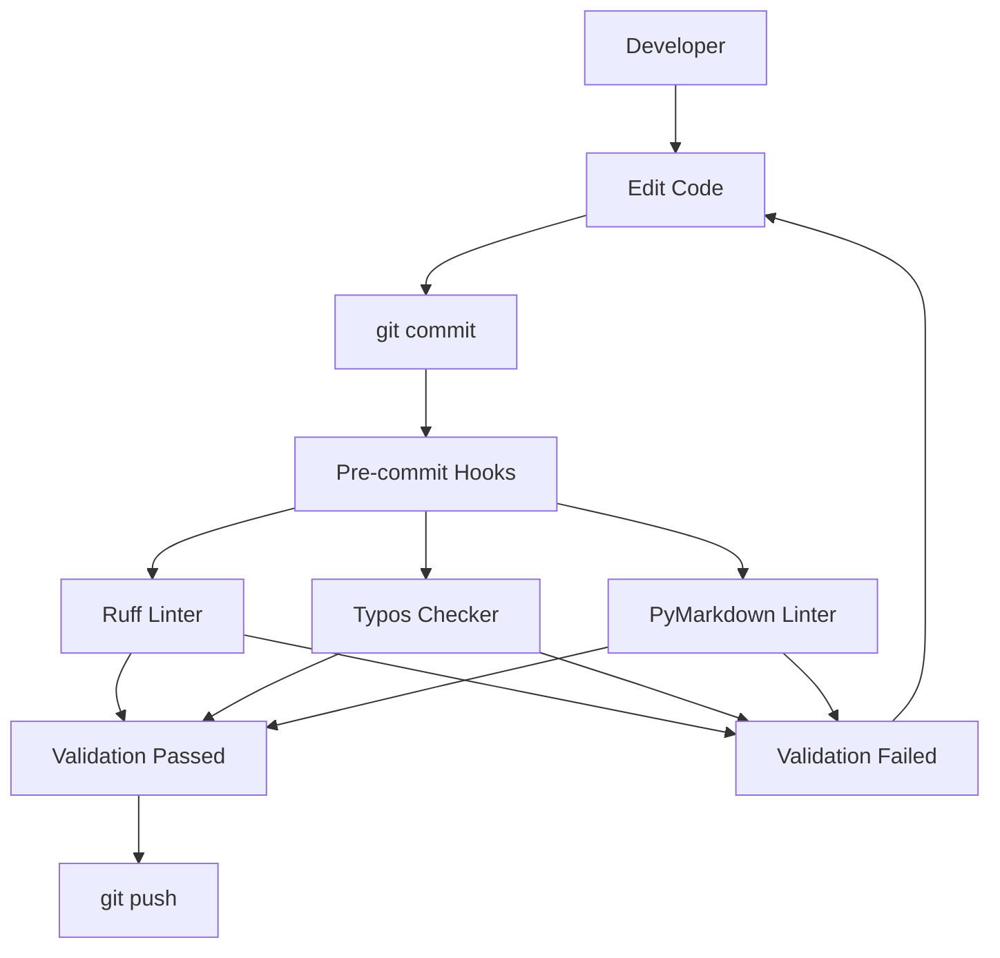
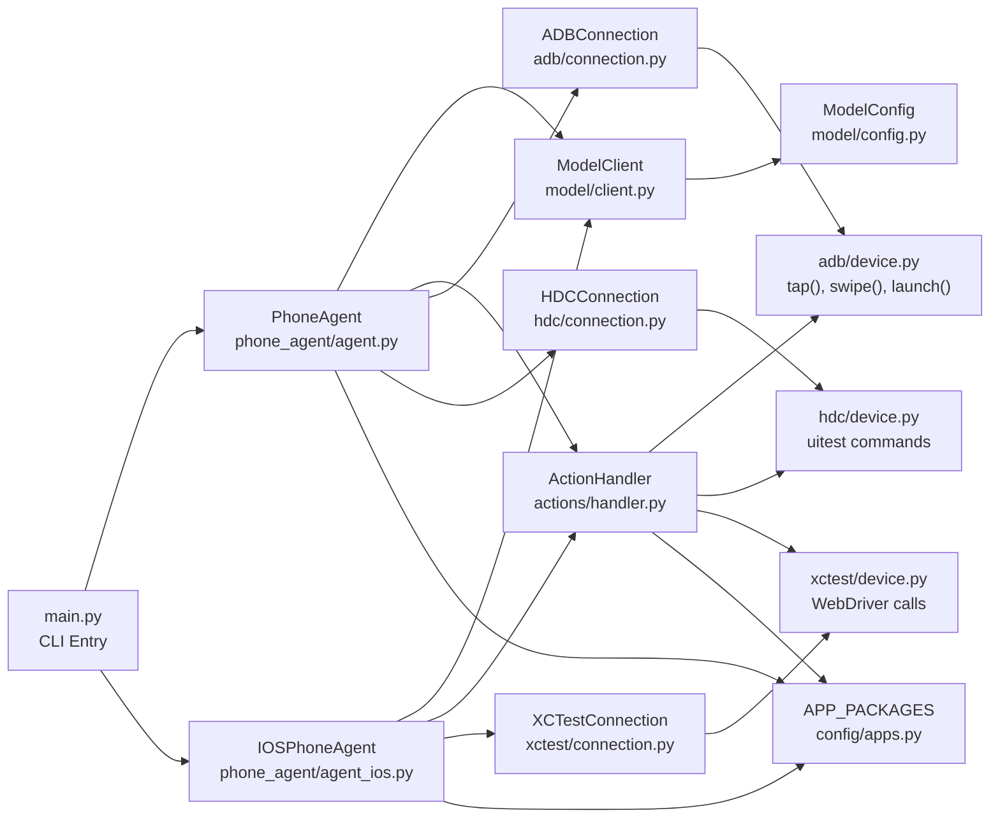
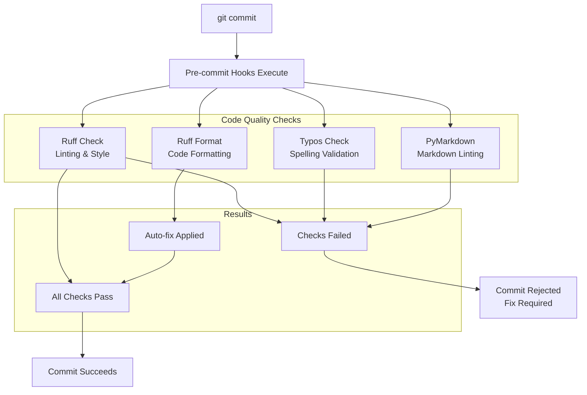

<!-- source: DeepWiki mcp.deepwiki.com · repo zai-org/Open-AutoGLM · page 9 Development Guide · fetched 2026-10-29 -->

# Development Guide

<details>
<summary>Relevant source files</summary>

The following files were used as context for generating this wiki page:

- [.gitignore](.gitignore)
- [.pre-commit-config.yaml](.pre-commit-config.yaml)
- [phone_agent/__init__.py](phone_agent/__init__.py)
- [requirements.txt](requirements.txt)

</details>


This document provides resources for developers who want to contribute to or extend the Open-AutoGLM framework. It covers project structure, development environment setup, code quality tools, and testing procedures.

For information about using Open-AutoGLM as an end user, see [Getting Started](#2). For extending the agent's capabilities through custom callbacks, see [Custom Callbacks](#6.3).

---

## Development Workflow Overview

The Open-AutoGLM development workflow emphasizes code quality, automated testing, and consistent formatting. All code contributions are validated through pre-commit hooks before entering version control.



**Development Workflow Diagram**

Sources: [README.md:652-666]()

---

## Project Structure

The codebase is organized into modular components that separate concerns across device communication, action execution, AI model integration, and configuration.

### Core Module Organization

```mermaid
graph TB
    ROOT["phone_agent/"]
    
    INIT["__init__.py<br/>Exports: PhoneAgent, IOSPhoneAgent"]
    AGENT["agent.py<br/>Class: PhoneAgent"]
    AGENT_IOS["agent_ios.py<br/>Class: IOSPhoneAgent"]
    
    ADB_PKG["adb/<br/>Android Debug Bridge"]
    ADB_CONN["adb/connection.py<br/>Class: ADBConnection"]
    ADB_DEV["adb/device.py<br/>Device control functions"]
    ADB_SS["adb/screenshot.py<br/>Screenshot capture"]
    ADB_INPUT["adb/input.py<br/>ADB Keyboard integration"]
    
    HDC_PKG["hdc/<br/>HarmonyOS Debug Client"]
    HDC_CONN["hdc/connection.py<br/>Class: HDCConnection"]
    HDC_DEV["hdc/device.py<br/>UITest commands"]
    
    XCTEST_PKG["xctest/<br/>iOS WebDriverAgent"]
    XCTEST_CONN["xctest/connection.py<br/>Class: XCTestConnection"]
    XCTEST_DEV["xctest/device.py<br/>WebDriver operations"]
    
    ACTIONS_PKG["actions/"]
    HANDLER["actions/handler.py<br/>Class: ActionHandler"]
    
    MODEL_PKG["model/"]
    MODEL_CLIENT["model/client.py<br/>Class: ModelClient"]
    MODEL_CFG["model/config.py<br/>Class: ModelConfig"]
    
    CONFIG_PKG["config/"]
    APPS["config/apps.py<br/>Dict: APP_PACKAGES"]
    PROMPTS_CN["config/prompts_zh.py<br/>SYSTEM_PROMPT_CN"]
    PROMPTS_EN["config/prompts_en.py<br/>SYSTEM_PROMPT_EN"]
    TIMING["config/timing.py<br/>Timing constants"]
    
    ROOT --> INIT
    ROOT --> AGENT
    ROOT --> AGENT_IOS
    ROOT --> ADB_PKG
    ROOT --> HDC_PKG
    ROOT --> XCTEST_PKG
    ROOT --> ACTIONS_PKG
    ROOT --> MODEL_PKG
    ROOT --> CONFIG_PKG
    
    ADB_PKG --> ADB_CONN
    ADB_PKG --> ADB_DEV
    ADB_PKG --> ADB_SS
    ADB_PKG --> ADB_INPUT
    
    HDC_PKG --> HDC_CONN
    HDC_PKG --> HDC_DEV
    
    XCTEST_PKG --> XCTEST_CONN
    XCTEST_PKG --> XCTEST_DEV
    
    ACTIONS_PKG --> HANDLER
    
    MODEL_PKG --> MODEL_CLIENT
    MODEL_PKG --> MODEL_CFG
    
    CONFIG_PKG --> APPS
    CONFIG_PKG --> PROMPTS_CN
    CONFIG_PKG --> PROMPTS_EN
    CONFIG_PKG --> TIMING
```



**Module Structure Diagram**

Sources: [README.md:668-687](), [phone_agent/__init__.py:1-13]()

### Directory Layout

| Directory/File | Purpose | Key Classes/Functions |
|----------------|---------|----------------------|
| `phone_agent/agent.py` | Android/HarmonyOS agent implementation | `PhoneAgent`, `AgentConfig` |
| `phone_agent/agent_ios.py` | iOS agent implementation | `IOSPhoneAgent` |
| `phone_agent/adb/` | Android device communication | `ADBConnection`, `list_devices()` |
| `phone_agent/hdc/` | HarmonyOS device communication | `HDCConnection`, `list_devices()` |
| `phone_agent/xctest/` | iOS device communication | `XCTestConnection`, WebDriver operations |
| `phone_agent/actions/handler.py` | Action parsing and execution | `ActionHandler` |
| `phone_agent/model/client.py` | AI model API client | `ModelClient` |
| `phone_agent/model/config.py` | Model configuration | `ModelConfig` |
| `phone_agent/config/apps.py` | Application package mappings | `APP_PACKAGES` dictionary |
| `phone_agent/config/prompts_zh.py` | Chinese system prompts | `SYSTEM_PROMPT_CN` |
| `phone_agent/config/prompts_en.py` | English system prompts | `SYSTEM_PROMPT_EN` |
| `phone_agent/config/timing.py` | Timing configuration | Delay/timeout constants |
| `main.py` | CLI entry point | Command-line interface |
| `examples/` | Usage examples | Sample scripts |
| `scripts/` | Utility scripts | Deployment verification |
| `tests/` | Unit tests | pytest test suite |

Sources: [README.md:668-687]()

### Code Entity Relationships



**Code Entity Relationships Diagram**

Sources: [phone_agent/__init__.py:1-13](), [README.md:668-687]()

---

## Development Environment Setup

### Prerequisites

- Python 3.10 or higher
- Git for version control
- Device debugging tools (ADB, HDC, or Xcode depending on target platform)

### Installation Steps

#### 1. Clone Repository

```bash
git clone https://github.com/zai-org/Open-AutoGLM.git
cd Open-AutoGLM
```

#### 2. Create Virtual Environment

```bash
# Create virtual environment
python -m venv venv

# Activate virtual environment
# On macOS/Linux:
source venv/bin/activate
# On Windows:
venv\Scripts\activate
```

#### 3. Install Development Dependencies

The development installation includes testing tools, code formatters, and linters:

```bash
# Install package in editable mode with development dependencies
pip install -e ".[dev]"
```

This installs:
- `pytest` for unit testing
- `pre-commit` for git hooks
- `ruff` for linting and formatting
- Type checking tools

Sources: [README.md:652-666](), [requirements.txt:16-20]()

#### 4. Install Pre-commit Hooks

Pre-commit hooks automatically validate code before commits:

```bash
# Install pre-commit hooks
pre-commit install

# Run hooks manually on all files
pre-commit run --all-files
```

Sources: [README.md:652-666]()

### Development Dependencies

The optional development dependencies in `requirements.txt` include:

| Package | Purpose | Version |
|---------|---------|---------|
| `pytest` | Unit testing framework | >=7.0.0 |
| `pre-commit` | Git hook management | >=4.5.0 |
| `black` | Code formatter (legacy, now using ruff) | >=23.0.0 |
| `mypy` | Static type checker | >=1.0.0 |

Sources: [requirements.txt:16-20]()

---

## Code Quality and Pre-commit Hooks

Open-AutoGLM uses automated code quality checks to maintain consistency and catch errors before they reach version control.

### Pre-commit Hook Configuration

The repository uses `.pre-commit-config.yaml` to define validation steps. Each commit triggers the following checks:



**Pre-commit Hook Flow Diagram**

### Ruff Linter and Formatter

Ruff is used for both linting and code formatting. It replaces multiple tools (flake8, black, isort) with a single fast Rust-based tool.

**Key Ruff Features:**
- Code style enforcement (PEP 8 compliance)
- Import sorting and organization
- Unused import detection
- Line length enforcement
- Automatic code formatting

**Running Ruff Manually:**

```bash
# Check code for issues
ruff check .

# Auto-fix issues where possible
ruff check --fix .

# Format code
ruff format .
```

### Typos Checker

The `typos` tool catches spelling mistakes in code comments, strings, and documentation.

**Running Typos Manually:**

```bash
# Check for typos
typos

# Fix typos automatically (use with caution)
typos --write-changes
```

### PyMarkdown Linter

PyMarkdown validates markdown documentation files to ensure proper formatting and structure.

**Running PyMarkdown Manually:**

```bash
# Check markdown files
pymarkdown scan README.md docs/
```

Sources: [README.md:652-666]()

### Bypassing Pre-commit Hooks

In rare cases where you need to commit without running hooks:

```bash
# Skip pre-commit hooks (not recommended)
git commit --no-verify -m "Emergency fix"
```

**Warning:** Only bypass hooks for urgent hotfixes. Always clean up code quality issues in a follow-up commit.

---

## Testing

### Running Tests

The project uses `pytest` for unit testing:

```bash
# Run all tests
pytest tests/

# Run tests with verbose output
pytest -v tests/

# Run specific test file
pytest tests/test_specific.py

# Run tests matching a pattern
pytest -k "test_connection" tests/
```

Sources: [README.md:663-666]()

### Test Structure

Tests should be organized under the `tests/` directory, mirroring the `phone_agent/` module structure:

```
tests/
├── test_agent.py              # PhoneAgent tests
├── test_agent_ios.py          # IOSPhoneAgent tests
├── test_adb_connection.py     # ADB connection tests
├── test_hdc_connection.py     # HDC connection tests
├── test_actions.py            # Action handler tests
└── test_model_client.py       # Model client tests
```

### Writing Tests

Example test structure:

```python
# tests/test_example.py
import pytest
from phone_agent.model import ModelConfig

def test_model_config_creation():
    """Test ModelConfig initialization with valid parameters."""
    config = ModelConfig(
        base_url="http://localhost:8000/v1",
        model_name="test-model"
    )
    assert config.base_url == "http://localhost:8000/v1"
    assert config.model_name == "test-model"

def test_model_config_validation():
    """Test ModelConfig validation for invalid parameters."""
    with pytest.raises(ValueError):
        ModelConfig(base_url="", model_name="test-model")
```

---

## Verification Scripts

### Deployment Verification

The `scripts/` directory contains tools for verifying model deployments:

```bash
# Verify Chinese model deployment
python scripts/check_deployment_cn.py \
    --base-url http://localhost:8000/v1 \
    --model autoglm-phone-9b

# Verify with custom test messages
python scripts/check_deployment_cn.py \
    --base-url http://localhost:8000/v1 \
    --model autoglm-phone-9b \
    --messages-file custom_test.json
```

**Expected Output:**
The script sends a test screenshot and task to the model, expecting a properly formatted response with thinking process and action.

Sources: [README.md:252-276]()

### System Requirements Check

Verify that device debugging tools are properly installed:

```bash
# Check ADB installation
adb version
adb devices

# Check HDC installation (HarmonyOS)
hdc version
hdc list targets

# Check device connection
python -c "from phone_agent.adb import list_devices; print(list_devices())"
```

---

## Contributing Guidelines

### Code Style

- Follow PEP 8 style guidelines (enforced by Ruff)
- Use type hints for function parameters and return values
- Write docstrings for public functions and classes
- Keep functions focused and under 50 lines when possible

### Adding New Features

When adding new functionality:

1. **Create feature branch**: `git checkout -b feature/your-feature-name`
2. **Implement changes**: Follow existing code patterns
3. **Add tests**: Ensure new code has test coverage
4. **Update documentation**: Modify relevant wiki pages and README
5. **Run quality checks**: `pre-commit run --all-files`
6. **Submit pull request**: Include clear description of changes

### Adding New Device Actions

To add a new action type to `ActionHandler`:

1. Define action schema in [phone_agent/actions/handler.py]()
2. Implement execution logic for each device type (ADB, HDC, iOS)
3. Update action type reference documentation
4. Add validation rules for action parameters
5. Write unit tests for the new action

### Adding New Applications

To add support for a new application in `APP_PACKAGES`:

1. Locate the app's package identifier (Android/HarmonyOS) or bundle ID (iOS)
2. Add entry to [phone_agent/config/apps.py]()
3. Test the app launch functionality
4. Update the supported apps list in documentation

---

## Debugging Tools

### Verbose Mode

Enable detailed logging during development:

```python
from phone_agent import PhoneAgent
from phone_agent.model import ModelConfig
from phone_agent.agent import AgentConfig

model_config = ModelConfig(
    base_url="http://localhost:8000/v1",
    model_name="autoglm-phone-9b"
)

agent_config = AgentConfig(
    verbose=True  # Enable detailed logging
)

agent = PhoneAgent(
    model_config=model_config,
    agent_config=agent_config
)
```

Verbose mode outputs:
- AI thinking process
- Parsed actions with full JSON
- Device operation results
- Screenshot capture confirmations

Sources: [README.md:526-564]()

### Device Connection Debugging

Debug device connection issues:

```python
from phone_agent.adb import ADBConnection, list_devices

# List all connected devices
devices = list_devices()
for device in devices:
    print(f"Device ID: {device.device_id}")
    print(f"Connection Type: {device.connection_type.value}")
    print(f"Status: {device.status}")

# Test specific device connection
conn = ADBConnection()
conn.device_id = "YOUR_DEVICE_ID"
success, message = conn.test_connection()
print(f"Connection test: {message}")
```

### Model Response Inspection

Inspect raw model responses for debugging:

```python
from phone_agent.model import ModelClient, ModelConfig

config = ModelConfig(
    base_url="http://localhost:8000/v1",
    model_name="autoglm-phone-9b"
)

client = ModelClient(config)
response = client.request(messages, screenshot_path)

print("Raw Response:", response.raw_response)
print("Thinking:", response.thinking)
print("Answer:", response.answer)
```

---

## Performance Profiling

### Timing Analysis

Measure execution time of key operations:

```python
import time

start = time.time()
# Your operation here
end = time.time()
print(f"Operation took {end - start:.2f} seconds")
```

### Memory Profiling

For memory-intensive operations:

```bash
# Install memory profiler
pip install memory_profiler

# Profile a script
python -m memory_profiler your_script.py
```

---

## Related Documentation

- For configuration details, see [Configuration Reference](#7)
- For action implementation details, see [ActionHandler Architecture](#6.2)
- For device-specific setup, see [Device Support](#4)
- For model integration details, see [AI Model Integration](#3.4)

Sources: [README.md:1-981](), [phone_agent/__init__.py:1-13](), [requirements.txt:1-21]()

---

