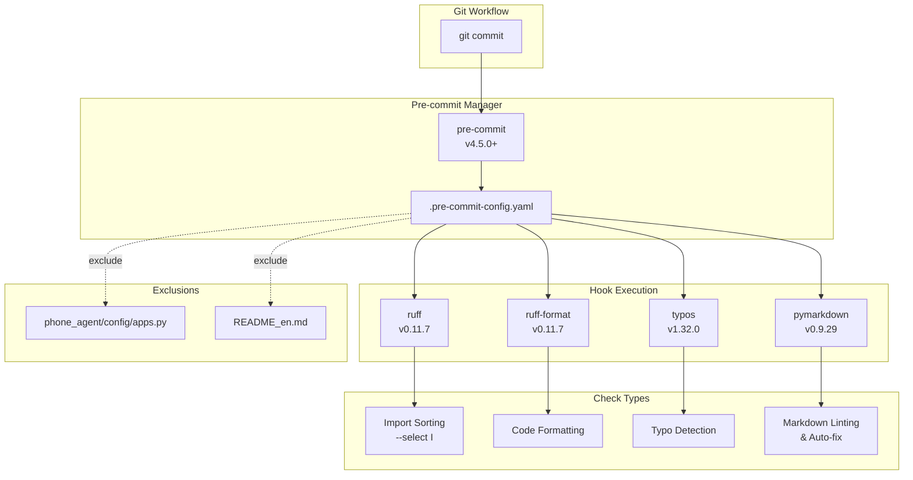
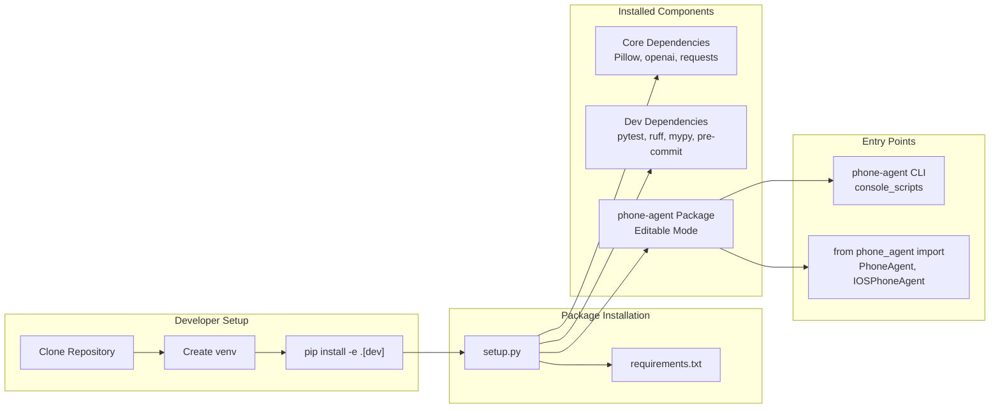

<!-- source: DeepWiki mcp.deepwiki.com · repo zai-org/Open-AutoGLM · page 9.2 Development Environment Setup · fetched 2026-10-29 -->

# Development Environment Setup

<details>
<summary>Relevant source files</summary>

The following files were used as context for generating this wiki page:

- [.pre-commit-config.yaml](.pre-commit-config.yaml)
- [LICENSE](LICENSE)
- [phone_agent/__init__.py](phone_agent/__init__.py)
- [phone_agent/adb/screenshot.py](phone_agent/adb/screenshot.py)
- [requirements.txt](requirements.txt)
- [setup.py](setup.py)

</details>


## Purpose and Scope

This page provides instructions for setting up a development environment for contributing to Open-AutoGLM. It covers Python environment configuration, dependency installation, and development tooling setup including pre-commit hooks for code quality enforcement.

For end-user installation instructions, see [Installation](#2.1). For detailed information about the pre-commit hooks and code quality standards, see [Code Quality and Pre-commit Hooks](#9.3). For an overview of the repository structure, see [Project Structure](#9.1).

---

## Prerequisites

### Python Version Requirements

Open-AutoGLM requires **Python 3.10 or higher**. The project is tested on Python 3.10, 3.11, and 3.12.

```
Python >=3.10, <=3.12
```

**Verification:**
```bash
python --version
# or
python3 --version
```

Sources: [setup.py:31](), [setup.py:25-27]()

---

## Installation Methods

### Development Installation

#### 1. Clone the Repository

```bash
git clone https://github.com/zai-org/Open-AutoGLM.git
cd Open-AutoGLM
```

#### 2. Create Virtual Environment (Recommended)

```bash
# Using venv
python -m venv venv
source venv/bin/activate  # On Windows: venv\Scripts\activate

# Using conda
conda create -n autoglm python=3.10
conda activate autoglm
```

#### 3. Install in Editable Mode with Development Dependencies

```bash
# Install core package in editable mode with dev extras
pip install -e ".[dev]"
```

This installs:
- Core runtime dependencies (`Pillow`, `openai`)
- Development tools (`pytest`, `black`, `mypy`, `ruff`)
- The package in editable mode (changes to source code are immediately available)

Sources: [setup.py:32-43](), [setup.py:1-49]()

---

## Dependency Overview

### Core Runtime Dependencies

| Package | Version | Purpose |
|---------|---------|---------|
| `Pillow` | >=12.0.0 | Screenshot image processing and manipulation |
| `openai` | >=2.9.0 | OpenAI-compatible API client for model communication |
| `requests` | >=2.31.0 | HTTP client for iOS WebDriverAgent communication |

Sources: [requirements.txt:1-5](), [setup.py:32-35]()

### Development Dependencies

| Package | Version | Purpose |
|---------|---------|---------|
| `pytest` | >=7.0.0 | Testing framework |
| `black` | >=23.0.0 | Code formatter (legacy, now replaced by ruff-format) |
| `mypy` | >=1.0.0 | Static type checker |
| `ruff` | >=0.1.0 | Fast Python linter and formatter |
| `pre-commit` | >=4.5.0 | Git hook manager for code quality checks |

Sources: [requirements.txt:17-20](), [setup.py:37-42]()

### Optional Model Deployment Dependencies

These are only needed if you plan to self-host AutoGLM models locally (see [Self-Hosting Models](#8.2)):

| Package | Version | Purpose | Note |
|---------|---------|---------|------|
| `sglang` | >=0.5.6.post1 | SGLang inference server | Requires GPU |
| `vllm` | >=0.12.0 | vLLM inference server | Requires GPU |
| `transformers` | >=5.0.0rc0 | Model loading library | Upgrade after vLLM/SGLang |

**Important:** After installing `sglang` or `vllm`, run `pip install -U transformers` to upgrade to version 5.0.0rc0. Dependency conflicts related to Transformers can be ignored.

Sources: [requirements.txt:7-14]()

---

## Development Tool Configuration

### Pre-commit Hook Setup

Pre-commit hooks automatically enforce code quality standards before commits are allowed. Open-AutoGLM uses pre-commit for linting, formatting, typo checking, and markdown linting.

#### Installation

```bash
# Install pre-commit (if not already installed with dev extras)
pip install pre-commit>=4.5.0

# Install the git hooks
pre-commit install

# Install commit-msg hook (for commit message validation)
pre-commit install --hook-type commit-msg
```

#### Hook Configuration Overview



**Pre-commit Hook Pipeline**

Sources: [.pre-commit-config.yaml:1-24]()

#### Configured Hooks

The pre-commit configuration includes four main hooks:

**1. Ruff Linter** ([.pre-commit-config.yaml:12-13]())
- **Repository:** `astral-sh/ruff-pre-commit`
- **Version:** v0.11.7
- **Purpose:** Import statement sorting and organization
- **Arguments:** `--output-format github --fix --select I`
- **Behavior:** Automatically fixes import order violations

**2. Ruff Format** ([.pre-commit-config.yaml:14]())
- **Repository:** `astral-sh/ruff-pre-commit`
- **Version:** v0.11.7
- **Purpose:** Code formatting (Black-compatible)
- **Behavior:** Automatically formats Python code to match style guide

**3. Typos** ([.pre-commit-config.yaml:18]())
- **Repository:** `crate-ci/typos`
- **Version:** v1.32.0
- **Purpose:** Spell checking for common typos in code and documentation
- **Behavior:** Detects typos; requires manual correction

**4. PyMarkdown** ([.pre-commit-config.yaml:22-23]())
- **Repository:** `jackdewinter/pymarkdown`
- **Version:** v0.9.29
- **Purpose:** Markdown linting and auto-fixing
- **Arguments:** `fix`
- **Behavior:** Automatically fixes markdown formatting issues

Sources: [.pre-commit-config.yaml:9-23]()

#### Excluded Files

Certain files are excluded from pre-commit checks:

| File Pattern | Reason |
|-------------|--------|
| `phone_agent/config/apps.py` | Large generated app package list |
| `README_en.md` | External documentation, different formatting standards |

Sources: [.pre-commit-config.yaml:4-5]()

#### Hook Execution

```bash
# Manually run all hooks on all files
pre-commit run --all-files

# Run hooks on staged files only (automatic during git commit)
pre-commit run

# Run a specific hook
pre-commit run ruff --all-files
pre-commit run ruff-format --all-files

# Update hooks to latest versions
pre-commit autoupdate
```

Sources: [.pre-commit-config.yaml:1-24]()

---

## Development Workflow

### Dependency Installation Workflow



**Development Installation Flow**

Sources: [setup.py:1-49](), [requirements.txt:1-20](), [phone_agent/__init__.py:1-12]()

### Code Quality Enforcement Flow

```mermaid
sequenceDiagram
    participant Dev as Developer
    participant Git as Git
    participant PreCommit as pre-commit
    participant Ruff as ruff/ruff-format
    participant Typos as typos
    participant PyMD as pymarkdown
    participant Repo as Repository
    
    Dev->>Git: git add <files>
    Dev->>Git: git commit -m "message"
    Git->>PreCommit: Trigger pre-commit hook
    
    activate PreCommit
    
    PreCommit->>Ruff: Check import sorting (--select I)
    Ruff-->>PreCommit: Auto-fix imports
    
    PreCommit->>Ruff: Format code (ruff-format)
    Ruff-->>PreCommit: Auto-format Python files
    
    PreCommit->>Typos: Check spelling
    alt Typos Found
        Typos-->>PreCommit: FAIL - Typos detected
        PreCommit-->>Git: Block commit
        Git-->>Dev: Show typo errors
        Dev->>Dev: Fix typos manually
    else No Typos
        Typos-->>PreCommit: PASS
    end
    
    PreCommit->>PyMD: Lint markdown files
    PyMD-->>PreCommit: Auto-fix markdown
    
    alt All Checks Pass
        PreCommit-->>Git: Allow commit
        deactivate PreCommit
        Git->>Repo: Commit pushed
        Repo-->>Dev: Success
    else Checks Failed
        PreCommit-->>Git: Block commit
        deactivate PreCommit
        Git-->>Dev: Show errors
    end
```

**Pre-commit Hook Execution Flow**

Sources: [.pre-commit-config.yaml:1-24]()

---

## IDE and Editor Setup

### Recommended Editor Configuration

While not required, the following configurations improve the development experience:

#### VS Code

Create `.vscode/settings.json` (not tracked in git):

```json
{
  "python.defaultInterpreterPath": "${workspaceFolder}/venv/bin/python",
  "[python]": {
    "editor.defaultFormatter": "charliermarsh.ruff",
    "editor.formatOnSave": true,
    "editor.codeActionsOnSave": {
      "source.organizeImports": true
    }
  },
  "python.linting.enabled": true,
  "ruff.path": ["${workspaceFolder}/venv/bin/ruff"]
}
```

**Extensions:**
- Ruff (charliermarsh.ruff)
- Python (ms-python.python)
- Markdown All in One (yzhang.markdown-all-in-one)

#### PyCharm

1. **Interpreter:** Settings → Project → Python Interpreter → Add → Existing environment → Select `venv/bin/python`
2. **Code Style:** Settings → Editor → Code Style → Python → Set from: Black
3. **External Tools:** Configure Ruff as an external tool for manual runs

#### Emacs/Vim

- Install language server protocol (LSP) plugins
- Configure to use `ruff-lsp` or `pylsp` with ruff integration
- Set up pre-commit integration for automatic hook execution

---

## Verification

### Verify Installation

```bash
# Check package is installed
python -c "from phone_agent import PhoneAgent; print('Success')"

# Check CLI is available
phone-agent --help

# Check pre-commit is installed
pre-commit --version

# Run all pre-commit hooks
pre-commit run --all-files
```

### Verify Package Structure

```python
# Verify main exports
from phone_agent import PhoneAgent, IOSPhoneAgent, __version__

print(f"Version: {__version__}")
print(f"PhoneAgent available: {PhoneAgent is not None}")
print(f"IOSPhoneAgent available: {IOSPhoneAgent is not None}")
```

Sources: [phone_agent/__init__.py:8-12]()

---

## Common Setup Issues

### Issue: Pre-commit hooks not running

**Symptom:** Commits succeed without running hooks

**Solution:**
```bash
# Reinstall hooks
pre-commit uninstall
pre-commit install
pre-commit install --hook-type commit-msg
```

### Issue: Ruff version mismatch

**Symptom:** Different formatting behavior than CI

**Solution:**
```bash
# Update pre-commit hooks to match .pre-commit-config.yaml
pre-commit autoupdate
```

### Issue: Import errors after installation

**Symptom:** `ModuleNotFoundError: No module named 'phone_agent'`

**Solution:**
```bash
# Ensure editable install
pip install -e .

# Or reinstall
pip uninstall phone-agent
pip install -e ".[dev]"
```

### Issue: Pillow installation fails

**Symptom:** Build errors during `pip install`

**Solution:**
```bash
# Install system dependencies (Ubuntu/Debian)
sudo apt-get install python3-dev libjpeg-dev zlib1g-dev

# macOS
brew install libjpeg

# Then retry
pip install Pillow>=12.0.0
```

---

## Next Steps

After setting up your development environment:

1. Review the [Project Structure](#9.1) to understand the codebase organization
2. Read [Code Quality and Pre-commit Hooks](#9.3) for detailed standards
3. Configure your device connection ([Android](#4.1), [HarmonyOS](#4.2), or [iOS](#4.3))
4. Deploy or connect to an AI model ([Third-Party APIs](#8.1) or [Self-Hosting](#8.2))
5. Run the example in [Quick Start](#2.2) to verify your setup

Sources: [setup.py:1-49](), [requirements.txt:1-20](), [.pre-commit-config.yaml:1-24](), [phone_agent/__init__.py:1-12]()

---

