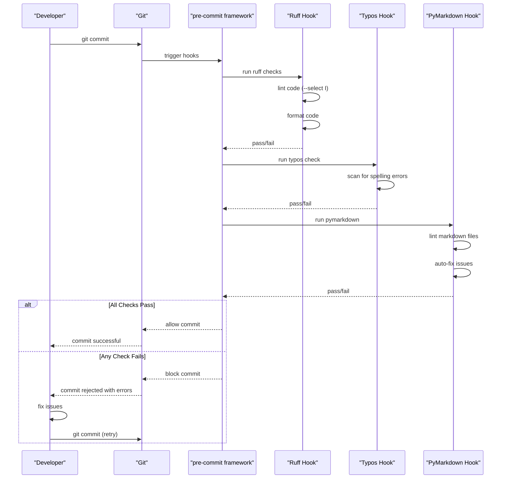
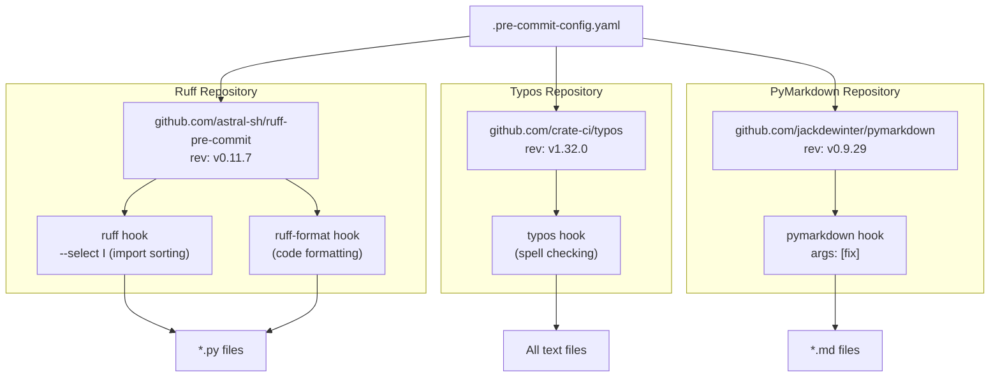
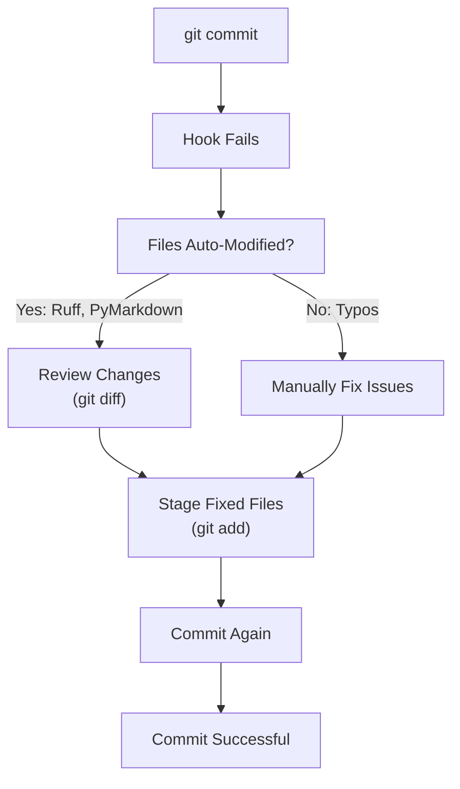
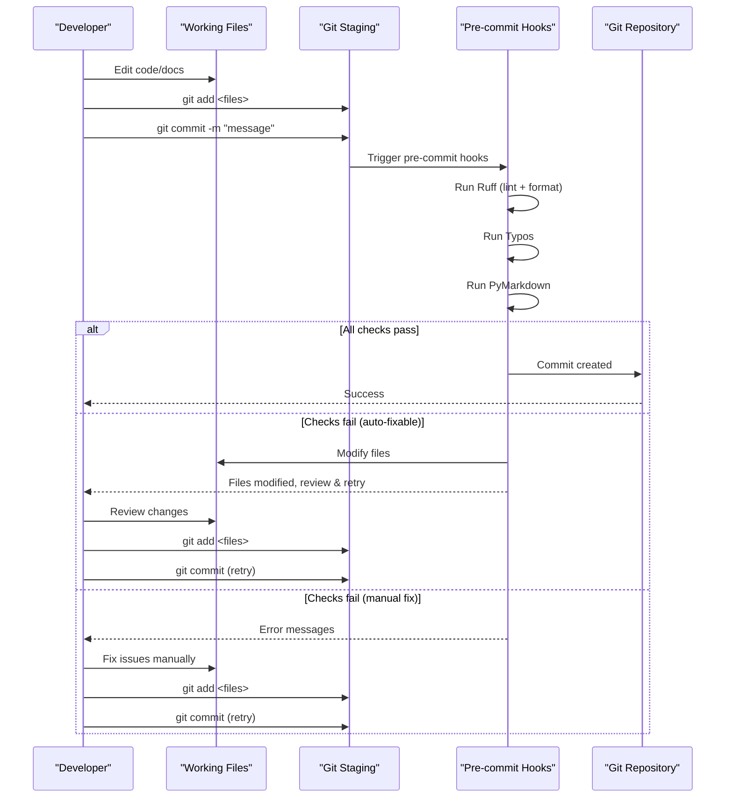

<!-- source: DeepWiki mcp.deepwiki.com · repo zai-org/Open-AutoGLM · page 9.3 Code Quality and Pre-commit Hooks · fetched 2026-10-29 -->

# Code Quality and Pre-commit Hooks

<details>
<summary>Relevant source files</summary>

The following files were used as context for generating this wiki page:

- [.gitignore](.gitignore)
- [.pre-commit-config.yaml](.pre-commit-config.yaml)

</details>


## Purpose and Scope

This document describes the automated code quality enforcement system used in Open-AutoGLM. It covers the pre-commit hook configuration, the specific tools that validate code quality, and how developers interact with these systems during development.

For information about setting up the development environment, see [Development Environment Setup](#9.2). For the overall project structure, see [Project Structure](#9.1).

## Overview

Open-AutoGLM enforces code quality through automated pre-commit hooks that run before each Git commit. These hooks ensure consistent code formatting, catch common errors, and maintain documentation quality without requiring manual intervention.

### Pre-commit Hook Flow



**Sources:** [.pre-commit-config.yaml:1-24]()

## Configuration File

The pre-commit system is configured in `.pre-commit-config.yaml` at the repository root. This file defines which hooks run, their versions, and their configuration.

### Hook Types and Stages

[.pre-commit-config.yaml:1-7]() configures the hook types and execution stages:

| Configuration Key | Value | Purpose |
|------------------|-------|---------|
| `default_install_hook_types` | `pre-commit`, `commit-msg` | Defines which Git hook types to install |
| `default_stages` | `pre-commit` | Specifies that hooks run locally before commits |

### File Exclusions

[.pre-commit-config.yaml:4-5]() specifies files that bypass the hooks:

| Excluded Pattern | Reason |
|-----------------|--------|
| `^phone_agent/config/apps\.py$` | Large auto-generated application package mapping file |
| `^README_en\.md$` | English README (possibly externally maintained) |

**Sources:** [.pre-commit-config.yaml:1-7]()

## Code Quality Tools

### Tool Integration Architecture



**Sources:** [.pre-commit-config.yaml:8-24]()

## Ruff: Python Linter and Formatter

Ruff is a high-performance Python linter and code formatter that replaces multiple traditional tools (Flake8, Black, isort, etc.).

### Configuration

[.pre-commit-config.yaml:9-14]() configures Ruff with two separate hook IDs:

#### Hook: `ruff`

| Parameter | Value | Purpose |
|-----------|-------|---------|
| `id` | `ruff` | Linting hook |
| `args` | `[--output-format, github, --fix, --select, I]` | Format output for GitHub, auto-fix issues, select import sorting rules |

The `--select I` argument specifically enables import sorting rules, ensuring consistent import organization across the codebase.

#### Hook: `ruff-format`

| Parameter | Value | Purpose |
|-----------|-------|---------|
| `id` | `ruff-format` | Code formatting hook |
| `args` | (none) | Uses default formatting rules |

### Manual Execution

To run Ruff checks manually without committing:

```bash
# Lint and auto-fix issues
ruff check . --fix

# Format code
ruff format .

# Check without fixing (dry-run)
ruff check .
```

### What Ruff Checks

Ruff enforces:
- **Import sorting**: Alphabetical ordering and grouping of import statements
- **Code formatting**: Consistent indentation, line length, and spacing
- **Style consistency**: PEP 8 compliance for Python code

**Sources:** [.pre-commit-config.yaml:9-14]()

## Typos: Spell Checker

Typos is a source code spell checker that identifies common typos and misspellings in code, comments, and documentation.

### Configuration

[.pre-commit-config.yaml:15-18]() configures the typos hook:

| Parameter | Value | Purpose |
|-----------|-------|---------|
| `repo` | `https://github.com/crate-ci/typos` | Source repository |
| `rev` | `v1.32.0` | Version pin |
| `id` | `typos` | Hook identifier |
| `args` | (none) | Uses default configuration |

### Manual Execution

To run typos manually:

```bash
# Check for typos
typos

# Show what would be fixed
typos --diff

# Auto-fix typos (use with caution)
typos --write-changes
```

### What Typos Checks

Typos scans all text files including:
- Python source code (`.py`)
- Markdown documentation (`.md`)
- YAML configuration files (`.yaml`, `.yml`)
- Shell scripts and other text files

It identifies common misspellings and suggests corrections based on a dictionary of known typos.

**Sources:** [.pre-commit-config.yaml:15-18]()

## PyMarkdown: Markdown Linter

PyMarkdown validates and auto-fixes Markdown documentation to ensure consistent formatting and correct syntax.

### Configuration

[.pre-commit-config.yaml:19-23]() configures the PyMarkdown hook:

| Parameter | Value | Purpose |
|-----------|-------|---------|
| `repo` | `https://github.com/jackdewinter/pymarkdown` | Source repository |
| `rev` | `v0.9.29` | Version pin |
| `id` | `pymarkdown` | Hook identifier |
| `args` | `[fix]` | Auto-fix markdown issues |

The `fix` argument enables automatic correction of formatting issues, making the hook less intrusive by fixing problems instead of just reporting them.

### Manual Execution

To run PyMarkdown manually:

```bash
# Check and fix markdown files
pymarkdown fix .

# Scan without fixing
pymarkdown scan .

# Check specific files
pymarkdown fix README.md
```

### What PyMarkdown Checks

PyMarkdown enforces:
- **Link validity**: Proper syntax for Markdown links
- **List formatting**: Consistent indentation and bullet styles
- **Heading hierarchy**: Proper nesting of heading levels
- **Code block syntax**: Correct fencing and language tags
- **Line endings**: Consistent line break formatting

**Sources:** [.pre-commit-config.yaml:19-23]()

## Setting Up Pre-commit Hooks

### Installation

After cloning the repository and installing dependencies, install the pre-commit hooks:

```bash
# Install the hooks into .git/hooks/
pre-commit install

# Install for all configured hook types (pre-commit, commit-msg)
pre-commit install --install-hooks
```

This creates Git hook scripts that automatically run before commits and commit messages.

### First-Time Setup Validation

To verify the hooks are installed correctly:

```bash
# Run all hooks against all files
pre-commit run --all-files
```

This command runs all configured hooks on every file in the repository, useful for:
- Validating initial setup
- Running checks after updating hook versions
- Reformatting the entire codebase

**Sources:** [.pre-commit-config.yaml:1-24]()

## Running Hooks Manually

### Command Reference

| Command | Purpose |
|---------|---------|
| `pre-commit run` | Run hooks on staged files only |
| `pre-commit run --all-files` | Run hooks on all files in repository |
| `pre-commit run <hook-id>` | Run a specific hook (e.g., `ruff`, `typos`) |
| `pre-commit run --files <path>` | Run hooks on specific files |

### Examples

```bash
# Run only Ruff on staged files
pre-commit run ruff

# Check spelling in all files
pre-commit run typos --all-files

# Fix markdown in specific directory
pre-commit run pymarkdown --files docs/
```

### Bypassing Hooks (Not Recommended)

In rare cases where you need to commit without running hooks:

```bash
# Skip all pre-commit hooks (use cautiously)
git commit --no-verify
```

This should only be used for exceptional circumstances, as it bypasses all quality checks.

**Sources:** [.pre-commit-config.yaml:1-24]()

## Handling Check Failures

### Common Failure Scenarios

#### Ruff Import Sorting

When Ruff detects incorrectly sorted imports:

```
[INFO] Stashed changes from /path/to/file.py
ruff....................................Failed
- hook id: ruff
- files were modified by this hook
```

**Resolution**: The hook automatically fixes the imports. Review the changes with `git diff`, then stage and commit again.

#### Typos Detection

When typos are found:

```
typos...................................Failed
- hook id: typos
- exit code: 2

error: `somethign` should be `something`
  --> ./file.py:42
```

**Resolution**: Manually fix the typo in the file, then commit again. Alternatively, if the word is correct (e.g., a technical term), add it to a typos configuration file.

#### PyMarkdown Issues

When markdown formatting is incorrect:

```
pymarkdown..............................Failed
- hook id: pymarkdown
- files were modified by this hook
```

**Resolution**: The `fix` argument causes automatic correction. Review changes with `git diff`, then stage and commit.

### Workflow After Failures



**Sources:** [.pre-commit-config.yaml:1-24]()

## Pre-commit System Architecture

This diagram maps the pre-commit configuration to actual code entities and file locations:

```mermaid
graph TB
    subgraph "Repository Root"
        Config[".pre-commit-config.yaml<br/>Hook Definitions"]
        GitHooks[".git/hooks/<br/>pre-commit script"]
    end
    
    subgraph "Hook Execution Targets"
        PyFiles["phone_agent/**/*.py<br/>main.py<br/>check_*.py"]
        MdFiles["README.md<br/>docs/**/*.md"]
        AllText["All repository files<br/>(except exclusions)"]
    end
    
    subgraph "Exclusions (line 4-5)"
        ExApps["phone_agent/config/apps.py"]
        ExReadme["README_en.md"]
    end
    
    subgraph "Hook Repositories"
        RuffRepo["astral-sh/ruff-pre-commit:v0.11.7"]
        TyposRepo["crate-ci/typos:v1.32.0"]
        PyMRepo["jackdewinter/pymarkdown:v0.9.29"]
    end
    
    Config -->|defines| GitHooks
    Config -->|references| RuffRepo
    Config -->|references| TyposRepo
    Config -->|references| PyMRepo
    
    GitHooks -->|"runs ruff (line 12)"| PyFiles
    GitHooks -->|"runs ruff-format (line 14)"| PyFiles
    GitHooks -->|"runs typos (line 18)"| AllText
    GitHooks -->|"runs pymarkdown fix (line 22-23)"| MdFiles
    
    AllText -.->|excludes| ExApps
    AllText -.->|excludes| ExReadme
    
    PyFiles -->|import sorting<br/>--select I| RuffRepo
    MdFiles -->|auto-fix mode<br/>args: [fix]| PyMRepo
```

**Sources:** [.pre-commit-config.yaml:1-24]()

## Configuration Details Reference

### Complete Hook Configuration Table

| Hook | Repository | Version | Hook ID | Arguments | Target Files | Auto-Fix |
|------|-----------|---------|---------|-----------|--------------|----------|
| Ruff Linter | `astral-sh/ruff-pre-commit` | v0.11.7 | `ruff` | `--output-format github --fix --select I` | `*.py` | Yes (imports) |
| Ruff Formatter | `astral-sh/ruff-pre-commit` | v0.11.7 | `ruff-format` | (none) | `*.py` | Yes (formatting) |
| Typos | `crate-ci/typos` | v1.32.0 | `typos` | (none) | All text | No (reports only) |
| PyMarkdown | `jackdewinter/pymarkdown` | v0.9.29 | `pymarkdown` | `fix` | `*.md` | Yes (formatting) |

### Version Management

The hooks are pinned to specific versions using the `rev` field:
- [.pre-commit-config.yaml:10]() - Ruff version
- [.pre-commit-config.yaml:16]() - Typos version
- [.pre-commit-config.yaml:20]() - PyMarkdown version

To update all hooks to their latest versions:

```bash
pre-commit autoupdate
```

This command updates the `rev` fields in `.pre-commit-config.yaml` to the latest available versions.

**Sources:** [.pre-commit-config.yaml:8-24]()

## Integration with Development Workflow

The pre-commit hooks integrate seamlessly into the standard Git workflow:



This workflow ensures that all committed code meets quality standards without requiring manual tool execution.

**Sources:** [.pre-commit-config.yaml:1-24]()

---

