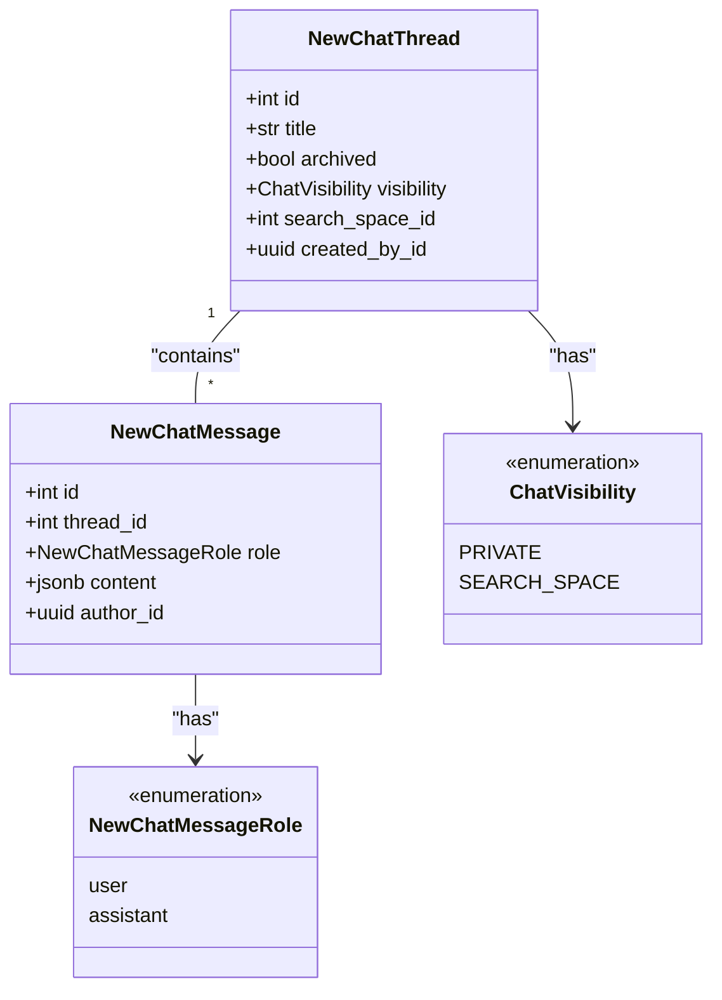
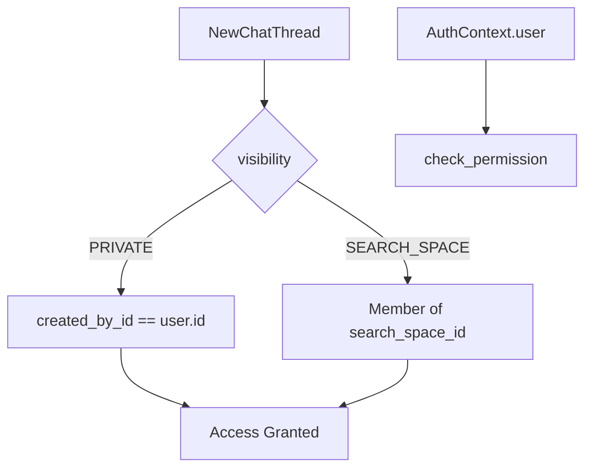

<!-- source: DeepWiki mcp.deepwiki.com · repo MODSetter/SurfSense · page 10 Chat System · fetched 2026-10-29 -->

# Chat System

Relevant source files

The following files were used as context for generating this wiki page:

- [surfsense_backend/app/routes/new_chat_routes.py](surfsense_backend/app/routes/new_chat_routes.py)
- [surfsense_backend/app/routes/public_chat_routes.py](surfsense_backend/app/routes/public_chat_routes.py)
- [surfsense_backend/app/schemas/new_chat.py](surfsense_backend/app/schemas/new_chat.py)
- [surfsense_backend/app/services/public_chat_service.py](surfsense_backend/app/services/public_chat_service.py)
- [surfsense_backend/app/tasks/chat/persistence.py](surfsense_backend/app/tasks/chat/persistence.py)
- [surfsense_web/atoms/chat/current-thread.atom.ts](surfsense_web/atoms/chat/current-thread.atom.ts)
- [surfsense_web/atoms/chat/mentioned-documents.atom.ts](surfsense_web/atoms/chat/mentioned-documents.atom.ts)
- [surfsense_web/components/assistant-ui/inline-mention-editor.tsx](surfsense_web/components/assistant-ui/inline-mention-editor.tsx)
- [surfsense_web/components/assistant-ui/mention-chip.tsx](surfsense_web/components/assistant-ui/mention-chip.tsx)
- [surfsense_web/components/assistant-ui/thread.tsx](surfsense_web/components/assistant-ui/thread.tsx)
- [surfsense_web/components/assistant-ui/user-message.tsx](surfsense_web/components/assistant-ui/user-message.tsx)
- [surfsense_web/components/layout/ui/header/Header.tsx](surfsense_web/components/layout/ui/header/Header.tsx)
- [surfsense_web/components/new-chat/chat-header.tsx](surfsense_web/components/new-chat/chat-header.tsx)
- [surfsense_web/components/new-chat/chat-share-button.tsx](surfsense_web/components/new-chat/chat-share-button.tsx)
- [surfsense_web/components/new-chat/composer-suggestion-popup.tsx](surfsense_web/components/new-chat/composer-suggestion-popup.tsx)
- [surfsense_web/components/new-chat/document-mention-picker.tsx](surfsense_web/components/new-chat/document-mention-picker.tsx)
- [surfsense_web/components/new-chat/image-model-selector.tsx](surfsense_web/components/new-chat/image-model-selector.tsx)
- [surfsense_web/components/new-chat/model-selector.tsx](surfsense_web/components/new-chat/model-selector.tsx)
- [surfsense_web/components/new-chat/prompt-picker.tsx](surfsense_web/components/new-chat/prompt-picker.tsx)
- [surfsense_web/lib/chat/mention-doc-key.ts](surfsense_web/lib/chat/mention-doc-key.ts)
- [surfsense_web/lib/chat/thread-persistence.ts](surfsense_web/lib/chat/thread-persistence.ts)

## Purpose and Scope

The Chat System provides a real-time conversational interface powered by the Deep Agent framework (LangGraph). Users interact through a thread-based chat interface with support for document mentions (`@mention`), streaming responses with thinking steps, and transparent source citations. The system uses Server-Sent Events (SSE) for streaming AI responses and persists conversation history in thread-based message storage.

Key capabilities:
- **Thread Management**: Create, load, and manage chat threads with configurable visibility (`PRIVATE` or `SEARCH_SPACE` shared) [surfsense_backend/app/routes/new_chat_routes.py:5-11]().
- **Document Mentions**: Reference documents, folders, or other threads inline using `@mention` syntax for targeted context injection [surfsense_web/components/assistant-ui/inline-mention-editor.tsx:34-43]().
- **Real-time Streaming**: SSE-based streaming with incremental text updates, thinking steps, and tool execution visibility [surfsense_backend/app/routes/new_chat_routes.py:75-78]().
- **Source Attribution**: Inline citations with `[[citation:chunk_id]]` markers that link to source documents [surfsense_backend/app/services/public_chat_service.py:50-56]().
- **Thread Persistence**: Automatic message persistence with thinking steps and metadata restoration [surfsense_backend/app/schemas/new_chat.py:47-60]().

For details, see [Chat Architecture and Workflow](#10.1).

---

## Thread and Message Data Model

The chat system uses a thread-based architecture with two core database tables: `NewChatThread` and `NewChatMessage`. Threads represent conversation containers scoped to SearchSpaces, while messages store individual user and assistant interactions [surfsense_backend/app/db.py:44-46]().

### Core Entities and Relationships

**Diagram: Chat Data Model to Code Entities**

Sources: [surfsense_backend/app/db.py:44-50](), [surfsense_backend/app/schemas/new_chat.py:15-16]()

### Thread Visibility Model

The system supports multi-tenant collaboration through thread visibility settings, allowing users to toggle between private and workspace-wide sharing [surfsense_backend/app/schemas/new_chat.py:89-91]().

**Diagram: Thread Access Logic**

Sources: [surfsense_backend/app/routes/new_chat_routes.py:39-50](), [surfsense_backend/app/utils/rbac.py:81](), [surfsense_web/components/new-chat/chat-share-button.tsx:27-45]()

For details, see [Thread Management](#10.4).

---

## Real-time Streaming Interface

The frontend uses the `assistant-ui` library to provide a high-performance chat interface [surfsense_web/components/assistant-ui/thread.tsx:1-8](). Responses are streamed via SSE (Server-Sent Events) from the backend's `stream_new_chat` flow [surfsense_backend/app/routes/new_chat_routes.py:75-78]().

### Thinking Steps and Transparency

The interface displays "Thinking Steps" to provide transparency into the agent's reasoning process and tool execution.

- **Tool Calls**: Real-time display of tools like `search_knowledge_base` or `generate_podcast` [surfsense_web/components/assistant-ui/thread.tsx:21-23]().
- **Model Selection**: Users can select specific LLMs for the chat role via the `ModelSelector` [surfsense_web/components/new-chat/model-selector.tsx:99-110]().
- **Reasoning**: Dedicated message parts for internal chain-of-thought and progress status [surfsense_web/components/assistant-ui/thread.tsx:53]().

For details, see [Thinking Steps and Transparency](#10.3).

---

## Document Mention System

Users can inject specific context into the conversation using the `@mention` system [surfsense_web/components/new-chat/document-mention-picker.tsx:58-72]().

- **Inline Mentions**: Powered by `Plate.js`, the `InlineMentionEditor` allows users to search for and insert document chips as they type [surfsense_web/components/assistant-ui/inline-mention-editor.tsx:12-17]().
- **Resource Scoping**: Users can mention individual documents, folders, connected accounts, or even other chat threads [surfsense_web/components/assistant-ui/inline-mention-editor.tsx:34-43]().
- **Context Injection**: Mentioned items are resolved on the backend and provided to the agent as high-priority context via the `MentionedDocumentInfo` schema [surfsense_backend/app/schemas/new_chat.py:203-215]().

For details, see [Document Mentions](#10.2).

---

## Public Chat Sharing

SurfSense allows users to create immutable snapshots of chat threads for public sharing [surfsense_backend/app/services/public_chat_service.py:4-9]().

- **Immutable Snapshots**: `PublicChatSnapshot` records store a frozen state of the conversation, deduplicated by a content hash [surfsense_backend/app/services/public_chat_service.py:133-156]().
- **Sanitization**: Citations are stripped and internal metadata is removed for public consumption to ensure clean readability [surfsense_backend/app/services/public_chat_service.py:50-63]().
- **Artifact Inclusion**: Public snapshots can include embedded podcasts, reports, and videos generated during the session [surfsense_backend/app/services/public_chat_service.py:213-220]().
- **UI Controls**: The `ChatShareButton` provides the interface for creating snapshots and managing public links [surfsense_web/components/new-chat/chat-share-button.tsx:110-121]().

**Diagram: Public Sharing Architecture**

Sources: [surfsense_backend/app/services/public_chat_service.py:1-156](), [surfsense_web/components/new-chat/chat-share-button.tsx:110-121]()

---

## Child Pages

- [Chat Architecture and Workflow](#10.1) — Detail the chat message flow from user input through agent processing, SSE streaming, and message persistence
- [Document Mentions](#10.2) — Explain the @mention system for referencing documents in chat messages and passing them as context to the agent
- [Thinking Steps and Transparency](#10.3) — Document the thinking steps feature that displays the agent's tool calls and reasoning process in real-time
- [Thread Management](#10.4) — Explain chat thread creation, persistence, visibility settings (private vs shared), and restoration of conversation state

---

