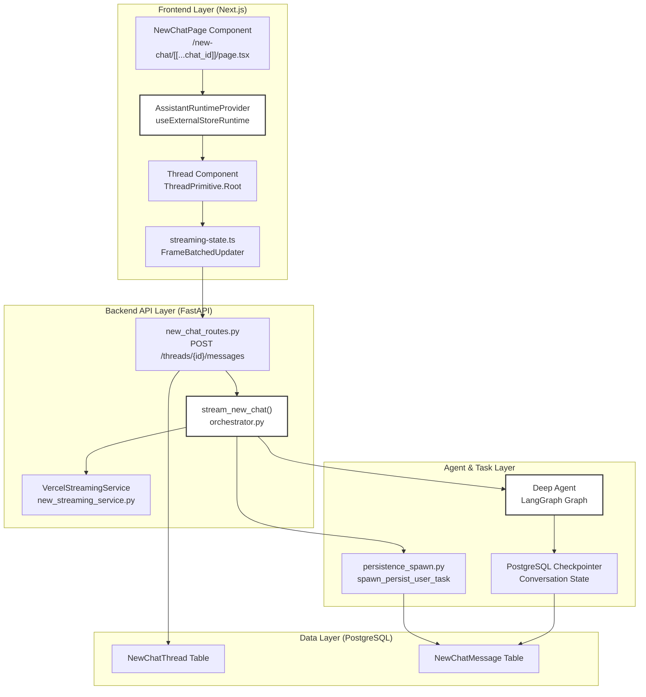
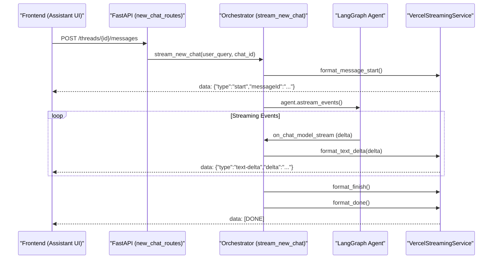

<!-- source: DeepWiki mcp.deepwiki.com · repo MODSetter/SurfSense · page 10.1 Chat Architecture and Workflow · fetched 2026-10-29 -->

# Chat Architecture and Workflow

Relevant source files

The following files were used as context for generating this wiki page:

- [surfsense_backend/app/routes/new_chat_routes.py](surfsense_backend/app/routes/new_chat_routes.py)
- [surfsense_backend/app/routes/public_chat_routes.py](surfsense_backend/app/routes/public_chat_routes.py)
- [surfsense_backend/app/schemas/new_chat.py](surfsense_backend/app/schemas/new_chat.py)
- [surfsense_backend/app/services/new_streaming_service.py](surfsense_backend/app/services/new_streaming_service.py)
- [surfsense_backend/app/services/public_chat_service.py](surfsense_backend/app/services/public_chat_service.py)
- [surfsense_backend/app/tasks/chat/streaming/agent/__init__.py](surfsense_backend/app/tasks/chat/streaming/agent/__init__.py)
- [surfsense_backend/app/tasks/chat/streaming/agent/builder.py](surfsense_backend/app/tasks/chat/streaming/agent/builder.py)
- [surfsense_backend/app/tasks/chat/streaming/flows/__init__.py](surfsense_backend/app/tasks/chat/streaming/flows/__init__.py)
- [surfsense_backend/app/tasks/chat/streaming/flows/new_chat/__init__.py](surfsense_backend/app/tasks/chat/streaming/flows/new_chat/__init__.py)
- [surfsense_backend/app/tasks/chat/streaming/flows/new_chat/auto_pin.py](surfsense_backend/app/tasks/chat/streaming/flows/new_chat/auto_pin.py)
- [surfsense_backend/app/tasks/chat/streaming/flows/new_chat/initial_thinking_step.py](surfsense_backend/app/tasks/chat/streaming/flows/new_chat/initial_thinking_step.py)
- [surfsense_backend/app/tasks/chat/streaming/flows/new_chat/input_state.py](surfsense_backend/app/tasks/chat/streaming/flows/new_chat/input_state.py)
- [surfsense_backend/app/tasks/chat/streaming/flows/new_chat/llm_capability.py](surfsense_backend/app/tasks/chat/streaming/flows/new_chat/llm_capability.py)
- [surfsense_backend/app/tasks/chat/streaming/flows/new_chat/orchestrator.py](surfsense_backend/app/tasks/chat/streaming/flows/new_chat/orchestrator.py)
- [surfsense_backend/app/tasks/chat/streaming/flows/new_chat/persistence_spawn.py](surfsense_backend/app/tasks/chat/streaming/flows/new_chat/persistence_spawn.py)
- [surfsense_backend/app/tasks/chat/streaming/flows/new_chat/runtime_context.py](surfsense_backend/app/tasks/chat/streaming/flows/new_chat/runtime_context.py)
- [surfsense_backend/app/tasks/chat/streaming/flows/new_chat/title_gen.py](surfsense_backend/app/tasks/chat/streaming/flows/new_chat/title_gen.py)
- [surfsense_backend/app/tasks/chat/streaming/flows/resume_chat/__init__.py](surfsense_backend/app/tasks/chat/streaming/flows/resume_chat/__init__.py)
- [surfsense_backend/app/tasks/chat/streaming/flows/resume_chat/orchestrator.py](surfsense_backend/app/tasks/chat/streaming/flows/resume_chat/orchestrator.py)
- [surfsense_backend/tests/unit/tasks/chat/test_extract_chunk_parts.py](surfsense_backend/tests/unit/tasks/chat/test_extract_chunk_parts.py)
- [surfsense_backend/tests/unit/tasks/chat/test_tool_input_streaming.py](surfsense_backend/tests/unit/tasks/chat/test_tool_input_streaming.py)
- [surfsense_web/atoms/agent/action-log-dialog.atom.ts](surfsense_web/atoms/agent/action-log-dialog.atom.ts)
- [surfsense_web/components/agent-action-log/action-log-button.tsx](surfsense_web/components/agent-action-log/action-log-button.tsx)
- [surfsense_web/components/agent-action-log/action-log-dialog.tsx](surfsense_web/components/agent-action-log/action-log-dialog.tsx)
- [surfsense_web/components/agent-action-log/action-log-item.tsx](surfsense_web/components/agent-action-log/action-log-item.tsx)
- [surfsense_web/components/assistant-ui/revert-turn-button.tsx](surfsense_web/components/assistant-ui/revert-turn-button.tsx)
- [surfsense_web/features/chat-messages/timeline/tool-registry/fallback/use-tool-action.ts](surfsense_web/features/chat-messages/timeline/tool-registry/fallback/use-tool-action.ts)
- [surfsense_web/hooks/use-agent-actions-query.ts](surfsense_web/hooks/use-agent-actions-query.ts)
- [surfsense_web/lib/chat/message-utils.ts](surfsense_web/lib/chat/message-utils.ts)
- [surfsense_web/lib/chat/streaming-state.ts](surfsense_web/lib/chat/streaming-state.ts)
- [surfsense_web/lib/chat/thread-persistence.ts](surfsense_web/lib/chat/thread-persistence.ts)

This document describes the technical architecture of the chat system, covering the message flow from user input through agent processing to streaming responses and persistence. It details the integration between the frontend chat UI (built with assistant-ui), the FastAPI backend, and the LangGraph-based agent system.

For information about specific chat features, see:
- Document mentions and @mention system: [10.2]()
- Thinking steps and transparency: [10.3]()
- Thread management and visibility: [10.4]()
- Agent architecture and tools: [6]()

## System Overview

The chat system implements a real-time conversational interface with streaming responses using Server-Sent Events (SSE). The architecture follows a client-server pattern where the backend manages stateful agent execution via LangGraph, and the frontend handles real-time UI updates using the Vercel AI SDK Data Stream Protocol.

### Architecture Diagram

**Sources:** [surfsense_backend/app/routes/new_chat_routes.py:1-11](), [surfsense_backend/app/tasks/chat/streaming/flows/new_chat/orchestrator.py:1-18](), [surfsense_web/lib/chat/streaming-state.ts:153-194]()

## Message Flow and Streaming

The message flow is initiated by the user and managed through a series of specialized orchestrators that handle validation, persistence, and agent execution.

### The Orchestration Pipeline
The `stream_new_chat` function in `orchestrator.py` follows a 10-step lifecycle:
1.  **Validation**: Resolves LLM configuration and capabilities [surfsense_backend/app/tasks/chat/streaming/flows/new_chat/orchestrator.py:7-17]().
2.  **Persistence Spawn**: Simultaneously writes the user message to the DB while setting up the agent [surfsense_backend/app/tasks/chat/streaming/flows/new_chat/orchestrator.py:57-62]().
3.  **Input Assembly**: Bootstraps history and resolves @-mentions into XML-wrapped context [surfsense_backend/app/tasks/chat/streaming/flows/new_chat/input_state.py:1-18]().
4.  **First Frames**: Emits initial SSE frames like `message_start` and `turn-status` [surfsense_backend/app/tasks/chat/streaming/flows/new_chat/orchestrator.py:79-82]().
5.  **Persistence Join**: Synchronizes with DB tasks to emit real `message_id` frames [surfsense_backend/app/tasks/chat/streaming/flows/new_chat/orchestrator.py:12]().
6.  **Thinking Steps**: Emits the initial "thinking" block to the UI [surfsense_backend/app/tasks/chat/streaming/flows/new_chat/orchestrator.py:47-50]().
7.  **Stream Loop**: Runs the agent's `astream_events` and yields text/tool deltas [surfsense_backend/app/tasks/chat/streaming/flows/shared/stream_loop.py:105]().
8.  **Finalize**: Calculates token usage and debits credits [surfsense_backend/app/tasks/chat/streaming/flows/new_chat/orchestrator.py:15-16]().
9.  **Exception Handling**: Catches and emits terminal errors [surfsense_backend/app/tasks/chat/streaming/flows/new_chat/orchestrator.py:106-108]().
10. **Cleanup**: Closes DB sessions and releases mutexes [surfsense_backend/app/tasks/chat/streaming/flows/new_chat/orchestrator.py:75-78]().

### Sequence: User Input to SSE Response

**Sources:** [surfsense_backend/app/services/new_streaming_service.py:37-61](), [surfsense_backend/app/tasks/chat/streaming/flows/new_chat/orchestrator.py:121-175]()

## State Management and Persistence

### Message Records and Thread History
Messages are persisted in the `NewChatMessage` table. The frontend uses `ThreadHistoryAdapter` to sync local state with these records [surfsense_backend/app/routes/new_chat_routes.py:4-11]().

| Entity | Description | Code Reference |
| :--- | :--- | :--- |
| `NewChatThread` | Container for a conversation, includes `visibility` and `workspace_id`. | [surfsense_backend/app/schemas/new_chat.py:106-117]() |
| `NewChatMessage` | Individual turn with `role` (user/assistant) and `content` (JSONB). | [surfsense_backend/app/schemas/new_chat.py:47-60]() |
| `turn_id` | Correlation ID (format `chat_id:timestamp`) used to link messages to LangGraph checkpoints. | [surfsense_backend/app/schemas/new_chat.py:55-59]() |

### Human-in-the-Loop (HITL) and Resume Flow
When an agent turn requires user approval, it pauses via a LangGraph interrupt. Resuming this turn uses a specialized orchestrator `stream_resume_chat` [surfsense_backend/app/tasks/chat/streaming/flows/resume_chat/orchestrator.py:100-111](). Unlike the new chat flow, it skips user-message persistence as the query already exists, and focuses on routing user `decisions` to the agent state [surfsense_backend/app/tasks/chat/streaming/flows/resume_chat/orchestrator.py:1-13]().

### Reconciliation of Interrupted Messages
When a HITL interrupt occurs, the backend persists a partial assistant message. Upon resumption, the system reconciles these fragments:
- **`reconcileInterruptedAssistantMessages`**: Merges "aborted" tool-call rows into their "resume" successors to present a single unified assistant bubble [surfsense_web/lib/chat/message-utils.ts:142-179]().
- **`isFullyAbortedAssistantMessage`**: Identifies rows where every tool-call was aborted, allowing the UI to drop them entirely [surfsense_web/lib/chat/message-utils.ts:32-42]().

**Sources:** [surfsense_web/lib/chat/thread-persistence.ts:17-65](), [surfsense_web/lib/chat/message-utils.ts:108-120](), [surfsense_backend/app/tasks/chat/streaming/flows/resume_chat/orchestrator.py:1-13]()

## Public Chat and Sharing

SurfSense supports public sharing through immutable snapshots, which decouple the shared view from the live, mutable thread.

### Public Snapshot Workflow
1.  **Creation**: `create_snapshot` captures the current state of a thread, including messages, podcasts, and reports [surfsense_backend/app/services/public_chat_service.py:164-207]().
2.  **Sanitization**: Citations like `[citation:doc-123]` are stripped, and only UI-relevant tools (e.g., `generate_podcast`) are preserved for the public view [surfsense_backend/app/services/public_chat_service.py:50-100]().
3.  **Deduplication**: `compute_content_hash` ensures that identical chat content results in the same shareable URL [surfsense_backend/app/services/public_chat_service.py:133-156]().
4.  **Cloning**: Authenticated users can `clone_public_chat` to copy a shared snapshot into their own workspace as a new mutable thread [surfsense_backend/app/routes/public_chat_routes.py:46-59]().

**Sources:** [surfsense_backend/app/services/public_chat_service.py:1-9](), [surfsense_backend/app/routes/public_chat_routes.py:32-43]()

## Key Implementation Details

### Frame Batched Updating
To prevent UI flicker during high-frequency SSE streaming (e.g., rapid text deltas), the frontend uses a `FrameBatchedUpdater`. This throttles React state updates to a ~50ms interval [surfsense_web/lib/chat/streaming-state.ts:153-170]().

### Busy Mutex and Cancellation
The backend implements a `busy_mutex` to prevent race conditions:
- **`request_cancel`**: Signals an active agent turn to stop [surfsense_backend/app/routes/new_chat_routes.py:27-32]().
- **`TURN_CANCELLING` Error**: If a user tries to start a new turn while the previous one is still stopping, the API returns a 409-style error with a `retry_after_ms` hint [surfsense_backend/app/routes/new_chat_routes.py:197-204]().

### Revert Turn Logic
Users can undo the effects of an entire assistant turn (e.g., deleting generated files or reports) using the `RevertTurnButton` [surfsense_web/components/assistant-ui/revert-turn-button.tsx:54-82](). This calls the `revert-turn/{chat_turn_id}` endpoint, which executes the inverse operations for all reversible actions in that turn [surfsense_web/components/assistant-ui/revert-turn-button.tsx:83-109]().

**Sources:** [surfsense_web/lib/chat/streaming-state.ts:196-213](), [surfsense_backend/app/routes/new_chat_routes.py:168-185](), [surfsense_web/components/assistant-ui/revert-turn-button.tsx:1-16]()

---

