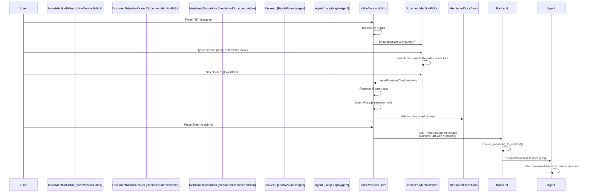
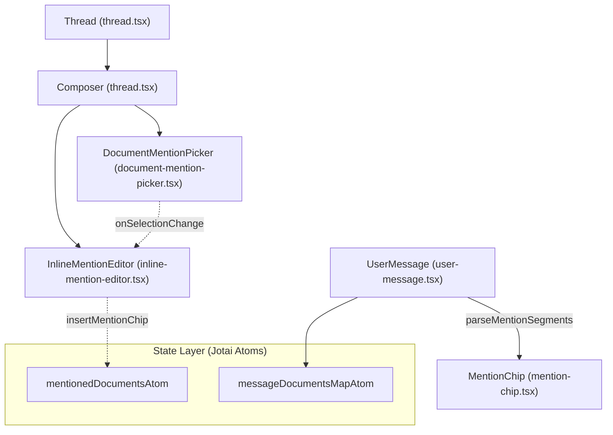

<!-- source: DeepWiki mcp.deepwiki.com · repo MODSetter/SurfSense · page 10.2 Document Mentions · fetched 2026-10-29 -->

# Document Mentions

<details>
<summary>Relevant source files</summary>

The following files were used as context for generating this wiki page:

- [surfsense_backend/app/agents/chat/multi_agent_chat/main_agent/middleware/anonymous_document/middleware.py](surfsense_backend/app/agents/chat/multi_agent_chat/main_agent/middleware/anonymous_document/middleware.py)
- [surfsense_backend/app/agents/chat/multi_agent_chat/main_agent/middleware/knowledge_tree/middleware.py](surfsense_backend/app/agents/chat/multi_agent_chat/main_agent/middleware/knowledge_tree/middleware.py)
- [surfsense_backend/app/agents/chat/runtime/mention_resolver.py](surfsense_backend/app/agents/chat/runtime/mention_resolver.py)
- [surfsense_backend/app/agents/chat/runtime/path_resolver.py](surfsense_backend/app/agents/chat/runtime/path_resolver.py)
- [surfsense_backend/app/agents/chat/runtime/references/documents/resolver.py](surfsense_backend/app/agents/chat/runtime/references/documents/resolver.py)
- [surfsense_backend/app/tasks/chat/persistence.py](surfsense_backend/app/tasks/chat/persistence.py)
- [surfsense_backend/tests/unit/agents/new_chat/test_mention_resolver.py](surfsense_backend/tests/unit/agents/new_chat/test_mention_resolver.py)
- [surfsense_backend/tests/unit/middleware/test_knowledge_tree.py](surfsense_backend/tests/unit/middleware/test_knowledge_tree.py)
- [surfsense_web/atoms/chat/current-thread.atom.ts](surfsense_web/atoms/chat/current-thread.atom.ts)
- [surfsense_web/atoms/chat/mentioned-documents.atom.ts](surfsense_web/atoms/chat/mentioned-documents.atom.ts)
- [surfsense_web/components/assistant-ui/inline-mention-editor.tsx](surfsense_web/components/assistant-ui/inline-mention-editor.tsx)
- [surfsense_web/components/assistant-ui/mention-chip.tsx](surfsense_web/components/assistant-ui/mention-chip.tsx)
- [surfsense_web/components/assistant-ui/thread.tsx](surfsense_web/components/assistant-ui/thread.tsx)
- [surfsense_web/components/assistant-ui/user-message.tsx](surfsense_web/components/assistant-ui/user-message.tsx)
- [surfsense_web/components/layout/ui/header/Header.tsx](surfsense_web/components/layout/ui/header/Header.tsx)
- [surfsense_web/components/new-chat/chat-header.tsx](surfsense_web/components/new-chat/chat-header.tsx)
- [surfsense_web/components/new-chat/chat-share-button.tsx](surfsense_web/components/new-chat/chat-share-button.tsx)
- [surfsense_web/components/new-chat/composer-suggestion-popup.tsx](surfsense_web/components/new-chat/composer-suggestion-popup.tsx)
- [surfsense_web/components/new-chat/document-mention-picker.tsx](surfsense_web/components/new-chat/document-mention-picker.tsx)
- [surfsense_web/components/new-chat/image-model-selector.tsx](surfsense_web/components/new-chat/image-model-selector.tsx)
- [surfsense_web/components/new-chat/model-selector.tsx](surfsense_web/components/new-chat/model-selector.tsx)
- [surfsense_web/components/new-chat/prompt-picker.tsx](surfsense_web/components/new-chat/prompt-picker.tsx)
- [surfsense_web/lib/chat/mention-doc-key.ts](surfsense_web/lib/chat/mention-doc-key.ts)

</details>


## Purpose and Scope

Document Mentions enable users to explicitly reference documents, folders, connector accounts, or other chat threads within messages using the `@` symbol. This feature allows users to provide direct context to the AI agent by pinning specific knowledge sources, which are then prioritized as primary sources in the response generation process.

This system has evolved from a document-only picker to a generalized **Composer Context** system capable of referencing multiple entity types.

**Sources**: [surfsense_web/components/assistant-ui/inline-mention-editor.tsx:34-43](), [surfsense_web/atoms/chat/mentioned-documents.atom.ts:13-36]()

---

## User Interaction Flow

The document mention workflow follows these steps:

Title: Mention Interaction Flow


**Sources**: [surfsense_web/components/assistant-ui/inline-mention-editor.tsx:68-95](), [surfsense_web/components/new-chat/document-mention-picker.tsx:58-72](), [surfsense_backend/app/tasks/chat/persistence.py:100-165]()

---

## Frontend Architecture

### State Management

The mention system uses Jotai atoms to track the active composer context and persist it across message turns.

| Atom | Type | Purpose |
|------|------|---------|
| `mentionedDocumentsAtom` | `MentionedDocumentInfo[]` | Stores the active context chips currently in the composer. |
| `submittedMentionsAtom` | `MentionedDocumentInfo[] \| null` | Captures chips at submit time to survive composer resets. |
| `messageDocumentsMapAtom` | `Record<string, MentionedDocumentInfo[]>` | Maps message IDs to their mentioned context for history rendering. |

**Sources**: [surfsense_web/atoms/chat/mentioned-documents.atom.ts:99-150]()

### Component Architecture

The system is built on top of the **Plate.js** framework (for the editor) and **assistant-ui** (for the chat thread).

Title: Component Entity Map


**Sources**: [surfsense_web/components/assistant-ui/thread.tsx:156-186](), [surfsense_web/components/assistant-ui/user-message.tsx:71-155]()

---

## InlineMentionEditor Component

The `InlineMentionEditor` is a rich text editor built with `platejs`. It manages the transition between raw text and structured "mention" nodes.

### Core Data Model

A mention is represented as a specialized node in the editor's document tree:

```typescript
type MentionElementNode = {
    type: "mention";
    id: number;
    title: string;
    kind: "doc" | "folder" | "connector" | "thread";
    document_type?: string;
    connector_type?: string;
    account_name?: string;
    children: [{ text: "" }];
};
```

**Sources**: [surfsense_web/components/assistant-ui/inline-mention-editor.tsx:119-131]()

### Mention Management

The editor provides an imperative API via `InlineMentionEditorRef` to manipulate these chips:

- `insertMentionChip(mention, options)`: Inserts a new mention node at the current cursor position [surfsense_web/components/assistant-ui/inline-mention-editor.tsx:74]().
- `removeDocumentChip(docId, ...)`: Finds and removes a specific chip from the editor content [surfsense_web/components/assistant-ui/inline-mention-editor.tsx:83-88]().
- `getMentionedDocuments()`: Scans the editor's JSON tree to return all current `MentionedDocument` objects [surfsense_web/components/assistant-ui/inline-mention-editor.tsx:73]().

**Sources**: [surfsense_web/components/assistant-ui/inline-mention-editor.tsx:68-95]()

---

## DocumentMentionPicker Component

This component provides the UI for searching and selecting entities. It implements a hierarchical browsing system.

### Browse Views

The picker supports multiple navigation states defined in `BrowseView` [surfsense_web/components/new-chat/document-mention-picker.tsx:80-85]():
- **Root**: Top-level options (Files/Folders, Connectors, Chats).
- **Files-Folders**: Browsing workspace file structure.
- **Connectors**: Listing all connected third-party accounts.
- **Chats**: Searching previous conversation threads.

**Sources**: [surfsense_web/components/new-chat/document-mention-picker.tsx:80-85]()

### Recent Mentions System

The picker maintains a "Recent" section using `localStorage` to allow quick access to frequently used context.

- **Persistence**: Saved per workspace via `getRecentsStorageKey(workspaceId)` [surfsense_web/components/new-chat/document-mention-picker.tsx:108-110]().
- **Promotion**: When an item is selected, `promoteRecentMention` moves it to the top of the recents list [surfsense_web/components/new-chat/document-mention-picker.tsx:137-145]().

**Sources**: [surfsense_web/components/new-chat/document-mention-picker.tsx:108-145]()

---

## Backend Persistence and Resolution

When a message is sent, the frontend captures the mentioned items via `deriveMentionedPayload` [surfsense_web/atoms/chat/mentioned-documents.atom.ts:111-143]() and includes them in the message content payload.

### User Content Construction

The `_build_user_content` helper in the backend constructs the final JSON representation of the user's turn:

```python
def _build_user_content(
    user_query: str,
    user_image_data_urls: list[str] | None,
    mentioned_documents: list[dict[str, Any]] | None = None,
) -> list[dict[str, Any]]:
    parts = [{"type": "text", "text": user_query or ""}]
    # ... handle images ...
    if mentioned_documents:
        parts.append({"type": "mentioned-documents", "documents": normalized})
    return parts
```

**Sources**: [surfsense_backend/app/tasks/chat/persistence.py:99-165]()

### Data Normalization

The backend ensures that every mention has a valid `kind` discriminator (`doc`, `folder`, `connector`, or `thread`). For legacy data, it defaults to `doc` [surfsense_backend/app/tasks/chat/persistence.py:138-143]().

---

## Display and Interaction

### User Message Rendering

In the chat history, `UserMessage` uses `parseMentionSegments` [surfsense_web/components/assistant-ui/user-message.tsx:109]() to turn the plain text query (containing mention markers) back into interactive chips.

```typescript
const segments = parseMentionSegments(text, mentionedDocs);
// ...
return (
    <p>
        {segments.map((segment) => (
            segment.type === "text" ? <span>{segment.value}</span> : <MentionChip ... />
        ))}
    </p>
);
```

**Sources**: [surfsense_web/components/assistant-ui/user-message.tsx:71-155]()

### Navigation Actions

Mention chips are interactive even in history:
- **Thread Chips**: Clicking a thread mention triggers `handleOpenThread`, navigating the user to that specific conversation [surfsense_web/components/assistant-ui/user-message.tsx:98-107]().
- **Document Chips**: Clicking a document chip triggers `openEditorPanel`, opening the document in the side-peek editor [surfsense_web/components/assistant-ui/user-message.tsx:82-96]().

**Sources**: [surfsense_web/components/assistant-ui/user-message.tsx:82-107]()

---

