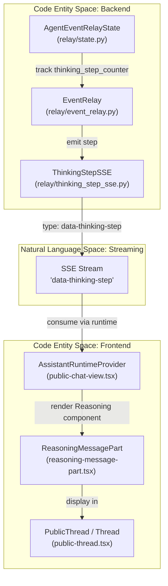
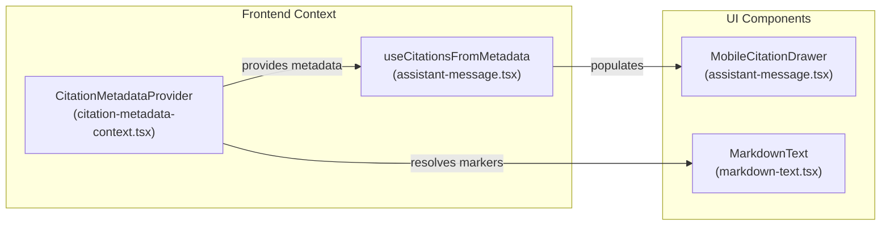

<!-- source: DeepWiki mcp.deepwiki.com · repo MODSetter/SurfSense · page 10.3 Thinking Steps and Transparency · fetched 2026-10-29 -->

# Thinking Steps and Transparency

<details>
<summary>Relevant source files</summary>

The following files were used as context for generating this wiki page:

- [surfsense_backend/app/services/memory/__init__.py](surfsense_backend/app/services/memory/__init__.py)
- [surfsense_backend/app/services/memory/document.py](surfsense_backend/app/services/memory/document.py)
- [surfsense_backend/app/services/memory/prompts.py](surfsense_backend/app/services/memory/prompts.py)
- [surfsense_backend/app/services/memory/schemas.py](surfsense_backend/app/services/memory/schemas.py)
- [surfsense_backend/app/services/memory/service.py](surfsense_backend/app/services/memory/service.py)
- [surfsense_backend/app/services/memory/validation.py](surfsense_backend/app/services/memory/validation.py)
- [surfsense_backend/app/tasks/chat/streaming/graph_stream/event_stream.py](surfsense_backend/app/tasks/chat/streaming/graph_stream/event_stream.py)
- [surfsense_backend/app/tasks/chat/streaming/graph_stream/result.py](surfsense_backend/app/tasks/chat/streaming/graph_stream/result.py)
- [surfsense_backend/app/tasks/chat/streaming/relay/__init__.py](surfsense_backend/app/tasks/chat/streaming/relay/__init__.py)
- [surfsense_backend/app/tasks/chat/streaming/relay/event_relay.py](surfsense_backend/app/tasks/chat/streaming/relay/event_relay.py)
- [surfsense_backend/app/tasks/chat/streaming/relay/state.py](surfsense_backend/app/tasks/chat/streaming/relay/state.py)
- [surfsense_backend/app/tasks/chat/streaming/relay/thinking_step_completion.py](surfsense_backend/app/tasks/chat/streaming/relay/thinking_step_completion.py)
- [surfsense_backend/app/tasks/chat/streaming/relay/thinking_step_sse.py](surfsense_backend/app/tasks/chat/streaming/relay/thinking_step_sse.py)
- [surfsense_backend/tests/unit/agents/new_chat/tools/test_update_memory_scope.py](surfsense_backend/tests/unit/agents/new_chat/tools/test_update_memory_scope.py)
- [surfsense_backend/tests/unit/services/test_memory_service.py](surfsense_backend/tests/unit/services/test_memory_service.py)
- [surfsense_backend/tests/unit/tasks/chat/streaming/test_stream_output.py](surfsense_backend/tests/unit/tasks/chat/streaming/test_stream_output.py)
- [surfsense_web/app/api/contact/route.ts](surfsense_web/app/api/contact/route.ts)
- [surfsense_web/app/db/index.ts](surfsense_web/app/db/index.ts)
- [surfsense_web/app/db/schema.ts](surfsense_web/app/db/schema.ts)
- [surfsense_web/components/assistant-ui/assistant-message.tsx](surfsense_web/components/assistant-ui/assistant-message.tsx)
- [surfsense_web/components/contact/contact-form.tsx](surfsense_web/components/contact/contact-form.tsx)
- [surfsense_web/components/homepage/community-strip.tsx](surfsense_web/components/homepage/community-strip.tsx)
- [surfsense_web/components/homepage/footer-new.tsx](surfsense_web/components/homepage/footer-new.tsx)
- [surfsense_web/components/homepage/navbar.tsx](surfsense_web/components/homepage/navbar.tsx)
- [surfsense_web/components/pricing.tsx](surfsense_web/components/pricing.tsx)
- [surfsense_web/components/public-chat/public-chat-view.tsx](surfsense_web/components/public-chat/public-chat-view.tsx)
- [surfsense_web/components/public-chat/public-thread.tsx](surfsense_web/components/public-chat/public-thread.tsx)
- [surfsense_web/components/tool-ui/index.ts](surfsense_web/components/tool-ui/index.ts)
- [surfsense_web/drizzle.config.ts](surfsense_web/drizzle.config.ts)

</details>


This page documents the **thinking steps** system that provides real-time visibility into the AI agent's reasoning process during chat interactions. Users see what the agent is analyzing, which tools it's invoking, and the progress of each reasoning step as the response streams.

For information about the overall chat architecture and streaming protocol, see [Chat Architecture and Workflow](10.1). For details on the agent's tool calling capabilities, see [Built-in Tools](6.2).

---

## Purpose and Scope

The thinking steps feature addresses transparency in complex agentic workflows. When a SurfSense agent performs reasoning involving multiple tool calls (e.g., searching a knowledge base, scraping a webpage, or generating a report), users benefit from understanding the agent's internal state.

The system implements a chain-of-thought display that streams thinking steps alongside the text response, creating a transparent user experience where the agent's reasoning process is visible rather than hidden.

**Sources**: [surfsense_backend/app/tasks/chat/streaming/relay/state.py:9-23](), [surfsense_web/components/assistant-ui/assistant-message.tsx:153-178]()

---

## Architecture Overview

The thinking steps system operates as a parallel stream of metadata alongside the main text response. The backend generates thinking step events during agent execution, and the frontend maintains a per-message map of steps that updates in real-time.

### System Flow: Reasoning to UI



**Sources**: [surfsense_backend/app/tasks/chat/streaming/relay/state.py:24-48](), [surfsense_web/components/assistant-ui/assistant-message.tsx:39-39](), [surfsense_web/components/public-chat/public-chat-view.tsx:43-52]()

---

## Backend: Step Generation and Streaming

The backend generates thinking steps by monitoring LangGraph events and emitting `data-thinking-step` SSE events via the relay system.

### Step State Management

The `AgentEventRelayState` class maintains the counters and maps necessary for one agent stream:

| Attribute | Type | Purpose |
|----------|------|---------|
| `thinking_step_counter` | `int` | Auto-incrementing counter for unique step IDs [surfsense_backend/app/tasks/chat/streaming/relay/state.py:27]() |
| `tool_step_ids` | `dict[str, str]` | Maps LangGraph `run_id` to thinking-row ID [surfsense_backend/app/tasks/chat/streaming/relay/state.py:28]() |
| `last_active_step_id` | `str \| None` | ID of the current active thinking step [surfsense_backend/app/tasks/chat/streaming/relay/state.py:30]() |
| `completed_step_ids` | `set[str]` | Set of IDs that have been marked as completed [surfsense_backend/app/tasks/chat/streaming/relay/state.py:29]() |
| `active_span_id` | `str \| None` | Groups steps and tools for one delegating task episode [surfsense_backend/app/tasks/chat/streaming/relay/state.py:45]() |

**Sources**: [surfsense_backend/app/tasks/chat/streaming/relay/state.py:24-48]()

### Step ID Generation

The `next_thinking_step_id` method increments the counter and returns a prefixed string (e.g., `step-1`):

```python
def next_thinking_step_id(self, step_prefix: str) -> str:
    self.thinking_step_counter += 1
    return f"{step_prefix}-{self.thinking_step_counter}"
```

**Sources**: [surfsense_backend/app/tasks/chat/streaming/relay/state.py:95-98]()

### Tool Activity Metadata

Thinking steps are linked to specific tool calls via metadata. The `tool_activity_metadata` function builds the payload for SSE and persistence, including the `thinkingStepId` and `spanId`. This ensures that when a tool is executed, the UI knows which thinking step it belongs to.

**Sources**: [surfsense_backend/app/tasks/chat/streaming/relay/state.py:56-77]()

---

## Frontend: Rendering Reasoning

The frontend utilizes `@assistant-ui/react` primitives and custom components to render the reasoning steps in both private and public chat views.

### Reasoning Component Mapping

The `PublicAssistantMessage` and standard `AssistantMessage` components register `ReasoningMessagePart` to handle reasoning segments:

```tsx
<MessagePrimitive.Parts
    components={{
        Text: MarkdownText,
        Reasoning: ReasoningMessagePart,
        tools: {
            by_name: {
                generate_podcast: GeneratePodcastToolUI,
                generate_report: GenerateReportToolUI,
                // ... other tool UIs
            },
        },
    }}
/>
```

**Sources**: [surfsense_web/components/public-chat/public-thread.tsx:161-175](), [surfsense_web/components/assistant-ui/assistant-message.tsx:244-255]()

### Tool UI Integration

When a thinking step involves a tool call, SurfSense renders specialized Tool UI components. These components are often dynamically imported to optimize performance.

| Tool Name | UI Component | Export Site |
|-----------|--------------|-------------|
| `generate_report` | `GenerateReportToolUI` | [surfsense_web/components/tool-ui/index.ts:19-19]() |
| `generate_podcast` | `GeneratePodcastToolUI` | [surfsense_web/components/tool-ui/index.ts:46-46]() |
| `generate_video_presentation` | `GenerateVideoPresentationToolUI` | [surfsense_web/components/tool-ui/index.ts:61-61]() |
| `display_image` | `GenerateImageToolUI` | [surfsense_web/components/tool-ui/index.ts:17-17]() |
| `update_memory` | `UpdateMemoryToolUI` | [surfsense_web/components/tool-ui/index.ts:59-59]() |

**Sources**: [surfsense_web/components/tool-ui/index.ts:1-62](), [surfsense_web/components/public-chat/public-thread.tsx:165-172]()

---

## Source Attribution and Citations

Transparency is further enhanced by showing exactly where the agent retrieved information. The `CitationMetadataProvider` wraps the assistant message content to provide context for any citations generated by the agent.

### Citation Flow



**Sources**: [surfsense_web/components/assistant-ui/assistant-message.tsx:110-128](), [surfsense_web/components/assistant-ui/assistant-message.tsx:159-183]()

### Web Source Metadata

The `useCitationsFromMetadata` hook transforms raw metadata into `SerializableCitation` objects, including favicons and domain information, to be displayed in the UI.

**Sources**: [surfsense_web/components/assistant-ui/assistant-message.tsx:110-128]()

---

## Summary of Transparency Features

1.  **Real-time Reasoning**: `ReasoningMessagePart` displays backend-generated steps during the agent's "thinking" phase [surfsense_web/components/assistant-ui/assistant-message.tsx:39]().
2.  **Tool Execution Visibility**: Rich UI components render for each tool call, showing parameters and results in real-time [surfsense_web/components/tool-ui/index.ts:1-62]().
3.  **Source Attribution**: `CitationMetadataProvider` manages and displays citations for web-sourced information, providing links back to the original content [surfsense_web/components/public-chat/public-thread.tsx:159-183]().
4.  **Memory Transparency**: Tools like `update_memory` show the agent's intent to store long-term facts about the user or workspace [surfsense_backend/app/services/memory/service.py:132-139]().

**Sources**: [surfsense_web/components/assistant-ui/assistant-message.tsx:110-128](), [surfsense_web/components/tool-ui/index.ts:1-62](), [surfsense_backend/app/services/memory/service.py:47-74]()

---

