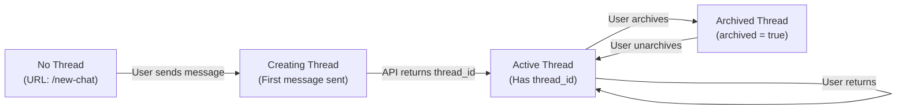
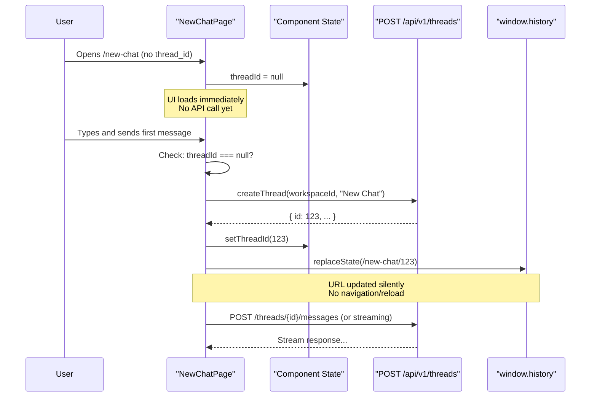
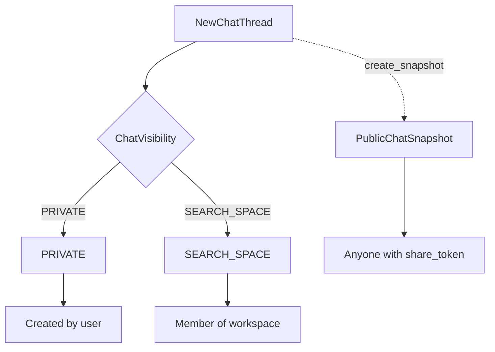

<!-- source: DeepWiki mcp.deepwiki.com · repo MODSetter/SurfSense · page 10.4 Thread Management · fetched 2026-10-29 -->

# Thread Management

<details>
<summary>Relevant source files</summary>

The following files were used as context for generating this wiki page:

- [surfsense_backend/app/routes/new_chat_routes.py](surfsense_backend/app/routes/new_chat_routes.py)
- [surfsense_backend/app/routes/public_chat_routes.py](surfsense_backend/app/routes/public_chat_routes.py)
- [surfsense_backend/app/schemas/new_chat.py](surfsense_backend/app/schemas/new_chat.py)
- [surfsense_backend/app/services/public_chat_service.py](surfsense_backend/app/services/public_chat_service.py)
- [surfsense_web/atoms/public-chat-snapshots/public-chat-snapshots-query.atoms.ts](surfsense_web/atoms/public-chat-snapshots/public-chat-snapshots-query.atoms.ts)
- [surfsense_web/components/assistant-ui/connector-popup/connector-configs/components/discord-config.tsx](surfsense_web/components/assistant-ui/connector-popup/connector-configs/components/discord-config.tsx)
- [surfsense_web/components/assistant-ui/connector-popup/connector-configs/components/slack-config.tsx](surfsense_web/components/assistant-ui/connector-popup/connector-configs/components/slack-config.tsx)
- [surfsense_web/components/public-chat-snapshots/public-chat-snapshot-row.tsx](surfsense_web/components/public-chat-snapshots/public-chat-snapshot-row.tsx)
- [surfsense_web/components/public-chat-snapshots/public-chat-snapshots-list.tsx](surfsense_web/components/public-chat-snapshots/public-chat-snapshots-list.tsx)
- [surfsense_web/components/public-chat-snapshots/public-chat-snapshots-manager.tsx](surfsense_web/components/public-chat-snapshots/public-chat-snapshots-manager.tsx)
- [surfsense_web/components/settings/general-settings-manager.tsx](surfsense_web/components/settings/general-settings-manager.tsx)
- [surfsense_web/components/settings/prompt-config-manager.tsx](surfsense_web/components/settings/prompt-config-manager.tsx)
- [surfsense_web/components/settings/roles-manager.tsx](surfsense_web/components/settings/roles-manager.tsx)
- [surfsense_web/components/ui/alert.tsx](surfsense_web/components/ui/alert.tsx)
- [surfsense_web/contracts/types/chat-threads.types.ts](surfsense_web/contracts/types/chat-threads.types.ts)
- [surfsense_web/contracts/types/public-chat.types.ts](surfsense_web/contracts/types/public-chat.types.ts)
- [surfsense_web/lib/apis/chat-threads-api.service.ts](surfsense_web/lib/apis/chat-threads-api.service.ts)
- [surfsense_web/lib/apis/public-chat-api.service.ts](surfsense_web/lib/apis/public-chat-api.service.ts)
- [surfsense_web/lib/chat/thread-persistence.ts](surfsense_web/lib/chat/thread-persistence.ts)

</details>


## Purpose and Scope

Thread Management in SurfSense handles the complete lifecycle of chat conversations, from creation through persistence and restoration. The system implements a lazy creation strategy for threads, flexible visibility controls (private vs shared), and comprehensive state management to ensure conversations survive page reloads and navigation. This page documents both frontend and backend implementations of thread management, including the database schema, API endpoints, and UI components.

For information about the chat UI and streaming responses, see [Chat Architecture and Workflow](#10.1). For message composition and document mentions, see [Document Mentions](#10.2). For details on the agent system that powers chat responses, see [Agent Architecture](#6.1).

---

## Thread Data Model

The thread system uses two primary database tables to store conversations:

**Database Schema**

| Table | Key Fields | Purpose |
|-------|------------|---------|
| `NewChatThread` | `id`, `title`, `visibility`, `created_by_id`, `workspace_id` | Thread metadata and ownership |
| `NewChatMessage` | `id`, `thread_id`, `role`, `content`, `author_id`, `turn_id` | Individual messages in a thread |

**Thread Visibility Enum**

```python
class ChatVisibility(str, Enum):
    PRIVATE = "PRIVATE"           # Only creator can access
    SEARCH_SPACE = "SEARCH_SPACE" # All workspace members can access
```

**Thread Lifecycle States**



Sources: [surfsense_backend/app/schemas/new_chat.py:15-126](), [surfsense_web/lib/chat/thread-persistence.ts:15-27]()

## Thread Creation

### Lazy Creation Strategy

SurfSense implements a lazy creation strategy where threads are only created when the user sends their first message. This approach improves UX (instant load) and avoids orphan threads.

**Creation Flow**



**Implementation Details**

The page component tracks thread creation state and performs a silent URL update using `window.history.replaceState()` to prevent interrupting the ongoing fetch/streaming request that would occur with React Router navigation.

Sources: [surfsense_backend/app/routes/new_chat_routes.py:339-395](), [surfsense_web/lib/chat/thread-persistence.ts:117-125]()

### Backend Thread Creation

The backend `POST /threads` endpoint creates a new thread record:

```python
@router.post("/threads", response_model=NewChatThreadRead)
async def create_thread(
    thread: NewChatThreadCreate,
    session: AsyncSession = Depends(get_async_session),
    user: User = Depends(get_auth_context),
):
    now = datetime.now(UTC)
    db_thread = NewChatThread(
        title=thread.title,
        archived=thread.archived,
        visibility=thread.visibility,  # Defaults to PRIVATE
        workspace_id=thread.workspace_id,
        created_by_id=user.id,
        updated_at=now,
    )
    session.add(db_thread)
    await session.commit()
    await session.refresh(db_thread)
    return db_thread
```

**Default Values:**
- `visibility`: `ChatVisibility.PRIVATE` [surfsense_backend/app/schemas/new_chat.py:90]()
- `archived`: `False` [surfsense_backend/app/schemas/new_chat.py:82]()
- `title`: "New Chat" [surfsense_backend/app/schemas/new_chat.py:81]()

Sources: [surfsense_backend/app/routes/new_chat_routes.py:339-395](), [surfsense_backend/app/schemas/new_chat.py:85-91]()

## Message Persistence

### Message Storage Format

Messages are stored with JSONB content. A key feature is the `turn_id`, which acts as a correlation ID to locate matching LangGraph checkpoints for edits and regeneration.

**Message Content Structure**

```typescript
// MessageRecord matching backend NewChatMessageRead
{
  id: 456,
  thread_id: 123,
  role: "assistant",
  content: [
    { type: "text", text: "Based on the document..." }
  ],
  token_usage: {
    prompt_tokens: 150,
    completion_tokens: 200,
    total_tokens: 350,
    cost_micros: 500
  },
  turn_id: "chat_123:1715000000"
}
```

Sources: [surfsense_backend/app/schemas/new_chat.py:38-60](), [surfsense_web/lib/chat/thread-persistence.ts:50-65]()

### Append Message Endpoint

While modern streaming flows (`stream_new_chat`) persist both user and assistant rows server-side via `persist_user_turn`, the legacy `appendMessage` utility remains for specific error fallback cases.

Sources: [surfsense_backend/app/routes/new_chat_routes.py:704-809](), [surfsense_web/lib/chat/thread-persistence.ts:133-165]()

## Thread Visibility and Sharing

### Visibility Types

Threads support two primary visibility modes and an immutable "Public Snapshot" system for external sharing.

| Visibility | Access | Use Case |
|-----------|--------|----------|
| `PRIVATE` | Only creator | Personal research |
| `SEARCH_SPACE` | All workspace members | Team collaboration |
| `Public Snapshot` | Anyone with token | External sharing (read-only) |

**Visibility Rules**



Sources: [surfsense_backend/app/db.py:43](), [surfsense_backend/app/services/public_chat_service.py:164-212](), [surfsense_web/lib/chat/thread-persistence.ts:15-21]()

### Public Chat Snapshots

Public sharing creates an immutable `PublicChatSnapshot`. 

1. **Deduplication**: Snapshots use content hashing via `compute_content_hash`. If the chat hasn't changed, the same share token is returned [surfsense_backend/app/services/public_chat_service.py:133-156]().
2. **Sanitization**: Citations like `[[citation:X]]` are stripped for public views via `strip_citations` [surfsense_backend/app/services/public_chat_service.py:50-63]().
3. **Cloning**: Authenticated users can clone a public snapshot to their own account using `clone_from_snapshot` [surfsense_backend/app/routes/public_chat_routes.py:48-60]().

Sources: [surfsense_backend/app/services/public_chat_service.py:164-212](), [surfsense_backend/app/routes/public_chat_routes.py:33-44]()

### Sharing UI

The `PublicChatSnapshotsManager` component manages the lifecycle of these snapshots within the workspace settings, allowing users to view, copy, or delete existing public links.

Sources: [surfsense_web/components/public-chat-snapshots/public-chat-snapshots-manager.tsx:30-53](), [surfsense_web/components/public-chat-snapshots/public-chat-snapshot-row.tsx:39-62]()

## Thread Loading and Restoration

### Frontend State Management

The frontend uses `fetchThreads` to populate the sidebar and `getThreadMessages` to restore the conversation state when a user navigates to a specific thread ID.

```typescript
export async function getThreadMessages(threadId: number): Promise<ThreadHistoryLoadResponse> {
	return baseApiService.get<ThreadHistoryLoadResponse>(`/api/v1/threads/${threadId}`);
}
```

Sources: [surfsense_web/lib/chat/thread-persistence.ts:94-101](), [surfsense_web/lib/chat/thread-persistence.ts:130-132]()

## Thread Update and Delete

### Update and Search

Threads can be renamed, archived, or searched. The `searchThreads` utility performs title-based filtering within a specific workspace.

```typescript
export async function searchThreads(workspaceId: number, title: string): Promise<ThreadListItem[]> {
	const params = new URLSearchParams({
		workspace_id: String(workspaceId),
		title,
	});
	return baseApiService.get<ThreadListItem[]>(`/api/v1/threads/search?${params}`);
}
```

Sources: [surfsense_web/lib/chat/thread-persistence.ts:106-112](), [surfsense_web/lib/chat/thread-persistence.ts:170-177]()

### Deletion

Deleting a thread removes all associated messages and the thread record itself. The backend ensures that only the creator or workspace admins can perform deletions via `DELETE /threads/{thread_id}`.

Sources: [surfsense_web/lib/chat/thread-persistence.ts:182-184](), [surfsense_backend/app/routes/new_chat_routes.py:596-653]()

---

