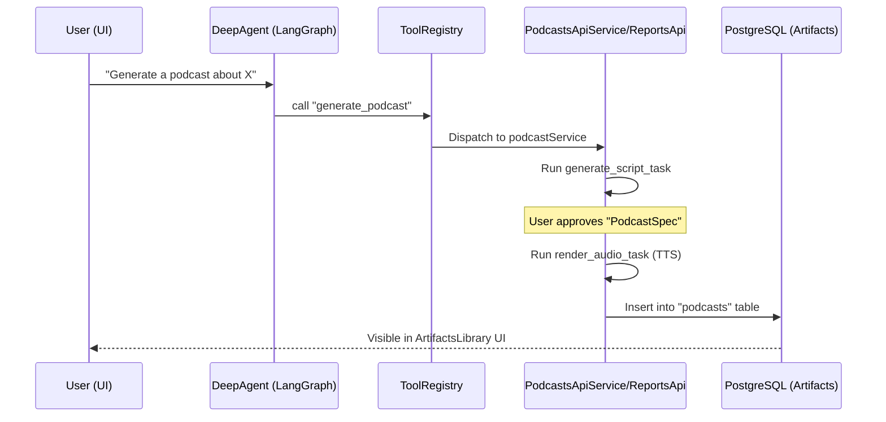
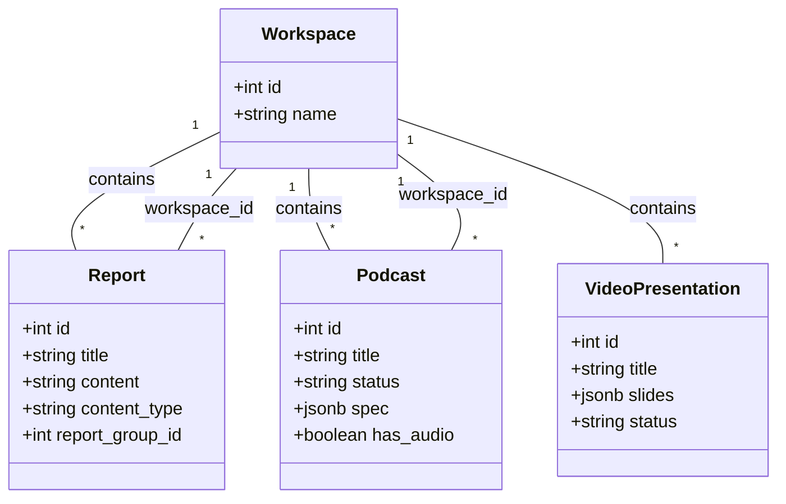

<!-- source: DeepWiki mcp.deepwiki.com · repo MODSetter/SurfSense · page 11 Artifacts and Deliverables · fetched 2026-10-29 -->

# Artifacts and Deliverables

Relevant source files

The following files were used as context for generating this wiki page:

- [surfsense_backend/app/podcasts/schemas/spec.py](surfsense_backend/app/podcasts/schemas/spec.py)
- [surfsense_backend/app/routes/reports_routes.py](surfsense_backend/app/routes/reports_routes.py)
- [surfsense_backend/tests/unit/agents/new_chat/tools/test_resume_page_limits.py](surfsense_backend/tests/unit/agents/new_chat/tools/test_resume_page_limits.py)
- [surfsense_backend/tests/unit/podcasts/test_spec.py](surfsense_backend/tests/unit/podcasts/test_spec.py)
- [surfsense_web/atoms/chat/report-panel.atom.ts](surfsense_web/atoms/chat/report-panel.atom.ts)
- [surfsense_web/components/editor-panel/memory.ts](surfsense_web/components/editor-panel/memory.ts)
- [surfsense_web/components/public-chat/public-chat-footer.tsx](surfsense_web/components/public-chat/public-chat-footer.tsx)
- [surfsense_web/components/report-panel/pdf-viewer.tsx](surfsense_web/components/report-panel/pdf-viewer.tsx)
- [surfsense_web/components/report-panel/report-panel.tsx](surfsense_web/components/report-panel/report-panel.tsx)
- [surfsense_web/components/tool-ui/generate-report.tsx](surfsense_web/components/tool-ui/generate-report.tsx)
- [surfsense_web/components/tool-ui/generate-resume.tsx](surfsense_web/components/tool-ui/generate-resume.tsx)
- [surfsense_web/components/tool-ui/podcast/brief-review.tsx](surfsense_web/components/tool-ui/podcast/brief-review.tsx)
- [surfsense_web/components/tool-ui/podcast/index.ts](surfsense_web/components/tool-ui/podcast/index.ts)
- [surfsense_web/components/tool-ui/podcast/player.tsx](surfsense_web/components/tool-ui/podcast/player.tsx)
- [surfsense_web/components/tool-ui/podcast/schema.ts](surfsense_web/components/tool-ui/podcast/schema.ts)
- [surfsense_web/components/tool-ui/sandbox-execute.tsx](surfsense_web/components/tool-ui/sandbox-execute.tsx)
- [surfsense_web/components/tool-ui/video-presentation/errors.ts](surfsense_web/components/tool-ui/video-presentation/errors.ts)
- [surfsense_web/components/tool-ui/video-presentation/generate-video-presentation.tsx](surfsense_web/components/tool-ui/video-presentation/generate-video-presentation.tsx)
- [surfsense_web/components/tool-ui/video-presentation/index.ts](surfsense_web/components/tool-ui/video-presentation/index.ts)
- [surfsense_web/contracts/types/image-generations.types.ts](surfsense_web/contracts/types/image-generations.types.ts)
- [surfsense_web/contracts/types/podcast.types.ts](surfsense_web/contracts/types/podcast.types.ts)
- [surfsense_web/contracts/types/reports.types.ts](surfsense_web/contracts/types/reports.types.ts)
- [surfsense_web/contracts/types/video-presentations.types.ts](surfsense_web/contracts/types/video-presentations.types.ts)
- [surfsense_web/features/artifacts-library/hooks/use-library-artifacts.ts](surfsense_web/features/artifacts-library/hooks/use-library-artifacts.ts)
- [surfsense_web/features/artifacts-library/model/artifact.ts](surfsense_web/features/artifacts-library/model/artifact.ts)
- [surfsense_web/features/artifacts-library/ui/artifact-card.tsx](surfsense_web/features/artifacts-library/ui/artifact-card.tsx)
- [surfsense_web/features/artifacts-library/ui/kind-meta.ts](surfsense_web/features/artifacts-library/ui/kind-meta.ts)
- [surfsense_web/lib/apis/image-generations-api.service.ts](surfsense_web/lib/apis/image-generations-api.service.ts)
- [surfsense_web/lib/apis/podcasts-api.service.ts](surfsense_web/lib/apis/podcasts-api.service.ts)
- [surfsense_web/lib/apis/reports-api.service.ts](surfsense_web/lib/apis/reports-api.service.ts)
- [surfsense_web/lib/apis/video-presentations-api.service.ts](surfsense_web/lib/apis/video-presentations-api.service.ts)

SurfSense provides a comprehensive system for generating high-value deliverables from collected knowledge and chat interactions. These "Artifacts" include AI-generated podcasts, professional reports, resumes, and video presentations. All generated content is managed through a centralized library, ensuring that deliverables are discoverable and reusable across a workspace.

## Deliverable Generation System

The generation of artifacts is primarily driven by the AI Agent using specialized tools. When a user requests a specific output (e.g., "Write a report on this" or "Make a podcast summary"), the agent invokes the corresponding tool to initiate a background processing pipeline.

### Podcast Generation
The podcast system converts chat conversations or source documents into multi-speaker audio content. It utilizes a sophisticated pipeline that includes script generation via LLMs and audio synthesis using Text-to-Speech (TTS) services like **Kokoro** (local) or **OpenAI**. 

*   **Lifecycle:** Podcasts transition through states such as `pending`, `awaiting_brief`, `rendering`, and `ready` [surfsense_web/contracts/types/podcast.types.ts:7-16]().
*   **The Brief:** Users can review and edit a `PodcastSpec` (the "Brief") which includes language, `speakerRole`, and `podcastStyle` (e.g., conversational, interview, debate) before rendering starts [surfsense_web/contracts/types/podcast.types.ts:36-46](), [surfsense_web/components/tool-ui/podcast/brief-review.tsx:68-75]().
*   **Performance:** Capable of generating a 3-minute podcast in under 20 seconds using local providers.

For details, see [Podcast Generation](#11.1).

### Report and Video Generation
SurfSense supports the creation of structured text documents and dynamic video presentations.

*   **Reports & Resumes:** Generates Markdown or Typst-based documents [surfsense_backend/app/routes/reports_routes.py:4-9](). The system uses `pypandoc` for format conversion and `typst-py` for high-quality PDF rendering [surfsense_backend/app/routes/reports_routes.py:23-24](). Users can edit these directly using the built-in **Plate editor** [surfsense_web/components/report-panel/report-panel.tsx:54-57]().
*   **Video Presentations:** Uses **Remotion** to compile React-based video scenes from source content, featuring synchronized audio and slide transitions [surfsense_web/components/tool-ui/video-presentation/generate-video-presentation.tsx:14-21](). It supports exporting to MP4 or PPTX [surfsense_web/components/tool-ui/video-presentation/generate-video-presentation.tsx:132-138]().

For details, see [Report and Video Generation](#11.2).

## Artifacts Library

The **Artifacts Library** serves as the central repository for all generated deliverables within a `SearchSpace`. It provides a unified UI for browsing, managing, and sharing these assets.

*   **Categorization:** Artifacts are grouped by type, including `Reports`, `Resumes`, `Podcasts`, `Presentations`, and `Images`.
*   **Management:** Supports viewing, downloading, and deleting artifacts. For reports, the library tracks versions and allows users to switch between historical iterations [surfsense_web/components/report-panel/report-panel.tsx:137-144]().
*   **Persistence:** Artifacts are linked to the `workspace_id` and the specific `thread_id` that generated them, preserving context [surfsense_web/contracts/types/podcast.types.ts:153-156]().

For details, see [Artifacts Library](#11.3).

## Technical Overview: Artifact Flow

The following diagram illustrates how natural language requests in the UI translate into persisted code entities and deliverables.

### Deliverable Creation Workflow
"Natural Language Space" to "Code Entity Space" mapping:

**Sources:** [surfsense_web/lib/apis/podcasts-api.service.ts:17-48](), [surfsense_web/components/tool-ui/podcast/brief-review.tsx:203-213]()

### Artifact Data Relationships
Mapping of system concepts to database models:

**Sources:** [surfsense_backend/app/routes/reports_routes.py:32-38](), [surfsense_web/contracts/types/podcast.types.ts:143-157](), [surfsense_web/components/tool-ui/video-presentation/generate-video-presentation.tsx:38-67]()

## Export and Format Support

Artifacts can be exported into various formats to facilitate sharing and external use.

| Artifact Type | Primary Backend Engine | Supported Formats |
| :--- | :--- | :--- |
| **Reports** | `pypandoc` | PDF, DOCX, HTML, LaTeX, EPUB, ODT, Plain Text [surfsense_backend/app/routes/reports_routes.py:55-63]() |
| **Podcasts** | TTS + FFmpeg | MP3/WAV Audio Download |
| **Videos** | `Remotion` | MP4 Video, PPTX (Slides only) [surfsense_web/components/tool-ui/video-presentation/generate-video-presentation.tsx:132-138]() |
| **Resumes** | `Typst` | Professional PDF (page-limited) [surfsense_web/components/tool-ui/generate-resume.tsx:23-28]() |

**Sources:** [surfsense_backend/app/routes/reports_routes.py:55-83](), [surfsense_web/components/tool-ui/video-presentation/generate-video-presentation.tsx:132-138]()

---

