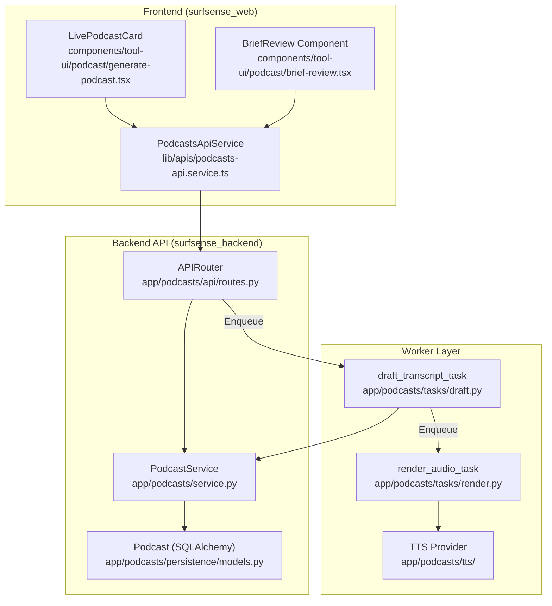
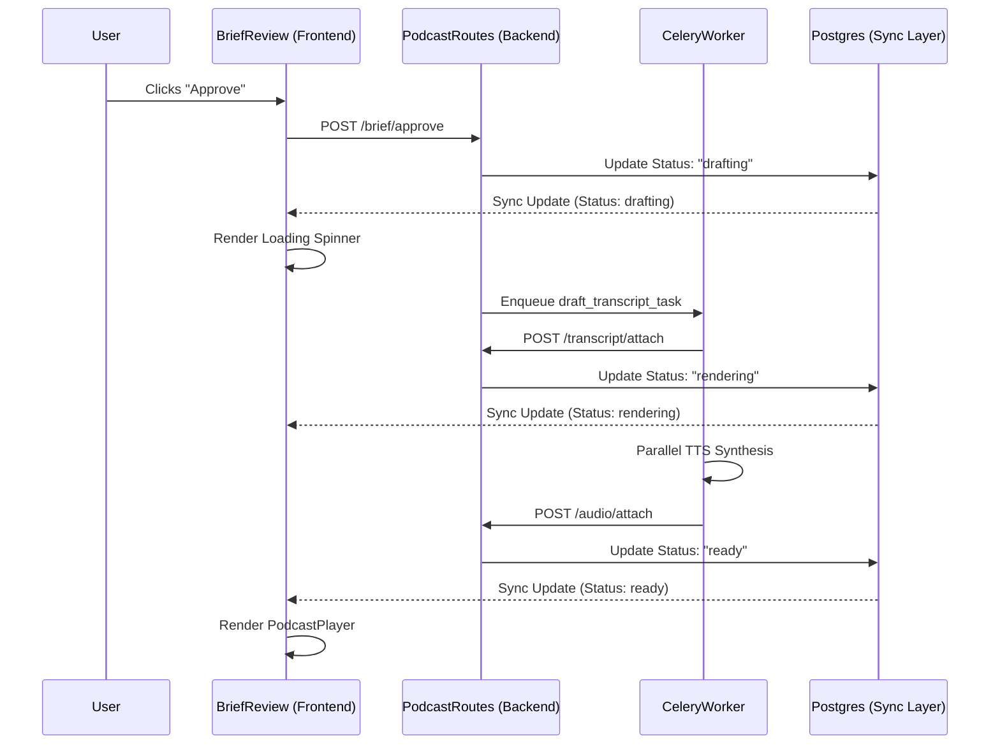

<!-- source: DeepWiki mcp.deepwiki.com · repo MODSetter/SurfSense · page 11.1 Podcast Generation · fetched 2026-10-29 -->

# Podcast Generation

Relevant source files

The following files were used as context for generating this wiki page:

- [surfsense_backend/app/podcasts/api/routes.py](surfsense_backend/app/podcasts/api/routes.py)
- [surfsense_backend/app/podcasts/api/schemas.py](surfsense_backend/app/podcasts/api/schemas.py)
- [surfsense_backend/app/podcasts/persistence/enums/podcast_status.py](surfsense_backend/app/podcasts/persistence/enums/podcast_status.py)
- [surfsense_backend/app/podcasts/schemas/spec.py](surfsense_backend/app/podcasts/schemas/spec.py)
- [surfsense_backend/app/podcasts/service.py](surfsense_backend/app/podcasts/service.py)
- [surfsense_backend/app/podcasts/tasks/render.py](surfsense_backend/app/podcasts/tasks/render.py)
- [surfsense_backend/tests/integration/podcasts/test_cancel.py](surfsense_backend/tests/integration/podcasts/test_cancel.py)
- [surfsense_backend/tests/integration/podcasts/test_regeneration.py](surfsense_backend/tests/integration/podcasts/test_regeneration.py)
- [surfsense_backend/tests/integration/podcasts/test_render_task.py](surfsense_backend/tests/integration/podcasts/test_render_task.py)
- [surfsense_backend/tests/unit/podcasts/test_api_schemas.py](surfsense_backend/tests/unit/podcasts/test_api_schemas.py)
- [surfsense_backend/tests/unit/podcasts/test_spec.py](surfsense_backend/tests/unit/podcasts/test_spec.py)
- [surfsense_web/components/tool-ui/podcast/brief-review.tsx](surfsense_web/components/tool-ui/podcast/brief-review.tsx)
- [surfsense_web/components/tool-ui/podcast/generate-podcast.tsx](surfsense_web/components/tool-ui/podcast/generate-podcast.tsx)
- [surfsense_web/contracts/types/image-generations.types.ts](surfsense_web/contracts/types/image-generations.types.ts)
- [surfsense_web/contracts/types/podcast.types.ts](surfsense_web/contracts/types/podcast.types.ts)
- [surfsense_web/contracts/types/reports.types.ts](surfsense_web/contracts/types/reports.types.ts)
- [surfsense_web/contracts/types/video-presentations.types.ts](surfsense_web/contracts/types/video-presentations.types.ts)
- [surfsense_web/features/artifacts-library/hooks/use-library-artifacts.ts](surfsense_web/features/artifacts-library/hooks/use-library-artifacts.ts)
- [surfsense_web/features/artifacts-library/model/artifact.ts](surfsense_web/features/artifacts-library/model/artifact.ts)
- [surfsense_web/features/artifacts-library/ui/artifact-card.tsx](surfsense_web/features/artifacts-library/ui/artifact-card.tsx)
- [surfsense_web/features/artifacts-library/ui/kind-meta.ts](surfsense_web/features/artifacts-library/ui/kind-meta.ts)
- [surfsense_web/lib/apis/image-generations-api.service.ts](surfsense_web/lib/apis/image-generations-api.service.ts)
- [surfsense_web/lib/apis/podcasts-api.service.ts](surfsense_web/lib/apis/podcasts-api.service.ts)
- [surfsense_web/lib/apis/reports-api.service.ts](surfsense_web/lib/apis/reports-api.service.ts)
- [surfsense_web/lib/apis/video-presentations-api.service.ts](surfsense_web/lib/apis/video-presentations-api.service.ts)

## Purpose and Scope

The podcast generation feature in SurfSense converts chat conversations or specific source content into multi-speaker audio podcasts. This feature is integrated as a core deliverable within the knowledge management ecosystem, allowing users to consume internal knowledge in an audio format. The system supports high-speed generation using a variety of Text-to-Speech (TTS) providers including **Kokoro** (local) and **OpenAI**.

The lifecycle involves a multi-stage pipeline:
1.  **Brief Proposal:** Generating a configuration (spec) including speakers, style, and duration.
2.  **Review/Edit:** A user-facing "gate" where the brief can be tweaked.
3.  **Drafting:** LLM-driven generation of a multi-speaker transcript.
4.  **Rendering:** Parallel TTS synthesis and audio merging.
5.  **Playback:** Integrated audio player within the chat or Artifacts Library.

**Sources:** [surfsense_backend/app/podcasts/api/routes.py:1-7](), [surfsense_backend/app/podcasts/schemas/spec.py:1-7]()

## System Architecture

The podcast system spans the Next.js frontend, FastAPI backend, and Celery background workers.

### Code Entity Relationship Diagram

This diagram maps the logical podcast flow to specific code entities and files.

**Sources:** [surfsense_web/lib/apis/podcasts-api.service.ts:17-83](), [surfsense_backend/app/podcasts/api/routes.py:57-210](), [surfsense_backend/app/podcasts/service.py:81-181]()

## Data Models and Lifecycle

### The Podcast Spec (The Brief)
The `PodcastSpec` (often called "The Brief") is the configuration approved by the user before expensive generation begins. It defines the language, style (conversational, interview, debate, monologue, narrative), speakers, and target duration. It is stored as `JSONB` on the `podcasts` table [surfsense_backend/app/podcasts/schemas/spec.py:1-7]().

| Field | Type | Description |
| :--- | :--- | :--- |
| `language` | `str` | BCP-47 tag (e.g., 'en', 'pt-BR'). Normalised on construction [surfsense_backend/app/podcasts/schemas/spec.py:154-157](). |
| `style` | `PodcastStyle` | Format (Conversational, Debate, etc.). Monologues must have exactly 1 speaker [surfsense_backend/app/podcasts/schemas/spec.py:175-180](). |
| `speakers` | `list[SpeakerSpec]` | List of speakers with assigned `voice_id` and `role`. Uses `slot` as a stable join key [surfsense_backend/app/podcasts/schemas/spec.py:65-71](). |
| `duration` | `DurationTarget` | Range in seconds (Min/Max). Drafting aims for the midpoint [surfsense_backend/app/podcasts/schemas/spec.py:129-133](). |
| `focus` | `str` | Optional user steer for the LLM. Max 2000 chars [surfsense_backend/app/podcasts/schemas/spec.py:148-152](). |

**Sources:** [surfsense_backend/app/podcasts/schemas/spec.py:139-180](), [surfsense_web/contracts/types/podcast.types.ts:86-99]()

### Status State Machine
The `PodcastStatus` enum governs the lifecycle. Transitions are strictly validated in `PodcastService._transition` using an allowed-transition table [surfsense_backend/app/podcasts/service.py:20-55]().

| Status | Description |
| :--- | :--- |
| `pending` | Initial state after creation. |
| `awaiting_brief` | System has proposed a brief; waiting for user approval. |
| `drafting` | LLM is generating the transcript. |
| `rendering` | TTS is synthesizing audio turns. |
| `ready` | Audio is merged and available for playback. |
| `failed` / `cancelled` | Terminal error or user-aborted states. |

**Sources:** [surfsense_backend/app/podcasts/service.py:20-55](), [surfsense_web/contracts/types/podcast.types.ts:7-16]()

## Implementation Details

### The Brief Gate
The `BriefReview` component in the frontend provides an interactive form for users to modify the proposed podcast before committing.
- **Voice Selection:** Fetches available voices via `podcastsApiService.listVoices()` [surfsense_web/lib/apis/podcasts-api.service.ts:68-71]().
- **Voice Previews:** Plays short audio samples using `podcastsApiService.previewVoice()` [surfsense_web/lib/apis/podcasts-api.service.ts:80-82]().
- **Optimistic Concurrency:** Uses `expected_version` in `updateSpec` to prevent clobbering concurrent edits [surfsense_web/lib/apis/podcasts-api.service.ts:34-44](). The backend raises `SpecConflictError` if versions mismatch [surfsense_backend/app/podcasts/service.py:66-74]().

### Generation Pipeline
The backend executes the following flow:
1.  **Creation:** `PodcastService.create` initializes the row in `PENDING` [surfsense_backend/app/podcasts/service.py:88-99]().
2.  **Brief Proposal:** `propose_brief` uses an LLM to suggest speakers and styles based on the source content [surfsense_backend/app/podcasts/api/routes.py:172-180]().
3.  **Approval:** When the user calls `/brief/approve`, the status moves to `DRAFTING` and a Celery task is enqueued [surfsense_backend/app/podcasts/api/routes.py:211-225]().
4.  **Drafting:** The worker generates a `Transcript` containing `TranscriptTurn` objects (speaker slot + text) [surfsense_web/contracts/types/podcast.types.ts:105-114]().
5.  **Rendering:** The `render` task calls the TTS provider for each turn. It merges the resulting audio chunks using FFmpeg [surfsense_backend/tests/integration/podcasts/test_render_task.py:22-36]().

### Regeneration and Reversion
Users can "Regenerate" a finished podcast. This moves the status back to `awaiting_brief`, allowing tweaks to the focus or voices [surfsense_backend/app/podcasts/service.py:145-157](). 
The system supports **Reversion**: if a user changes their mind during a regeneration, `revert_regeneration` restores the previous `READY` state and its associated audio, provided the new render hasn't committed yet [surfsense_backend/app/podcasts/service.py:159-170]().

**Sources:** [surfsense_backend/tests/integration/podcasts/test_regeneration.py:88-105](), [surfsense_web/components/tool-ui/podcast/generate-podcast.tsx:64-120]()

## Component Interaction Diagram

This diagram shows how the UI responds to real-time status updates pushed via the sync layer.

**Sources:** [surfsense_web/components/tool-ui/podcast/generate-podcast.tsx:201-228](), [surfsense_backend/app/podcasts/api/routes.py:3-7](), [surfsense_web/lib/apis/podcasts-api.service.ts:46-48]()

---

