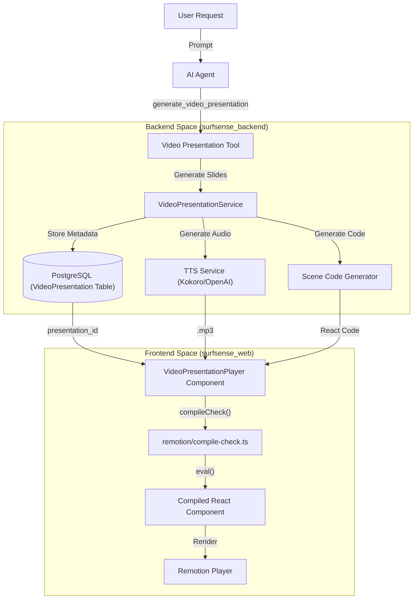
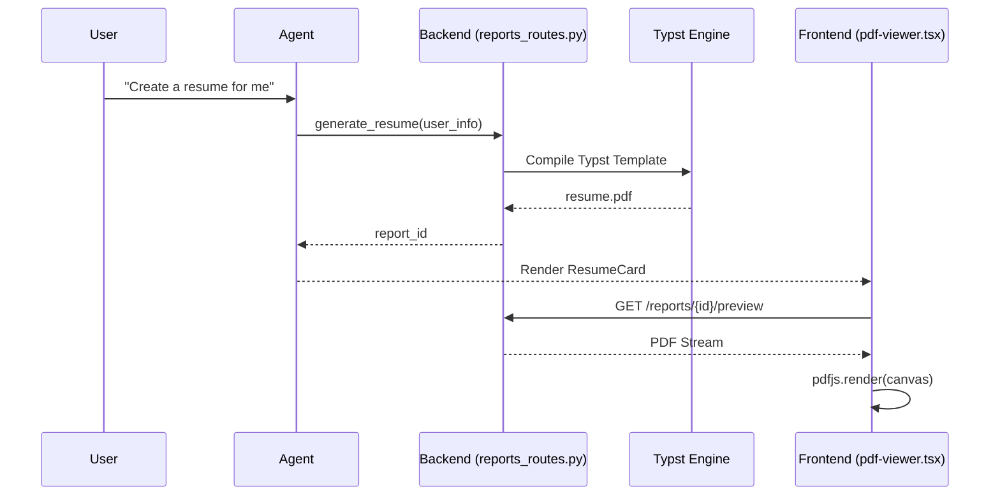

<!-- source: DeepWiki mcp.deepwiki.com · repo MODSetter/SurfSense · page 11.2 Report and Video Generation · fetched 2026-10-29 -->

# Report and Video Generation

Relevant source files

The following files were used as context for generating this wiki page:

- [surfsense_backend/app/agents/chat/multi_agent_chat/subagents/builtins/deliverables/tools/generate_image.py](surfsense_backend/app/agents/chat/multi_agent_chat/subagents/builtins/deliverables/tools/generate_image.py)
- [surfsense_backend/app/agents/chat/multi_agent_chat/subagents/builtins/deliverables/tools/index.py](surfsense_backend/app/agents/chat/multi_agent_chat/subagents/builtins/deliverables/tools/index.py)
- [surfsense_backend/app/routes/image_generation_routes.py](surfsense_backend/app/routes/image_generation_routes.py)
- [surfsense_backend/app/routes/reports_routes.py](surfsense_backend/app/routes/reports_routes.py)
- [surfsense_backend/app/schemas/image_generation.py](surfsense_backend/app/schemas/image_generation.py)
- [surfsense_backend/app/services/image_gen_router_service.py](surfsense_backend/app/services/image_gen_router_service.py)
- [surfsense_backend/scripts/verify_chat_image_capability.py](surfsense_backend/scripts/verify_chat_image_capability.py)
- [surfsense_backend/tests/integration/podcasts/test_draft_task.py](surfsense_backend/tests/integration/podcasts/test_draft_task.py)
- [surfsense_backend/tests/unit/agents/new_chat/tools/test_resume_page_limits.py](surfsense_backend/tests/unit/agents/new_chat/tools/test_resume_page_limits.py)
- [surfsense_backend/tests/unit/routes/test_image_gen_quota.py](surfsense_backend/tests/unit/routes/test_image_gen_quota.py)
- [surfsense_backend/tests/unit/services/test_auto_pin_image_aware.py](surfsense_backend/tests/unit/services/test_auto_pin_image_aware.py)
- [surfsense_backend/tests/unit/services/test_image_gen_api_base_defense.py](surfsense_backend/tests/unit/services/test_image_gen_api_base_defense.py)
- [surfsense_backend/tests/unit/services/test_llm_router_pool_filter.py](surfsense_backend/tests/unit/services/test_llm_router_pool_filter.py)
- [surfsense_backend/tests/unit/services/test_openrouter_legacy_config.py](surfsense_backend/tests/unit/services/test_openrouter_legacy_config.py)
- [surfsense_backend/tests/unit/services/test_or_health_enrichment.py](surfsense_backend/tests/unit/services/test_or_health_enrichment.py)
- [surfsense_backend/tests/unit/services/test_provider_capabilities.py](surfsense_backend/tests/unit/services/test_provider_capabilities.py)
- [surfsense_backend/tests/unit/services/test_quota_checked_vision_llm.py](surfsense_backend/tests/unit/services/test_quota_checked_vision_llm.py)
- [surfsense_backend/tests/unit/services/test_token_quota_service_cost.py](surfsense_backend/tests/unit/services/test_token_quota_service_cost.py)
- [surfsense_backend/tests/unit/tasks/test_stream_new_chat_image_safety_net.py](surfsense_backend/tests/unit/tasks/test_stream_new_chat_image_safety_net.py)
- [surfsense_backend/tests/unit/tasks/test_video_presentation_billing.py](surfsense_backend/tests/unit/tasks/test_video_presentation_billing.py)
- [surfsense_web/atoms/chat/report-panel.atom.ts](surfsense_web/atoms/chat/report-panel.atom.ts)
- [surfsense_web/components/editor-panel/memory.ts](surfsense_web/components/editor-panel/memory.ts)
- [surfsense_web/components/public-chat/public-chat-footer.tsx](surfsense_web/components/public-chat/public-chat-footer.tsx)
- [surfsense_web/components/report-panel/pdf-viewer.tsx](surfsense_web/components/report-panel/pdf-viewer.tsx)
- [surfsense_web/components/report-panel/report-panel.tsx](surfsense_web/components/report-panel/report-panel.tsx)
- [surfsense_web/components/tool-ui/generate-report.tsx](surfsense_web/components/tool-ui/generate-report.tsx)
- [surfsense_web/components/tool-ui/generate-resume.tsx](surfsense_web/components/tool-ui/generate-resume.tsx)
- [surfsense_web/components/tool-ui/podcast/index.ts](surfsense_web/components/tool-ui/podcast/index.ts)
- [surfsense_web/components/tool-ui/podcast/player.tsx](surfsense_web/components/tool-ui/podcast/player.tsx)
- [surfsense_web/components/tool-ui/podcast/schema.ts](surfsense_web/components/tool-ui/podcast/schema.ts)
- [surfsense_web/components/tool-ui/sandbox-execute.tsx](surfsense_web/components/tool-ui/sandbox-execute.tsx)
- [surfsense_web/components/tool-ui/video-presentation/errors.ts](surfsense_web/components/tool-ui/video-presentation/errors.ts)
- [surfsense_web/components/tool-ui/video-presentation/generate-video-presentation.tsx](surfsense_web/components/tool-ui/video-presentation/generate-video-presentation.tsx)
- [surfsense_web/components/tool-ui/video-presentation/index.ts](surfsense_web/components/tool-ui/video-presentation/index.ts)

SurfSense provides a sophisticated artifact generation system that allows AI agents to produce high-fidelity deliverables, including structured markdown reports, professionally formatted resumes, AI-generated images, and dynamic video presentations. These features bridge the gap between conversational AI and actionable business intelligence by transforming agent reasoning into shareable, multi-format assets.

## Report Generation Pipeline

Reports are generated as primary artifacts by the agent during a chat session. The system treats reports as versioned entities that can be edited, exported, and shared.

### Agent-Driven Creation
The `generate_report` tool is invoked by the agent when a user requests a structured summary or deep dive into a topic. The tool takes `topic`, `source_content`, and optional `report_style` as arguments [surfsense_web/components/tool-ui/generate-report.tsx:19-25]().

### The Rendering Pipeline
Once the agent produces the content, it is stored in the PostgreSQL database as Markdown [surfsense_backend/app/routes/reports_routes.py:4-6](). The system uses a two-stage processing pipeline for rendering:
1.  **Normalization**: The backend strips wrapping code fences and normalizes LaTeX delimiters (e.g., converting `\[...\]` to `$$...$$`) to ensure compatibility with Pandoc [surfsense_backend/app/routes/reports_routes.py:90-156]().
2.  **Conversion**: The system utilizes `pypandoc` and `typst` for multi-format export.

| Export Format | Engine | Technical Detail |
| :--- | :--- | :--- |
| **PDF** | `typst-py` | Uses Markdown -> Typst conversion via Pandoc, then renders with Typst templates [surfsense_backend/app/routes/reports_routes.py:7-9](). |
| **DOCX** | `pypandoc` | Uses a reference `.docx` file for consistent styling [surfsense_backend/app/routes/reports_routes.py:42-44](). |
| **HTML/EPUB/ODT** | `pypandoc` | Direct conversion with format-specific templates [surfsense_backend/app/routes/reports_routes.py:7-9](). |

### Versioning and Editing
Reports support a "Group" architecture where multiple versions of a report can exist under a single `report_group_id` [surfsense_backend/app/routes/reports_routes.py:180-196](). The frontend provides a `PlateEditor` (a rich-text editor) that allows users to modify the Markdown content directly and save new versions [surfsense_web/components/report-panel/report-panel.tsx:129-131]().

**Sources:**
- `surfsense_backend/app/routes/reports_routes.py` [1-196]()
- `surfsense_web/components/report-panel/report-panel.tsx` [63-186]()
- `surfsense_web/components/tool-ui/generate-report.tsx` [19-63]()

---

## Image Generation

SurfSense supports AI image generation integrated directly into the chat agent's toolset. This allows agents to create visual content based on user descriptions.

### Architecture and Execution
The `generate_image` tool leverages `litellm.aimage_generation` to interface with various image models (e.g., DALL-E, Midjourney via API) [surfsense_backend/app/agents/chat/multi_agent_chat/subagents/builtins/deliverables/tools/generate_image.py:10-12](). 

Key implementation details include:
- **Model Resolution**: The system resolves which model to use based on workspace preferences or an "Auto" mode that selects the best available candidate [surfsense_backend/app/agents/chat/multi_agent_chat/subagents/builtins/deliverables/tools/generate_image.py:127-143]().
- **Billing and Quotas**: Image generation is treated as a `billable_call`. The system calculates the `reserve_micros` (cost) based on the specific model's catalog before execution [surfsense_backend/app/routes/image_generation_routes.py:69-117]().
- **Security**: Generated images are served via a protected endpoint that requires signed tokens for access [surfsense_backend/app/routes/image_generation_routes.py:5-8]().

**Sources:**
- `surfsense_backend/app/agents/chat/multi_agent_chat/subagents/builtins/deliverables/tools/generate_image.py` [1-183]()
- `surfsense_backend/app/routes/image_generation_routes.py` [1-117]()

---

## Video Presentation Generation

SurfSense enables the generation of dynamic video presentations through a specialized tool that combines LLM-generated React code, audio synthesis, and the Remotion rendering engine.

### System Flow: Natural Language to Video Component
The following diagram illustrates how a user request is transformed into a rendered video artifact.

**Sources:**
- `surfsense_web/components/tool-ui/video-presentation/generate-video-presentation.tsx` [119-186]()
- `surfsense_web/lib/remotion/compile-check.ts` [1-20]()
- `surfsense_backend/app/routes/video_presentations_routes.py` [1-50]()

### Technical Implementation
1.  **Scene Generation**: The agent generates React code for each slide. This code is stored in the `scene_codes` array within the `VideoPresentation` model [surfsense_web/components/tool-ui/video-presentation/generate-video-presentation.tsx:57-65]().
2.  **Audio Integration**: Each slide contains `speaker_transcripts` which are converted to audio URLs. The frontend fetches these as Blobs to ensure compatibility with the Remotion player [surfsense_web/components/tool-ui/video-presentation/generate-video-presentation.tsx:187-205]().
3.  **Runtime Compilation**: The frontend uses `compileToComponent` to transform the stored string-based React code into live executable components at 30 FPS [surfsense_web/components/tool-ui/video-presentation/generate-video-presentation.tsx:165-180]().
4.  **Export**: Users can export the presentation to `.mp4` (rendered via Remotion) or `.pptx` [surfsense_web/components/tool-ui/video-presentation/generate-video-presentation.tsx:132-138]().

**Sources:**
- `surfsense_web/components/tool-ui/video-presentation/generate-video-presentation.tsx` [1-205]()
- `surfsense_web/lib/remotion/constants.ts` [1-5]()

---

## Resume Generation

Resume generation is a specialized form of report that uses a distinct rendering engine (Typst) to ensure pixel-perfect PDF layouts.

### Implementation Details
The `generate_resume` tool accepts `user_info` and `max_pages` [surfsense_web/components/tool-ui/generate-resume.tsx:23-28](). Unlike standard reports, resumes are often rendered with a `contentType` of `"typst"` [surfsense_web/atoms/chat/report-panel.atom:11-13]().

The frontend `ResumeCard` utilizes `pdf.js` to generate a live thumbnail of the generated resume by rendering the first page of the PDF into a canvas element [surfsense_web/components/tool-ui/generate-resume.tsx:139-188]().

**Sources:**
- `surfsense_web/components/tool-ui/generate-resume.tsx` [23-52, 139-188]()
- `surfsense_backend/app/routes/reports_routes.py` [55-83]()
- `surfsense_web/components/report-panel/pdf-viewer.tsx` [91-130]()

---

## Artifacts Management UI

The `ReportPanel` serves as the central interface for interacting with generated artifacts.

-   **State Management**: The panel's visibility and active content are managed via `reportPanelAtom` [surfsense_web/atoms/chat/report-panel.atom:25](). Opening a report automatically collapses the right sidebar's source view to prioritize the artifact [surfsense_web/atoms/chat/report-panel.atom:64-65]().
-   **Public Access**: Reports can be accessed via a `shareToken` for public chat threads, which switches the API calls to public endpoints [surfsense_web/components/report-panel/report-panel.tsx:152-154]().
-   **PDF Interaction**: The `PdfViewer` component handles multi-page rendering using a virtualized scroll approach, only rendering pages that are currently in the viewport to maintain performance [surfsense_web/components/report-panel/pdf-viewer.tsx:58-89]().

**Sources:**
- `surfsense_web/atoms/chat/report-panel.atom` [1-79]()
- `surfsense_web/components/report-panel/report-panel.tsx` [98-186]()
- `surfsense_web/components/report-panel/pdf-viewer.tsx` [58-168]()

---

