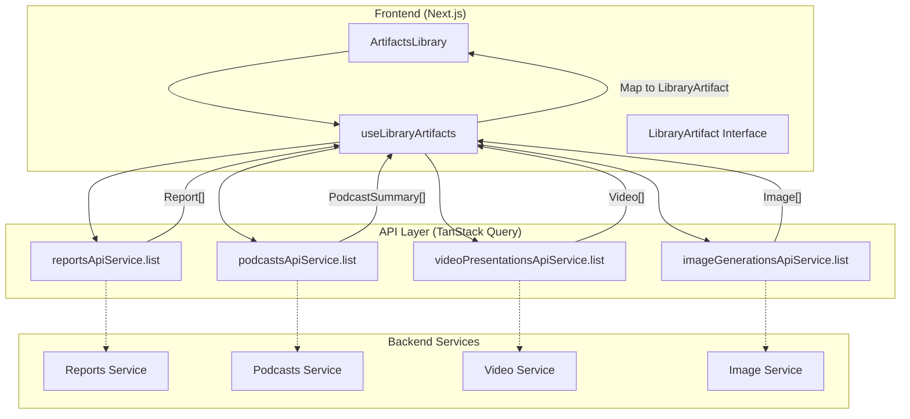
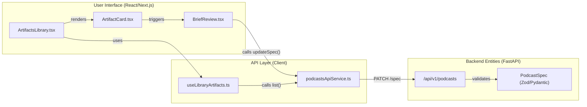

<!-- source: DeepWiki mcp.deepwiki.com · repo MODSetter/SurfSense · page 11.3 Artifacts Library · fetched 2026-10-29 -->

# Artifacts Library

Relevant source files

The following files were used as context for generating this wiki page:

- [surfsense_backend/app/capabilities/reddit/scrape/definition.py](surfsense_backend/app/capabilities/reddit/scrape/definition.py)
- [surfsense_backend/app/capabilities/reddit/scrape/schemas.py](surfsense_backend/app/capabilities/reddit/scrape/schemas.py)
- [surfsense_backend/app/podcasts/schemas/spec.py](surfsense_backend/app/podcasts/schemas/spec.py)
- [surfsense_backend/tests/unit/podcasts/test_spec.py](surfsense_backend/tests/unit/podcasts/test_spec.py)
- [surfsense_web/app/dashboard/[workspace_id]/playground/api-keys/page.tsx](surfsense_web/app/dashboard/[workspace_id]/playground/api-keys/page.tsx)
- [surfsense_web/app/dashboard/[workspace_id]/playground/components/api-reference.tsx](surfsense_web/app/dashboard/[workspace_id]/playground/components/api-reference.tsx)
- [surfsense_web/app/dashboard/[workspace_id]/playground/components/output-viewer.tsx](surfsense_web/app/dashboard/[workspace_id]/playground/components/output-viewer.tsx)
- [surfsense_web/app/dashboard/[workspace_id]/playground/components/playground-index.tsx](surfsense_web/app/dashboard/[workspace_id]/playground/components/playground-index.tsx)
- [surfsense_web/app/dashboard/[workspace_id]/playground/components/playground-runner.tsx](surfsense_web/app/dashboard/[workspace_id]/playground/components/playground-runner.tsx)
- [surfsense_web/app/dashboard/[workspace_id]/playground/components/run-detail.tsx](surfsense_web/app/dashboard/[workspace_id]/playground/components/run-detail.tsx)
- [surfsense_web/app/dashboard/[workspace_id]/playground/components/run-progress-panel.tsx](surfsense_web/app/dashboard/[workspace_id]/playground/components/run-progress-panel.tsx)
- [surfsense_web/app/dashboard/[workspace_id]/playground/components/run-status-badge.tsx](surfsense_web/app/dashboard/[workspace_id]/playground/components/run-status-badge.tsx)
- [surfsense_web/app/dashboard/[workspace_id]/playground/components/runs-table.tsx](surfsense_web/app/dashboard/[workspace_id]/playground/components/runs-table.tsx)
- [surfsense_web/app/dashboard/[workspace_id]/playground/components/schema-form.tsx](surfsense_web/app/dashboard/[workspace_id]/playground/components/schema-form.tsx)
- [surfsense_web/app/dashboard/[workspace_id]/playground/layout-shell.tsx](surfsense_web/app/dashboard/[workspace_id]/playground/layout-shell.tsx)
- [surfsense_web/app/dashboard/[workspace_id]/user-settings/layout-shell.tsx](surfsense_web/app/dashboard/[workspace_id]/user-settings/layout-shell.tsx)
- [surfsense_web/app/dashboard/[workspace_id]/workspace-settings/layout-shell.tsx](surfsense_web/app/dashboard/[workspace_id]/workspace-settings/layout-shell.tsx)
- [surfsense_web/components/assistant-ui/connector-popup/connector-configs/components/circleback-config.tsx](surfsense_web/components/assistant-ui/connector-popup/connector-configs/components/circleback-config.tsx)
- [surfsense_web/components/assistant-ui/connector-popup/connector-configs/components/webcrawler-config.tsx](surfsense_web/components/assistant-ui/connector-popup/connector-configs/components/webcrawler-config.tsx)
- [surfsense_web/components/layout/ui/RoutedSectionShell.tsx](surfsense_web/components/layout/ui/RoutedSectionShell.tsx)
- [surfsense_web/components/layout/ui/playground/PlaygroundSidebar.tsx](surfsense_web/components/layout/ui/playground/PlaygroundSidebar.tsx)
- [surfsense_web/components/settings/workspace-api-access-control.tsx](surfsense_web/components/settings/workspace-api-access-control.tsx)
- [surfsense_web/components/tool-ui/podcast/brief-review.tsx](surfsense_web/components/tool-ui/podcast/brief-review.tsx)
- [surfsense_web/components/ui/tabs.tsx](surfsense_web/components/ui/tabs.tsx)
- [surfsense_web/contracts/types/image-generations.types.ts](surfsense_web/contracts/types/image-generations.types.ts)
- [surfsense_web/contracts/types/podcast.types.ts](surfsense_web/contracts/types/podcast.types.ts)
- [surfsense_web/contracts/types/reports.types.ts](surfsense_web/contracts/types/reports.types.ts)
- [surfsense_web/contracts/types/scraper.types.ts](surfsense_web/contracts/types/scraper.types.ts)
- [surfsense_web/contracts/types/video-presentations.types.ts](surfsense_web/contracts/types/video-presentations.types.ts)
- [surfsense_web/features/artifacts-library/hooks/use-library-artifacts.ts](surfsense_web/features/artifacts-library/hooks/use-library-artifacts.ts)
- [surfsense_web/features/artifacts-library/index.ts](surfsense_web/features/artifacts-library/index.ts)
- [surfsense_web/features/artifacts-library/model/artifact.ts](surfsense_web/features/artifacts-library/model/artifact.ts)
- [surfsense_web/features/artifacts-library/ui/artifact-card.tsx](surfsense_web/features/artifacts-library/ui/artifact-card.tsx)
- [surfsense_web/features/artifacts-library/ui/artifacts-library.tsx](surfsense_web/features/artifacts-library/ui/artifacts-library.tsx)
- [surfsense_web/features/artifacts-library/ui/kind-meta.ts](surfsense_web/features/artifacts-library/ui/kind-meta.ts)
- [surfsense_web/hooks/use-search-source-connectors.ts](surfsense_web/hooks/use-search-source-connectors.ts)
- [surfsense_web/lib/apis/image-generations-api.service.ts](surfsense_web/lib/apis/image-generations-api.service.ts)
- [surfsense_web/lib/apis/podcasts-api.service.ts](surfsense_web/lib/apis/podcasts-api.service.ts)
- [surfsense_web/lib/apis/reports-api.service.ts](surfsense_web/lib/apis/reports-api.service.ts)
- [surfsense_web/lib/apis/video-presentations-api.service.ts](surfsense_web/lib/apis/video-presentations-api.service.ts)
- [surfsense_web/lib/playground/platform-overrides/amazon.tsx](surfsense_web/lib/playground/platform-overrides/amazon.tsx)
- [surfsense_web/lib/url.ts](surfsense_web/lib/url.ts)
- [surfsense_web/public/connectors/reddit.svg](surfsense_web/public/connectors/reddit.svg)
- [surfsense_web/public/connectors/web.svg](surfsense_web/public/connectors/web.svg)

The Artifacts Library is a centralized workspace interface for browsing, managing, and viewing AI-generated deliverables. It aggregates diverse outputs—including podcasts, research reports, images, and video presentations—generated during chat sessions or through automated tools, providing a unified view of the knowledge assets produced within a SearchSpace.

## Overview and Data Flow

The library acts as an aggregator across multiple backend domains. It transforms entity-specific data (e.g., a `PodcastDetail` [surfsense_web/contracts/types/podcast.types.ts:143-157]() or a `Report`) into a common `LibraryArtifact` interface for display.

### Data Flow Diagram

The following diagram illustrates how the frontend aggregates data from multiple specialized API services into the unified Library UI.

**Artifact Aggregation Flow**

**Sources:** [surfsense_web/features/artifacts-library/ui/artifacts-library.tsx:63-88](), [surfsense_web/features/artifacts-library/hooks/use-library-artifacts.ts:22-87](), [surfsense_web/lib/apis/podcasts-api.service.ts:18-24]()

## Data Models and Contracts

The library relies on a unified model to represent different types of deliverables.

### LibraryArtifact Entity
The `LibraryArtifact` type is the core internal model used by the UI [surfsense_web/features/artifacts-library/model/artifact.ts:1-20]().

| Field | Type | Description |
| :--- | :--- | :--- |
| `key` | `string` | Unique identifier (e.g., `podcast-123`) |
| `kind` | `LibraryArtifactKind` | One of: `report`, `resume`, `podcast`, `video`, `image` |
| `entityId` | `number` | The ID of the source entity in its respective database table |
| `status` | `LibraryArtifactStatus` | Normalized status: `ready`, `error`, or `running` |
| `sourceThreadId` | `number \| null` | Link back to the chat thread that generated the artifact |

### Podcast Specifications (The "Brief")
For podcasts, the library interacts with a complex "Brief" system. A `PodcastSpec` defines the configuration before generation begins [surfsense_web/contracts/types/podcast.types.ts:86-99]().

- **Speakers:** Up to 6 speakers with assigned `voice_id` and `role` [surfsense_web/contracts/types/podcast.types.ts:48-60]().
- **Duration:** Stored as a range (`min_seconds`, `max_seconds`) to guide the drafting agent [surfsense_web/contracts/types/podcast.types.ts:75-83]().
- **Lifecycle:** Managed via `PodcastStatus` enum, including `awaiting_brief`, `rendering`, and `ready` [surfsense_web/contracts/types/podcast.types.ts:7-16]().

**Sources:** [surfsense_web/features/artifacts-library/hooks/use-library-artifacts.ts:30-82](), [surfsense_web/contracts/types/podcast.types.ts:7-170](), [surfsense_backend/app/podcasts/schemas/spec.py:1-180]()

## Implementation Details

### UI Components
The library is implemented as a functional React component using **Jotai** for state management and **TanStack Query** for data fetching.

- **`ArtifactsLibrary`**: The main container that groups artifacts by `kind` using the `KIND_ORDER` constant [surfsense_web/features/artifacts-library/ui/artifacts-library.tsx:62-138]().
- **`ArtifactCard`**: A presentational component that renders the artifact metadata and provides a link to the source chat thread via `sourceThreadId` [surfsense_web/features/artifacts-library/ui/artifact-card.tsx:7-63]().
- **`MediaViewerDialog`**: A polymorphic modal that renders the appropriate viewer (audio player, video player, or image gallery) based on the artifact kind [surfsense_web/features/artifacts-library/ui/artifacts-library.tsx:134]().
- **`BriefReview`**: Rendered inline in chat cards to allow users to approve or modify podcast specifications before audio rendering [surfsense_web/components/tool-ui/podcast/brief-review.tsx:68-214]().

### Status Normalization
Since different backend services use different status enums, the `useLibraryArtifacts` hook performs normalization [surfsense_web/features/artifacts-library/hooks/use-library-artifacts.ts:8-82]():

- **Podcasts**: `ready` becomes `ready`; `failed`/`cancelled` become `error`; others become `running` [surfsense_web/features/artifacts-library/hooks/use-library-artifacts.ts:50-58]().
- **Reports**: Determined by the report's internal status field [surfsense_web/features/artifacts-library/hooks/use-library-artifacts.ts:39]().
- **Images**: Determined by the `is_success` boolean from the image generation record [surfsense_web/features/artifacts-library/hooks/use-library-artifacts.ts:78]().

**Sources:** [surfsense_web/features/artifacts-library/ui/artifacts-library.tsx:62-138](), [surfsense_web/features/artifacts-library/hooks/use-library-artifacts.ts:8-82]()

## API Integration

The library interacts with the backend through the `podcastsApiService`, `reportsApiService`, `videoPresentationsApiService`, and `imageGenerationsApiService`.

### Key Podcast Functions
| Function | Endpoint | Description |
| :--- | :--- | :--- |
| `list` | `GET /api/v1/podcasts` | Fetches summaries for the workspace [surfsense_web/lib/apis/podcasts-api.service.ts:18-24](). |
| `updateSpec` | `PATCH /api/v1/podcasts/{id}/spec` | Updates the brief with version-guarding to prevent clobbering [surfsense_web/lib/apis/podcasts-api.service.ts:34-44](). |
| `approveBrief` | `POST /api/v1/podcasts/{id}/brief/approve` | Moves a podcast from `awaiting_brief` to `drafting` [surfsense_web/lib/apis/podcasts-api.service.ts:46-48](). |
| `regenerate` | `POST /api/v1/podcasts/{id}/transcript/regenerate` | Re-opens the brief gate for a ready podcast [surfsense_web/lib/apis/podcasts-api.service.ts:52-54](). |
| `listVoices` | `GET /api/v1/podcasts/voices` | Fetches available TTS voices filtered by language [surfsense_web/lib/apis/podcasts-api.service.ts:68-71](). |

**Sources:** [surfsense_web/lib/apis/podcasts-api.service.ts:13-85](), [surfsense_web/contracts/types/podcast.types.ts:137-141]()

## System Integration Diagram

This diagram maps the high-level UI actions to the underlying code entities and API routes.

**UI-to-Code Mapping**

**Sources:** [surfsense_web/features/artifacts-library/ui/artifacts-library.tsx:63-126](), [surfsense_web/lib/apis/podcasts-api.service.ts:34-44](), [surfsense_web/contracts/types/podcast.types.ts:86-99](), [surfsense_web/components/tool-ui/podcast/brief-review.tsx:187-201]()

---

