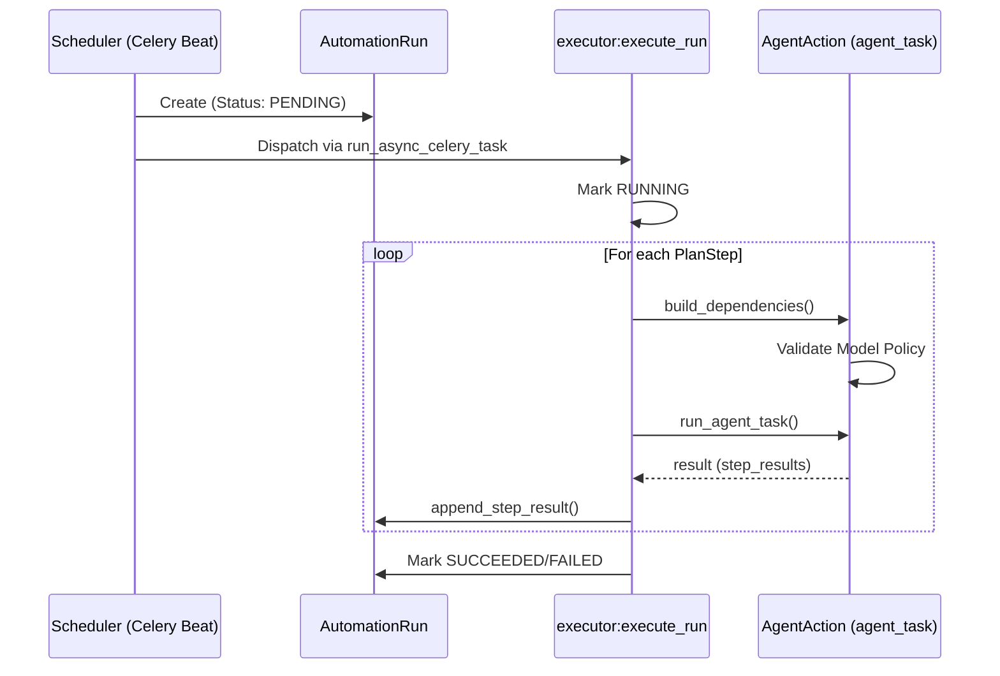

<!-- source: DeepWiki mcp.deepwiki.com · repo MODSetter/SurfSense · page 12 Automations · fetched 2026-10-29 -->

# Automations

Relevant source files

The following files were used as context for generating this wiki page:

- [surfsense_backend/alembic/versions/144_add_automation_tables.py](surfsense_backend/alembic/versions/144_add_automation_tables.py)
- [surfsense_backend/app/agents/chat/multi_agent_chat/main_agent/tools/automation/create.py](surfsense_backend/app/agents/chat/multi_agent_chat/main_agent/tools/automation/create.py)
- [surfsense_backend/app/agents/chat/multi_agent_chat/main_agent/tools/index.py](surfsense_backend/app/agents/chat/multi_agent_chat/main_agent/tools/index.py)
- [surfsense_backend/app/agents/chat/multi_agent_chat/main_agent/tools/registry.py](surfsense_backend/app/agents/chat/multi_agent_chat/main_agent/tools/registry.py)
- [surfsense_backend/app/agents/chat/multi_agent_chat/shared/tools/catalog.py](surfsense_backend/app/agents/chat/multi_agent_chat/shared/tools/catalog.py)
- [surfsense_backend/app/automations/__init__.py](surfsense_backend/app/automations/__init__.py)
- [surfsense_backend/app/automations/actions/__init__.py](surfsense_backend/app/automations/actions/__init__.py)
- [surfsense_backend/app/automations/actions/builtin/__init__.py](surfsense_backend/app/automations/actions/builtin/__init__.py)
- [surfsense_backend/app/automations/actions/builtin/agent_task/dependencies.py](surfsense_backend/app/automations/actions/builtin/agent_task/dependencies.py)
- [surfsense_backend/app/automations/actions/builtin/agent_task/invoke.py](surfsense_backend/app/automations/actions/builtin/agent_task/invoke.py)
- [surfsense_backend/app/automations/actions/types.py](surfsense_backend/app/automations/actions/types.py)
- [surfsense_backend/app/automations/api/__init__.py](surfsense_backend/app/automations/api/__init__.py)
- [surfsense_backend/app/automations/api/automation.py](surfsense_backend/app/automations/api/automation.py)
- [surfsense_backend/app/automations/api/run.py](surfsense_backend/app/automations/api/run.py)
- [surfsense_backend/app/automations/persistence/__init__.py](surfsense_backend/app/automations/persistence/__init__.py)
- [surfsense_backend/app/automations/persistence/enums/__init__.py](surfsense_backend/app/automations/persistence/enums/__init__.py)
- [surfsense_backend/app/automations/persistence/enums/automation_status.py](surfsense_backend/app/automations/persistence/enums/automation_status.py)
- [surfsense_backend/app/automations/persistence/enums/run_status.py](surfsense_backend/app/automations/persistence/enums/run_status.py)
- [surfsense_backend/app/automations/persistence/enums/trigger_type.py](surfsense_backend/app/automations/persistence/enums/trigger_type.py)
- [surfsense_backend/app/automations/persistence/models/__init__.py](surfsense_backend/app/automations/persistence/models/__init__.py)
- [surfsense_backend/app/automations/persistence/models/automation.py](surfsense_backend/app/automations/persistence/models/automation.py)
- [surfsense_backend/app/automations/persistence/models/run.py](surfsense_backend/app/automations/persistence/models/run.py)
- [surfsense_backend/app/automations/persistence/models/trigger.py](surfsense_backend/app/automations/persistence/models/trigger.py)
- [surfsense_backend/app/automations/runtime/executor.py](surfsense_backend/app/automations/runtime/executor.py)
- [surfsense_backend/app/automations/runtime/step.py](surfsense_backend/app/automations/runtime/step.py)
- [surfsense_backend/app/automations/schemas/api/__init__.py](surfsense_backend/app/automations/schemas/api/__init__.py)
- [surfsense_backend/app/automations/schemas/api/run.py](surfsense_backend/app/automations/schemas/api/run.py)
- [surfsense_backend/app/automations/services/__init__.py](surfsense_backend/app/automations/services/__init__.py)
- [surfsense_backend/app/automations/services/automation.py](surfsense_backend/app/automations/services/automation.py)
- [surfsense_backend/app/automations/services/model_policy.py](surfsense_backend/app/automations/services/model_policy.py)
- [surfsense_backend/app/automations/services/run.py](surfsense_backend/app/automations/services/run.py)
- [surfsense_backend/app/automations/services/trigger.py](surfsense_backend/app/automations/services/trigger.py)
- [surfsense_backend/app/automations/triggers/__init__.py](surfsense_backend/app/automations/triggers/__init__.py)
- [surfsense_backend/app/file_storage/persistence/__init__.py](surfsense_backend/app/file_storage/persistence/__init__.py)
- [surfsense_backend/app/file_storage/persistence/enums.py](surfsense_backend/app/file_storage/persistence/enums.py)
- [surfsense_backend/app/file_storage/persistence/models.py](surfsense_backend/app/file_storage/persistence/models.py)
- [surfsense_backend/app/notifications/persistence/models.py](surfsense_backend/app/notifications/persistence/models.py)
- [surfsense_backend/app/podcasts/persistence/__init__.py](surfsense_backend/app/podcasts/persistence/__init__.py)
- [surfsense_backend/app/podcasts/persistence/enums/__init__.py](surfsense_backend/app/podcasts/persistence/enums/__init__.py)
- [surfsense_backend/app/podcasts/persistence/models.py](surfsense_backend/app/podcasts/persistence/models.py)
- [surfsense_backend/app/podcasts/persistence/repository.py](surfsense_backend/app/podcasts/persistence/repository.py)
- [surfsense_backend/app/tasks/celery_tasks/__init__.py](surfsense_backend/app/tasks/celery_tasks/__init__.py)
- [surfsense_backend/app/tasks/chat/streaming/flows/shared/pre_stream_setup.py](surfsense_backend/app/tasks/chat/streaming/flows/shared/pre_stream_setup.py)
- [surfsense_backend/tests/unit/automations/runtime/test_executor_action_ctx.py](surfsense_backend/tests/unit/automations/runtime/test_executor_action_ctx.py)
- [surfsense_backend/tests/unit/automations/services/test_model_policy.py](surfsense_backend/tests/unit/automations/services/test_model_policy.py)
- [surfsense_backend/tests/unit/tasks/test_celery_async_runner.py](surfsense_backend/tests/unit/tasks/test_celery_async_runner.py)

The SurfSense automation system provides a robust framework for scheduling and triggering AI agent tasks within a workspace. It allows users to define multi-step plans that leverage the Deep Agent framework to perform recurring knowledge work, such as daily summaries, research reports, or monitoring data sources.

The system is built on a three-tier model consisting of an editable **Automation** definition, one or more **Triggers**, and immutable **AutomationRuns** that record the execution history.

### System Overview Diagram

The following diagram illustrates the relationship between the core automation entities and the execution runtime, mapping high-level concepts to the backend implementation.

**Automation Entity Relationships**

```mermaid
graph TD
    subgraph "Natural Language Space"
        User["User"]
        Task["Scheduled Task"]
        History["Execution History"]
    end

    subgraph "Code Entity Space (app.automations.persistence.models)"
        Automation["Automation"]
        Trigger["AutomationTrigger"]
        Run["AutomationRun"]
        
        Automation -- "1:N" --> Trigger
        Automation -- "1:N" --> Run
        Trigger -- "1:N" --> Run
    end

    subgraph "Execution Runtime"
        Executor["app.automations.runtime.executor:execute_run"]
        Celery["app.tasks.celery_tasks:run_async_celery_task"]
        Agent["app.automations.actions.builtin.agent_task.invoke:run_agent_task"]
    end

    User --> Automation
    Task --> Trigger
    Trigger --> Executor
    Executor --> Celery
    Celery --> Agent
    Agent --> History
    History --> Run
```

**Sources:** [surfsense_backend/app/automations/persistence/models/automation.py:24-82](), [surfsense_backend/app/automations/persistence/models/trigger.py:21-68](), [surfsense_backend/app/automations/persistence/models/run.py:20-67](), [surfsense_backend/app/automations/runtime/executor.py:48-103](), [surfsense_backend/app/automations/actions/builtin/agent_task/invoke.py:125-145]()

---

## Automation Architecture

The backend architecture is centered around a versioned definition snapshot. When an automation is triggered, the system creates an `AutomationRun` which captures a `definition_snapshot` [surfsense_backend/app/automations/persistence/models/run.py:50](). This ensures that even if the automation is edited later, the historical run record remains an accurate representation of what was executed.

### Core Components
*   **Triggers**: Supports `schedule` (cron/interval) and `manual` types [surfsense_backend/alembic/versions/144_add_automation_tables.py:53-55](). The `next_fire_at` field is precomputed in UTC to allow efficient scanning by the scheduler [surfsense_backend/app/automations/persistence/models/trigger.py:60]().
*   **Actions**: The primary action type is the `agent_task`, which spins up a LangGraph agent. It uses an `InMemorySaver` for one-shot execution checkpointing [surfsense_backend/app/automations/actions/builtin/agent_task/dependencies.py:90]().
*   **Execution Lifecycle**: Runs transition through states: `pending` -> `running` -> `succeeded`/`failed` [surfsense_backend/alembic/versions/144_add_automation_tables.py:68-71]().

For details, see [Automation Architecture](#12.1).

**Sources:** [surfsense_backend/app/automations/persistence/models/trigger.py:1-68](), [surfsense_backend/app/automations/persistence/models/run.py:37-47](), [surfsense_backend/app/automations/actions/builtin/agent_task/dependencies.py:28-96](), [surfsense_backend/alembic/versions/144_add_automation_tables.py:1-175]()

---

## Execution Runtime

Automations are executed asynchronously via Celery using a dedicated event loop runner [surfsense_backend/app/tasks/celery_tasks/__init__.py:115-140](). The `execute_run` function [surfsense_backend/app/automations/runtime/executor.py:48]() iterates through the `PlanStep` sequence defined in the automation.

### Execution Flow
1.  **Context Building**: A `template_context` is generated containing workspace IDs, trigger metadata, and runtime inputs [surfsense_backend/app/automations/runtime/executor.py:129-147]().
2.  **Step Execution**: Each step is processed by `execute_step`, which handles retries and timeouts [surfsense_backend/app/automations/runtime/executor.py:80-87]().
3.  **Model Policy**: Before an agent task runs, the system validates that the configured LLM models are billable via `assert_models_billable` [surfsense_backend/app/automations/actions/builtin/agent_task/dependencies.py:58-64]().
4.  **Mention Resolution**: If the task includes `@-mentions` for documents or folders, the runtime resolves these into canonical paths and context for the agent [surfsense_backend/app/automations/actions/builtin/agent_task/invoke.py:65-122]().

**Automation Execution Flow**

**Sources:** [surfsense_backend/app/automations/runtime/executor.py:48-103](), [surfsense_backend/app/automations/actions/builtin/agent_task/dependencies.py:37-96](), [surfsense_backend/app/automations/actions/builtin/agent_task/invoke.py:125-178](), [surfsense_backend/app/tasks/celery_tasks/__init__.py:115-140]()

---

## Automation Builder UI

The frontend provides a visual builder for managing the lifecycle of an automation. Users can configure the JSON-based `definition` [surfsense_backend/app/automations/persistence/models/automation.py:56]() through a structured interface.

### Key Capabilities
*   **Trigger Configuration**: Setting up schedules or manual triggers.
*   **Action Mapping**: Defining the prompt, tools, and model configurations for the AI agent. The `AutomationService` snapshots workspace model settings during creation if not explicitly provided [surfsense_backend/app/automations/services/automation.py:58-64]().
*   **Monitoring**: A dashboard for viewing `automation_runs`, including `step_results`, `artifacts` (like generated podcasts or reports), and `error` logs [surfsense_backend/app/automations/persistence/models/run.py:55-60]().

For details, see [Automation Builder UI](#12.2).

**Sources:** [surfsense_backend/app/automations/services/automation.py:45-91](), [surfsense_backend/app/automations/persistence/models/automation.py:41-58](), [surfsense_backend/app/automations/persistence/models/run.py:55-60]()

---

