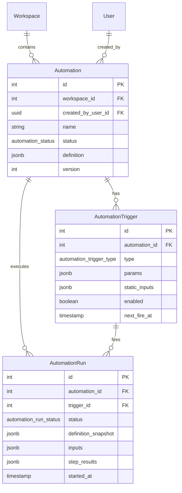
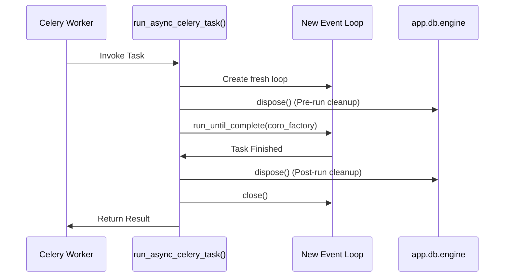

<!-- source: DeepWiki mcp.deepwiki.com · repo MODSetter/SurfSense · page 12.1 Automation Architecture · fetched 2026-10-29 -->

# Automation Architecture

<details>
<summary>Relevant source files</summary>

The following files were used as context for generating this wiki page:

- [surfsense_backend/alembic/versions/144_add_automation_tables.py](surfsense_backend/alembic/versions/144_add_automation_tables.py)
- [surfsense_backend/app/agents/chat/multi_agent_chat/main_agent/tools/automation/create.py](surfsense_backend/app/agents/chat/multi_agent_chat/main_agent/tools/automation/create.py)
- [surfsense_backend/app/agents/chat/multi_agent_chat/main_agent/tools/index.py](surfsense_backend/app/agents/chat/multi_agent_chat/main_agent/tools/index.py)
- [surfsense_backend/app/agents/chat/multi_agent_chat/main_agent/tools/registry.py](surfsense_backend/app/agents/chat/multi_agent_chat/main_agent/tools/registry.py)
- [surfsense_backend/app/agents/chat/multi_agent_chat/shared/tools/catalog.py](surfsense_backend/app/agents/chat/multi_agent_chat/shared/tools/catalog.py)
- [surfsense_backend/app/automations/__init__.py](surfsense_backend/app/automations/__init__.py)
- [surfsense_backend/app/automations/actions/__init__.py](surfsense_backend/app/automations/actions/__init__.py)
- [surfsense_backend/app/automations/actions/builtin/__init__.py](surfsense_backend/app/automations/actions/builtin/__init__.py)
- [surfsense_backend/app/automations/actions/builtin/agent_task/dependencies.py](surfsense_backend/app/automations/actions/builtin/agent_task/dependencies.py)
- [surfsense_backend/app/automations/actions/builtin/agent_task/invoke.py](surfsense_backend/app/automations/actions/builtin/agent_task/invoke.py)
- [surfsense_backend/app/automations/actions/types.py](surfsense_backend/app/automations/actions/types.py)
- [surfsense_backend/app/automations/api/__init__.py](surfsense_backend/app/automations/api/__init__.py)
- [surfsense_backend/app/automations/api/automation.py](surfsense_backend/app/automations/api/automation.py)
- [surfsense_backend/app/automations/api/run.py](surfsense_backend/app/automations/api/run.py)
- [surfsense_backend/app/automations/persistence/__init__.py](surfsense_backend/app/automations/persistence/__init__.py)
- [surfsense_backend/app/automations/persistence/enums/__init__.py](surfsense_backend/app/automations/persistence/enums/__init__.py)
- [surfsense_backend/app/automations/persistence/enums/automation_status.py](surfsense_backend/app/automations/persistence/enums/automation_status.py)
- [surfsense_backend/app/automations/persistence/enums/run_status.py](surfsense_backend/app/automations/persistence/enums/run_status.py)
- [surfsense_backend/app/automations/persistence/enums/trigger_type.py](surfsense_backend/app/automations/persistence/enums/trigger_type.py)
- [surfsense_backend/app/automations/persistence/models/__init__.py](surfsense_backend/app/automations/persistence/models/__init__.py)
- [surfsense_backend/app/automations/persistence/models/automation.py](surfsense_backend/app/automations/persistence/models/automation.py)
- [surfsense_backend/app/automations/persistence/models/run.py](surfsense_backend/app/automations/persistence/models/run.py)
- [surfsense_backend/app/automations/persistence/models/trigger.py](surfsense_backend/app/automations/persistence/models/trigger.py)
- [surfsense_backend/app/automations/runtime/executor.py](surfsense_backend/app/automations/runtime/executor.py)
- [surfsense_backend/app/automations/runtime/step.py](surfsense_backend/app/automations/runtime/step.py)
- [surfsense_backend/app/automations/schemas/api/__init__.py](surfsense_backend/app/automations/schemas/api/__init__.py)
- [surfsense_backend/app/automations/schemas/api/run.py](surfsense_backend/app/automations/schemas/api/run.py)
- [surfsense_backend/app/automations/services/__init__.py](surfsense_backend/app/automations/services/__init__.py)
- [surfsense_backend/app/automations/services/automation.py](surfsense_backend/app/automations/services/automation.py)
- [surfsense_backend/app/automations/services/model_policy.py](surfsense_backend/app/automations/services/model_policy.py)
- [surfsense_backend/app/automations/services/run.py](surfsense_backend/app/automations/services/run.py)
- [surfsense_backend/app/automations/services/trigger.py](surfsense_backend/app/automations/services/trigger.py)
- [surfsense_backend/app/automations/triggers/__init__.py](surfsense_backend/app/automations/triggers/__init__.py)
- [surfsense_backend/app/file_storage/persistence/__init__.py](surfsense_backend/app/file_storage/persistence/__init__.py)
- [surfsense_backend/app/file_storage/persistence/enums.py](surfsense_backend/app/file_storage/persistence/enums.py)
- [surfsense_backend/app/file_storage/persistence/models.py](surfsense_backend/app/file_storage/persistence/models.py)
- [surfsense_backend/app/notifications/persistence/models.py](surfsense_backend/app/notifications/persistence/models.py)
- [surfsense_backend/app/podcasts/persistence/__init__.py](surfsense_backend/app/podcasts/persistence/__init__.py)
- [surfsense_backend/app/podcasts/persistence/enums/__init__.py](surfsense_backend/app/podcasts/persistence/enums/__init__.py)
- [surfsense_backend/app/podcasts/persistence/models.py](surfsense_backend/app/podcasts/persistence/models.py)
- [surfsense_backend/app/podcasts/persistence/repository.py](surfsense_backend/app/podcasts/persistence/repository.py)
- [surfsense_backend/app/tasks/celery_tasks/__init__.py](surfsense_backend/app/tasks/celery_tasks/__init__.py)
- [surfsense_backend/app/tasks/chat/streaming/flows/shared/pre_stream_setup.py](surfsense_backend/app/tasks/chat/streaming/flows/shared/pre_stream_setup.py)
- [surfsense_backend/tests/unit/automations/runtime/test_executor_action_ctx.py](surfsense_backend/tests/unit/automations/runtime/test_executor_action_ctx.py)
- [surfsense_backend/tests/unit/automations/services/test_model_policy.py](surfsense_backend/tests/unit/automations/services/test_model_policy.py)
- [surfsense_backend/tests/unit/tasks/test_celery_async_runner.py](surfsense_backend/tests/unit/tasks/test_celery_async_runner.py)

</details>


The SurfSense automation system provides a robust engine for scheduling and triggering AI agent tasks. It allows users to define multi-step workflows (plans) that can be executed on a schedule or in response to events, utilizing the full capabilities of the Deep Agent framework.

## Data Model

The automation system is built on three primary database tables that manage the lifecycle of an automation from definition to execution. These tables were introduced in database revision `144`.

### Core Entities

| Entity | Description | Table Name | Code Reference |
| :--- | :--- | :--- | :--- |
| **Automation** | The editable, versioned definition of an automation workflow. | `automations` | [surfsense_backend/app/automations/persistence/models/automation.py:24-25]() |
| **AutomationTrigger** | A specific configuration (e.g., a schedule) that fires an automation. | `automation_triggers` | [surfsense_backend/app/automations/persistence/models/trigger.py:21-22]() |
| **AutomationRun** | An immutable record of a single execution instance. | `automation_runs` | [surfsense_backend/app/automations/persistence/models/run.py:20-21]() |

### Database Schema Relationships

The following diagram illustrates the relationships between the automation entities and the core workspace/user models.

**Automation Entity Relationship Diagram**


Sources: [surfsense_backend/alembic/versions/144_add_automation_tables.py:78-188](), [surfsense_backend/app/automations/persistence/models/automation.py:24-81](), [surfsense_backend/app/automations/persistence/models/trigger.py:21-67](), [surfsense_backend/app/automations/persistence/models/run.py:20-66]()

## Trigger System

SurfSense supports multiple trigger types to initiate automation runs. Triggers are stored in the `automation_triggers` table and linked to a specific `Automation`.

### Trigger Types
- **Schedule**: Uses CRON or interval-based timing. The `next_fire_at` column is precomputed and advanced by a schedule tick service [surfsense_backend/app/automations/persistence/models/trigger.py:57-60]().
- **Manual**: Reserved for "Run Now" functionality in the UI [surfsense_backend/alembic/versions/144_add_automation_tables.py:53-55]().
- **Event**: (Planned) For triggering based on system domain events such as document ingestion [surfsense_backend/alembic/versions/144_add_automation_tables.py:12-13]().

### Trigger Dispatching
When a trigger fires, it creates an `AutomationRun`. This run captures a `definition_snapshot` of the automation at that exact moment [surfsense_backend/app/automations/persistence/models/run.py:49-50](). This ensures that even if the automation definition is edited later, the historical execution record reflects the logic that was actually executed at fire time.

Sources: [surfsense_backend/app/automations/persistence/models/trigger.py:47-60](), [surfsense_backend/app/automations/persistence/models/run.py:49-50]()

## Execution Runtime

The execution runtime is responsible for walking an `AutomationRun` through its plan steps until it reaches a terminal state (`succeeded` or `failed`).

### Execution Flow
1. **Loading**: The `execute_run` function loads the run from `repository.load_run` and validates the snapshot definition using Pydantic models [surfsense_backend/app/automations/runtime/executor.py:50-58]().
2. **Step Execution**: It iterates through the `definition.plan`. For each `PlanStep`, it builds a `template_context` (containing previous step outputs) and an `ActionContext` [surfsense_backend/app/automations/runtime/executor.py:77-79]().
3. **Persistence**: Results are appended to `step_results` in the database after every step via `repository.append_step_result` [surfsense_backend/app/automations/runtime/executor.py:88-89]().
4. **Error Handling**: If a step fails, the runtime executes the `on_failure` steps defined in the automation's execution configuration [surfsense_backend/app/automations/runtime/executor.py:91-96](), [surfsense_backend/app/automations/runtime/executor.py:106-126]().

**Automation Execution Logic**
```mermaid
graph TD
    subgraph "Code Entity Space"
        E["execute_run()"]
        S["execute_step()"]
        R["repository.append_step_result()"]
        B["build_dependencies()"]
    end

    subgraph "Process Flow"
        Start["Trigger Fired"] --> E
        E --> LoadSnap["Load definition_snapshot"]
        LoadSnap --> Loop["For each Step in Plan"]
        Loop --> B
        B --> S
        S --> R
        R --> Loop
        Loop -- "All Succeeded" --> Finish["Mark SUCCEEDED"]
        S -- "Failure" --> Fail["Execute _run_on_failure()"]
        Fail --> MarkFail["Mark FAILED"]
    end

    E -.-> "executor.py"
    S -.-> "step.py"
    B -.-> "dependencies.py"
```

Sources: [surfsense_backend/app/automations/runtime/executor.py:48-103](), [surfsense_backend/app/automations/runtime/step.py:1-20]()

## Agent Task Integration

The primary action in the automation system is the `agent_task`. This action invokes the `multi_agent_chat` framework.

### Dependency Management
Before an agent task runs, `build_dependencies` resolves the execution environment:
- **LLM Bundle**: Loads the specific LLM configuration (`chat_model_id`) captured in the automation definition to insulate runs from global workspace changes [surfsense_backend/app/automations/actions/builtin/agent_task/dependencies.py:47-51]().
- **Model Policy**: Enforces `assert_models_billable` to ensure automations only run on supported/premium configurations [surfsense_backend/app/automations/actions/builtin/agent_task/dependencies.py:58-62]().
- **Connector Service**: Initializes the `ConnectorService` for the workspace to allow the agent to perform knowledge retrieval [surfsense_backend/app/automations/actions/builtin/agent_task/dependencies.py:84-86]().
- **Checkpointer**: Uses an `InMemorySaver` for one-shot automation tasks, as they do not require durable multi-turn persistence like standard chat threads [surfsense_backend/app/automations/actions/builtin/agent_task/dependencies.py:90-91]().

### Mention Resolution
The automation system mirrors the browser chat experience by supporting `@-mentions` for documents, folders, and connectors. The `_resolve_mention_context` function uses `resolve_mentions` and `substitute_in_text` to rewrite user queries into canonical paths (e.g., `/documents/...`) and populates the `SurfSenseContextSchema` for the agent's retrieval tools [surfsense_backend/app/automations/actions/builtin/agent_task/invoke.py:65-122]().

Sources: [surfsense_backend/app/automations/actions/builtin/agent_task/dependencies.py:37-96](), [surfsense_backend/app/automations/actions/builtin/agent_task/invoke.py:125-180]()

## Async Task Safety (Celery)

Automations are executed as background tasks via Celery. To prevent database connection leaks and "stale loop" errors—where a connection from a previous task's event loop is reused by a new loop—SurfSense uses a specialized runner.

### `run_async_celery_task`
This helper provides a clean environment for every async Celery task:
1.  **Loop Isolation**: Creates a fresh `asyncio` event loop for the current task [surfsense_backend/app/tasks/celery_tasks/__init__.py:141-142]().
2.  **Pre-run Cleanup**: Disposes of the module-level shared `app.db.engine` connection pool before the task starts [surfsense_backend/app/tasks/celery_tasks/__init__.py:146]().
3.  **Post-run Cleanup**: Disposes of the engine and the shared checkpointer pool after the task completes, ensuring all `asyncpg` connections are closed before the loop is destroyed [surfsense_backend/app/tasks/celery_tasks/__init__.py:152-153]().

**Celery Worker Lifecycle**


Sources: [surfsense_backend/app/tasks/celery_tasks/__init__.py:115-160](), [surfsense_backend/tests/unit/tasks/test_celery_async_runner.py:1-22]()

---

