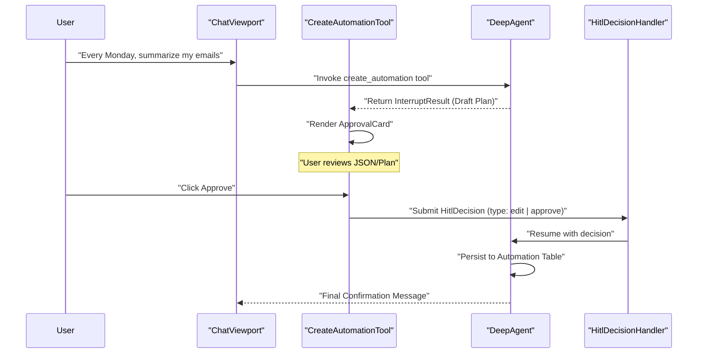
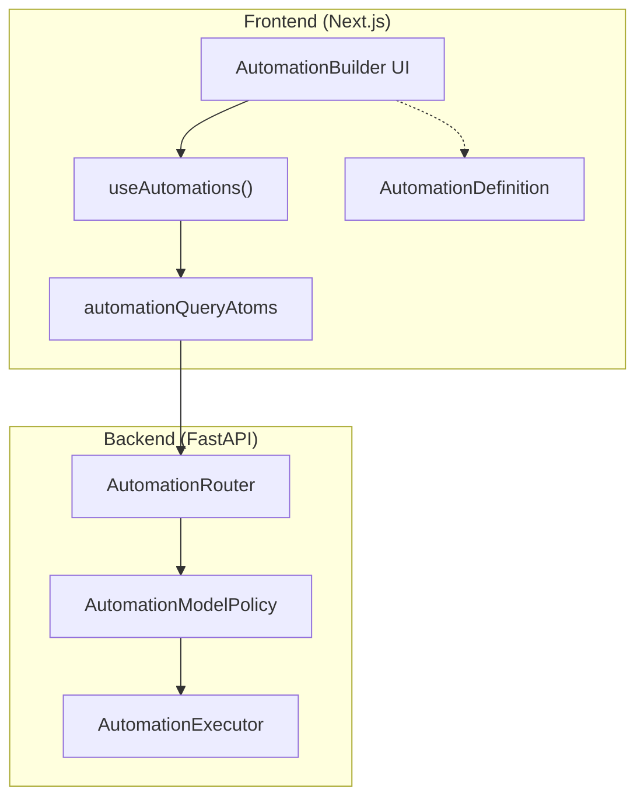

<!-- source: DeepWiki mcp.deepwiki.com · repo MODSetter/SurfSense · page 12.2 Automation Builder UI · fetched 2026-10-29 -->

# Automation Builder UI

Relevant source files

The following files were used as context for generating this wiki page:

- [surfsense_web/atoms/automations/automations-mutation.atoms.ts](surfsense_web/atoms/automations/automations-mutation.atoms.ts)
- [surfsense_web/atoms/automations/automations-query.atoms.ts](surfsense_web/atoms/automations/automations-query.atoms.ts)
- [surfsense_web/atoms/public-chat-snapshots/public-chat-snapshots-query.atoms.ts](surfsense_web/atoms/public-chat-snapshots/public-chat-snapshots-query.atoms.ts)
- [surfsense_web/components/assistant-ui/chat-viewport.tsx](surfsense_web/components/assistant-ui/chat-viewport.tsx)
- [surfsense_web/components/assistant-ui/connector-popup/connector-configs/components/discord-config.tsx](surfsense_web/components/assistant-ui/connector-popup/connector-configs/components/discord-config.tsx)
- [surfsense_web/components/assistant-ui/connector-popup/connector-configs/components/slack-config.tsx](surfsense_web/components/assistant-ui/connector-popup/connector-configs/components/slack-config.tsx)
- [surfsense_web/components/new-chat/chat-example-prompts.tsx](surfsense_web/components/new-chat/chat-example-prompts.tsx)
- [surfsense_web/components/providers/PostHogProvider.tsx](surfsense_web/components/providers/PostHogProvider.tsx)
- [surfsense_web/components/providers/PostHogReferral.tsx](surfsense_web/components/providers/PostHogReferral.tsx)
- [surfsense_web/components/public-chat-snapshots/public-chat-snapshot-row.tsx](surfsense_web/components/public-chat-snapshots/public-chat-snapshot-row.tsx)
- [surfsense_web/components/public-chat-snapshots/public-chat-snapshots-list.tsx](surfsense_web/components/public-chat-snapshots/public-chat-snapshots-list.tsx)
- [surfsense_web/components/public-chat-snapshots/public-chat-snapshots-manager.tsx](surfsense_web/components/public-chat-snapshots/public-chat-snapshots-manager.tsx)
- [surfsense_web/components/settings/general-settings-manager.tsx](surfsense_web/components/settings/general-settings-manager.tsx)
- [surfsense_web/components/settings/prompt-config-manager.tsx](surfsense_web/components/settings/prompt-config-manager.tsx)
- [surfsense_web/components/settings/roles-manager.tsx](surfsense_web/components/settings/roles-manager.tsx)
- [surfsense_web/components/tool-ui/automation/create-automation.tsx](surfsense_web/components/tool-ui/automation/create-automation.tsx)
- [surfsense_web/components/ui/alert.tsx](surfsense_web/components/ui/alert.tsx)
- [surfsense_web/contracts/enums/toolIcons.tsx](surfsense_web/contracts/enums/toolIcons.tsx)
- [surfsense_web/contracts/types/automation.types.ts](surfsense_web/contracts/types/automation.types.ts)
- [surfsense_web/contracts/types/chat-threads.types.ts](surfsense_web/contracts/types/chat-threads.types.ts)
- [surfsense_web/contracts/types/public-chat.types.ts](surfsense_web/contracts/types/public-chat.types.ts)
- [surfsense_web/hooks/use-automation-eligible-models.ts](surfsense_web/hooks/use-automation-eligible-models.ts)
- [surfsense_web/hooks/use-automation-runs.ts](surfsense_web/hooks/use-automation-runs.ts)
- [surfsense_web/hooks/use-automation.ts](surfsense_web/hooks/use-automation.ts)
- [surfsense_web/hooks/use-automations.ts](surfsense_web/hooks/use-automations.ts)
- [surfsense_web/instrumentation-client.ts](surfsense_web/instrumentation-client.ts)
- [surfsense_web/lib/apis/automations-api.service.ts](surfsense_web/lib/apis/automations-api.service.ts)
- [surfsense_web/lib/apis/chat-threads-api.service.ts](surfsense_web/lib/apis/chat-threads-api.service.ts)
- [surfsense_web/lib/apis/public-chat-api.service.ts](surfsense_web/lib/apis/public-chat-api.service.ts)
- [surfsense_web/lib/automations/builder-schema.ts](surfsense_web/lib/automations/builder-schema.ts)
- [surfsense_web/lib/chat/parse-mention-segments.ts](surfsense_web/lib/chat/parse-mention-segments.ts)
- [surfsense_web/lib/posthog/events.ts](surfsense_web/lib/posthog/events.ts)
- [surfsense_web/public/homepage/hero_realtime/RealTimeChatGif.gif](surfsense_web/public/homepage/hero_realtime/RealTimeChatGif.gif)
- [surfsense_web/public/homepage/hero_realtime/RealTimeCommentsFlow.gif](surfsense_web/public/homepage/hero_realtime/RealTimeCommentsFlow.gif)
- [surfsense_web/public/homepage/hero_tutorial/general_assist.gif](surfsense_web/public/homepage/hero_tutorial/general_assist.gif)
- [surfsense_web/public/homepage/hero_tutorial/quick_assist.gif](surfsense_web/public/homepage/hero_tutorial/quick_assist.gif)

The **Automation Builder UI** provides a graphical and conversational interface for users to create, configure, and manage scheduled or event-driven AI tasks. It bridges the gap between natural language intent and the structured `AutomationDefinition` required by the backend runtime.

## Overview

The automation system allows users to define complex multi-step workflows (plans) triggered by schedules or specific events. The frontend implementation focuses on two primary entry points:
1.  **Conversational Creation**: An AI agent generates a draft automation based on chat instructions, which the user reviews and approves via a specialized UI card.
2.  **Structured Configuration**: A form-based builder for fine-tuning triggers, actions, and model selections.

### Key Data Structures
The UI interacts with the backend using Zod-validated contracts that mirror the FastAPI schemas:
*   **`AutomationDefinition`**: The core logic containing the `plan` (steps), `triggers`, and `execution` settings [surfsense_web/contracts/types/automation.types.ts:72-82]().
*   **`PlanStep`**: Individual actions within a plan, including `action` name, `params`, and `output_as` bindings [surfsense_web/contracts/types/automation.types.ts:27-35]().
*   **`AutomationModels`**: A snapshot of the specific LLM configurations (Chat, Image, Vision) assigned to the automation at creation time [surfsense_web/contracts/types/automation.types.ts:65-70]().

---

## Conversational Builder Workflow

The primary way users create automations is through the chat interface. This flow utilizes a **Human-in-the-Loop (HITL)** mechanism to ensure the generated plan is safe and accurate before persistence.

### Logic Flow: Chat to Automation
The diagram below illustrates how a user's natural language request is transformed into a structured database entity.

Title: Conversational Automation Creation Flow

**Sources:** [surfsense_web/components/tool-ui/automation/create-automation.tsx:95-188](), [surfsense_web/components/assistant-ui/chat-viewport.tsx:27-56]()

### Implementation Details: `ApprovalCard`
The `ApprovalCard` component [surfsense_web/components/tool-ui/automation/create-automation.tsx:89-94]() is responsible for:
*   **Draft Preview**: Rendering the proposed automation using `AutomationDraftPreview` [surfsense_web/components/tool-ui/automation/create-automation.tsx:28]().
*   **Model Selection**: Allowing users to pick specific models for the automation using `AutomationModelFields` [surfsense_web/components/tool-ui/automation/create-automation.tsx:10-11](). It defaults to workspace-eligible models via the `useAutomationEligibleModels` hook [surfsense_web/components/tool-ui/automation/create-automation.tsx:114-138]().
*   **Inline Editing**: Providing a raw JSON editor for advanced users to modify the `AutomationCreateRequest` before submission [surfsense_web/components/tool-ui/automation/create-automation.tsx:30-80]().

---

## Technical Architecture

The frontend state for automations is managed using a combination of **Jotai** (atomic state) and **TanStack Query** (server state).

### Data Flow and State Management
The UI components map directly to backend services and models.

Title: Automation UI to Code Entity Mapping

**Sources:** [surfsense_web/atoms/automations/automations-query.atoms.ts](), [surfsense_web/hooks/use-automations.ts]()

### Permission Integration
Automation features are gated by the workspace RBAC system. The `RolesManager` defines specific permissions for automation lifecycle management:
*   `automations:create`, `automations:read`, `automations:update`, and `automations:execute` [surfsense_web/components/settings/roles-manager.tsx:210-213]().
*   The `CATEGORY_CONFIG` maps the automation section to the `Workflow` icon for consistent UI representation [surfsense_web/components/settings/roles-manager.tsx:130-135]().

---

## Component Reference

### Automation Tool UI
| Component | File Path | Role |
| :--- | :--- | :--- |
| `CreateAutomation` | [surfsense_web/components/tool-ui/automation/create-automation.tsx:1]() | Main entry point for the automation tool card in chat. |
| `ApprovalCard` | [surfsense_web/components/tool-ui/automation/create-automation.tsx:89]() | Handles HITL approval, rejection, and editing of drafts. |
| `AutomationModelFields` | [surfsense_web/app/dashboard/[workspace_id]/automations/components/builder/automation-model-fields.tsx]() | Dropdown selectors for Chat, Image, and Vision models. |
| `ChatExamplePrompts` | [surfsense_web/components/new-chat/chat-example-prompts.tsx:27]() | Provides "automate" category prompts to help users discover automation capabilities. |

### Analytics and Observability
The UI tracks the entire lifecycle of an automation via **PostHog**:
*   **`trackAutomationChatApproved`**: Fired when a user approves a draft, capturing task count and trigger types [surfsense_web/components/tool-ui/automation/create-automation.tsx:158-168]().
*   **`trackAutomationChatRejected`**: Fired when a draft is dismissed [surfsense_web/components/tool-ui/automation/create-automation.tsx:193-195]().
*   **`trackAutomationChatDraftEdited`**: Tracks manual modifications to the agent's proposed JSON [surfsense_web/components/tool-ui/automation/create-automation.tsx:25]().

### Icons and Display
The UI uses a canonical mapping for tool icons to provide a consistent "action" language:
*   **Automation Icon**: `AlarmClock` is the primary icon for automation-related actions [surfsense_web/contracts/enums/toolIcons.tsx:48]().
*   **Display Name**: The tool `create_automation` is rendered as "Create automation" in the chat interface [surfsense_web/contracts/enums/toolIcons.tsx:151]().

**Sources:**
*   [surfsense_web/contracts/types/automation.types.ts]()
*   [surfsense_web/components/tool-ui/automation/create-automation.tsx]()
*   [surfsense_web/contracts/enums/toolIcons.tsx]()
*   [surfsense_web/lib/posthog/events.ts]()
*   [surfsense_web/components/settings/roles-manager.tsx]()

---

