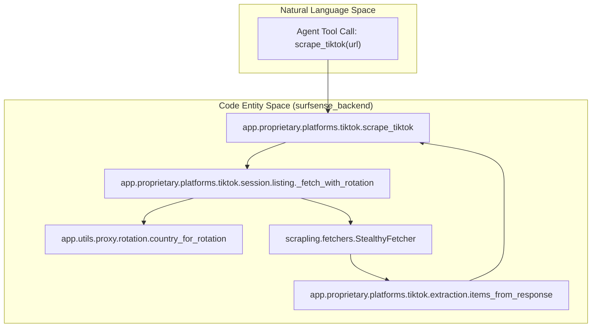
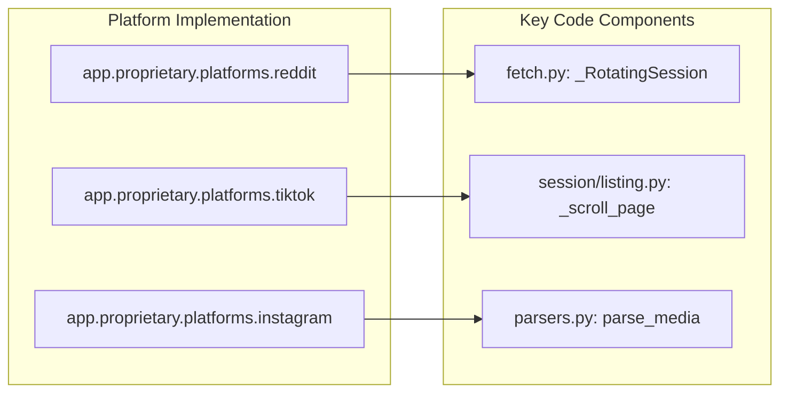

<!-- source: DeepWiki mcp.deepwiki.com · repo MODSetter/SurfSense · page 13 Native Platform Scrapers · fetched 2026-10-29 -->

# Native Platform Scrapers

Relevant source files

The following files were used as context for generating this wiki page:

- [surfsense_backend/app/proprietary/platforms/instagram/__init__.py](surfsense_backend/app/proprietary/platforms/instagram/__init__.py)
- [surfsense_backend/app/proprietary/platforms/instagram/fetch.py](surfsense_backend/app/proprietary/platforms/instagram/fetch.py)
- [surfsense_backend/app/proprietary/platforms/instagram/parsers.py](surfsense_backend/app/proprietary/platforms/instagram/parsers.py)
- [surfsense_backend/app/proprietary/platforms/instagram/schemas.py](surfsense_backend/app/proprietary/platforms/instagram/schemas.py)
- [surfsense_backend/app/proprietary/platforms/instagram/scraper.py](surfsense_backend/app/proprietary/platforms/instagram/scraper.py)
- [surfsense_backend/app/proprietary/platforms/instagram/url_resolver.py](surfsense_backend/app/proprietary/platforms/instagram/url_resolver.py)
- [surfsense_backend/app/proprietary/platforms/reddit/fetch.py](surfsense_backend/app/proprietary/platforms/reddit/fetch.py)
- [surfsense_backend/app/proprietary/platforms/tiktok/session/listing.py](surfsense_backend/app/proprietary/platforms/tiktok/session/listing.py)
- [surfsense_backend/scripts/e2e_reddit_scraper.py](surfsense_backend/scripts/e2e_reddit_scraper.py)
- [surfsense_backend/scripts/e2e_tiktok_scrape.py](surfsense_backend/scripts/e2e_tiktok_scrape.py)
- [surfsense_backend/tests/fixtures/tiktok/listing_item.json](surfsense_backend/tests/fixtures/tiktok/listing_item.json)
- [surfsense_backend/tests/fixtures/tiktok/video_item_struct.json](surfsense_backend/tests/fixtures/tiktok/video_item_struct.json)
- [surfsense_backend/tests/unit/platforms/instagram/__init__.py](surfsense_backend/tests/unit/platforms/instagram/__init__.py)
- [surfsense_backend/tests/unit/platforms/instagram/test_budget.py](surfsense_backend/tests/unit/platforms/instagram/test_budget.py)
- [surfsense_backend/tests/unit/platforms/instagram/test_discovery.py](surfsense_backend/tests/unit/platforms/instagram/test_discovery.py)
- [surfsense_backend/tests/unit/platforms/instagram/test_fetch_resilience.py](surfsense_backend/tests/unit/platforms/instagram/test_fetch_resilience.py)
- [surfsense_backend/tests/unit/platforms/instagram/test_parsers.py](surfsense_backend/tests/unit/platforms/instagram/test_parsers.py)
- [surfsense_backend/tests/unit/platforms/instagram/test_skeleton.py](surfsense_backend/tests/unit/platforms/instagram/test_skeleton.py)
- [surfsense_backend/tests/unit/platforms/reddit/test_fetch_resilience.py](surfsense_backend/tests/unit/platforms/reddit/test_fetch_resilience.py)
- [surfsense_backend/tests/unit/utils/proxy/test_rotation.py](surfsense_backend/tests/unit/utils/proxy/test_rotation.py)

SurfSense features a proprietary scraping system designed to provide AI agents with high-fidelity, live data from major social and commerce platforms. Unlike standard web crawlers, these scrapers are optimized to bypass anti-bot measures and return structured JSON specifically modeled for each platform (e.g., Reddit listings, TikTok `itemStruct` payloads, Instagram media objects).

This system bridges the gap between static knowledge bases and the live web, allowing agents to perform real-time research across social feeds and search engines with cited, evidence-based responses [surfsense_backend/scripts/e2e_tiktok_scrape.py:1-30]().

## System Overview

The scraping infrastructure is built to handle the complexities of modern platform APIs and aggressive anti-scraping techniques. It exposes connectors through a unified capability framework.

### Core Capabilities
| Platform | Implementation Strategy | Key Data Entities |
| :--- | :--- | :--- |
| **Reddit** | Browser-warm (JS challenge) then HTTP-fetch [surfsense_backend/app/proprietary/platforms/reddit/fetch.py:6-20](). | Posts, comments, subreddit listings |
| **TikTok** | Stealth browser XHR capture via `StealthyFetcher` [surfsense_backend/app/proprietary/platforms/tiktok/session/listing.py:1-11](). | `itemStruct`, `user_list`, `comment/list` |
| **Instagram** | Anonymous sticky-session JSON extraction [surfsense_backend/app/proprietary/platforms/instagram/fetch.py:6-18](). | `InstagramMediaItem`, `InstagramProfile` |
| **Google Search** | SERP extraction and discovery [surfsense_backend/app/proprietary/platforms/instagram/scraper.py:39-40](). | Search results, organic links |

## Scraper Architecture

The architecture utilizes a "warm-then-fetch" lifecycle to handle session-dependent platforms. This approach minimizes cost by paying the browser automation "tax" once to solve challenges and then performing fast HTTP requests for the actual data.

### Stealth & Resilience Logic
*   **Proxy Rotation**: Scrapers utilize residential proxies and country-pinned exit nodes. If a request is blocked (403/401), the system rotates to a fresh IP and re-warms the session [surfsense_backend/app/proprietary/platforms/reddit/fetch.py:82-93](), [surfsense_backend/app/proprietary/platforms/instagram/fetch.py:70-76]().
*   **Sticky Sessions**: To maintain valid session cookies (like Reddit's `loid` or Instagram's `csrftoken`), the system uses a `ContextVar` to pin a single sticky exit IP across a sequence of fetches [surfsense_backend/app/proprietary/platforms/reddit/fetch.py:74-76](), [surfsense_backend/app/proprietary/platforms/instagram/fetch.py:60-68]().
*   **Paced Fetching**: To avoid 429 rate limits, sessions include jittered sleep intervals between requests [surfsense_backend/app/proprietary/platforms/reddit/fetch.py:97-106](), [surfsense_backend/app/proprietary/platforms/instagram/fetch.py:79-83]().

### Data Flow: Scraper Request Lifecycle

This diagram maps the transition from high-level scraping requests to the internal code entities that manage network resilience.

**Sources:** [surfsense_backend/app/proprietary/platforms/tiktok/session/listing.py:1-18](), [surfsense_backend/app/proprietary/platforms/reddit/fetch.py:24-28](), [surfsense_backend/app/proprietary/platforms/instagram/fetch.py:1-25]()

## Platform-Specific Implementations

Each platform has a dedicated implementation to handle its unique data structures and anti-bot challenges.

*   **TikTok**: Uses `InteractFn` to drive the page (scrolling, clicking comments) to trigger target XHRs which are then captured as raw JSON [surfsense_backend/app/proprietary/platforms/tiktok/session/listing.py:46-50, 109-122]().
*   **Instagram**: Focuses on anonymous-only surfaces. It uses a `fan_out` worker pool to process multiple targets concurrently while maintaining session stickiness for each worker [surfsense_backend/app/proprietary/platforms/instagram/scraper.py:12-21, 120-133]().
*   **Reddit**: Specifically handles the May 2026 anonymous `.json` shutdown by using a browser to mint the `loid` cookie before falling back to fast HTTP fetches [surfsense_backend/app/proprietary/platforms/reddit/fetch.py:6-20]().

### Mapping Platforms to Code Entities

**Sources:** [surfsense_backend/app/proprietary/platforms/reddit/fetch.py:182](), [surfsense_backend/app/proprietary/platforms/tiktok/session/listing.py:109](), [surfsense_backend/app/proprietary/platforms/instagram/parsers.py:191]()

---

### Child Pages
*   **[Scraper Architecture](#13.1)**: Documentation of the warm-then-fetch lifecycle, proxy rotation, and the `scrapling` stealth integration.
*   **[Platform-Specific Scrapers](#13.2)**: Detailed implementation notes for Reddit, TikTok, Instagram, and Amazon, including data models and parser logic.
*   **[MCP Server](#13.3)**: Guide for the `surfsense_mcp` package that exposes these scrapers as tools for Claude and Cursor via the Model Context Protocol.

---

