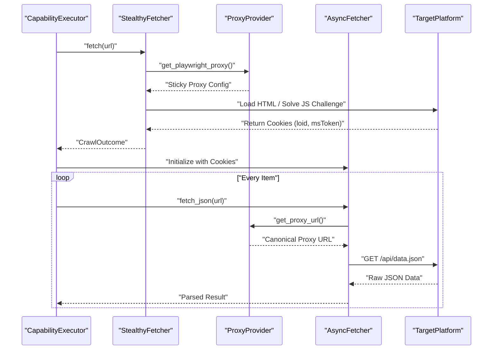
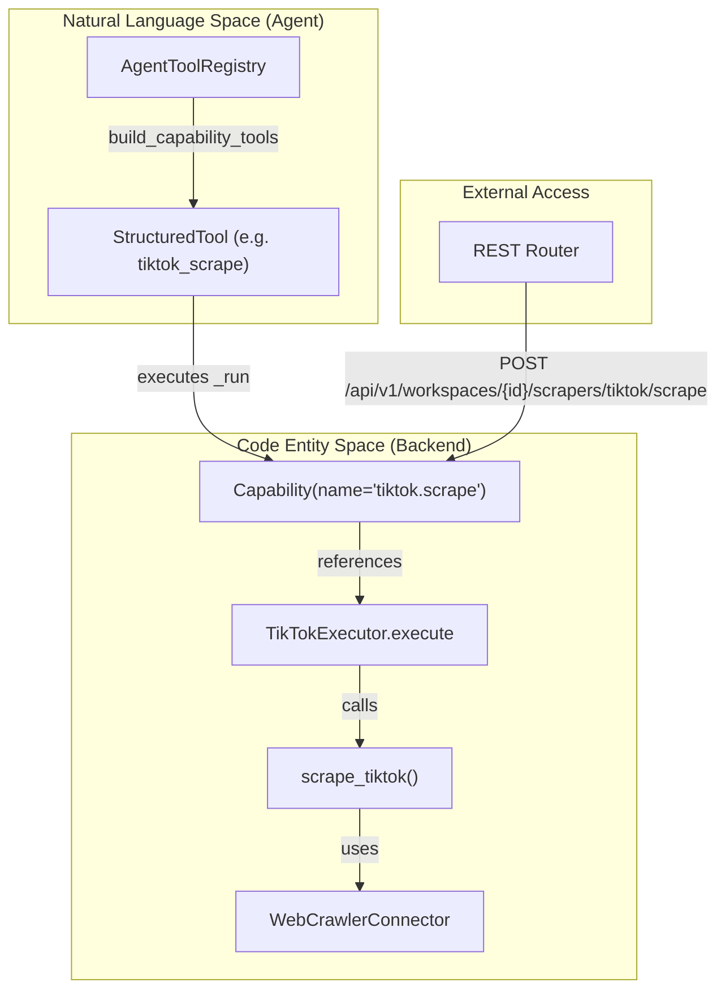

<!-- source: DeepWiki mcp.deepwiki.com · repo MODSetter/SurfSense · page 13.1 Scraper Architecture · fetched 2026-10-29 -->

# Scraper Architecture

Relevant source files

The following files were used as context for generating this wiki page:

- [surfsense_backend/alembic/versions/171_add_runs_and_tool_output_spills.py](surfsense_backend/alembic/versions/171_add_runs_and_tool_output_spills.py)
- [surfsense_backend/app/agents/chat/multi_agent_chat/main_agent/middleware/context_editing/builder.py](surfsense_backend/app/agents/chat/multi_agent_chat/main_agent/middleware/context_editing/builder.py)
- [surfsense_backend/app/agents/chat/multi_agent_chat/main_agent/middleware/context_editing/middleware.py](surfsense_backend/app/agents/chat/multi_agent_chat/main_agent/middleware/context_editing/middleware.py)
- [surfsense_backend/app/agents/chat/multi_agent_chat/subagents/builtins/tiktok/tools/index.py](surfsense_backend/app/agents/chat/multi_agent_chat/subagents/builtins/tiktok/tools/index.py)
- [surfsense_backend/app/agents/chat/multi_agent_chat/subagents/shared/run_reader.py](surfsense_backend/app/agents/chat/multi_agent_chat/subagents/shared/run_reader.py)
- [surfsense_backend/app/capabilities/core/access/agent.py](surfsense_backend/app/capabilities/core/access/agent.py)
- [surfsense_backend/app/capabilities/core/access/rest.py](surfsense_backend/app/capabilities/core/access/rest.py)
- [surfsense_backend/app/capabilities/core/billing.py](surfsense_backend/app/capabilities/core/billing.py)
- [surfsense_backend/app/capabilities/core/runs.py](surfsense_backend/app/capabilities/core/runs.py)
- [surfsense_backend/app/capabilities/core/types.py](surfsense_backend/app/capabilities/core/types.py)
- [surfsense_backend/app/capabilities/tiktok/__init__.py](surfsense_backend/app/capabilities/tiktok/__init__.py)
- [surfsense_backend/app/capabilities/tiktok/scrape/__init__.py](surfsense_backend/app/capabilities/tiktok/scrape/__init__.py)
- [surfsense_backend/app/capabilities/tiktok/scrape/definition.py](surfsense_backend/app/capabilities/tiktok/scrape/definition.py)
- [surfsense_backend/app/capabilities/tiktok/scrape/executor.py](surfsense_backend/app/capabilities/tiktok/scrape/executor.py)
- [surfsense_backend/app/capabilities/tiktok/trending/__init__.py](surfsense_backend/app/capabilities/tiktok/trending/__init__.py)
- [surfsense_backend/app/capabilities/tiktok/trending/definition.py](surfsense_backend/app/capabilities/tiktok/trending/definition.py)
- [surfsense_backend/app/capabilities/tiktok/trending/executor.py](surfsense_backend/app/capabilities/tiktok/trending/executor.py)
- [surfsense_backend/app/capabilities/tiktok/trending/schemas.py](surfsense_backend/app/capabilities/tiktok/trending/schemas.py)
- [surfsense_backend/app/capabilities/web/__init__.py](surfsense_backend/app/capabilities/web/__init__.py)
- [surfsense_backend/app/capabilities/web/crawl/__init__.py](surfsense_backend/app/capabilities/web/crawl/__init__.py)
- [surfsense_backend/app/proprietary/platforms/tiktok/__init__.py](surfsense_backend/app/proprietary/platforms/tiktok/__init__.py)
- [surfsense_backend/app/proprietary/platforms/tiktok/session/__init__.py](surfsense_backend/app/proprietary/platforms/tiktok/session/__init__.py)
- [surfsense_backend/app/proprietary/platforms/tiktok/targets/types.py](surfsense_backend/app/proprietary/platforms/tiktok/targets/types.py)
- [surfsense_backend/app/proprietary/web_crawler/connector.py](surfsense_backend/app/proprietary/web_crawler/connector.py)
- [surfsense_backend/app/utils/proxy/__init__.py](surfsense_backend/app/utils/proxy/__init__.py)
- [surfsense_backend/app/utils/proxy/base.py](surfsense_backend/app/utils/proxy/base.py)
- [surfsense_backend/app/utils/proxy/providers/custom.py](surfsense_backend/app/utils/proxy/providers/custom.py)
- [surfsense_backend/app/utils/proxy/providers/dataimpulse.py](surfsense_backend/app/utils/proxy/providers/dataimpulse.py)
- [surfsense_backend/app/utils/proxy/registry.py](surfsense_backend/app/utils/proxy/registry.py)
- [surfsense_backend/tests/unit/agents/new_chat/test_context_editing.py](surfsense_backend/tests/unit/agents/new_chat/test_context_editing.py)
- [surfsense_backend/tests/unit/capabilities/access/test_agent_tools.py](surfsense_backend/tests/unit/capabilities/access/test_agent_tools.py)
- [surfsense_backend/tests/unit/capabilities/access/test_rate_limit.py](surfsense_backend/tests/unit/capabilities/access/test_rate_limit.py)
- [surfsense_backend/tests/unit/capabilities/access/test_rest_router.py](surfsense_backend/tests/unit/capabilities/access/test_rest_router.py)
- [surfsense_backend/tests/unit/capabilities/test_billing.py](surfsense_backend/tests/unit/capabilities/test_billing.py)
- [surfsense_backend/tests/unit/capabilities/test_registry.py](surfsense_backend/tests/unit/capabilities/test_registry.py)
- [surfsense_backend/tests/unit/capabilities/test_run_truncation.py](surfsense_backend/tests/unit/capabilities/test_run_truncation.py)
- [surfsense_backend/tests/unit/capabilities/tiktok/__init__.py](surfsense_backend/tests/unit/capabilities/tiktok/__init__.py)
- [surfsense_backend/tests/unit/capabilities/tiktok/scrape/__init__.py](surfsense_backend/tests/unit/capabilities/tiktok/scrape/__init__.py)
- [surfsense_backend/tests/unit/capabilities/tiktok/test_registry.py](surfsense_backend/tests/unit/capabilities/tiktok/test_registry.py)
- [surfsense_backend/tests/unit/proprietary/web_crawler/test_connector.py](surfsense_backend/tests/unit/proprietary/web_crawler/test_connector.py)
- [surfsense_backend/tests/unit/utils/proxy/__init__.py](surfsense_backend/tests/unit/utils/proxy/__init__.py)
- [surfsense_backend/tests/unit/utils/proxy/test_custom_provider.py](surfsense_backend/tests/unit/utils/proxy/test_custom_provider.py)
- [surfsense_backend/tests/unit/utils/proxy/test_registry.py](surfsense_backend/tests/unit/utils/proxy/test_registry.py)

SurfSense implements a sophisticated proprietary scraping engine designed to bypass anti-bot measures while maintaining high throughput. The architecture relies on a "warm-then-fetch" lifecycle, where a heavyweight stealth browser is used to establish session state (cookies, tokens) which is then replayed by lightweight HTTP clients.

## The Warm-then-Fetch Lifecycle

To bypass modern bot detection (e.g., Cloudflare, TikTok's `X-Gnarly` signatures, Reddit's `loid` challenges), SurfSense separates session initialization from data retrieval.

1.  **Warm Phase**: A `StealthyFetcher` (based on `patchright-Chromium`) navigates to a public page. This executes JavaScript challenges, solves CAPTCHAs, and mints anonymous session cookies [surfsense_backend/app/proprietary/web_crawler/connector.py:37-43]().
2.  **Fetch Phase**: The cookies and session headers (like `msToken` for TikTok or `loid` for Reddit) are extracted and passed to a plain-HTTP `AsyncFetcher`. Subsequent data requests (often targeting `.json` endpoints) are performed via this lightweight session [surfsense_backend/app/proprietary/web_crawler/connector.py:13-16]().

### Diagram: Session Lifecycle and Data Flow

Sources: [surfsense_backend/app/proprietary/web_crawler/connector.py:12-21](), [surfsense_backend/app/utils/proxy/base.py:21-57]()

## Proxy Rotation and Stealth

The system utilizes residential proxy pools to avoid IP-based blocking. The `ProxyProvider` abstract base class defines the interface for different vendors [surfsense_backend/app/utils/proxy/base.py:21-25]().

*   **Sticky IPs**: Each scraping job can be pinned to a specific proxy exit node using `get_sticky_proxy_url`. This ensures the session cookies (which are often IP-bound) remain valid throughout the job [surfsense_backend/app/utils/proxy/base.py:78-86]().
*   **Geo-Routing**: Providers like `DataImpulseProvider` support country-specific exit nodes via `__cr.<country>` username suffixes, allowing the crawler to align browser locale with the exit IP [surfsense_backend/app/utils/proxy/providers/dataimpulse.py:62-71]().
*   **Pool Management**: The system checks `is_pool_backed` to determine if it should perform client-side rotation-retries upon proxy errors [surfsense_backend/app/utils/proxy/base.py:100-109]().

Sources: [surfsense_backend/app/utils/proxy/base.py:1-15](), [surfsense_backend/app/utils/proxy/providers/dataimpulse.py:53-60](), [surfsense_backend/app/utils/proxy/__init__.py:13-44]()

## Capabilities Framework

SurfSense exposes its scrapers through a unified `Capability` framework. This allows the same scraping logic to be consumed as a REST API endpoint or as a tool by the LangGraph-based Deep Agent.

### Core Entities

| Class | Role | File |
| :--- | :--- | :--- |
| `Capability` | Definition of a verb (name, schemas, executor, billing). | [surfsense_backend/app/capabilities/core/types.py:65-75]() |
| `CapabilityContext` | Request-scoped dependencies (DB session, workspace_id). | [surfsense_backend/app/capabilities/core/types.py:54-59]() |
| `BillingUnit` | Enum defining the meter for usage tracking (e.g., `TIKTOK_VIDEO`). | [surfsense_backend/app/capabilities/core/types.py:15-36]() |

### Diagram: Capability Registration to Execution

Sources: [surfsense_backend/app/capabilities/core/types.py:65-75](), [surfsense_backend/app/capabilities/core/access/agent.py:35-50](), [surfsense_backend/app/capabilities/core/access/rest.py:160-171]()

## Billing and Gating

To manage costs and prevent abuse, the architecture includes a pre-flight gating and post-execution charging system.

1.  **Gate (`gate_capability`)**: Before execution, the system calculates the "worst-case" cost based on `estimated_units` in the `BillableInput` [surfsense_backend/app/capabilities/core/billing.py:111-125](). It checks the workspace owner's credit balance using `WebCrawlCreditService` or `PlatformScrapeCreditService` and blocks the request if funds are insufficient [surfsense_backend/app/capabilities/core/billing.py:149-176]().
2.  **Charge (`charge_capability`)**: After the scraper completes, the system counts the actual `billable_units` (e.g., number of successful crawl items) and debits the owner's wallet [surfsense_backend/app/capabilities/core/billing.py:179-180]().

### Multi-Meter Support
Certain scrapers are dual-metered. For example, `google_maps.scrape` bills for both the "Place" retrieved and any "Reviews" fetched for that place [surfsense_backend/app/capabilities/core/billing.py:100-108](). The web crawler bills for both successful pages and CAPTCHA solves [surfsense_backend/app/capabilities/core/billing.py:83-96]().

Sources: [surfsense_backend/app/capabilities/core/billing.py:1-47](), [surfsense_backend/app/capabilities/core/types.py:39-50]()

## Implementation Details: Web Crawler Ladder

The proprietary web crawler uses a "fallback ladder" strategy to maximize success rates while minimizing resource usage [surfsense_backend/app/proprietary/web_crawler/connector.py:12-21]().

1.  **AsyncFetcher**: Fast static HTTP with TLS impersonation.
2.  **DynamicFetcher**: Full browser rendering for JavaScript-heavy sites.
3.  **StealthyFetcher**: Patchright-Chromium with anti-bot bypass and Cloudflare solving.

The system automatically escalates to the next tier if it detects a "JS Shell" (high HTML size but low content extraction) [surfsense_backend/app/proprietary/web_crawler/connector.py:67-72](). It also implements "Lossy-extraction repair" by falling back to a sanitized whole-body markdown if Trafilatura drops critical data like currency amounts [surfsense_backend/app/proprietary/web_crawler/connector.py:107-114]().

Sources: [surfsense_backend/app/proprietary/web_crawler/connector.py:23-47](), [surfsense_backend/app/proprietary/web_crawler/connector.py:117-132]()

---

