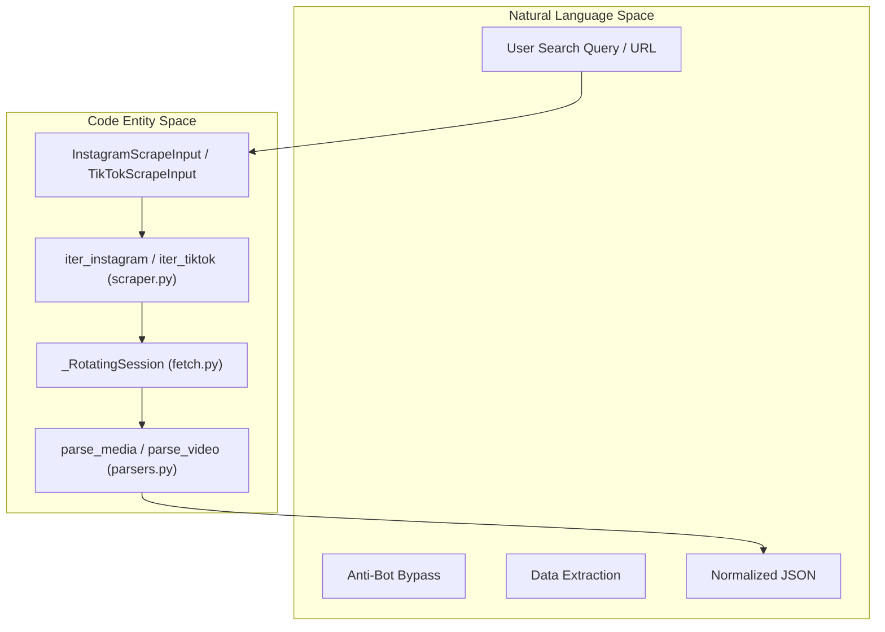
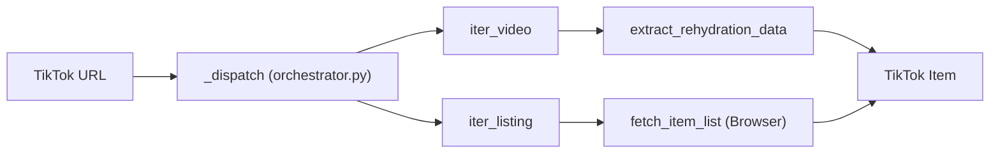

<!-- source: DeepWiki mcp.deepwiki.com · repo MODSetter/SurfSense · page 13.2 Platform-Specific Scrapers · fetched 2026-10-29 -->

# Platform-Specific Scrapers

Relevant source files

The following files were used as context for generating this wiki page:

- [surfsense_backend/alembic/env.py](surfsense_backend/alembic/env.py)
- [surfsense_backend/app/agents/chat/multi_agent_chat/subagents/builtins/indeed/system_prompt.md](surfsense_backend/app/agents/chat/multi_agent_chat/subagents/builtins/indeed/system_prompt.md)
- [surfsense_backend/app/capabilities/tiktok/comments/__init__.py](surfsense_backend/app/capabilities/tiktok/comments/__init__.py)
- [surfsense_backend/app/capabilities/tiktok/comments/definition.py](surfsense_backend/app/capabilities/tiktok/comments/definition.py)
- [surfsense_backend/app/capabilities/tiktok/comments/executor.py](surfsense_backend/app/capabilities/tiktok/comments/executor.py)
- [surfsense_backend/app/capabilities/tiktok/comments/schemas.py](surfsense_backend/app/capabilities/tiktok/comments/schemas.py)
- [surfsense_backend/app/capabilities/tiktok/scrape/schemas.py](surfsense_backend/app/capabilities/tiktok/scrape/schemas.py)
- [surfsense_backend/app/proprietary/platforms/google_search/fetch.py](surfsense_backend/app/proprietary/platforms/google_search/fetch.py)
- [surfsense_backend/app/proprietary/platforms/indeed_jobs/fetch.py](surfsense_backend/app/proprietary/platforms/indeed_jobs/fetch.py)
- [surfsense_backend/app/proprietary/platforms/indeed_jobs/scraper.py](surfsense_backend/app/proprietary/platforms/indeed_jobs/scraper.py)
- [surfsense_backend/app/proprietary/platforms/instagram/__init__.py](surfsense_backend/app/proprietary/platforms/instagram/__init__.py)
- [surfsense_backend/app/proprietary/platforms/instagram/fetch.py](surfsense_backend/app/proprietary/platforms/instagram/fetch.py)
- [surfsense_backend/app/proprietary/platforms/instagram/parsers.py](surfsense_backend/app/proprietary/platforms/instagram/parsers.py)
- [surfsense_backend/app/proprietary/platforms/instagram/schemas.py](surfsense_backend/app/proprietary/platforms/instagram/schemas.py)
- [surfsense_backend/app/proprietary/platforms/instagram/scraper.py](surfsense_backend/app/proprietary/platforms/instagram/scraper.py)
- [surfsense_backend/app/proprietary/platforms/instagram/url_resolver.py](surfsense_backend/app/proprietary/platforms/instagram/url_resolver.py)
- [surfsense_backend/app/proprietary/platforms/reddit/fetch.py](surfsense_backend/app/proprietary/platforms/reddit/fetch.py)
- [surfsense_backend/app/proprietary/platforms/tiktok/extraction/__init__.py](surfsense_backend/app/proprietary/platforms/tiktok/extraction/__init__.py)
- [surfsense_backend/app/proprietary/platforms/tiktok/extraction/hydration.py](surfsense_backend/app/proprietary/platforms/tiktok/extraction/hydration.py)
- [surfsense_backend/app/proprietary/platforms/tiktok/extraction/item_list.py](surfsense_backend/app/proprietary/platforms/tiktok/extraction/item_list.py)
- [surfsense_backend/app/proprietary/platforms/tiktok/extraction/timestamps.py](surfsense_backend/app/proprietary/platforms/tiktok/extraction/timestamps.py)
- [surfsense_backend/app/proprietary/platforms/tiktok/extraction/video.py](surfsense_backend/app/proprietary/platforms/tiktok/extraction/video.py)
- [surfsense_backend/app/proprietary/platforms/tiktok/flows/__init__.py](surfsense_backend/app/proprietary/platforms/tiktok/flows/__init__.py)
- [surfsense_backend/app/proprietary/platforms/tiktok/flows/listing.py](surfsense_backend/app/proprietary/platforms/tiktok/flows/listing.py)
- [surfsense_backend/app/proprietary/platforms/tiktok/orchestrator.py](surfsense_backend/app/proprietary/platforms/tiktok/orchestrator.py)
- [surfsense_backend/app/proprietary/platforms/tiktok/session/client.py](surfsense_backend/app/proprietary/platforms/tiktok/session/client.py)
- [surfsense_backend/app/proprietary/platforms/tiktok/session/listing.py](surfsense_backend/app/proprietary/platforms/tiktok/session/listing.py)
- [surfsense_backend/app/proprietary/platforms/tiktok/session/proxy.py](surfsense_backend/app/proprietary/platforms/tiktok/session/proxy.py)
- [surfsense_backend/app/schemas/logs.py](surfsense_backend/app/schemas/logs.py)
- [surfsense_backend/app/services/task_logging_service.py](surfsense_backend/app/services/task_logging_service.py)
- [surfsense_backend/app/utils/browser_loop.py](surfsense_backend/app/utils/browser_loop.py)
- [surfsense_backend/app/utils/proxy/rotation.py](surfsense_backend/app/utils/proxy/rotation.py)
- [surfsense_backend/scripts/check_migration_flow.py](surfsense_backend/scripts/check_migration_flow.py)
- [surfsense_backend/scripts/e2e_instagram_scraper.py](surfsense_backend/scripts/e2e_instagram_scraper.py)
- [surfsense_backend/scripts/e2e_reddit_scraper.py](surfsense_backend/scripts/e2e_reddit_scraper.py)
- [surfsense_backend/scripts/e2e_tiktok_scrape.py](surfsense_backend/scripts/e2e_tiktok_scrape.py)
- [surfsense_backend/tests/fixtures/tiktok/listing_item.json](surfsense_backend/tests/fixtures/tiktok/listing_item.json)
- [surfsense_backend/tests/fixtures/tiktok/video_item_struct.json](surfsense_backend/tests/fixtures/tiktok/video_item_struct.json)
- [surfsense_backend/tests/unit/capabilities/tiktok/scrape/test_schemas.py](surfsense_backend/tests/unit/capabilities/tiktok/scrape/test_schemas.py)
- [surfsense_backend/tests/unit/platforms/google_search/test_fetch_concurrency.py](surfsense_backend/tests/unit/platforms/google_search/test_fetch_concurrency.py)
- [surfsense_backend/tests/unit/platforms/indeed_jobs/test_fetch_resilience.py](surfsense_backend/tests/unit/platforms/indeed_jobs/test_fetch_resilience.py)
- [surfsense_backend/tests/unit/platforms/indeed_jobs/test_scraper.py](surfsense_backend/tests/unit/platforms/indeed_jobs/test_scraper.py)
- [surfsense_backend/tests/unit/platforms/instagram/__init__.py](surfsense_backend/tests/unit/platforms/instagram/__init__.py)
- [surfsense_backend/tests/unit/platforms/instagram/test_budget.py](surfsense_backend/tests/unit/platforms/instagram/test_budget.py)
- [surfsense_backend/tests/unit/platforms/instagram/test_discovery.py](surfsense_backend/tests/unit/platforms/instagram/test_discovery.py)
- [surfsense_backend/tests/unit/platforms/instagram/test_fetch_resilience.py](surfsense_backend/tests/unit/platforms/instagram/test_fetch_resilience.py)
- [surfsense_backend/tests/unit/platforms/instagram/test_parsers.py](surfsense_backend/tests/unit/platforms/instagram/test_parsers.py)
- [surfsense_backend/tests/unit/platforms/instagram/test_skeleton.py](surfsense_backend/tests/unit/platforms/instagram/test_skeleton.py)
- [surfsense_backend/tests/unit/platforms/reddit/test_fetch_resilience.py](surfsense_backend/tests/unit/platforms/reddit/test_fetch_resilience.py)
- [surfsense_backend/tests/unit/platforms/tiktok/test_hydration.py](surfsense_backend/tests/unit/platforms/tiktok/test_hydration.py)
- [surfsense_backend/tests/unit/platforms/tiktok/test_item_list.py](surfsense_backend/tests/unit/platforms/tiktok/test_item_list.py)
- [surfsense_backend/tests/unit/platforms/tiktok/test_orchestrator.py](surfsense_backend/tests/unit/platforms/tiktok/test_orchestrator.py)
- [surfsense_backend/tests/unit/platforms/tiktok/test_parsers.py](surfsense_backend/tests/unit/platforms/tiktok/test_parsers.py)
- [surfsense_backend/tests/unit/utils/proxy/test_rotation.py](surfsense_backend/tests/unit/utils/proxy/test_rotation.py)

SurfSense implements a suite of high-fidelity, platform-specific scrapers designed to bypass anti-bot measures and extract structured data from major social, job, and e-commerce platforms. These scrapers power the system's real-time knowledge acquisition capabilities, allowing the Deep Agent to browse live data from Reddit, TikTok, Instagram, Amazon, YouTube, Indeed, and Google.

## Architecture Overview

The scrapers follow a "warm-then-fetch" lifecycle. Instead of simple one-off requests, they maintain stateful sessions with residential proxy rotation and browser impersonation.

### Data Flow and Code Entities

The following diagram maps the Natural Language concepts of the scraping process to specific Code Entities within the backend.

**Scraper Execution Flow**

Sources: `[surfsense_backend/app/proprietary/platforms/instagram/scraper.py:18-27]()`, `[surfsense_backend/app/proprietary/platforms/tiktok/orchestrator.py:1-7]()`

---

## Instagram Scraper

The Instagram scraper is strictly anonymous and does not require login credentials. It targets profile metadata, media items (posts/reels), and handles discovery via Google-backed search [surfsense_backend/app/proprietary/platforms/instagram/scraper.py:12-21]().

### Anti-Bot Techniques
Instagram is highly hostile to automated access. The implementation uses:
1.  **Session Warming**: A plain GET to `www.instagram.com` to mint `csrftoken` and `mid` cookies before calling API endpoints [surfsense_backend/app/proprietary/platforms/instagram/fetch.py:6-13]().
2.  **Sticky Proxy Sessions**: Uses `_RotatingSession` via a `ContextVar` named `_current_session` to ensure warmed cookies stay bound to the same exit IP during a fetch chain [surfsense_backend/app/proprietary/platforms/instagram/fetch.py:60-68]().
3.  **Automatic Rotation**: If a 401/403 (Login Wall) is detected, the session rotates to a fresh residential IP and re-warms [surfsense_backend/app/proprietary/platforms/instagram/fetch.py:70-75]().
4.  **Fan-out Concurrency**: Independent targets are processed concurrently via the `fan_out` function (default limit of 8) to optimize throughput while minimizing IP burn [surfsense_backend/app/proprietary/platforms/instagram/scraper.py:62-65]().

### Data Model
| Field | Source | Description |
| :--- | :--- | :--- |
| `shortCode` | `edge_media_to_caption` | The unique identifier in the IG URL [surfsense_backend/app/proprietary/platforms/instagram/parsers.py:108-112](). |
| `likesCount` | `edge_liked_by` | Extracted from GraphQL containers; supports hidden counts (-1) [surfsense_backend/app/proprietary/platforms/instagram/parsers.py:99-105](). |
| `childPosts` | `edge_sidecar_to_children` | Flattened list of images/videos in a carousel [surfsense_backend/app/proprietary/platforms/instagram/parsers.py:153-167](). |

Sources: `[surfsense_backend/app/proprietary/platforms/instagram/fetch.py:1-26]()`, `[surfsense_backend/app/proprietary/platforms/instagram/parsers.py:1-14]()`

---

## TikTok Scraper

The TikTok scraper handles video URLs, profiles, hashtags, and trending feeds. It uses a hybrid approach: HTTP rehydration for single videos and stealth browser automation for listings [surfsense_backend/app/proprietary/platforms/tiktok/orchestrator.py:1-7]().

### Extraction Strategy
TikTok embeds data in a JSON blob within the HTML. The scraper uses `extract_rehydration_data` to pull the `__UNIVERSAL_DATA_FOR_REHYDRATION__` script tag [surfsense_backend/app/proprietary/platforms/tiktok/extraction/hydration.py:1-10]().

For listings (profiles/hashtags), the scraper uses `StealthyFetcher` (patchright-Chromium) to capture `item_list` XHRs. This allows TikTok's own scripts to sign requests (e.g., `X-Gnarly` headers) correctly [surfsense_backend/app/proprietary/platforms/tiktok/session/listing.py:1-11]().

**TikTok Scraper Logic**

Sources: `[surfsense_backend/app/proprietary/platforms/tiktok/orchestrator.py:69-82]()`, `[surfsense_backend/app/proprietary/platforms/tiktok/extraction/__init__.py:1-25]()`, `[surfsense_backend/app/proprietary/platforms/tiktok/session/listing.py:1-18]()`

---

## Indeed Jobs Scraper

The Indeed scraper extracts job listings and detailed descriptions using sequential targets to reuse a single warmed session [surfsense_backend/app/proprietary/platforms/indeed_jobs/scraper.py:1-6]().

### Implementation Details
*   **Target Resolution**: Resolves `startUrls` and `queries` into search or job detail targets via `_targets` [surfsense_backend/app/proprietary/platforms/indeed_jobs/scraper.py:62-67]().
*   **Detail Enrichment**: If `scrapeJobDetails` is enabled, the scraper calls `_enrich` to fetch the `/viewjob` page and merge the full description onto the listing item [surfsense_backend/app/proprietary/platforms/indeed_jobs/scraper.py:98-103]().
*   **Pagination Limits**: Anonymous access is capped at the first page (~15 jobs) as Indeed gates `start>=10` for unauthenticated sessions [surfsense_backend/app/proprietary/platforms/indeed_jobs/scraper.py:35-42]().

Sources: `[surfsense_backend/app/proprietary/platforms/indeed_jobs/scraper.py:1-23]()`, `[surfsense_backend/tests/unit/platforms/indeed_jobs/test_scraper.py:1-13]()`

---

## Common Utilities and Patterns

### Proxy Management
All scrapers rely on a central proxy utility located in `app.utils.proxy`.
*   `get_geo_proxy_url`: Provides an IP for a specific country [surfsense_backend/app/proprietary/platforms/tiktok/session/listing.py:35]().
*   `country_for_rotation`: Walks country-pinned exits until a valid response is received [surfsense_backend/app/proprietary/platforms/tiktok/session/listing.py:15-17]().

### Error Handling
Scrapers implement "Partial Results" logic. If one target in a batch fails or is blocked, the system yields successful items and an `ErrorItem` for the failed target, rather than aborting the entire process [surfsense_backend/app/proprietary/platforms/instagram/scraper.py:123-134]().

**Error Schema Example**
Items inherit from `_ItemBase`, which includes:
*   `errorCode`: Short error code (e.g., `bad_url`, `no_items`, `no_results`) [surfsense_backend/app/proprietary/platforms/tiktok/orchestrator.py:185-192]().
*   `error`: Human-readable details.
*   `scrapedAt`: Normalized UTC timestamp [surfsense_backend/app/proprietary/platforms/tiktok/extraction/timestamps.py:1-10]().

Sources: `[surfsense_backend/app/proprietary/platforms/instagram/schemas.py:51-67]()`, `[surfsense_backend/app/proprietary/platforms/tiktok/orchestrator.py:181-192]()`

---

