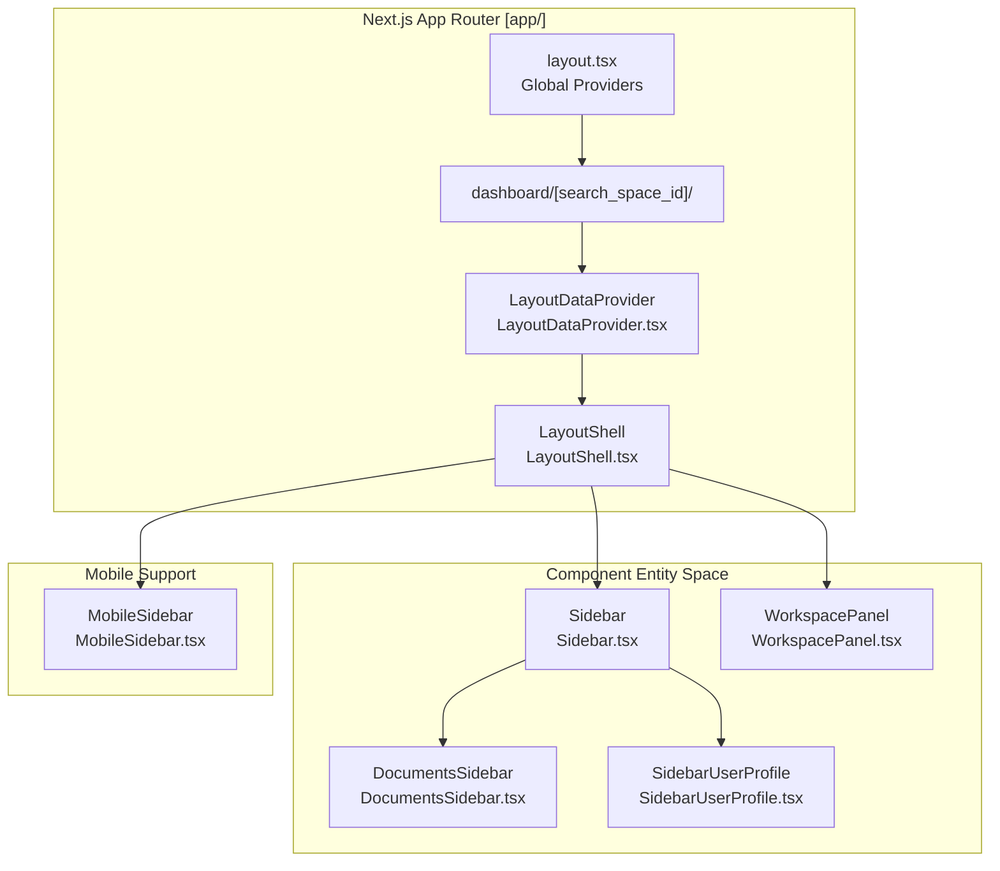
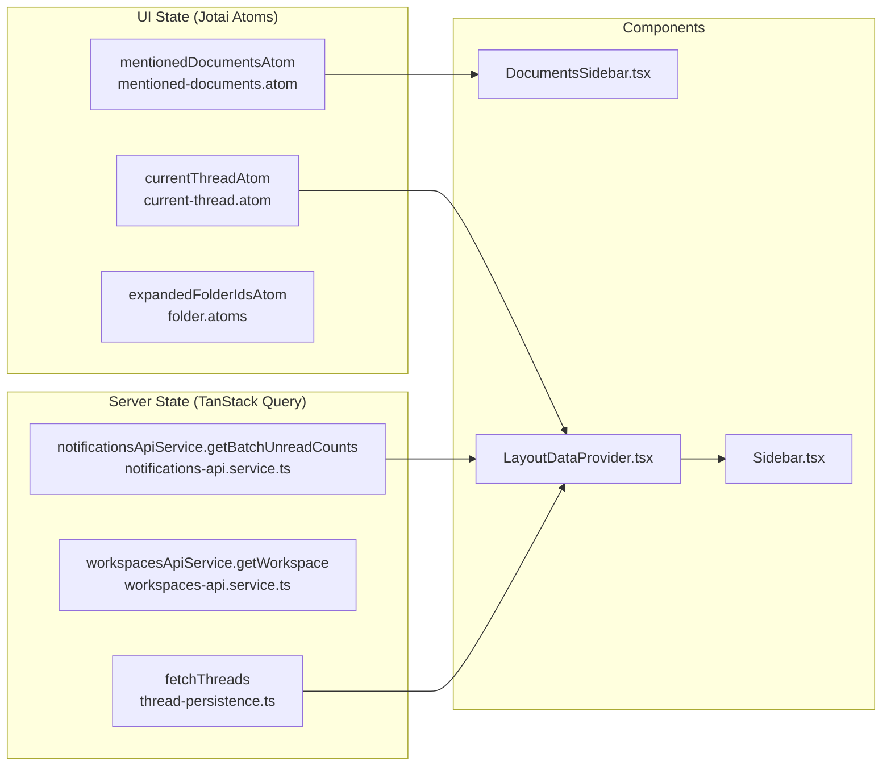

<!-- source: DeepWiki mcp.deepwiki.com · repo MODSetter/SurfSense · page 14 Frontend Application · fetched 2026-10-29 -->

# Frontend Application

Relevant source files

The following files were used as context for generating this wiki page:

- [VERSION](VERSION)
- [surfsense_backend/pyproject.toml](surfsense_backend/pyproject.toml)
- [surfsense_backend/uv.lock](surfsense_backend/uv.lock)
- [surfsense_browser_extension/package.json](surfsense_browser_extension/package.json)
- [surfsense_desktop/package.json](surfsense_desktop/package.json)
- [surfsense_web/app/docs/layout.tsx](surfsense_web/app/docs/layout.tsx)
- [surfsense_web/app/globals.css](surfsense_web/app/globals.css)
- [surfsense_web/app/layout.config.tsx](surfsense_web/app/layout.config.tsx)
- [surfsense_web/components/documents/DocumentNode.tsx](surfsense_web/components/documents/DocumentNode.tsx)
- [surfsense_web/components/documents/FolderNode.tsx](surfsense_web/components/documents/FolderNode.tsx)
- [surfsense_web/components/documents/FolderTreeView.tsx](surfsense_web/components/documents/FolderTreeView.tsx)
- [surfsense_web/components/layout/providers/FreeLayoutDataProvider.tsx](surfsense_web/components/layout/providers/FreeLayoutDataProvider.tsx)
- [surfsense_web/components/layout/providers/LayoutDataProvider.tsx](surfsense_web/components/layout/providers/LayoutDataProvider.tsx)
- [surfsense_web/components/layout/ui/icon-rail/IconRail.tsx](surfsense_web/components/layout/ui/icon-rail/IconRail.tsx)
- [surfsense_web/components/layout/ui/shell/LayoutShell.tsx](surfsense_web/components/layout/ui/shell/LayoutShell.tsx)
- [surfsense_web/components/layout/ui/sidebar/AllChatsSidebar.tsx](surfsense_web/components/layout/ui/sidebar/AllChatsSidebar.tsx)
- [surfsense_web/components/layout/ui/sidebar/ChatListItem.tsx](surfsense_web/components/layout/ui/sidebar/ChatListItem.tsx)
- [surfsense_web/components/layout/ui/sidebar/DocumentsSidebar.tsx](surfsense_web/components/layout/ui/sidebar/DocumentsSidebar.tsx)
- [surfsense_web/components/layout/ui/sidebar/MobileSidebar.tsx](surfsense_web/components/layout/ui/sidebar/MobileSidebar.tsx)
- [surfsense_web/components/layout/ui/sidebar/NotificationsDropdown.tsx](surfsense_web/components/layout/ui/sidebar/NotificationsDropdown.tsx)
- [surfsense_web/components/layout/ui/sidebar/Sidebar.tsx](surfsense_web/components/layout/ui/sidebar/Sidebar.tsx)
- [surfsense_web/components/layout/ui/sidebar/SidebarSection.tsx](surfsense_web/components/layout/ui/sidebar/SidebarSection.tsx)
- [surfsense_web/components/layout/ui/sidebar/SidebarUserProfile.tsx](surfsense_web/components/layout/ui/sidebar/SidebarUserProfile.tsx)
- [surfsense_web/components/layout/ui/sidebar/index.ts](surfsense_web/components/layout/ui/sidebar/index.ts)
- [surfsense_web/components/markdown-viewer.tsx](surfsense_web/components/markdown-viewer.tsx)
- [surfsense_web/package.json](surfsense_web/package.json)
- [surfsense_web/pnpm-lock.yaml](surfsense_web/pnpm-lock.yaml)

## Purpose and Scope

This document describes the Next.js frontend application architecture, including its component structure, state management patterns, routing mechanisms, and integration with backend APIs. The frontend serves as the user interface layer for SurfSense, providing dashboard pages, research interface, document management, and team collaboration features.

For information about backend API endpoints and business logic, see [System Architecture](#3). For details about the Research Agent UI specifically, see [Chat System](#10). For authentication flows, see [Authentication System](#4.1).

---

## Technology Stack

The frontend application is built using the following core technologies:

| Technology | Purpose | Key Features Used |
|------------|---------|-------------------|
| **Next.js** | React framework | App Router, Turbopack, Dynamic Routes [surfsense_web/package.json:123]() |
| **React** | UI library | Hooks, Context, Suspense [surfsense_web/package.json:134]() |
| **Jotai** | Atomic state management | Atoms, derived atoms, async atoms [surfsense_web/package.json:113]() |
| **TanStack Query** | Server state management | Queries, mutations, cache management [surfsense_web/package.json:91]() |
| **Tailwind CSS v4** | Styling system | Utility-first CSS, oklch colors, dark mode [surfsense_web/package.json:180]() |
| **Radix UI** | Component primitives | Accessible, unstyled components (Sheet, Dialog, etc.) [surfsense_web/package.json:60-81]() |
| **next-intl** | Internationalization | Message translations, locale context [surfsense_web/package.json:124]() |
| **Motion** | Animations | Page transitions, micro-interactions [surfsense_web/package.json:122]() |

Sources: [surfsense_web/package.json:31-160]()

---

## Application Architecture

### Directory Structure and Routing

The application follows Next.js App Router conventions with a component-based layout system. The primary workspace container is the `[search_space_id]` dynamic route.

Title: Frontend Layout and Component Hierarchy

**Dynamic Route Parameters**:
- `[search_space_id]`: Identifies the active workspace/tenant.
- `chat_id`: Optional parameter for specific chat threads, extracted via `useParams` [surfsense_web/components/layout/providers/LayoutDataProvider.tsx:104-106]().

Sources: [surfsense_web/components/layout/ui/shell/LayoutShell.tsx:141-230](), [surfsense_web/components/layout/providers/LayoutDataProvider.tsx:65-113](), [surfsense_web/components/layout/ui/sidebar/Sidebar.tsx:95-133]()

---

## State Management Architecture

SurfSense employs a multi-library state management strategy to handle different types of data:

- **TanStack Query**: Manages server state (fetching, caching, and synchronizing data from the FastAPI backend).
- **Jotai**: Manages atomic UI state (e.g., active thread, mentioned documents, sidebar collapse state).
- **Zustand**: Used for simple global state where atomic granularity is not required.

Title: Data Flow and State Management

Sources: [surfsense_web/components/layout/providers/LayoutDataProvider.tsx:81-120](), [surfsense_web/components/layout/ui/sidebar/DocumentsSidebar.tsx:18-22](), [surfsense_web/components/layout/providers/LayoutDataProvider.tsx:128-135]()

---

## Component Architecture

### Layout Hierarchy

The application UI is structured into a hierarchical layout shell that adapts to desktop and mobile environments.

- **`LayoutShell`**: The root UI container that manages the responsive transition between desktop (with `Sidebar` and `IconRail`) and mobile (using `MobileSidebar` sheets) [surfsense_web/components/layout/ui/shell/LayoutShell.tsx:141-230]().
- **`LayoutDataProvider`**: A non-rendering provider that fetches essential workspace data, thread lists, and notification counts to feed the UI components [surfsense_web/components/layout/providers/LayoutDataProvider.tsx:65-157]().
- **`Sidebar`**: The primary navigation component containing the workspace header, chat history, and document management [surfsense_web/components/layout/ui/sidebar/Sidebar.tsx:95-133]().

### Document and Folder Management

The `DocumentsSidebar` provides a hierarchical view of the workspace knowledge base.

- **`DocumentsSidebar`**: Orchestrates the rendering of folders and documents, including filtering by type and creating new folders [surfsense_web/components/layout/ui/sidebar/DocumentsSidebar.tsx:111-185]().
- **`DocumentNode`**: Represents an individual file or captured webpage, including status indicators for `pending`, `processing`, or `failed` states [surfsense_web/components/documents/DocumentNode.tsx:179-217]().
- **`SidebarListItem`**: A base primitive for consistent list items across the sidebar [surfsense_web/components/documents/DocumentNode.tsx:167-178]().

Sources: [surfsense_web/components/layout/ui/sidebar/DocumentsSidebar.tsx:1-121](), [surfsense_web/components/documents/DocumentNode.tsx:72-164](), [surfsense_web/components/layout/ui/sidebar/MobileSidebar.tsx:64-119]()

---

## Internationalization (i18n)

SurfSense uses `next-intl` to support multiple languages.

- **Supported Languages**: Configuration includes English (`en`), Spanish (`es`), Portuguese (`pt`), Hindi (`hi`), Chinese (`zh`), and Korean (`ko`) [surfsense_web/components/layout/ui/sidebar/SidebarUserProfile.tsx:49-56]().
- **`SidebarUserProfile`**: Allows users to switch languages via a dropdown or mobile drawer interface [surfsense_web/components/layout/ui/sidebar/SidebarUserProfile.tsx:161-163]().
- **`useTranslations`**: Hook used extensively throughout components (e.g., `dashboard`, `sidebar`, `common`) to retrieve localized strings [surfsense_web/components/layout/providers/LayoutDataProvider.tsx:70-72]().

Sources: [surfsense_web/components/layout/ui/sidebar/SidebarUserProfile.tsx:18-21](), [surfsense_web/components/layout/ui/sidebar/SidebarUserProfile.tsx:235-240]()

---

## Styling and Theming

The styling system is built on **Tailwind CSS v4** and **next-themes**.

- **OKLCH Color System**: Used for perceptually uniform colors in both light and dark modes [surfsense_web/app/globals.css:1-50]().
- **Dark Mode**: Managed via the `useTheme` hook, supporting `light`, `dark`, and `system` options [surfsense_web/components/layout/ui/sidebar/SidebarUserProfile.tsx:59-63]().
- **Responsive Design**: The `useIsMobile` hook and Tailwind's responsive modifiers ensure the UI functions on mobile, desktop, and within the Electron wrapper [surfsense_web/components/layout/ui/shell/LayoutShell.tsx:10-13]().

Sources: [surfsense_web/components/layout/ui/sidebar/SidebarUserProfile.tsx:165-167](), [surfsense_web/components/layout/ui/sidebar/Sidebar.tsx:172-179]()

---

## Child Pages

For detailed technical documentation on specific frontend subsystems, see the following pages:

- [Application Structure and Layout](#14.1) — Provider hierarchy, layout shell, and responsive design.
- [State Management](#14.2) — Atomic state with Jotai, server state with TanStack Query.
- [Sidebar and Navigation](#14.3) — Workspace selector, chat lists, and user profile.
- [Internationalization](#14.4) — Supporting English and Chinese with `next-intl`.
- [Styling System](#14.5) — Tailwind CSS v4, OKLCH colors, and dark mode.

---

