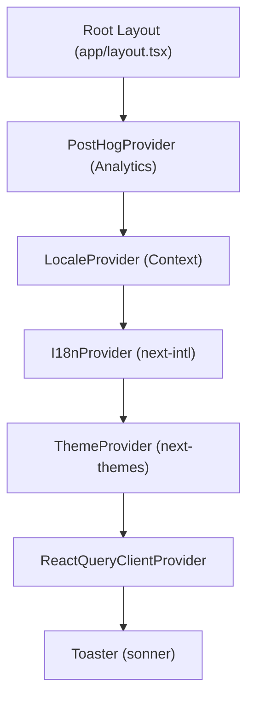
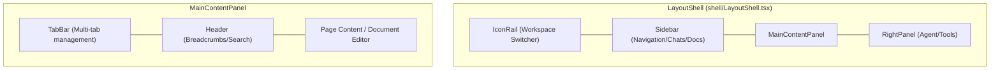
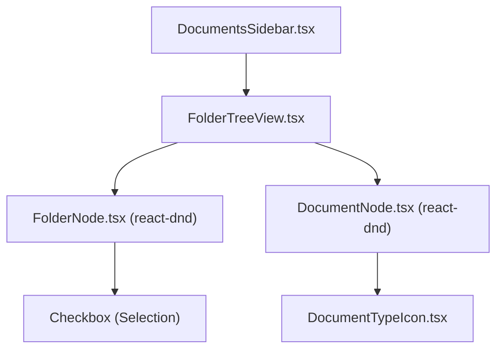

<!-- source: DeepWiki mcp.deepwiki.com · repo MODSetter/SurfSense · page 14.1 Application Structure and Layout · fetched 2026-10-29 -->

# Application Structure and Layout

Relevant source files

The following files were used as context for generating this wiki page:

- [surfsense_backend/app/proprietary/platforms/google_search/captcha.py](surfsense_backend/app/proprietary/platforms/google_search/captcha.py)
- [surfsense_backend/app/proprietary/platforms/google_search/pool_store.py](surfsense_backend/app/proprietary/platforms/google_search/pool_store.py)
- [surfsense_backend/app/utils/captcha/solvers.py](surfsense_backend/app/utils/captcha/solvers.py)
- [surfsense_backend/scripts/scale_google_search.py](surfsense_backend/scripts/scale_google_search.py)
- [surfsense_backend/scripts/stress_google_search.py](surfsense_backend/scripts/stress_google_search.py)
- [surfsense_backend/tests/unit/routes/test_llm_setup_status.py](surfsense_backend/tests/unit/routes/test_llm_setup_status.py)
- [surfsense_backend/tests/unit/utils/captcha/test_solvers.py](surfsense_backend/tests/unit/utils/captcha/test_solvers.py)
- [surfsense_web/app/dashboard/[workspace_id]/client-layout.tsx](surfsense_web/app/dashboard/[workspace_id]/client-layout.tsx)
- [surfsense_web/app/dashboard/[workspace_id]/layout.tsx](surfsense_web/app/dashboard/[workspace_id]/layout.tsx)
- [surfsense_web/components/assistant-ui/connector-popup/constants/connector-popup.schemas.ts](surfsense_web/components/assistant-ui/connector-popup/constants/connector-popup.schemas.ts)
- [surfsense_web/components/assistant-ui/connector-popup/index.ts](surfsense_web/components/assistant-ui/connector-popup/index.ts)
- [surfsense_web/components/documents/DocumentNode.tsx](surfsense_web/components/documents/DocumentNode.tsx)
- [surfsense_web/components/documents/FolderNode.tsx](surfsense_web/components/documents/FolderNode.tsx)
- [surfsense_web/components/documents/FolderTreeView.tsx](surfsense_web/components/documents/FolderTreeView.tsx)
- [surfsense_web/components/layout/providers/FreeLayoutDataProvider.tsx](surfsense_web/components/layout/providers/FreeLayoutDataProvider.tsx)
- [surfsense_web/components/layout/providers/LayoutDataProvider.tsx](surfsense_web/components/layout/providers/LayoutDataProvider.tsx)
- [surfsense_web/components/layout/ui/icon-rail/IconRail.tsx](surfsense_web/components/layout/ui/icon-rail/IconRail.tsx)
- [surfsense_web/components/layout/ui/shell/LayoutShell.tsx](surfsense_web/components/layout/ui/shell/LayoutShell.tsx)
- [surfsense_web/components/layout/ui/sidebar/AllChatsSidebar.tsx](surfsense_web/components/layout/ui/sidebar/AllChatsSidebar.tsx)
- [surfsense_web/components/layout/ui/sidebar/ChatListItem.tsx](surfsense_web/components/layout/ui/sidebar/ChatListItem.tsx)
- [surfsense_web/components/layout/ui/sidebar/DocumentsSidebar.tsx](surfsense_web/components/layout/ui/sidebar/DocumentsSidebar.tsx)
- [surfsense_web/components/layout/ui/sidebar/MobileSidebar.tsx](surfsense_web/components/layout/ui/sidebar/MobileSidebar.tsx)
- [surfsense_web/components/layout/ui/sidebar/NotificationsDropdown.tsx](surfsense_web/components/layout/ui/sidebar/NotificationsDropdown.tsx)
- [surfsense_web/components/layout/ui/sidebar/Sidebar.tsx](surfsense_web/components/layout/ui/sidebar/Sidebar.tsx)
- [surfsense_web/components/layout/ui/sidebar/SidebarSection.tsx](surfsense_web/components/layout/ui/sidebar/SidebarSection.tsx)
- [surfsense_web/components/layout/ui/sidebar/SidebarUserProfile.tsx](surfsense_web/components/layout/ui/sidebar/SidebarUserProfile.tsx)
- [surfsense_web/components/layout/ui/sidebar/index.ts](surfsense_web/components/layout/ui/sidebar/index.ts)

## Purpose and Scope

This document describes the Next.js frontend application structure for SurfSense, covering the provider hierarchy, layout shell, dashboard structure, and responsive design patterns. It details how the application manages multi-tenancy through SearchSpaces and provides a unified interface across desktop and mobile platforms.

## Next.js Application Architecture

SurfSense is built on **Next.js 15.5.7** using the **App Router** architecture. It utilizes a hybrid approach where layout logic is handled by client components while initial routing and metadata are managed by server components.

### Technology Stack

| Category | Technology | Version | Purpose |
|----------|-----------|---------|---------|
| Framework | Next.js | 15.5.7 | React framework with App Router |
| Styling | Tailwind CSS | 4.1.11 | Utility-first styling with OKLCH support |
| State Management | Jotai | 2.15.1 | Atomic state for UI and configuration |
| Server State | TanStack Query | 5.90.7 | Caching and async data fetching |
| Multi-tab Sync | Zero | Latest | Real-time sync for document tree and mentions |
| Internationalization | next-intl | 3.26.3 | Multi-language support (EN, ES, PT, HI, ZH, KO) |

**Sources:** `surfsense_web/package.json`, [surfsense_web/components/layout/ui/sidebar/SidebarUserProfile.tsx:49-56]()

## Provider Hierarchy and Data Flow

The application uses a nested provider hierarchy to manage global state, theming, and real-time data synchronization.

### Root Provider Hierarchy

The root layout wraps the application in fundamental infrastructure providers.

**Sources:** `surfsense_web/app/layout.tsx`

### Layout Data Provider

Within the dashboard, the `LayoutDataProvider` acts as the primary data orchestrator. It bridges the gap between URL parameters and global state atoms.

| Implementation Detail | File Citation |
|-----------------------|---------------|
| Fetches user profile via `currentUserAtom` | [surfsense_web/components/layout/providers/LayoutDataProvider.tsx:82]() |
| Synchronizes current workspace details | [surfsense_web/components/layout/providers/LayoutDataProvider.tsx:109-113]() |
| Manages batch unread counts for notifications | [surfsense_web/components/layout/providers/LayoutDataProvider.tsx:130-135]() |
| Handles thread persistence and navigation | [surfsense_web/components/layout/providers/LayoutDataProvider.tsx:50-52]() |

**Sources:** [surfsense_web/components/layout/providers/LayoutDataProvider.tsx:65-178]()

## Layout Shell and Responsive Design

The `LayoutShell` component provides a unified container that dynamically switches between desktop and mobile layouts based on the `useIsMobile()` hook.

### Component Structure Diagram

**Sources:** [surfsense_web/components/layout/ui/shell/LayoutShell.tsx:141-180](), [surfsense_web/components/layout/ui/shell/LayoutShell.tsx:228-250]()

### Desktop vs. Mobile Layouts

| Feature | Desktop Layout | Mobile Layout |
|---------|----------------|---------------|
| **Navigation** | Fixed sidebar with resize handle | Drawer-based `Sheet` component |
| **Workspace Switcher** | Vertical `IconRail` on the left | Horizontal rail inside `MobileSidebar` |
| **Sidebar Content** | Persistent or collapsible (min-width 51px) | Full-screen overlay triggered by `PanelLeft` |
| **Right Panel** | Expandable/collapsible utility panel | Hidden or accessible via specific triggers |

**Sources:** [surfsense_web/components/layout/ui/shell/LayoutShell.tsx:228-260](), [surfsense_web/components/layout/ui/sidebar/MobileSidebar.tsx:120-188]()

## Dashboard Structure

The dashboard is the primary workspace where users interact with AI agents and knowledge sources.

### SearchSpace and Redirection
When a user visits `/dashboard`, the application automatically redirects them to their first available workspace or shows an empty state to create one.

| Function/Component | Role |
|--------------------|------|
| `LayoutDataProvider` | Fetches `workspacesAtom` to resolve the current SearchSpace |
| `useActivateChatThread` | Hook used to navigate between chat threads within a space |
| `router.push` | Used for navigation to specific workspace paths |

**Sources:** [surfsense_web/components/layout/providers/LayoutDataProvider.tsx:83-87](), [surfsense_web/components/layout/providers/LayoutDataProvider.tsx:94]()

### Sidebar Organization
The `Sidebar` component [surfsense_web/components/layout/ui/sidebar/Sidebar.tsx:95-217]() is divided into functional sections:
1.  **Header**: SearchSpace selector and settings [surfsense_web/components/layout/ui/sidebar/Sidebar.tsx:189-195]().
2.  **Primary Actions**: "New Chat" button and tool buttons [surfsense_web/components/layout/ui/sidebar/Sidebar.tsx:223-238]().
3.  **Recents**: Recently accessed chat threads via `ChatListItem` [surfsense_web/components/layout/ui/sidebar/Sidebar.tsx:244-250]().
4.  **Documents**: Hierarchical explorer via `DocumentsSidebar` [surfsense_web/components/layout/ui/sidebar/Sidebar.tsx:254-258]().
5.  **Nav Items**: Links to Automations, Artifacts, and Connectors [surfsense_web/components/layout/ui/sidebar/Sidebar.tsx:141-152]().
6.  **User Profile**: Theme switcher and language selector [surfsense_web/components/layout/ui/sidebar/SidebarUserProfile.tsx:135-178]().

## Document Tree and Navigation
The `DocumentsSidebar` provides a hierarchical view of the workspace knowledge base using a two-tier structure of folders and documents.

*   **FolderTreeView**: Uses `react-dnd` for drag-and-drop reordering and folder nesting [surfsense_web/components/documents/FolderTreeView.tsx:61-87]().
*   **DocumentNode**: Represents individual files with status indicators (Pending, Processing, Failed) and document type icons [surfsense_web/components/documents/DocumentNode.tsx:180-217]().
*   **Selection Logic**: Supports mentioning specific documents or entire folders in chat via `mentionedDocKeys` [surfsense_web/components/documents/FolderTreeView.tsx:153-162]().

**Sources:** [surfsense_web/components/layout/ui/sidebar/DocumentsSidebar.tsx:111-128](), [surfsense_web/components/documents/FolderTreeView.tsx:1-49]()

## Multi-Tab System
The dashboard supports a tabbed interface managed via `TabBar` and `activeTabIdAtom`. This allows users to keep multiple chats or documents open simultaneously.

*   **Tab Switching**: Managed by `onTabSwitch` in the `LayoutShell` [surfsense_web/components/layout/ui/shell/LayoutShell.tsx:135]().
*   **Dynamic Content**: The `MainContentPanel` dynamically renders `DocumentTabContent` for document tabs or the page children for chat routes [surfsense_web/components/layout/ui/shell/LayoutShell.tsx:225-240]().

**Sources:** [surfsense_web/components/layout/ui/shell/LayoutShell.tsx:33-43](), [surfsense_web/components/layout/ui/shell/LayoutShell.tsx:205-226]()

---

