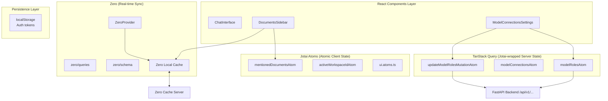
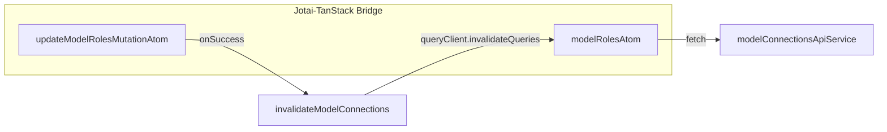
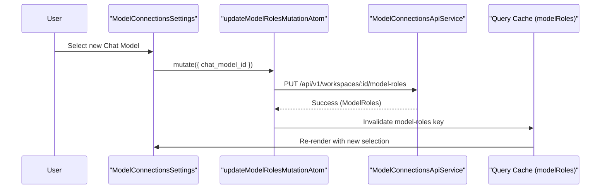

<!-- source: DeepWiki mcp.deepwiki.com · repo MODSetter/SurfSense · page 14.2 State Management · fetched 2026-10-29 -->

# State Management

Relevant source files

The following files were used as context for generating this wiki page:

- [.vscode/settings.json](.vscode/settings.json)
- [surfsense_backend/alembic/versions/160_add_model_connections.py](surfsense_backend/alembic/versions/160_add_model_connections.py)
- [surfsense_backend/app/routes/model_connections_routes.py](surfsense_backend/app/routes/model_connections_routes.py)
- [surfsense_backend/app/schemas/__init__.py](surfsense_backend/app/schemas/__init__.py)
- [surfsense_backend/app/schemas/model_connections.py](surfsense_backend/app/schemas/model_connections.py)
- [surfsense_backend/app/services/model_connection_service.py](surfsense_backend/app/services/model_connection_service.py)
- [surfsense_browser_extension/.gitignore](surfsense_browser_extension/.gitignore)
- [surfsense_web/.gitignore](surfsense_web/.gitignore)
- [surfsense_web/app/(home)/login/layout.tsx](surfsense_web/app/(home)/login/layout.tsx)
- [surfsense_web/app/(home)/register/layout.tsx](surfsense_web/app/(home)/register/layout.tsx)
- [surfsense_web/app/api/zero/query/route.ts](surfsense_web/app/api/zero/query/route.ts)
- [surfsense_web/app/dashboard/[workspace_id]/team/page.tsx](surfsense_web/app/dashboard/[workspace_id]/team/page.tsx)
- [surfsense_web/app/dashboard/dashboard-shell.tsx](surfsense_web/app/dashboard/dashboard-shell.tsx)
- [surfsense_web/app/desktop/login/layout.tsx](surfsense_web/app/desktop/login/layout.tsx)
- [surfsense_web/atoms/agent/agent-flags-query.atom.ts](surfsense_web/atoms/agent/agent-flags-query.atom.ts)
- [surfsense_web/atoms/model-connections/model-connections-mutation.atoms.ts](surfsense_web/atoms/model-connections/model-connections-mutation.atoms.ts)
- [surfsense_web/atoms/model-connections/model-connections-query.atoms.ts](surfsense_web/atoms/model-connections/model-connections-query.atoms.ts)
- [surfsense_web/atoms/user/user-mutation.atoms.ts](surfsense_web/atoms/user/user-mutation.atoms.ts)
- [surfsense_web/atoms/user/user-query.atoms.ts](surfsense_web/atoms/user/user-query.atoms.ts)
- [surfsense_web/biome.json](surfsense_web/biome.json)
- [surfsense_web/components/providers/ZeroProvider.tsx](surfsense_web/components/providers/ZeroProvider.tsx)
- [surfsense_web/components/providers/runtime-config.server.tsx](surfsense_web/components/providers/runtime-config.server.tsx)
- [surfsense_web/components/providers/runtime-config.tsx](surfsense_web/components/providers/runtime-config.tsx)
- [surfsense_web/components/settings/model-connections-settings.tsx](surfsense_web/components/settings/model-connections-settings.tsx)
- [surfsense_web/contracts/types/model-connections.types.ts](surfsense_web/contracts/types/model-connections.types.ts)
- [surfsense_web/lib/apis/model-connections-api.service.ts](surfsense_web/lib/apis/model-connections-api.service.ts)
- [surfsense_web/lib/query-client/cache-keys.ts](surfsense_web/lib/query-client/cache-keys.ts)
- [surfsense_web/types/zero.d.ts](surfsense_web/types/zero.d.ts)
- [surfsense_web/zero/queries/authz.ts](surfsense_web/zero/queries/authz.ts)

## Purpose and Scope

This document describes the state management architecture used in the SurfSense Next.js frontend application. The system uses a multi-library approach combining **Jotai** for atomic state, **TanStack Query** (integrated via `jotai-tanstack-query`) for server state management, and **Zero** for real-time synchronization of relational data. This hybrid architecture ensures that transient UI state, cached server data, and real-time collaborative entities are handled by specialized tools.

---

## State Management Architecture

The SurfSense frontend employs a layered state management architecture that separates concerns between transient UI state, client-side application state, and real-time synchronized data.

**Key Architecture Principles:**

| Layer | Technology | Purpose | Persistence |
|-------|-----------|---------|-------------|
| **Real-time Data** | Zero | Synchronizing relational entities (Documents, Folders, Users) | Local DB (IDB) |
| **Client Global State** | Jotai | Application-wide client state (selections, UI flags, navigation state) | Optional localStorage |
| **Server State** | TanStack Query | API data, LLM configurations, and complex mutations | Query cache |
| **Contextual State** | React Context | Auth status, locale, and theme | Provider-scoped |

Sources: [surfsense_web/components/providers/ZeroProvider.tsx:16-16](), [surfsense_web/atoms/model-connections/model-connections-query.atoms.ts:1-15](), [surfsense_web/components/settings/model-connections-settings.tsx:53-63]()

---

## Zero for Real-time Relational State

SurfSense uses **Zero** to manage relational data that requires real-time synchronization across clients, such as document structures and folder hierarchies.

### Zero Integration and Schema
The `ZeroProvider` initializes the synchronization engine using a schema defined in `surfsense_web/zero/schema` [surfsense_web/components/providers/ZeroProvider.tsx:16-16](). It handles authentication refreshes via `ZeroAuthSync` and desktop-specific token synchronization [surfsense_web/components/providers/ZeroProvider.tsx:62-132](). The provider also manages `ZeroContext` which includes the `userId` required for row-level security [surfsense_web/components/providers/ZeroProvider.tsx:34-51]().

### Data Consumption Pattern
The application uses the `ZeroReactProvider` to make the zero instance available to the component tree [surfsense_web/components/providers/ZeroProvider.tsx:234-238](). Server-side rendering support for Zero queries is handled via the `/api/zero/query` route, which validates requests using an internal API key [surfsense_web/app/api/zero/query/route.ts:17-21]().

Sources: [surfsense_web/components/providers/ZeroProvider.tsx:190-239](), [surfsense_web/app/api/zero/query/route.ts:55-77]()

---

## Jotai for Atomic Client and Server State

SurfSense extensively uses **Jotai** not just for local state, but as the primary interface for TanStack Query via `jotai-tanstack-query`.

### Key Atoms and Their Roles

| Atom | File | Purpose |
|------|------|---------|
| `activeWorkspaceIdAtom` | `workspace-query.atoms.ts` | Tracks the currently active workspace ID [surfsense_web/atoms/model-connections/model-connections-mutation.atoms.ts:18-18]() |
| `modelConnectionsAtom` | `model-connections-query.atoms.ts` | Fetches and caches LLM connections for a workspace [surfsense_web/atoms/model-connections/model-connections-query.atoms.ts:10-10]() |
| `modelRolesAtom` | `model-connections-query.atoms.ts` | Manages the mapping of LLMs to roles (Chat, Vision, Image Gen) [surfsense_web/atoms/model-connections/model-connections-query.atoms.ts:9-9]() |

### Bridge Atoms (Query + Mutation)
The application wraps `modelConnectionsApiService` calls into atoms using `atomWithMutation` and `atomWithQuery`. This allows components to use standard Jotai hooks like `useAtom` while benefiting from TanStack Query's caching and invalidation logic.

Sources: [surfsense_web/atoms/model-connections/model-connections-mutation.atoms.ts:166-186](), [surfsense_web/lib/query-client/cache-keys.ts:39-46](), [surfsense_web/components/settings/model-connections-settings.tsx:53-57]()

---

## Cache Management and Invalidation

SurfSense uses a centralized `cacheKeys` object to ensure consistency across queries and manual cache invalidations [surfsense_web/lib/query-client/cache-keys.ts:19-19]().

### Stable Cache Keys
To avoid order-dependency in object-based queries, the `stableEntries` function sorts keys alphabetically before flattening them into a query key array [surfsense_web/lib/query-client/cache-keys.ts:11-17]().

### Mutation Side-Effects
When a model connection is updated or deleted, the system triggers a cascade of invalidations to ensure the UI reflects the current LLM availability:
1. **Invalidate Connections**: Refresh the list of available providers [surfsense_web/atoms/model-connections/model-connections-mutation.atoms.ts:22-22]().
2. **Invalidate Roles**: Update which models are assigned to Chat/Vision [surfsense_web/atoms/model-connections/model-connections-mutation.atoms.ts:25-25]().
3. **Setup Status Check**: Trigger `warnIfWorkspaceChatDisabled` to alert the user if no chat models remain [surfsense_web/atoms/model-connections/model-connections-mutation.atoms.ts:35-48]().

Sources: [surfsense_web/lib/query-client/cache-keys.ts:1-135](), [surfsense_web/atoms/model-connections/model-connections-mutation.atoms.ts:20-30]()

---

## State Synchronization and Flow

### LLM Role Selection Flow
The interaction between the settings UI and the backend state demonstrates the flow from user action to global state update.

Sources: [surfsense_web/components/settings/model-connections-settings.tsx:97-108](), [surfsense_web/lib/apis/model-connections-api.service.ts:177-181](), [surfsense_web/atoms/model-connections/model-connections-mutation.atoms.ts:201-213]()

---

## Summary of State Responsibilities

| Feature | Primary Library | Implementation Detail |
|---------|----------------|-----------------------|
| **Relational Data** | Zero | Documents, Folders, and real-time syncing [surfsense_web/zero/schema/index.ts]() |
| **LLM Config** | Jotai + Query | `modelConnectionsAtom` and `modelRolesAtom` [surfsense_web/atoms/model-connections/model-connections-query.atoms.ts]() |
| **Workspace Context** | Jotai | `activeWorkspaceIdAtom` [surfsense_web/atoms/workspaces/workspace-query.atoms.ts]() |
| **Auth Context** | React Context | `useSession` and `ZeroAuthSync` [surfsense_web/components/providers/ZeroProvider.tsx:62-62]() |
| **Cache Keys** | Utility | `cacheKeys` for stable query identification [surfsense_web/lib/query-client/cache-keys.ts:19-19]() |

Sources: [surfsense_web/components/settings/model-connections-settings.tsx:53-63](), [surfsense_web/lib/apis/model-connections-api.service.ts:34-50]()

---

