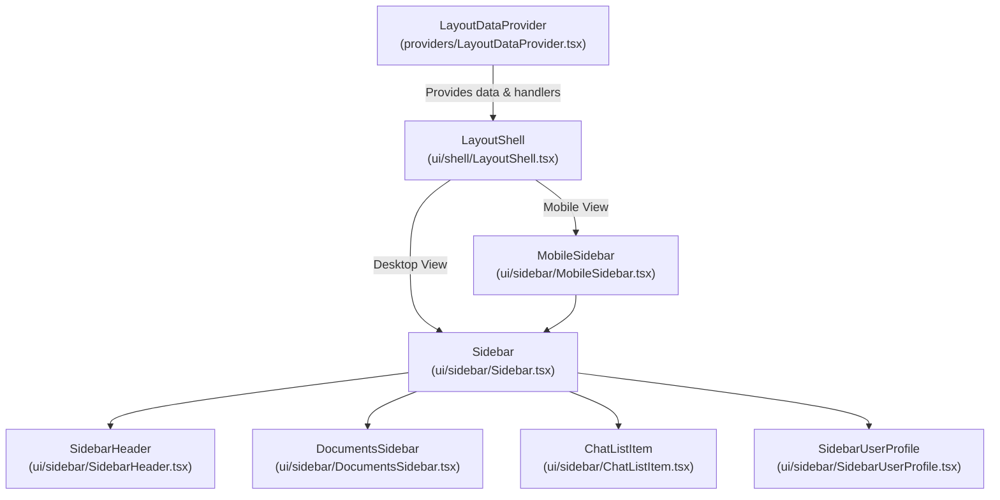
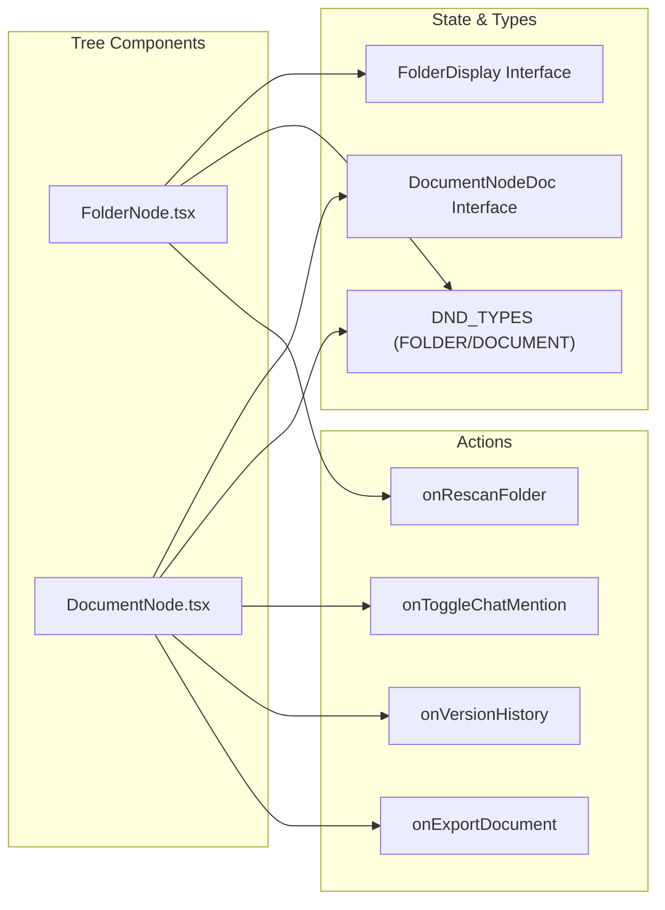

<!-- source: DeepWiki mcp.deepwiki.com · repo MODSetter/SurfSense · page 14.3 Sidebar and Navigation · fetched 2026-10-29 -->

# Sidebar and Navigation

Relevant source files

The following files were used as context for generating this wiki page:

- [surfsense_web/components/connectors-marketing/api-mcp-tabs.tsx](surfsense_web/components/connectors-marketing/api-mcp-tabs.tsx)
- [surfsense_web/components/documents/DocumentNode.tsx](surfsense_web/components/documents/DocumentNode.tsx)
- [surfsense_web/components/documents/FolderNode.tsx](surfsense_web/components/documents/FolderNode.tsx)
- [surfsense_web/components/documents/FolderTreeView.tsx](surfsense_web/components/documents/FolderTreeView.tsx)
- [surfsense_web/components/layout/index.ts](surfsense_web/components/layout/index.ts)
- [surfsense_web/components/layout/providers/FreeLayoutDataProvider.tsx](surfsense_web/components/layout/providers/FreeLayoutDataProvider.tsx)
- [surfsense_web/components/layout/providers/LayoutDataProvider.tsx](surfsense_web/components/layout/providers/LayoutDataProvider.tsx)
- [surfsense_web/components/layout/types/layout.types.ts](surfsense_web/components/layout/types/layout.types.ts)
- [surfsense_web/components/layout/ui/icon-rail/IconRail.tsx](surfsense_web/components/layout/ui/icon-rail/IconRail.tsx)
- [surfsense_web/components/layout/ui/index.ts](surfsense_web/components/layout/ui/index.ts)
- [surfsense_web/components/layout/ui/shell/LayoutShell.tsx](surfsense_web/components/layout/ui/shell/LayoutShell.tsx)
- [surfsense_web/components/layout/ui/sidebar/AllChatsSidebar.tsx](surfsense_web/components/layout/ui/sidebar/AllChatsSidebar.tsx)
- [surfsense_web/components/layout/ui/sidebar/ChatListItem.tsx](surfsense_web/components/layout/ui/sidebar/ChatListItem.tsx)
- [surfsense_web/components/layout/ui/sidebar/DocumentsSidebar.tsx](surfsense_web/components/layout/ui/sidebar/DocumentsSidebar.tsx)
- [surfsense_web/components/layout/ui/sidebar/MobileSidebar.tsx](surfsense_web/components/layout/ui/sidebar/MobileSidebar.tsx)
- [surfsense_web/components/layout/ui/sidebar/NavSection.tsx](surfsense_web/components/layout/ui/sidebar/NavSection.tsx)
- [surfsense_web/components/layout/ui/sidebar/NotificationsDropdown.tsx](surfsense_web/components/layout/ui/sidebar/NotificationsDropdown.tsx)
- [surfsense_web/components/layout/ui/sidebar/Sidebar.tsx](surfsense_web/components/layout/ui/sidebar/Sidebar.tsx)
- [surfsense_web/components/layout/ui/sidebar/SidebarButton.tsx](surfsense_web/components/layout/ui/sidebar/SidebarButton.tsx)
- [surfsense_web/components/layout/ui/sidebar/SidebarHeader.tsx](surfsense_web/components/layout/ui/sidebar/SidebarHeader.tsx)
- [surfsense_web/components/layout/ui/sidebar/SidebarSection.tsx](surfsense_web/components/layout/ui/sidebar/SidebarSection.tsx)
- [surfsense_web/components/layout/ui/sidebar/SidebarUserProfile.tsx](surfsense_web/components/layout/ui/sidebar/SidebarUserProfile.tsx)
- [surfsense_web/components/layout/ui/sidebar/index.ts](surfsense_web/components/layout/ui/sidebar/index.ts)
- [surfsense_web/components/mcp/agent-setup-tabs.tsx](surfsense_web/components/mcp/agent-setup-tabs.tsx)
- [surfsense_web/components/mcp/connect-agent-dialog.tsx](surfsense_web/components/mcp/connect-agent-dialog.tsx)
- [surfsense_web/components/ui/context-menu.tsx](surfsense_web/components/ui/context-menu.tsx)
- [surfsense_web/hooks/use-documents-processing.ts](surfsense_web/hooks/use-documents-processing.ts)
- [surfsense_web/lib/mcp/clients.ts](surfsense_web/lib/mcp/clients.ts)

This page documents the sidebar and navigation system in the SurfSense frontend application. The sidebar provides workspace navigation, chat history access, and quick actions within a SearchSpace context.

## Purpose and Scope

The sidebar serves as the primary navigation interface for users within a workspace. It provides:
- **SearchSpace Selector:** Switch between different workspaces and access workspace settings.
- **New Chat Creation:** Quick access to start new AI agent conversations.
- **Platform Navigation:** Links to Documents, Automations, Artifacts, and Playground.
- **Organized Chat History:** Recent threads with management capabilities (rename, archive, delete).
- **Document Explorer:** Hierarchical view of folders and files within the workspace.
- **User Profile:** Account management, theme switching, and language selection.

## Component Architecture

The sidebar system is organized into specialized components managed by the `LayoutDataProvider` [surfsense_web/components/layout/providers/LayoutDataProvider.tsx:65-69]().

### Visual Component Hierarchy
The following diagram maps high-level UI concepts to their respective React implementation files.

**Sources:** [surfsense_web/components/layout/providers/LayoutDataProvider.tsx:65-69](), [surfsense_web/components/layout/ui/shell/LayoutShell.tsx:28-30](), [surfsense_web/components/layout/ui/sidebar/Sidebar.tsx:95-133](), [surfsense_web/components/layout/ui/sidebar/MobileSidebar.tsx:64-100]()

## Data Flow and State Management

The `LayoutDataProvider` orchestrates data fetching using TanStack Query and state management via Jotai atoms.

### Thread Management
Threads are fetched using `fetchThreads` [surfsense_web/components/layout/providers/LayoutDataProvider.tsx:116-120]() and managed through custom hooks:
- `useArchiveThread` [surfsense_web/components/layout/providers/LayoutDataProvider.tsx:95-95]()
- `useDeleteThread` [surfsense_web/components/layout/providers/LayoutDataProvider.tsx:96-96]()
- `useRenameThread` [surfsense_web/components/layout/providers/LayoutDataProvider.tsx:97-97]()

### Workspace Context
The current workspace is identified by the `workspaceId` param [surfsense_web/components/layout/providers/LayoutDataProvider.tsx:60-60](). The provider fetches workspace details [surfsense_web/components/layout/providers/LayoutDataProvider.tsx:109-113]() and manages workspace-specific unread counts for notifications using `getBatchUnreadCounts` [surfsense_web/components/layout/providers/LayoutDataProvider.tsx:130-135]().

**Sources:** [surfsense_web/components/layout/providers/LayoutDataProvider.tsx:90-135](), [surfsense_web/lib/chat/thread-persistence.ts:46-46]()

## Documents Sidebar and Folder Tree

The `DocumentsSidebar` [surfsense_web/components/layout/ui/sidebar/DocumentsSidebar.tsx:111-121]() provides a hierarchical view of the workspace knowledge base. It includes specialized logic for "Memory" documents [surfsense_web/components/layout/ui/sidebar/DocumentsSidebar.tsx:77-97]().

### FolderTreeView Implementation
The document tree is rendered using `FolderTreeView` [surfsense_web/components/documents/FolderTreeView.tsx:61-87](), which supports:
- **Drag and Drop:** Powered by `react-dnd` [surfsense_web/components/documents/FolderTreeView.tsx:6-7]() for reordering folders and moving documents.
- **Hierarchical Rendering:** Recursive display of `FolderNode` [surfsense_web/components/documents/FolderNode.tsx:102-127]() and `DocumentNode` [surfsense_web/components/documents/DocumentNode.tsx:72-88]().
- **Chat Mentions:** Documents can be toggled for inclusion in the AI agent's context using `onToggleChatMention` [surfsense_web/components/documents/DocumentNode.tsx:98-102]().
- **Status Indicators:** Real-time visual feedback for document processing states (pending, processing, failed) [surfsense_web/components/documents/DocumentNode.tsx:180-217]().

### Code Entity Mapping
The following diagram maps the logical tree structures to the underlying code entities.

**Sources:** [surfsense_web/components/documents/FolderTreeView.tsx:61-87](), [surfsense_web/components/documents/DocumentNode.tsx:180-217](), [surfsense_web/components/documents/FolderNode.tsx:41-55](), [surfsense_web/components/documents/DocumentNode.tsx:46-52]()

## Sidebar Sections

### Chat History
The `ChatListItem` component [surfsense_web/components/layout/ui/sidebar/ChatListItem.tsx:32-43]() represents individual conversation threads. It features a typewriter effect for names using `useTypewriter` [surfsense_web/components/layout/ui/sidebar/ChatListItem.tsx:49-49]() and a context menu for management actions [surfsense_web/components/layout/ui/sidebar/ChatListItem.tsx:93-152](). For full history, the `AllChatsSidebar` [surfsense_web/components/layout/ui/sidebar/AllChatsSidebar.tsx:55-56]() provides search and filtering.

### Navigation Items
The sidebar explicitly separates functional items by filtering the `navItems` array [surfsense_web/components/layout/ui/sidebar/Sidebar.tsx:141-167]():
- **Automations:** `navItems.find((item) => item.url.endsWith("/automations"))` [surfsense_web/components/layout/ui/sidebar/Sidebar.tsx:141-144]().
- **Artifacts:** `navItems.find((item) => item.url.endsWith("/artifacts"))` [surfsense_web/components/layout/ui/sidebar/Sidebar.tsx:145-148]().
- **Playground:** `navItems.find((item) => item.url.endsWith("/playground"))` [surfsense_web/components/layout/ui/sidebar/Sidebar.tsx:153-156]().

**Sources:** [surfsense_web/components/layout/ui/sidebar/Sidebar.tsx:141-167](), [surfsense_web/components/layout/ui/sidebar/ChatListItem.tsx:93-152](), [surfsense_web/components/layout/ui/sidebar/AllChatsSidebar.tsx:55-56]()

## User Profile and Preferences

The `SidebarUserProfile` [surfsense_web/components/layout/ui/sidebar/SidebarUserProfile.tsx:135-145]() handles user-centric configurations:

| Feature | Implementation | Options |
| :--- | :--- | :--- |
| **Theme** | `handleThemeChange` | Light, Dark, System [surfsense_web/components/layout/ui/sidebar/SidebarUserProfile.tsx:59-63]() |
| **Language** | `handleLanguageChange` | EN, ES, PT, HI, ZH, KO [surfsense_web/components/layout/ui/sidebar/SidebarUserProfile.tsx:49-56]() |
| **Desktop CTA** | `showDownloadCta` | Prompts web users to download the Electron app [surfsense_web/components/layout/ui/sidebar/SidebarUserProfile.tsx:158-158]() |
| **Announcements** | `onAnnouncements` | Access to product updates via `announcementUnreadCount` [surfsense_web/components/layout/ui/sidebar/SidebarUserProfile.tsx:138-139]() |

**Sources:** [surfsense_web/components/layout/ui/sidebar/SidebarUserProfile.tsx:49-63](), [surfsense_web/components/layout/ui/sidebar/SidebarUserProfile.tsx:158-177]()

## Mobile and Desktop Adaptation

SurfSense uses a responsive design strategy to ensure navigation is functional across devices.

- **Desktop:** Features a resizable sidebar with a minimum width defined by `SIDEBAR_MIN_WIDTH` [surfsense_web/components/layout/ui/sidebar/Sidebar.tsx:21-21](). It supports a collapsed state showing only icons [surfsense_web/components/layout/ui/sidebar/Sidebar.tsx:178-178]().
- **Mobile:** Uses the `MobileSidebar` component [surfsense_web/components/layout/ui/sidebar/MobileSidebar.tsx:64-100](), which renders a `Sheet` (drawer). It includes a vertical workspaces rail on the left using `WorkspaceAvatar` [surfsense_web/components/layout/ui/sidebar/MobileSidebar.tsx:128-142]() and the standard sidebar content on the right [surfsense_web/components/layout/ui/sidebar/MobileSidebar.tsx:191-192]().

**Sources:** [surfsense_web/components/layout/ui/shell/LayoutShell.tsx:28-28](), [surfsense_web/components/layout/ui/sidebar/MobileSidebar.tsx:128-192](), [surfsense_web/components/layout/ui/sidebar/Sidebar.tsx:21-21]()

---

