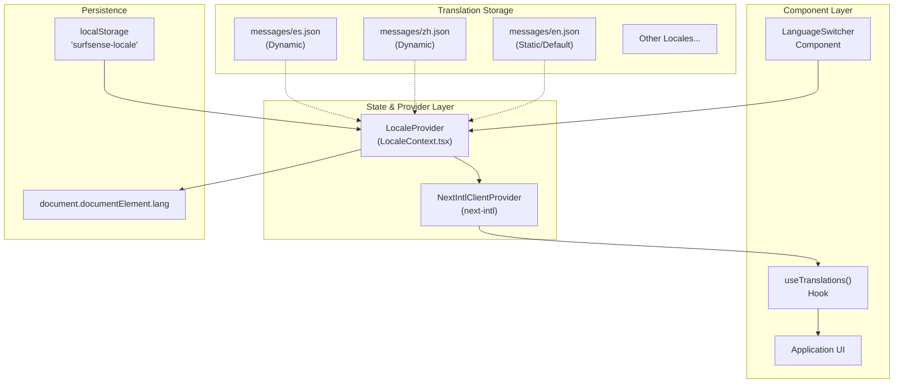
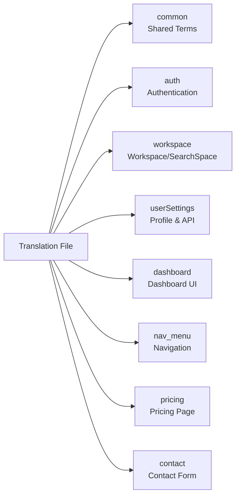
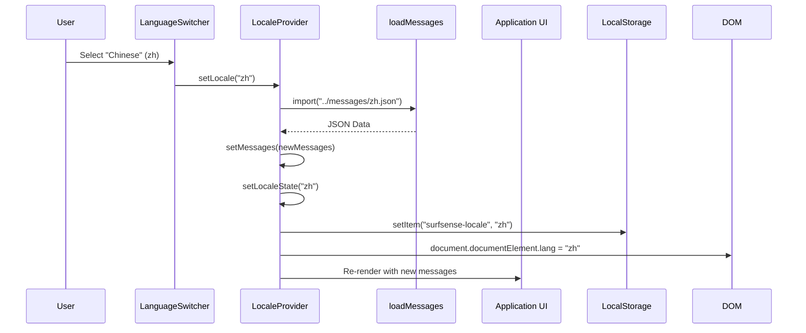

<!-- source: DeepWiki mcp.deepwiki.com · repo MODSetter/SurfSense · page 14.4 Internationalization · fetched 2026-10-29 -->

# Internationalization

<details>
<summary>Relevant source files</summary>

The following files were used as context for generating this wiki page:

- [surfsense_web/components/LanguageSwitcher.tsx](surfsense_web/components/LanguageSwitcher.tsx)
- [surfsense_web/components/assistant-ui/document-upload-popup.tsx](surfsense_web/components/assistant-ui/document-upload-popup.tsx)
- [surfsense_web/components/sources/DocumentUploadTab.tsx](surfsense_web/components/sources/DocumentUploadTab.tsx)
- [surfsense_web/components/ui/animated-tabs.tsx](surfsense_web/components/ui/animated-tabs.tsx)
- [surfsense_web/components/ui/checkbox.tsx](surfsense_web/components/ui/checkbox.tsx)
- [surfsense_web/components/ui/dropdown-menu.tsx](surfsense_web/components/ui/dropdown-menu.tsx)
- [surfsense_web/components/ui/separator.tsx](surfsense_web/components/ui/separator.tsx)
- [surfsense_web/components/ui/toggle-group.tsx](surfsense_web/components/ui/toggle-group.tsx)
- [surfsense_web/components/ui/toggle.tsx](surfsense_web/components/ui/toggle.tsx)
- [surfsense_web/components/ui/tooltip.tsx](surfsense_web/components/ui/tooltip.tsx)
- [surfsense_web/contexts/LocaleContext.tsx](surfsense_web/contexts/LocaleContext.tsx)
- [surfsense_web/i18n/routing.ts](surfsense_web/i18n/routing.ts)
- [surfsense_web/messages/en.json](surfsense_web/messages/en.json)
- [surfsense_web/messages/es.json](surfsense_web/messages/es.json)
- [surfsense_web/messages/hi.json](surfsense_web/messages/hi.json)
- [surfsense_web/messages/ko.json](surfsense_web/messages/ko.json)
- [surfsense_web/messages/pt.json](surfsense_web/messages/pt.json)
- [surfsense_web/messages/zh.json](surfsense_web/messages/zh.json)

</details>


## Purpose and Scope

This document describes the internationalization (i18n) system implemented in SurfSense's frontend application. It covers the translation file structure, provider configuration, usage of translation hooks in components, and the language switching mechanism. The system supports English, Spanish, Portuguese, Hindi, Chinese, and Korean using `next-intl` integration with a custom dynamic loading strategy for optimized performance.

## System Overview

SurfSense implements client-side internationalization using a combination of a custom `LocaleContext` and the `next-intl` library. This hybrid approach allows for immediate availability of English (default) while dynamically loading other language bundles on demand to reduce the initial bundle size.

### Architecture Diagram



**Sources:** [surfsense_web/contexts/LocaleContext.tsx:1-28](), [surfsense_web/contexts/LocaleContext.tsx:40-89](), [surfsense_web/messages/en.json:1-34](), [surfsense_web/messages/zh.json:1-34]()

## Translation File Structure

Translation files are organized as hierarchical JSON objects with namespaced keys. Each namespace groups related translations for specific features or components.

### Supported Locales

| Locale Code | Language | Implementation |
|-----------|----------|-------------|
| `en` | English | Default, Synchronous load |
| `zh` | Chinese (Simplified) | Dynamic load |
| `es` | Spanish | Dynamic load |
| `pt` | Portuguese | Dynamic load |
| `hi` | Hindi | Dynamic load |
| `ko` | Korean | Dynamic load |

**Sources:** [surfsense_web/contexts/LocaleContext.tsx:7-28]()

### Namespace Structure

Translation files use a nested structure with the following top-level namespaces:



**Sources:** [surfsense_web/messages/en.json:2-240](), [surfsense_web/messages/zh.json:2-240]()

### Pluralization and Interpolation

The system supports ICU MessageFormat for dynamic content, particularly for counts in workspaces and members.

| Feature | Key Example | JSON Pattern |
|---------|-------------|--------------|
| Interpolation | `sign_in_with` | `"sign_in_with": "Sign in with {provider}"` |
| Pluralization | `workspaces_count` | `"{count, plural, =0 {No workspaces} =1 {1 workspace} other {# workspaces}}"` |

**Sources:** [surfsense_web/messages/en.json:48-48](), [surfsense_web/messages/en.json:92-92](), [surfsense_web/messages/en.json:95-95]()

## Provider Configuration

The i18n system is configured through a custom `LocaleProvider` which manages the lifecycle of translation data.

### Locale Context Implementation

The `LocaleProvider` in `surfsense_web/contexts/LocaleContext.tsx` performs several critical functions:

1.  **Hydration Safety**: Always starts with `en` locale and `enMessages` to avoid hydration mismatches between server and client [surfsense_web/contexts/LocaleContext.tsx:43-45]().
2.  **Dynamic Loading**: Uses a `loadMessages` helper to asynchronously import JSON files based on the user's selection [surfsense_web/contexts/LocaleContext.tsx:13-28]().
3.  **Persistence**: Synchronizes with `localStorage` using the key `surfsense-locale` [surfsense_web/contexts/LocaleContext.tsx:38-51]().
4.  **DOM Sync**: Automatically updates the `lang` attribute on the `<html>` element whenever the locale changes [surfsense_web/contexts/LocaleContext.tsx:77-82]().

**Sources:** [surfsense_web/contexts/LocaleContext.tsx:40-98]()

## Using Translations in Components

Components access translations using the `useTranslations` hook from `next-intl`.

### Component Example: Document Upload

The `DocumentUploadTab` demonstrates how translations are consumed in feature-specific components.

```typescript
// surfsense_web/components/sources/DocumentUploadTab.tsx
import { useTranslations } from "next-intl";

export function DocumentUploadTab({ workspaceId }: Props) {
    const t = useTranslations("upload_documents");
    
    // Usage in error handling
    toast.error(t("file_too_large"), {
        description: t("file_too_large_desc", {
            name: oversized[0].name,
            maxMB: 500,
        }),
    });
}
```

**Sources:** [surfsense_web/components/sources/DocumentUploadTab.tsx:6-6](), [surfsense_web/components/sources/DocumentUploadTab.tsx:135-135](), [surfsense_web/components/sources/DocumentUploadTab.tsx:175-180]()

### Key Patterns in UI Components

Many UI components are designed to be locale-agnostic by accepting translated strings as children, while others (like the Upload Popup) contain hardcoded strings that are candidates for further i18n migration.

| Component | Translation Method | File Reference |
|-----------|--------------------|----------------|
| `DocumentUploadTab` | `useTranslations("upload_documents")` | [surfsense_web/components/sources/DocumentUploadTab.tsx:135]() |
| `Tooltip` | Accepts `children` (translated elsewhere) | [surfsense_web/components/ui/tooltip.tsx:62-83]() |
| `DropdownMenu` | Accepts `children` | [surfsense_web/components/ui/dropdown-menu.tsx:25-43]() |

## Language Switching Flow

The `LanguageSwitcher` component interacts with the `LocaleContext` to trigger a global update.



**Sources:** [surfsense_web/contexts/LocaleContext.tsx:64-74](), [surfsense_web/contexts/LocaleContext.tsx:13-28]()

## Implementation Best Practices

### Adding New Locales
To add a new language to SurfSense:
1.  Create a new JSON file in `surfsense_web/messages/`.
2.  Update the `Locale` type definition in `LocaleContext.tsx` [surfsense_web/contexts/LocaleContext.tsx:7-7]().
3.  Add a case to the `loadMessages` function [surfsense_web/contexts/LocaleContext.tsx:13-28]().
4.  Update the `useEffect` validation check to include the new locale code [surfsense_web/contexts/LocaleContext.tsx:52-52]().

### Handling Large Files
The system enforces batching and size limits for uploads, with translated error messages:
- `MAX_FILE_SIZE_MB`: 500MB [surfsense_web/components/sources/DocumentUploadTab.tsx:124-124]()
- `FOLDER_BATCH_SIZE_BYTES`: 20MB [surfsense_web/components/sources/DocumentUploadTab.tsx:121-121]()

**Sources:** [surfsense_web/components/sources/DocumentUploadTab.tsx:121-125](), [surfsense_web/components/sources/DocumentUploadTab.tsx:173-181]()

---

