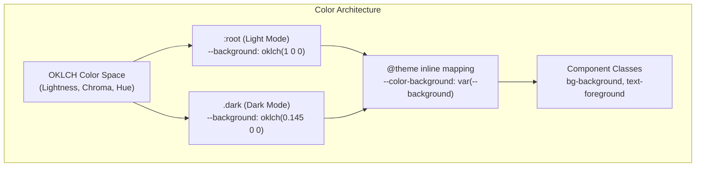
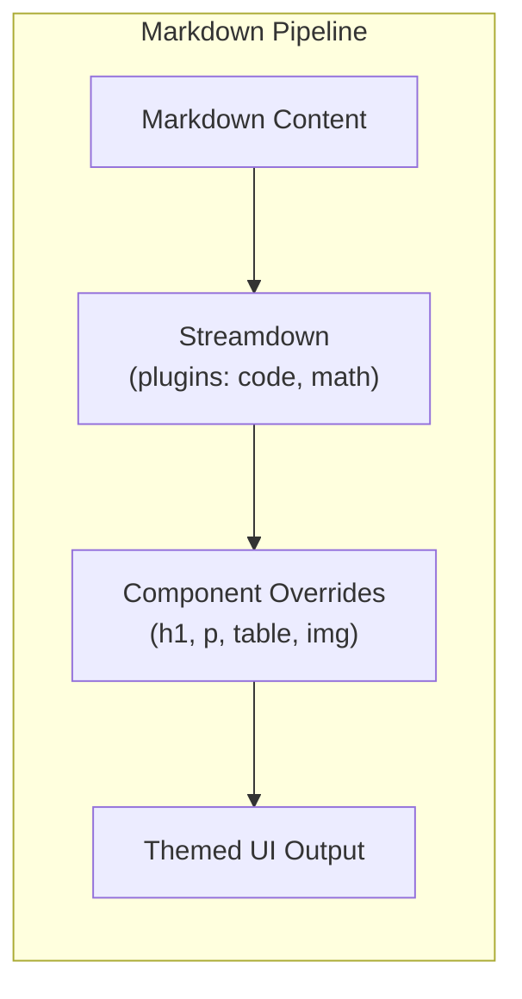

<!-- source: DeepWiki mcp.deepwiki.com · repo MODSetter/SurfSense · page 14.5 Styling System · fetched 2026-10-29 -->

# Styling System

<details>
<summary>Relevant source files</summary>

The following files were used as context for generating this wiki page:

- [VERSION](VERSION)
- [surfsense_backend/pyproject.toml](surfsense_backend/pyproject.toml)
- [surfsense_backend/uv.lock](surfsense_backend/uv.lock)
- [surfsense_browser_extension/package.json](surfsense_browser_extension/package.json)
- [surfsense_desktop/package.json](surfsense_desktop/package.json)
- [surfsense_web/app/docs/layout.tsx](surfsense_web/app/docs/layout.tsx)
- [surfsense_web/app/globals.css](surfsense_web/app/globals.css)
- [surfsense_web/app/layout.config.tsx](surfsense_web/app/layout.config.tsx)
- [surfsense_web/components/LanguageSwitcher.tsx](surfsense_web/components/LanguageSwitcher.tsx)
- [surfsense_web/components/markdown-viewer.tsx](surfsense_web/components/markdown-viewer.tsx)
- [surfsense_web/components/ui/animated-tabs.tsx](surfsense_web/components/ui/animated-tabs.tsx)
- [surfsense_web/components/ui/checkbox.tsx](surfsense_web/components/ui/checkbox.tsx)
- [surfsense_web/components/ui/dropdown-menu.tsx](surfsense_web/components/ui/dropdown-menu.tsx)
- [surfsense_web/components/ui/separator.tsx](surfsense_web/components/ui/separator.tsx)
- [surfsense_web/components/ui/toggle-group.tsx](surfsense_web/components/ui/toggle-group.tsx)
- [surfsense_web/components/ui/toggle.tsx](surfsense_web/components/ui/toggle.tsx)
- [surfsense_web/components/ui/tooltip.tsx](surfsense_web/components/ui/tooltip.tsx)
- [surfsense_web/contexts/LocaleContext.tsx](surfsense_web/contexts/LocaleContext.tsx)
- [surfsense_web/i18n/routing.ts](surfsense_web/i18n/routing.ts)
- [surfsense_web/messages/ko.json](surfsense_web/messages/ko.json)
- [surfsense_web/package.json](surfsense_web/package.json)
- [surfsense_web/pnpm-lock.yaml](surfsense_web/pnpm-lock.yaml)

</details>


This document describes the frontend styling architecture, including the Tailwind CSS v4 configuration, OKLCH color system, theme management, dark mode support, and component styling patterns. The styling system provides a consistent, accessible, and customizable visual design across the entire application.

---

## Technology Stack

The SurfSense frontend uses a modern CSS architecture built on the following technologies:

| Technology | Version | Purpose |
|------------|---------|---------|
| Tailwind CSS | v4.1.11 | Core utility-first CSS framework [surfsense_web/package.json:180]() |
| Fumadocs UI | ^16.3.1 | Documentation-specific UI components and styling [surfsense_web/package.json:110]() |
| next-themes | ^0.4.6 | Theme provider with system detection [surfsense_web/package.json:125]() |
| Radix UI | Latest | Unstyled accessible primitives (Accordion, Dialog, etc.) [surfsense_web/package.json:60-81]() |
| tailwindcss-animate | ^1.0.7 | Pre-built animation utilities [surfsense_web/package.json:155]() |

**Sources:** [surfsense_web/package.json:31-185](), [surfsense_web/app/globals.css:1-5]()

---

## Tailwind CSS v4 Configuration

### Import Structure

SurfSense utilizes Tailwind CSS v4, which moves configuration into the CSS entry point using `@import` and `@theme` directives. This version eliminates the need for a separate `tailwind.config.js` in many cases, favoring CSS-native variables.

```css
@import "tailwindcss";
@import "fumadocs-ui/css/neutral.css";
@import "fumadocs-ui/css/preset.css";

@plugin "tailwindcss-animate";
@plugin "tailwind-scrollbar-hide";

@custom-variant dark (&:is(.dark *));

@theme {
	--font-sans: var(--font-geist-sans);
	--font-mono: var(--font-geist-mono);
}
```

Key aspects:
- **Directives:** `@import "tailwindcss"` replaces the legacy `@tailwind` directives [surfsense_web/app/globals.css:1]().
- **Plugins:** Loaded via the `@plugin` directive, including animation and scrollbar utilities [surfsense_web/app/globals.css:5-7]().
- **Custom Variants:** The `dark` variant is explicitly defined to target the `.dark` class on parent elements [surfsense_web/app/globals.css:9]().
- **Font Integration:** Geist Sans and Geist Mono are mapped to standard Tailwind font families [surfsense_web/app/globals.css:12-13]().

**Sources:** [surfsense_web/app/globals.css:1-14]()

---

## OKLCH Color System

### Overview

SurfSense uses the OKLCH color space for its design tokens. OKLCH provides perceptually uniform lightness, making it superior to HSL for accessibility and theme consistency. Lightness is represented as a value from 0 to 1, Chroma as the intensity of the color, and Hue as the angle on the color wheel.



### Color Variables

The system defines semantic tokens that adapt based on the active theme.

| Token | Light Mode (OKLCH) | Dark Mode (OKLCH) |
|-------|--------------------|-------------------|
| `--background` | `1 0 0` | `0.145 0 0` |
| `--foreground` | `0.145 0 0` | `0.985 0 0` |
| `--primary` | `0.205 0 0` | `0.985 0 0` |
| `--muted` | `0.97 0 0` | `0.269 0 0` |
| `--accent` | `0.97 0 0` | `0.269 0 0` |
| `--destructive` | `0.577 0.245 27.325` | `0.577 0.245 27.325` |

**Sources:** [surfsense_web/app/globals.css:16-59](), [surfsense_web/app/globals.css:66-108]()

### UI Surface Tokens

SurfSense introduces specific surface tokens for its complex layout to differentiate between panels and navigation rails:
- `--panel`: Unified surface used by the left sidebar, main panel, and right panel [surfsense_web/app/globals.css:44]().
- `--rail`: Distinct (lighter in light mode, darker in dark mode) surface used by the leftmost icon rail [surfsense_web/app/globals.css:46, 95]().
- `--sidebar`: Maps to the panel surface for consistency [surfsense_web/app/globals.css:47]().

**Sources:** [surfsense_web/app/globals.css:43-55](), [surfsense_web/app/globals.css:92-104]()

---

## Theme Token Mapping

The `@theme inline` block maps CSS variables to Tailwind utility classes, allowing for dynamic updates without re-generating the CSS bundle. This block serves as the bridge between the custom OKLCH variables and Tailwind's utility class generator.

```css
@theme inline {
	--color-background: var(--background);
	--color-foreground: var(--foreground);
	--color-primary: var(--primary);
	--color-accent: var(--accent);
	--color-sidebar: var(--sidebar);
	--radius-lg: var(--radius);
}
```

**Sources:** [surfsense_web/app/globals.css:110-155]()

---

## Component Styling Patterns

### Compound UI Components

UI components are built using Radix UI primitives and styled with utility classes. For example, the `DropdownMenu` utilizes standard theme tokens for its background and borders, ensuring it respects the active dark/light mode state.

```tsx
function DropdownMenuContent({
	className,
	sideOffset = 4,
	...props
}: React.ComponentProps<typeof DropdownMenuPrimitive.Content>) {
	return (
		<DropdownMenuPrimitive.Portal>
			<DropdownMenuPrimitive.Content
				className={cn(
					"bg-popover text-popover-foreground border border-popover-border ...",
					className
				)}
				{...props}
			/>
		</DropdownMenuPrimitive.Portal>
	);
}
```

**Sources:** [surfsense_web/components/ui/dropdown-menu.tsx:25-43]()

### Specialized Component Systems

#### 1. Markdown Styling
Markdown content is rendered using `MarkdownViewer`, which maps standard HTML tags to themed UI components.



- **Math Support:** Normalizes various LaTeX delimiters (`\\begin{equation}`, `\\[...\\\]`, etc.) to Streamdown's double-dollar syntax [surfsense_web/components/markdown-viewer.tsx:38-60]().
- **Citations:** Integrates with the knowledge base via `preprocessCitationMarkdown` and `processChildrenWithCitations` to render interactive badges [surfsense_web/components/markdown-viewer.tsx:72-89]().

**Sources:** [surfsense_web/components/markdown-viewer.tsx:11-19](), [surfsense_web/components/markdown-viewer.tsx:91-193]()

#### 2. Animated Components
The system includes high-quality interactive components like `AnimatedTabs`. These components use a `TabsContext` to manage active state and `XScrollable` for drag-scrolling behavior.

- **`XScrollable`**: Uses `ResizeObserver` to determine if content can scroll and applies a linear-gradient mask to indicate overflow [surfsense_web/components/ui/animated-tabs.tsx:83-140]().
- **`AnimatedTabs`**: Provides variants like `pills` and `underlined` with smooth transitions [surfsense_web/components/ui/animated-tabs.tsx:46-56]().

**Sources:** [surfsense_web/components/ui/animated-tabs.tsx:21-34](), [surfsense_web/components/ui/animated-tabs.tsx:143-172]()

---

## Internationalization (i18n) Styling

The styling system responds to the application's locale and configuration. The system can hide specific UI elements based on the authentication type configured on the `<html>` tag.

```css
html[data-surfsense-auth-type="GOOGLE"] .runtime-auth-local,
html[data-surfsense-auth-type="LOCAL"] .runtime-auth-google {
	display: none;
}
```

**Sources:** [surfsense_web/app/globals.css:61-64]()

---

## Dark Mode and Hover Logic

The system includes specialized hooks to ensure styling is appropriate for the device capability:
- **`useCanHover`**: Detects if the pointer supports hover (fine pointer) using `window.matchMedia("(hover: hover) and (pointer: fine)")`. This is used to disable tooltips on touch devices where hover states can be sticky or confusing [surfsense_web/components/ui/tooltip.tsx:9-22]().
- **Conditional Tooltips**: The `Tooltip` component uses the `canHover` state to determine if it should even register open/close events [surfsense_web/components/ui/tooltip.tsx:39-56]().

**Sources:** [surfsense_web/components/ui/tooltip.tsx:1-56]()

---

