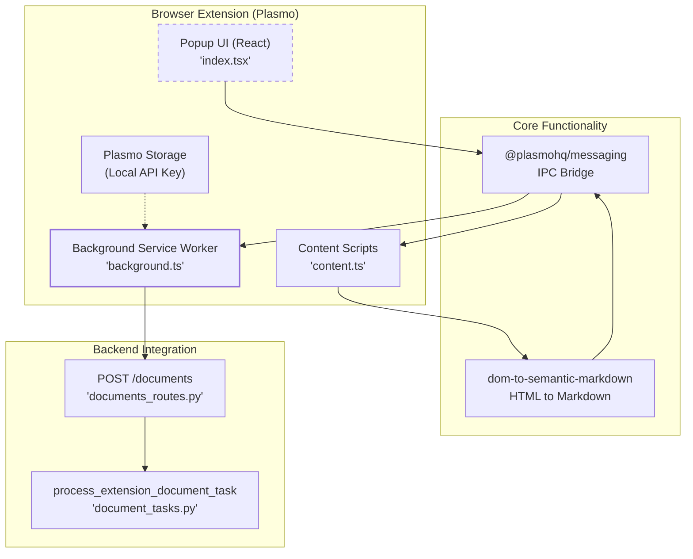
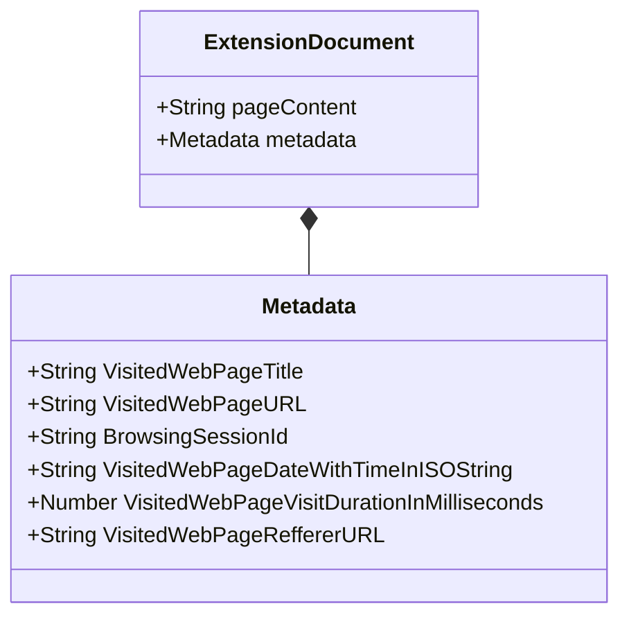

<!-- source: DeepWiki mcp.deepwiki.com · repo MODSetter/SurfSense · page 15 Browser Extension · fetched 2026-10-29 -->

# Browser Extension

<details>
<summary>Relevant source files</summary>

The following files were used as context for generating this wiki page:

- [VERSION](VERSION)
- [surfsense_backend/.env.example](surfsense_backend/.env.example)
- [surfsense_backend/app/config/__init__.py](surfsense_backend/app/config/__init__.py)
- [surfsense_backend/app/connectors/composio_connector.py](surfsense_backend/app/connectors/composio_connector.py)
- [surfsense_backend/app/db.py](surfsense_backend/app/db.py)
- [surfsense_backend/app/routes/__init__.py](surfsense_backend/app/routes/__init__.py)
- [surfsense_backend/app/routes/composio_routes.py](surfsense_backend/app/routes/composio_routes.py)
- [surfsense_backend/app/routes/documents_routes.py](surfsense_backend/app/routes/documents_routes.py)
- [surfsense_backend/app/routes/search_source_connectors_routes.py](surfsense_backend/app/routes/search_source_connectors_routes.py)
- [surfsense_backend/app/schemas/documents.py](surfsense_backend/app/schemas/documents.py)
- [surfsense_backend/app/schemas/search_source_connector.py](surfsense_backend/app/schemas/search_source_connector.py)
- [surfsense_backend/app/services/composio_service.py](surfsense_backend/app/services/composio_service.py)
- [surfsense_backend/app/tasks/celery_tasks/connector_tasks.py](surfsense_backend/app/tasks/celery_tasks/connector_tasks.py)
- [surfsense_backend/app/tasks/celery_tasks/document_tasks.py](surfsense_backend/app/tasks/celery_tasks/document_tasks.py)
- [surfsense_backend/app/tasks/celery_tasks/schedule_checker_task.py](surfsense_backend/app/tasks/celery_tasks/schedule_checker_task.py)
- [surfsense_backend/app/tasks/celery_tasks/stale_notification_cleanup_task.py](surfsense_backend/app/tasks/celery_tasks/stale_notification_cleanup_task.py)
- [surfsense_backend/app/tasks/composio_indexer.py](surfsense_backend/app/tasks/composio_indexer.py)
- [surfsense_backend/app/tasks/connector_indexers/__init__.py](surfsense_backend/app/tasks/connector_indexers/__init__.py)
- [surfsense_backend/app/utils/periodic_scheduler.py](surfsense_backend/app/utils/periodic_scheduler.py)
- [surfsense_backend/pyproject.toml](surfsense_backend/pyproject.toml)
- [surfsense_backend/uv.lock](surfsense_backend/uv.lock)
- [surfsense_browser_extension/package.json](surfsense_browser_extension/package.json)
- [surfsense_desktop/package.json](surfsense_desktop/package.json)
- [surfsense_web/app/docs/layout.tsx](surfsense_web/app/docs/layout.tsx)
- [surfsense_web/app/globals.css](surfsense_web/app/globals.css)
- [surfsense_web/app/layout.config.tsx](surfsense_web/app/layout.config.tsx)
- [surfsense_web/components/markdown-viewer.tsx](surfsense_web/components/markdown-viewer.tsx)
- [surfsense_web/content/docs/manual-installation.mdx](surfsense_web/content/docs/manual-installation.mdx)
- [surfsense_web/package.json](surfsense_web/package.json)
- [surfsense_web/pnpm-lock.yaml](surfsense_web/pnpm-lock.yaml)

</details>


The SurfSense browser extension is a Manifest v3 extension built using the **Plasmo** framework. It enables users to capture and save web pages directly into SurfSense workspaces. Its primary function is to extract content from pages—including those behind authentication walls that standard crawlers cannot reach—and submit them to the ingestion pipeline.

---

## Purpose and Scope

The extension acts as a client-side bridge between the user's browser and the SurfSense backend.
- **Content Extraction**: Converts the active tab's DOM into semantic markdown.
- **Context Preservation**: Captures metadata such as URL, page title, and browsing session details.
- **Multi-Tenancy**: Allows users to select specific Workspaces (SearchSpaces) as the destination for captured content.
- **Authentication**: Uses API keys for secure communication with the backend.

**Sources:** [surfsense_browser_extension/package.json:1-5](), [surfsense_backend/app/routes/documents_routes.py:80-85]()

---

## Extension Architecture

The extension follows the Plasmo component model, separating logic into execution environments like Popups, Background Service Workers, and Content Scripts.



**Diagram: Browser Extension Data Flow and Code Entities**

**Sources:** [surfsense_browser_extension/package.json:21-36](), [surfsense_backend/app/routes/documents_routes.py:80-100]()

---

## Technical Implementation

### Content Extraction
The extension uses `dom-to-semantic-markdown` [surfsense_browser_extension/package.json:33]() to process the browser DOM. Unlike simple text scrapers, this library preserves structural elements (headers, lists, links) which are critical for the downstream RAG (Retrieval-Augmented Generation) process.

### Backend Data Flow
When a user triggers a capture, the extension sends a request to the `POST /documents` endpoint. The backend specifically checks for the `DocumentType.EXTENSION` [surfsense_backend/app/routes/documents_routes.py:83]() and routes the payload to a specialized background task.

| Code Entity | File Path | Role |
|:---|:---|:---|
| `DocumentType.EXTENSION` | [surfsense_backend/app/db.py:44]() | Enum value identifying browser-captured content. |
| `create_documents` | [surfsense_backend/app/routes/documents_routes.py:62]() | FastAPI route that receives extension JSON payloads. |
| `process_extension_document_task` | [surfsense_backend/app/routes/documents_routes.py:84-86]() | Celery task that processes the markdown and metadata. |

**Sources:** [surfsense_backend/app/routes/documents_routes.py:80-102](), [surfsense_backend/app/db.py:43-73]()

---

## Data Model: Extension Metadata

The extension captures a specific set of metadata defined in the `DocumentsCreate` schema. This allows SurfSense to track the origin of the knowledge.



**Diagram: Extension Metadata Schema mapping to Code**

When the backend receives this data, it extracts these specific fields to build the document's metadata dictionary before Celery serialization:
- `VisitedWebPageTitle` [surfsense_backend/app/routes/documents_routes.py:92]()
- `VisitedWebPageURL` [surfsense_backend/app/routes/documents_routes.py:93]()
- `BrowsingSessionId` [surfsense_backend/app/routes/documents_routes.py:94]()
- `VisitedWebPageDateWithTimeInISOString` [surfsense_backend/app/routes/documents_routes.py:95]()

**Sources:** [surfsense_backend/app/routes/documents_routes.py:85-103]()

---

## Configuration and Permissions

### Manifest Permissions
The extension requests specific permissions to ensure it can capture content across the web:
- `storage`: To persist the backend URL and API Key [surfsense_browser_extension/package.json:67]().
- `scripting`: To execute the extraction logic in the context of the webpage [surfsense_browser_extension/package.json:68]().
- `activeTab`: To access the currently focused tab [surfsense_browser_extension/package.json:70]().
- `<all_urls>`: Host permission required to scrape content from any domain [surfsense_browser_extension/package.json:59-61]().

**Sources:** [surfsense_browser_extension/package.json:58-71]()

---

## Development and Deployment

### Build Scripts
Plasmo handles the bundling and manifest generation for different browser targets.

```bash
# Development mode with hot-reload
pnpm dev

# Production build
pnpm build

# Package for Chrome Web Store / Firefox Add-ons
pnpm package
```

**Sources:** [surfsense_browser_extension/package.json:16-20]()

### Backend Integration Endpoint
The extension communicates with the backend via:
- `POST /documents`: Used to submit the `document_dict` containing `metadata` and `pageContent` [surfsense_backend/app/routes/documents_routes.py:62-100]().
- Authentication is handled via the `AuthContext` dependency [surfsense_backend/app/routes/documents_routes.py:66]().

**Sources:** [surfsense_backend/app/routes/documents_routes.py:59-100]()

---

