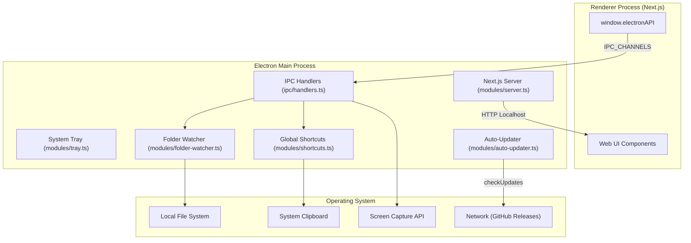
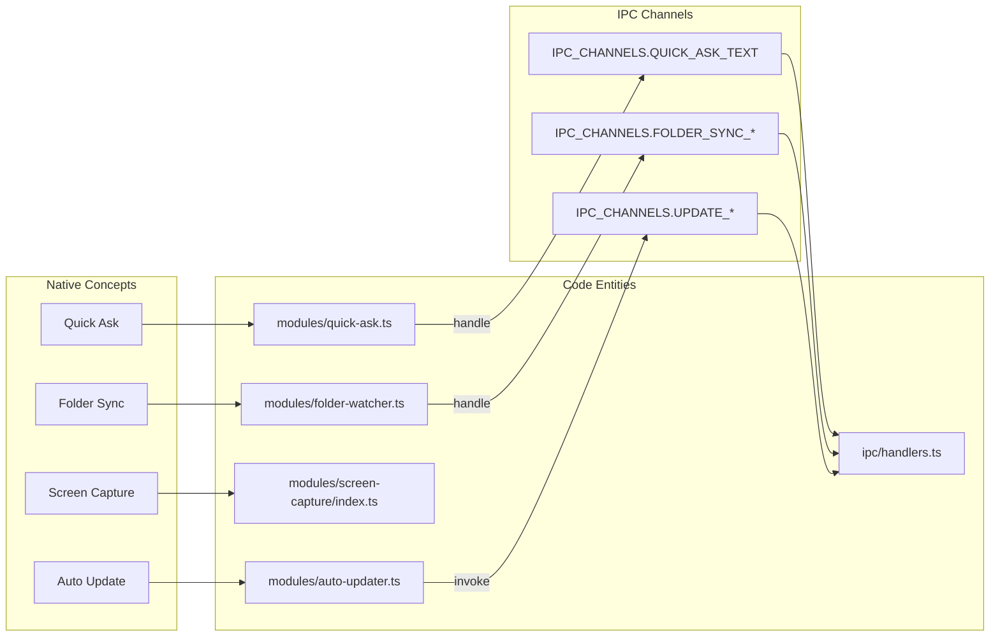

<!-- source: DeepWiki mcp.deepwiki.com · repo MODSetter/SurfSense · page 16 Desktop Application · fetched 2026-10-29 -->

# Desktop Application

Relevant source files

The following files were used as context for generating this wiki page:

- [.github/workflows/desktop-release.yml](.github/workflows/desktop-release.yml)
- [.github/workflows/docker-build.yml](.github/workflows/docker-build.yml)
- [scripts/bump-version.ps1](scripts/bump-version.ps1)
- [scripts/bump-version.sh](scripts/bump-version.sh)
- [surfsense_desktop/.env.example](surfsense_desktop/.env.example)
- [surfsense_desktop/assets/icon-128.png](surfsense_desktop/assets/icon-128.png)
- [surfsense_desktop/assets/iconTemplate.png](surfsense_desktop/assets/iconTemplate.png)
- [surfsense_desktop/assets/iconTemplate@2x.png](surfsense_desktop/assets/iconTemplate@2x.png)
- [surfsense_desktop/electron-builder.yml](surfsense_desktop/electron-builder.yml)
- [surfsense_desktop/pnpm-lock.yaml](surfsense_desktop/pnpm-lock.yaml)
- [surfsense_desktop/scripts/build-electron.mjs](surfsense_desktop/scripts/build-electron.mjs)
- [surfsense_desktop/src/ipc/channels.ts](surfsense_desktop/src/ipc/channels.ts)
- [surfsense_desktop/src/ipc/handlers.ts](surfsense_desktop/src/ipc/handlers.ts)
- [surfsense_desktop/src/main.ts](surfsense_desktop/src/main.ts)
- [surfsense_desktop/src/modules/analytics.ts](surfsense_desktop/src/modules/analytics.ts)
- [surfsense_desktop/src/modules/auto-launch.ts](surfsense_desktop/src/modules/auto-launch.ts)
- [surfsense_desktop/src/modules/auto-updater.ts](surfsense_desktop/src/modules/auto-updater.ts)
- [surfsense_desktop/src/modules/deep-links.ts](surfsense_desktop/src/modules/deep-links.ts)
- [surfsense_desktop/src/modules/folder-watcher.ts](surfsense_desktop/src/modules/folder-watcher.ts)
- [surfsense_desktop/src/modules/menu.ts](surfsense_desktop/src/modules/menu.ts)
- [surfsense_desktop/src/modules/oauth-page.ts](surfsense_desktop/src/modules/oauth-page.ts)
- [surfsense_desktop/src/modules/oauth.ts](surfsense_desktop/src/modules/oauth.ts)
- [surfsense_desktop/src/modules/permissions.ts](surfsense_desktop/src/modules/permissions.ts)
- [surfsense_desktop/src/modules/quick-ask.ts](surfsense_desktop/src/modules/quick-ask.ts)
- [surfsense_desktop/src/modules/screen-capture/index.ts](surfsense_desktop/src/modules/screen-capture/index.ts)
- [surfsense_desktop/src/modules/screen-capture/screen-region-picker.ts](surfsense_desktop/src/modules/screen-capture/screen-region-picker.ts)
- [surfsense_desktop/src/modules/screen-capture/screen-region-preload.ts](surfsense_desktop/src/modules/screen-capture/screen-region-preload.ts)
- [surfsense_desktop/src/modules/screen-capture/screenshot-assist.ts](surfsense_desktop/src/modules/screen-capture/screenshot-assist.ts)
- [surfsense_desktop/src/modules/screen-capture/window-picker-preload.ts](surfsense_desktop/src/modules/screen-capture/window-picker-preload.ts)
- [surfsense_desktop/src/modules/screen-capture/window-picker.ts](surfsense_desktop/src/modules/screen-capture/window-picker.ts)
- [surfsense_desktop/src/modules/server.ts](surfsense_desktop/src/modules/server.ts)
- [surfsense_desktop/src/modules/tray.ts](surfsense_desktop/src/modules/tray.ts)
- [surfsense_desktop/src/modules/window.ts](surfsense_desktop/src/modules/window.ts)
- [surfsense_desktop/src/preload.ts](surfsense_desktop/src/preload.ts)
- [surfsense_web/app/desktop/permissions/page.tsx](surfsense_web/app/desktop/permissions/page.tsx)
- [surfsense_web/hooks/use-session.ts](surfsense_web/hooks/use-session.ts)
- [surfsense_web/lib/auth-fetch.ts](surfsense_web/lib/auth-fetch.ts)
- [surfsense_web/types/window.d.ts](surfsense_web/types/window.d.ts)

The SurfSense Desktop Application is an Electron-based wrapper that extends the core Next.js web application with native system capabilities. It provides deep integration with the host operating system, enabling features like global keyboard shortcuts, local file system synchronization, and screen capture tools that are not possible in a standard web browser.

## Overview

The desktop application serves as a native shell for the SurfSense ecosystem. It manages a local Next.js server in production environments, handles secure token storage via a secret store, and exposes system-level APIs to the frontend via a structured Inter-Process Communication (IPC) layer.

### System Integration Map

The following diagram illustrates how the desktop application bridges the gap between the Next.js web frontend and the underlying operating system.

"Desktop System Integration"

Sources: [surfsense_desktop/src/main.ts:29-80](), [surfsense_desktop/src/ipc/handlers.ts:114-223](), [surfsense_desktop/src/modules/server.ts:38-95](), [surfsense_desktop/src/modules/auto-updater.ts:108-121]()

## Architecture Overview

The application follows the standard Electron architecture, separating concerns between the Main process (Node.js environment) and the Renderer process (Web environment).

*   **Main Process**: Entry point is `main.ts`. It manages the application lifecycle, system tray, and native modules like `chokidar` for file watching. [surfsense_desktop/src/main.ts:1-20]()
*   **Preload Script**: Defined in `preload.ts`, it uses `contextBridge` to securely expose specific IPC channels to the frontend under the `window.electronAPI` namespace. [surfsense_desktop/src/preload.ts:4-44]()
*   **Next.js Server**: In packaged builds, the app starts a local server to host the Next.js standalone output. [surfsense_desktop/src/modules/server.ts:48-61]()

For a deep dive into the process model and IPC design, see **[Desktop Architecture](#16.1)**.

## Key Features

The desktop app introduces several native-only features designed to streamline knowledge capture and retrieval:

| Feature | Description | Code Reference |
| :--- | :--- | :--- |
| **Quick Ask** | A global shortcut that grabs selected text via `simulateCopy` and opens a mini-chat window. | [surfsense_desktop/src/modules/quick-ask.ts:96-128]() |
| **Screenshot Assist** | Tools for capturing regions or windows to be used as context for the AI agent. | [surfsense_desktop/src/modules/screen-capture/screenshot-assist.ts:1-10]() |
| **Folder Watching** | Monitors local directories using `chokidar` for file changes and syncs them to SurfSense. | [surfsense_desktop/src/modules/folder-watcher.ts:11-27]() |
| **System Tray** | Persistent entry point in the menu bar/taskbar for quick access and background operation. | [surfsense_desktop/src/modules/tray.ts:1-15]() |
| **Auto-Updater** | Integrated with `electron-updater` and GitHub Releases for seamless updates. | [surfsense_desktop/src/modules/auto-updater.ts:108-121]() |

For detailed implementation and configuration of these features, see **[Desktop Features](#16.2)**.

## Technical Entity Mapping

The following diagram maps high-level desktop concepts to their specific implementations and IPC communication channels.

"Native Feature Mapping"

Sources: [surfsense_desktop/src/ipc/channels.ts:7-37](), [surfsense_desktop/src/ipc/handlers.ts:160-205](), [surfsense_desktop/src/modules/quick-ask.ts:132-171]()

## Build and Distribution

The application is built using `esbuild` and packaged via `electron-builder`.

*   **Build Script**: `scripts/build-electron.mjs` handles transpilation and flattens the `pnpm` store by hoisting packages from `.pnpm` to ensure compatibility with the ASAR archive format. [surfsense_desktop/scripts/build-electron.mjs:47-88]()
*   **Packaging**: `electron-builder.yml` defines the distribution settings for macOS (DMG/Zip with notarization), Windows (NSIS with Azure Code Signing), and Linux (AppImage/Deb/Rpm). [surfsense_desktop/electron-builder.yml:45-94]()
*   **CI/CD**: `.github/workflows/desktop-release.yml` automates the multi-platform build, signing, and publishing process. [.github/workflows/desktop-release.yml:28-40]()
*   **Deep Links**: The app registers the `surfsense://` protocol to handle external triggers and authentication redirects. [surfsense_desktop/src/modules/deep-links.ts:1-10]()

---

