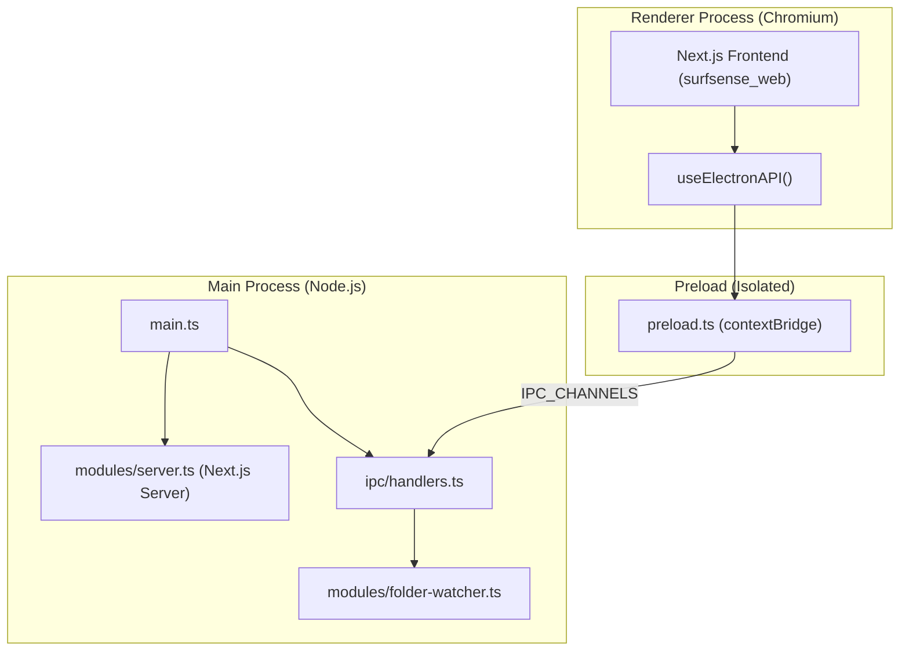
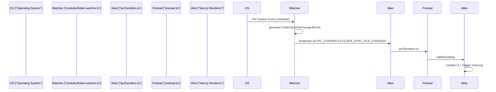

<!-- source: DeepWiki mcp.deepwiki.com · repo MODSetter/SurfSense · page 16.1 Desktop Architecture · fetched 2026-10-29 -->

# Desktop Architecture

Relevant source files

The following files were used as context for generating this wiki page:

- [surfsense_desktop/assets/icon-128.png](surfsense_desktop/assets/icon-128.png)
- [surfsense_desktop/assets/iconTemplate.png](surfsense_desktop/assets/iconTemplate.png)
- [surfsense_desktop/assets/iconTemplate@2x.png](surfsense_desktop/assets/iconTemplate@2x.png)
- [surfsense_desktop/electron-builder.yml](surfsense_desktop/electron-builder.yml)
- [surfsense_desktop/pnpm-lock.yaml](surfsense_desktop/pnpm-lock.yaml)
- [surfsense_desktop/scripts/build-electron.mjs](surfsense_desktop/scripts/build-electron.mjs)
- [surfsense_desktop/src/ipc/channels.ts](surfsense_desktop/src/ipc/channels.ts)
- [surfsense_desktop/src/ipc/handlers.ts](surfsense_desktop/src/ipc/handlers.ts)
- [surfsense_desktop/src/main.ts](surfsense_desktop/src/main.ts)
- [surfsense_desktop/src/modules/analytics.ts](surfsense_desktop/src/modules/analytics.ts)
- [surfsense_desktop/src/modules/folder-watcher.ts](surfsense_desktop/src/modules/folder-watcher.ts)
- [surfsense_desktop/src/modules/permissions.ts](surfsense_desktop/src/modules/permissions.ts)
- [surfsense_desktop/src/modules/tray.ts](surfsense_desktop/src/modules/tray.ts)
- [surfsense_desktop/src/preload.ts](surfsense_desktop/src/preload.ts)
- [surfsense_web/app/desktop/permissions/page.tsx](surfsense_web/app/desktop/permissions/page.tsx)
- [surfsense_web/types/window.d.ts](surfsense_web/types/window.d.ts)

The SurfSense desktop application is an Electron-based wrapper that integrates the Next.js frontend with native operating system capabilities. It enables deep system integration features such as global keyboard shortcuts, local folder synchronization, screen capture, and background processing that are unavailable to standard web applications.

## Electron Process Model

SurfSense follows the standard Electron multi-process architecture, dividing responsibilities between a single **Main Process** and multiple **Renderer Processes**.

### Main Process
The Main Process [surfsense_desktop/src/main.ts:1-20]() acts as the application's entry point and orchestrator. It manages the application lifecycle, creates native windows, handles system tray integration via `createTray` [surfsense_desktop/src/modules/tray.ts:80-102](), and manages native modules like `chokidar` for file watching [surfsense_desktop/src/modules/folder-watcher.ts:250-255](). It also manages a local Next.js server instance to serve the frontend via `startNextServer` [surfsense_desktop/src/main.ts:42]().

### Preload Script
The Preload script [surfsense_desktop/src/preload.ts:1-4]() acts as a secure bridge. It uses `contextBridge` to expose a limited, safe subset of IPC (Inter-Process Communication) methods to the Next.js frontend via `window.electronAPI` [surfsense_desktop/src/preload.ts:4-207](). This prevents the renderer from having direct access to Node.js APIs while allowing it to trigger native actions.

### Renderer Process
The Renderer process is the Next.js application (`surfsense_web`). When running inside Electron, it detects the presence of `window.electronAPI` to toggle desktop-specific UI and features [surfsense_web/app/desktop/permissions/page.tsx:63-75]().

### Desktop Process Architecture
The following diagram illustrates the relationship between the Electron processes and the embedded Next.js server.

Sources: [surfsense_desktop/src/main.ts:1-13](), [surfsense_desktop/src/preload.ts:4-44](), [surfsense_desktop/src/ipc/handlers.ts:114-150](), [surfsense_web/types/window.d.ts:90-207]()

## IPC Channel Design

Communication between the frontend and the native layer is strictly governed by a set of predefined channels in `IPC_CHANNELS` [surfsense_desktop/src/ipc/channels.ts:1-72](). 

| Category | Key Channels | Purpose |
| :--- | :--- | :--- |
| **App Lifecycle** | `GET_APP_VERSION`, `RESTART_APP` | Versioning and update management [surfsense_desktop/src/ipc/channels.ts:3-15](). |
| **Folder Sync** | `FOLDER_SYNC_ADD_FOLDER`, `FOLDER_SYNC_FILE_CHANGED` | Managing local folder watchers via `chokidar` [surfsense_desktop/src/ipc/channels.ts:24-37](). |
| **Assists** | `QUICK_ASK_TEXT`, `CAPTURE_FULL_SCREEN` | Text selection and screenshot capabilities [surfsense_desktop/src/ipc/channels.ts:7-16](). |
| **Auth** | `AUTH_CHANGED`, `GET_ACCESS_TOKEN` | Syncing JWT tokens between Main and Renderer [surfsense_desktop/src/ipc/channels.ts:43-48](). |
| **Filesystem** | `READ_AGENT_LOCAL_FILE_TEXT` | Allowing the AI Agent to read/write local files [surfsense_desktop/src/ipc/channels.ts:40-41](). |

### Data Flow: Native Event to UI
When a file changes on the local disk, the Main process captures the event and broadcasts it to the Renderer via `sendFileChangedEvent` [surfsense_desktop/src/modules/folder-watcher.ts:128-142]().

Sources: [surfsense_desktop/src/modules/folder-watcher.ts:236-255](), [surfsense_desktop/src/ipc/handlers.ts:74-78](), [surfsense_desktop/src/preload.ts:51-57]()

## Application Packaging and Standalone Next.js

SurfSense Desktop packages the Next.js frontend as a standalone Node.js server within the Electron bundle.

### Build Pipeline
1. **Frontend Build**: `surfsense_web` is built using `next build`, producing a `standalone` output folder.
2. **Symlink Resolution**: The build script `build-electron.mjs` recursively resolves symlinks in the Next.js standalone output via `resolveAllSymlinks` and flattens the `pnpm` virtual store via `flattenPnpmStore` to ensure compatibility with Electron's ASAR packaging [surfsense_desktop/scripts/build-electron.mjs:17-88]().
3. **Electron Build**: `esbuild` bundles the Main and Preload scripts [surfsense_desktop/scripts/build-electron.mjs:129-151]().
4. **Packaging**: `electron-builder` packages the application, including the Next.js standalone folder as an `extraResource` [surfsense_desktop/electron-builder.yml:21-38]().

### Runtime Server Management
On startup, the Main process calls `startNextServer()` [surfsense_desktop/src/main.ts:42](). This spawns the Next.js server on a local port. The `createMainWindow` function then loads the application from the dashboard route [surfsense_desktop/src/main.ts:61]().

## Key Components

### Secret Store and Auth Sync
The Main process maintains an encrypted `secretStore` for sensitive data like the `surfsense_refresh_token` [surfsense_desktop/src/ipc/handlers.ts:58-86](). It provides handlers for the Renderer to perform OAuth flows via `startGoogleOAuth` and token refreshes without exposing tokens to the browser's `localStorage` [surfsense_desktop/src/ipc/handlers.ts:88-112]().

### Permissions Management
On macOS, SurfSense requires Accessibility and Screen Recording permissions for its assist features. The `getPermissionsStatus` handler uses `node-mac-permissions` to check and request these from the OS [surfsense_desktop/src/ipc/handlers.ts:134-144](). The frontend provides a dedicated setup page `DesktopPermissionsPage` to guide users through this process [surfsense_web/app/desktop/permissions/page.tsx:61-125]().

### Analytics Bridge
To ensure desktop events are correctly attributed, the Main process includes a `PostHog` client [surfsense_desktop/src/modules/analytics.ts:31-36](). The Renderer process mirrors its analytics calls to the Main process via `analyticsIdentify` and `analyticsCapture` methods in the preload API, allowing unified tracking across the web and native layers [surfsense_desktop/src/preload.ts:114-118]().

Sources: [surfsense_desktop/src/ipc/handlers.ts:58-86](), [surfsense_desktop/src/modules/analytics.ts:1-40](), [surfsense_desktop/scripts/build-electron.mjs:1-161](), [surfsense_desktop/electron-builder.yml:1-94](), [surfsense_desktop/src/modules/tray.ts:1-137]()

---

