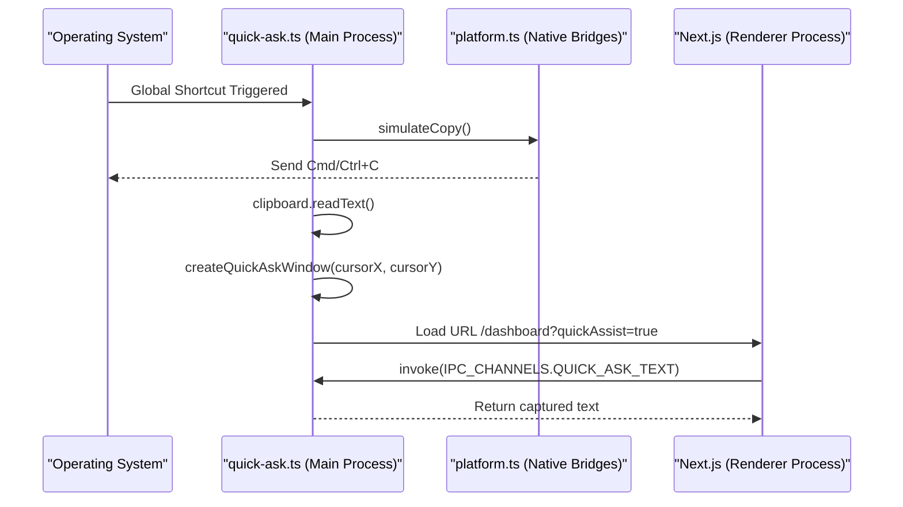
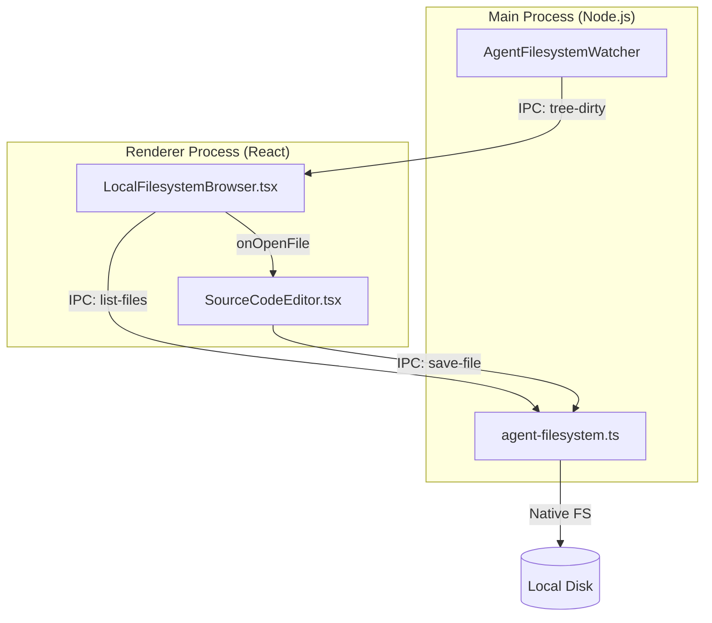

<!-- source: DeepWiki mcp.deepwiki.com · repo MODSetter/SurfSense · page 16.2 Desktop Features · fetched 2026-10-29 -->

# Desktop Features

Relevant source files

The following files were used as context for generating this wiki page:

- [.github/workflows/desktop-release.yml](.github/workflows/desktop-release.yml)
- [.github/workflows/docker-build.yml](.github/workflows/docker-build.yml)
- [scripts/bump-version.ps1](scripts/bump-version.ps1)
- [scripts/bump-version.sh](scripts/bump-version.sh)
- [surfsense_backend/app/routes/editor_routes.py](surfsense_backend/app/routes/editor_routes.py)
- [surfsense_backend/app/tasks/celery_tasks/document_reindex_tasks.py](surfsense_backend/app/tasks/celery_tasks/document_reindex_tasks.py)
- [surfsense_backend/tests/integration/test_document_versioning.py](surfsense_backend/tests/integration/test_document_versioning.py)
- [surfsense_backend/tests/unit/connector_indexers/test_local_folder_scan.py](surfsense_backend/tests/unit/connector_indexers/test_local_folder_scan.py)
- [surfsense_desktop/.env.example](surfsense_desktop/.env.example)
- [surfsense_desktop/src/modules/agent-filesystem.ts](surfsense_desktop/src/modules/agent-filesystem.ts)
- [surfsense_desktop/src/modules/auto-launch.ts](surfsense_desktop/src/modules/auto-launch.ts)
- [surfsense_desktop/src/modules/auto-updater.ts](surfsense_desktop/src/modules/auto-updater.ts)
- [surfsense_desktop/src/modules/deep-links.ts](surfsense_desktop/src/modules/deep-links.ts)
- [surfsense_desktop/src/modules/menu.ts](surfsense_desktop/src/modules/menu.ts)
- [surfsense_desktop/src/modules/oauth-page.ts](surfsense_desktop/src/modules/oauth-page.ts)
- [surfsense_desktop/src/modules/oauth.ts](surfsense_desktop/src/modules/oauth.ts)
- [surfsense_desktop/src/modules/quick-ask.ts](surfsense_desktop/src/modules/quick-ask.ts)
- [surfsense_desktop/src/modules/screen-capture/index.ts](surfsense_desktop/src/modules/screen-capture/index.ts)
- [surfsense_desktop/src/modules/screen-capture/screen-region-picker.ts](surfsense_desktop/src/modules/screen-capture/screen-region-picker.ts)
- [surfsense_desktop/src/modules/screen-capture/screen-region-preload.ts](surfsense_desktop/src/modules/screen-capture/screen-region-preload.ts)
- [surfsense_desktop/src/modules/screen-capture/screenshot-assist.ts](surfsense_desktop/src/modules/screen-capture/screenshot-assist.ts)
- [surfsense_desktop/src/modules/screen-capture/window-picker-preload.ts](surfsense_desktop/src/modules/screen-capture/window-picker-preload.ts)
- [surfsense_desktop/src/modules/screen-capture/window-picker.ts](surfsense_desktop/src/modules/screen-capture/window-picker.ts)
- [surfsense_desktop/src/modules/server.ts](surfsense_desktop/src/modules/server.ts)
- [surfsense_desktop/src/modules/window.ts](surfsense_desktop/src/modules/window.ts)
- [surfsense_web/atoms/tabs/tabs.atom.ts](surfsense_web/atoms/tabs/tabs.atom.ts)
- [surfsense_web/components/editor-panel/editor-panel.tsx](surfsense_web/components/editor-panel/editor-panel.tsx)
- [surfsense_web/components/editor/source-code-editor.tsx](surfsense_web/components/editor/source-code-editor.tsx)
- [surfsense_web/components/layout/hooks/useSidebarState.ts](surfsense_web/components/layout/hooks/useSidebarState.ts)
- [surfsense_web/components/layout/ui/right-panel/RightPanel.tsx](surfsense_web/components/layout/ui/right-panel/RightPanel.tsx)
- [surfsense_web/components/layout/ui/sidebar/LocalFilesystemBrowser.tsx](surfsense_web/components/layout/ui/sidebar/LocalFilesystemBrowser.tsx)
- [surfsense_web/components/layout/ui/sidebar/SidebarCollapseButton.tsx](surfsense_web/components/layout/ui/sidebar/SidebarCollapseButton.tsx)
- [surfsense_web/components/layout/ui/tabs/DocumentTabContent.tsx](surfsense_web/components/layout/ui/tabs/DocumentTabContent.tsx)
- [surfsense_web/components/layout/ui/tabs/TabBar.tsx](surfsense_web/components/layout/ui/tabs/TabBar.tsx)
- [surfsense_web/components/onboarding-tour.tsx](surfsense_web/components/onboarding-tour.tsx)
- [surfsense_web/components/ui/shortcut-kbd.tsx](surfsense_web/components/ui/shortcut-kbd.tsx)
- [surfsense_web/hooks/use-platform-shortcut.ts](surfsense_web/hooks/use-platform-shortcut.ts)
- [surfsense_web/hooks/use-session.ts](surfsense_web/hooks/use-session.ts)
- [surfsense_web/hooks/use-zero-document-type-counts.ts](surfsense_web/hooks/use-zero-document-type-counts.ts)
- [surfsense_web/lib/agent-filesystem.ts](surfsense_web/lib/agent-filesystem.ts)
- [surfsense_web/lib/auth-fetch.ts](surfsense_web/lib/auth-fetch.ts)
- [surfsense_web/tests/helpers/api/documents.ts](surfsense_web/tests/helpers/api/documents.ts)

The SurfSense desktop application extends the core knowledge management platform with native OS integrations. It leverages Electron's multi-process architecture to provide deep system access for features like global shortcuts, screen capture, local file synchronization, and system tray persistence.

## Quick Ask (Text Selection Assist)

Quick Ask is a productivity feature that allows users to select text in any application and trigger a global shortcut (default: `Cmd/Ctrl + Shift + S`) to instantly bring up a specialized chat interface populated with that text.

### Implementation Details
The feature is managed by the `QuickAsk` module [surfsense_desktop/src/modules/quick-ask.ts:10-17](). It utilizes accessibility APIs to programmatically simulate a copy command, capturing the user's current selection into the clipboard temporarily.

**Data Flow:**
1.  **Trigger:** User presses the global shortcut registered via `globalShortcut.register` [surfsense_desktop/src/modules/quick-ask.ts:177-178]().
2.  **Capture:** The `quickAskHandler` saves the current clipboard state, calls `simulateCopy()`, and reads the new clipboard content [surfsense_desktop/src/modules/quick-ask.ts:110-122]().
3.  **Window Creation:** A specialized `BrowserWindow` is created at the cursor position [surfsense_desktop/src/modules/quick-ask.ts:91-93]().
4.  **Routing:** The window loads the dashboard with a `quickAssist=true` query parameter [surfsense_desktop/src/modules/quick-ask.ts:62-62]().
5.  **IPC:** The frontend requests the captured text via the `QUICK_ASK_TEXT` IPC channel [surfsense_desktop/src/modules/quick-ask.ts:136-140]().

**Key Entities:**
| Entity | Role |
| :--- | :--- |
| `quickAskHandler` | Orchestrates the copy simulation and window positioning [surfsense_desktop/src/modules/quick-ask.ts:96-128](). |
| `simulateCopy` | Platform-specific implementation to trigger a copy event [surfsense_desktop/src/modules/platform.ts:4-4](). |
| `REPLACE_TEXT` | IPC handler that allows the AI to paste generated content back into the source app [surfsense_desktop/src/modules/quick-ask.ts:153-171](). |

### Quick Ask Interaction Diagram
The following diagram illustrates the bridge between the OS-level shortcut and the application code.

Title: Quick Ask Execution Flow

Sources: [surfsense_desktop/src/modules/quick-ask.ts:87-128](), [surfsense_desktop/src/modules/quick-ask.ts:136-140]()

## Screenshot Assist

Screenshot Assist allows users to capture specific regions of their screen or specific windows and immediately ingest them into the SurfSense agent context for analysis (OCR, visual reasoning).

### Implementation
The system uses a multi-stage picker UI:
1.  **Screen Capture Entry:** Initiated via `screenshot-assist.ts` [surfsense_desktop/src/modules/screen-capture/screenshot-assist.ts:1-5]().
2.  **Region/Window Selection:** Uses `screen-region-picker.ts` and `window-picker.ts` to create transparent overlays where the user can select the target area [surfsense_desktop/src/modules/screen-capture/index.ts:1-10]().
3.  **Processing:** The captured buffer is passed to the frontend via IPC to be attached to the active chat thread.

Sources: [surfsense_desktop/src/modules/screen-capture/screenshot-assist.ts](), [surfsense_desktop/src/modules/screen-capture/screen-region-picker.ts]()

## Local Folder Watching

SurfSense can monitor local directories and automatically synchronize their contents with a SearchSpace. This enables a "Local-First" knowledge base where local Markdown files, code, or documents are indexed in real-time.

### Implementation
The `LocalFilesystemBrowser` component in the frontend interacts with the Electron main process to list and watch files [surfsense_web/components/layout/ui/sidebar/LocalFilesystemBrowser.tsx:144-155]().

**Key Functions:**
*   `listAgentFilesystemFiles`: Recursively scans the directory while respecting `DEFAULT_EXCLUDE_PATTERNS` (e.g., `.git`, `node_modules`) [surfsense_web/components/layout/ui/sidebar/LocalFilesystemBrowser.tsx:213-217]().
*   `startAgentFilesystemTreeWatch`: Registers a native file watcher in the main process to notify the frontend of changes [surfsense_web/components/layout/ui/sidebar/LocalFilesystemBrowser.tsx:252-255]().
*   `onAgentFilesystemTreeDirty`: An IPC listener that triggers a UI refresh or re-indexing when the local disk state changes [surfsense_web/components/layout/ui/sidebar/LocalFilesystemBrowser.tsx:254-254]().

### Local File Integration Diagram
Title: Local Filesystem Synchronization

Sources: [surfsense_web/components/layout/ui/sidebar/LocalFilesystemBrowser.tsx:135-160](), [surfsense_web/components/editor/source-code-editor.tsx:22-30]()

## System Tray and Lifecycle

The application resides in the system tray to ensure background services (like folder watching and messaging gateways) remain active even when the main window is closed.

### Window Management
The `mainWindow` is configured to "hide-on-close" unless the application is explicitly quitting [surfsense_desktop/src/modules/window.ts:160-165]().
*   `markQuitting()`: Sets a flag `isQuitting = true` during the `before-quit` app event to allow the window to actually destroy [surfsense_desktop/src/modules/window.ts:39-41]().
*   `showMainWindow()`: Restores the window from the tray, creating it if it was destroyed [surfsense_desktop/src/modules/window.ts:174-184]().

### OAuth Interception
The desktop app includes a special `webRequest` filter to intercept OAuth callbacks from providers like Google or Notion. It rewrites URLs intended for the hosted web app back to the local Electron server [surfsense_desktop/src/modules/window.ts:95-115]().

Sources: [surfsense_desktop/src/modules/window.ts:160-165](), [surfsense_desktop/src/modules/window.ts:95-115]()

## Auto-Updater

The application includes an integrated update system using `electron-updater`, configured via GitHub Actions for multi-platform releases [surfsense_desktop/src/modules/auto-updater.ts:1-10]().

### Workflow
1.  **Check:** On startup (and manually via menu), the app calls `checkForUpdates()` [surfsense_desktop/src/modules/auto-updater.ts:117-121]().
2.  **Download:** Updates are automatically downloaded in the background [surfsense_desktop/src/modules/auto-updater.ts:53-53]().
3.  **Notify:** Once downloaded, the main process sends the `UPDATE_DOWNLOADED` IPC message to all renderers [surfsense_desktop/src/modules/auto-updater.ts:92-100]().
4.  **Install:** The user is prompted to restart. `installDownloadedUpdate()` triggers `quitAndInstall()` [surfsense_desktop/src/modules/auto-updater.ts:102-106]().

### Release Pipeline
The `.github/workflows/desktop-release.yml` handles the packaging and signing for Windows (Azure CodeSign), macOS (Notarization), and Linux [surfsense_desktop/.github/workflows/desktop-release.yml:28-39]().

Sources: [surfsense_desktop/src/modules/auto-updater.ts:52-90](), [surfsense_desktop/src/modules/auto-updater.ts:92-100](), [.github/workflows/desktop-release.yml:135-159]()

---

