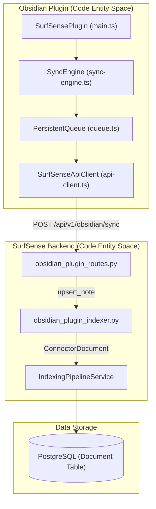
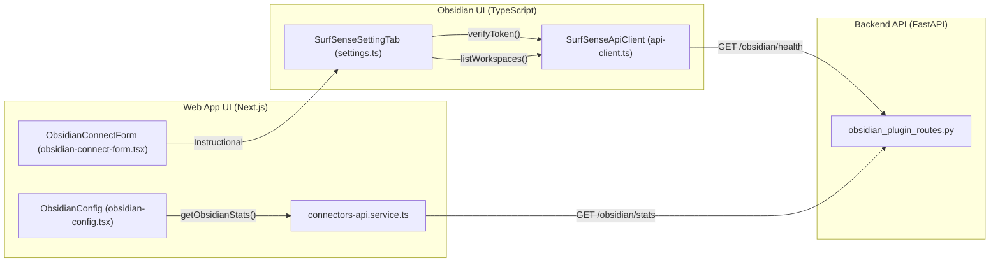

<!-- source: DeepWiki mcp.deepwiki.com · repo MODSetter/SurfSense · page 17 Obsidian Plugin · fetched 2026-10-29 -->

# Obsidian Plugin

Relevant source files

The following files were used as context for generating this wiki page:

- [.github/workflows/obsidian-plugin-lint.yml](.github/workflows/obsidian-plugin-lint.yml)
- [.github/workflows/release-obsidian-plugin.yml](.github/workflows/release-obsidian-plugin.yml)
- [manifest.json](manifest.json)
- [surfsense_backend/app/routes/obsidian_plugin_routes.py](surfsense_backend/app/routes/obsidian_plugin_routes.py)
- [surfsense_backend/app/schemas/obsidian_plugin.py](surfsense_backend/app/schemas/obsidian_plugin.py)
- [surfsense_backend/app/services/obsidian_plugin_indexer.py](surfsense_backend/app/services/obsidian_plugin_indexer.py)
- [surfsense_backend/tests/integration/test_obsidian_plugin_routes.py](surfsense_backend/tests/integration/test_obsidian_plugin_routes.py)
- [surfsense_backend/tests/unit/test_obsidian_plugin_indexer.py](surfsense_backend/tests/unit/test_obsidian_plugin_indexer.py)
- [surfsense_obsidian/LICENSE](surfsense_obsidian/LICENSE)
- [surfsense_obsidian/eslint.config.mts](surfsense_obsidian/eslint.config.mts)
- [surfsense_obsidian/manifest.json](surfsense_obsidian/manifest.json)
- [surfsense_obsidian/package-lock.json](surfsense_obsidian/package-lock.json)
- [surfsense_obsidian/package.json](surfsense_obsidian/package.json)
- [surfsense_obsidian/src/api-client.ts](surfsense_obsidian/src/api-client.ts)
- [surfsense_obsidian/src/attachments-confirm-modal.ts](surfsense_obsidian/src/attachments-confirm-modal.ts)
- [surfsense_obsidian/src/excludes.ts](surfsense_obsidian/src/excludes.ts)
- [surfsense_obsidian/src/folder-suggest-modal.ts](surfsense_obsidian/src/folder-suggest-modal.ts)
- [surfsense_obsidian/src/main.ts](surfsense_obsidian/src/main.ts)
- [surfsense_obsidian/src/queue.ts](surfsense_obsidian/src/queue.ts)
- [surfsense_obsidian/src/settings.ts](surfsense_obsidian/src/settings.ts)
- [surfsense_obsidian/src/status-bar.ts](surfsense_obsidian/src/status-bar.ts)
- [surfsense_obsidian/src/status-modal.ts](surfsense_obsidian/src/status-modal.ts)
- [surfsense_obsidian/src/status-visuals.ts](surfsense_obsidian/src/status-visuals.ts)
- [surfsense_obsidian/src/sync-engine.ts](surfsense_obsidian/src/sync-engine.ts)
- [surfsense_obsidian/src/types.ts](surfsense_obsidian/src/types.ts)
- [surfsense_obsidian/styles.css](surfsense_obsidian/styles.css)
- [surfsense_obsidian/versions.json](surfsense_obsidian/versions.json)
- [surfsense_web/components/assistant-ui/connector-popup/connect-forms/components/obsidian-connect-form.tsx](surfsense_web/components/assistant-ui/connector-popup/connect-forms/components/obsidian-connect-form.tsx)
- [surfsense_web/components/assistant-ui/connector-popup/connector-configs/components/obsidian-config.tsx](surfsense_web/components/assistant-ui/connector-popup/connector-configs/components/obsidian-config.tsx)
- [surfsense_web/public/connectors/obsidian.svg](surfsense_web/public/connectors/obsidian.svg)
- [versions.json](versions.json)

The SurfSense Obsidian plugin provides a real-time bridge between a local Obsidian vault and a SurfSense SearchSpace. It enables users to index their personal knowledge base for use with the AI Agent system, supporting markdown notes, frontmatter metadata, and binary attachments like PDFs and images.

### Purpose and Scope
The plugin operates as a push-based connector. Unlike traditional connectors that the SurfSense backend pulls from (e.g., Slack or Notion), the Obsidian plugin monitors local file system events and pushes changes to the SurfSense API over HTTPS [surfsense_obsidian/src/api-client.ts:14-27](). This architecture ensures compatibility with local-only vaults and works across desktop and mobile platforms without requiring server-side access to the user's file system [surfsense_web/components/assistant-ui/connector-popup/connect-forms/components/obsidian-connect-form.tsx:56-60]().

### Code Entity Space Mapping

The following diagram illustrates the relationship between the Obsidian plugin components and the Backend API infrastructure.

**Obsidian-to-Backend Sync Flow**

Sources: [surfsense_obsidian/src/main.ts:17-70](), [surfsense_backend/app/routes/obsidian_plugin_routes.py:61-65](), [surfsense_backend/app/services/obsidian_plugin_indexer.py:1-31]()

---

## Plugin Architecture and Sync Engine

The core of the plugin is the `SyncEngine`, which manages the reconciliation of the local vault state with the server's index. It utilizes a `PersistentQueue` to handle intermittent connectivity, ensuring that edits made offline are eventually synchronized [surfsense_obsidian/src/sync-engine.ts:31-45]().

### Key Features:
*   **Event-Driven Sync**: Listens to Obsidian vault events (`create`, `modify`, `delete`, `rename`) and metadata changes to trigger immediate updates [surfsense_obsidian/src/main.ts:84-102]().
*   **Reconciliation Engine**: On startup, the engine compares a local vault manifest with the server's `ManifestResponse` to identify and fix drift [surfsense_obsidian/src/sync-engine.ts:95-119]().
*   **Adaptive Backoff**: Implements an idle streak counter that scales the sync interval if no changes are detected, preserving battery and bandwidth [surfsense_obsidian/src/sync-engine.ts:70-73]().
*   **Binary Support**: Syncs non-markdown files (PDF, PNG, JPG, etc.) for background ETL processing [surfsense_backend/app/schemas/obsidian_plugin.py:20-30]().

For details, see [Plugin Architecture and Sync Engine](#17.1).

Sources: [surfsense_obsidian/src/sync-engine.ts:66-75](), [surfsense_obsidian/src/queue.ts:19-20](), [surfsense_backend/app/schemas/obsidian_plugin.py:141-146]()

---

## Plugin Configuration and Installation

Setting up the plugin involves authenticating via a Personal Access Token (PAT) and selecting a target SearchSpace. The configuration UI is handled by `SurfSenseSettingTab` [surfsense_obsidian/src/settings.ts:20-30]().

### Setup Process:
1.  **Server URL**: Configure the plugin to point to SurfSense Cloud (`https://surfsense.com`) or a self-hosted instance [surfsense_obsidian/src/settings.ts:41-60]().
2.  **Authentication**: Users generate a PAT in the SurfSense web app and paste it into the plugin's `API token` setting [surfsense_web/components/assistant-ui/connector-popup/connect-forms/components/obsidian-connect-form.tsx:98-108]().
3.  **Workspace Selection**: The plugin fetches available workspaces, allowing the user to choose where vault data should reside [surfsense_obsidian/src/settings.ts:115-143]().
4.  **Vault Filtering**: Users can specify inclusion/exclusion folders and advanced glob patterns to control which notes are indexed [surfsense_obsidian/src/settings.ts:185-219]().

**Configuration Component Map**

Sources: [surfsense_obsidian/src/settings.ts:32-152](), [surfsense_web/components/assistant-ui/connector-popup/connector-configs/components/obsidian-config.tsx:37-45](), [surfsense_web/components/assistant-ui/connector-popup/connect-forms/components/obsidian-connect-form.tsx:30-46]()

For details, see [Plugin Configuration and Installation](#17.2).

---

## Data Integration and Indexing

When a note is pushed to the backend, the `obsidian_plugin_indexer.py` service processes the `NotePayload` [surfsense_backend/app/schemas/obsidian_plugin.py:46-95]().

| Feature | Backend Implementation |
| :--- | :--- |
| **Metadata Preservation** | Frontmatter, tags, and headings are stored in the `document_metadata` JSONB column [surfsense_backend/app/services/obsidian_plugin_indexer.py:89-126](). |
| **Deep Linking** | Generates `obsidian://open?vault=...&file=...` URLs for the web UI's "Open in Obsidian" button [surfsense_backend/app/services/obsidian_plugin_indexer.py:77-86](). |
| **Vault Deduping** | Uses `vault_fingerprint` to recognize the same vault across different devices, preventing duplicate connector rows [surfsense_backend/app/routes/obsidian_plugin_routes.py:148-161](). |
| **ETL for Attachments** | Enqueues binary files for background extraction using `index_obsidian_attachment_task` [surfsense_backend/app/routes/obsidian_plugin_routes.py:214-221](). |

Sources: [surfsense_backend/app/services/obsidian_plugin_indexer.py:1-31](), [surfsense_backend/app/routes/obsidian_plugin_routes.py:65-65](), [surfsense_backend/app/schemas/obsidian_plugin.py:148-161]()

---

