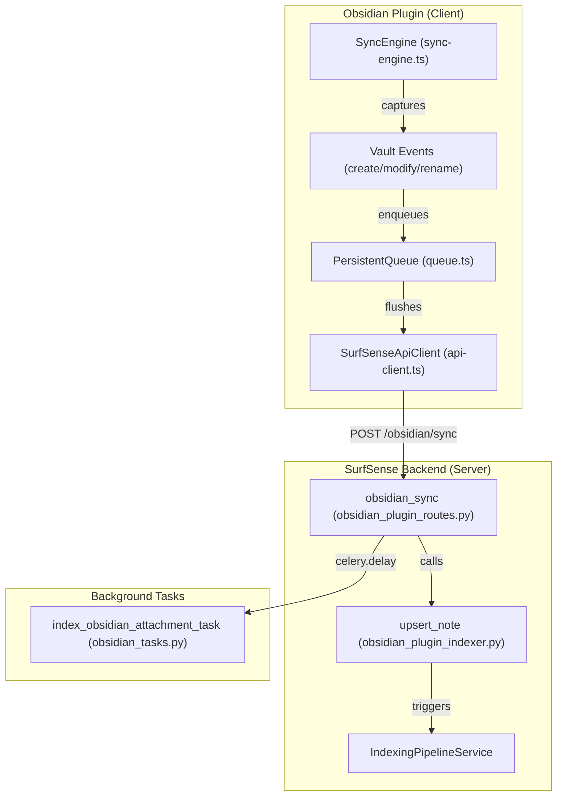
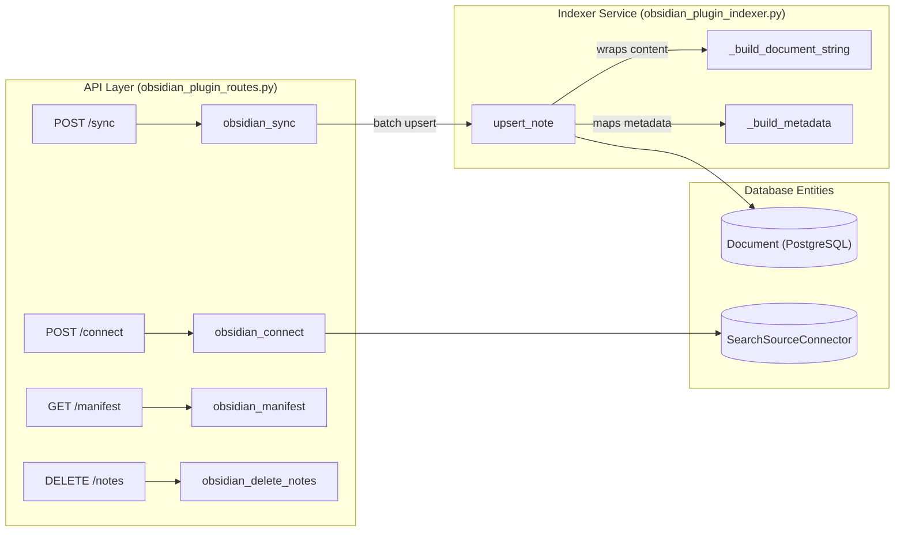

<!-- source: DeepWiki mcp.deepwiki.com · repo MODSetter/SurfSense · page 17.1 Plugin Architecture and Sync Engine · fetched 2026-10-29 -->

# Plugin Architecture and Sync Engine

Relevant source files

The following files were used as context for generating this wiki page:

- [surfsense_backend/app/routes/obsidian_plugin_routes.py](surfsense_backend/app/routes/obsidian_plugin_routes.py)
- [surfsense_backend/app/schemas/obsidian_plugin.py](surfsense_backend/app/schemas/obsidian_plugin.py)
- [surfsense_backend/app/services/obsidian_plugin_indexer.py](surfsense_backend/app/services/obsidian_plugin_indexer.py)
- [surfsense_backend/tests/integration/test_obsidian_plugin_routes.py](surfsense_backend/tests/integration/test_obsidian_plugin_routes.py)
- [surfsense_backend/tests/unit/test_obsidian_plugin_indexer.py](surfsense_backend/tests/unit/test_obsidian_plugin_indexer.py)
- [surfsense_obsidian/src/api-client.ts](surfsense_obsidian/src/api-client.ts)
- [surfsense_obsidian/src/attachments-confirm-modal.ts](surfsense_obsidian/src/attachments-confirm-modal.ts)
- [surfsense_obsidian/src/excludes.ts](surfsense_obsidian/src/excludes.ts)
- [surfsense_obsidian/src/folder-suggest-modal.ts](surfsense_obsidian/src/folder-suggest-modal.ts)
- [surfsense_obsidian/src/main.ts](surfsense_obsidian/src/main.ts)
- [surfsense_obsidian/src/settings.ts](surfsense_obsidian/src/settings.ts)
- [surfsense_obsidian/src/status-bar.ts](surfsense_obsidian/src/status-bar.ts)
- [surfsense_obsidian/src/sync-engine.ts](surfsense_obsidian/src/sync-engine.ts)
- [surfsense_obsidian/src/types.ts](surfsense_obsidian/src/types.ts)
- [surfsense_obsidian/styles.css](surfsense_obsidian/styles.css)
- [surfsense_web/components/assistant-ui/connector-popup/connect-forms/components/obsidian-connect-form.tsx](surfsense_web/components/assistant-ui/connector-popup/connect-forms/components/obsidian-connect-form.tsx)
- [surfsense_web/components/assistant-ui/connector-popup/connector-configs/components/obsidian-config.tsx](surfsense_web/components/assistant-ui/connector-popup/connector-configs/components/obsidian-config.tsx)
- [surfsense_web/public/connectors/obsidian.svg](surfsense_web/public/connectors/obsidian.svg)

The SurfSense Obsidian plugin enables real-time, bi-directional-aware synchronization of local Obsidian vaults into SurfSense SearchSpaces. Unlike legacy connectors that required server-side file access, the plugin operates as a push-client over HTTPS, making it compatible with both SurfSense Cloud and self-hosted deployments on desktop and mobile platforms [surfsense_web/components/assistant-ui/connector-popup/connect-forms/components/obsidian-connect-form.tsx:57-60]().

## System Architecture

The integration consists of a TypeScript-based Obsidian plugin and a dedicated FastAPI routing layer in the backend.

### High-Level Data Flow

The plugin monitors the Obsidian `vault` and `metadataCache` for changes, enqueues operations, and flushes them to the backend in batches.

1.  **Event Capture**: The `SyncEngine` listens to Obsidian's internal events (`create`, `modify`, `delete`, `rename`) and metadata changes [surfsense_obsidian/src/main.ts:84-102]().
2.  **Queue Management**: Operations are stored in a `PersistentQueue` to ensure data integrity across plugin reloads [surfsense_obsidian/src/main.ts:41-46]().
3.  **Batching & Transport**: The `SurfSenseApiClient` sends batches of `NotePayload` objects to the `/api/v1/obsidian/sync` endpoint [surfsense_obsidian/src/api-client.ts:135-148]().
4.  **Backend Indexing**: The `obsidian_plugin_routes.py` receives the batch and invokes `upsert_note`, `rename_note`, or `delete_note` within the `obsidian_plugin_indexer.py` [surfsense_backend/app/routes/obsidian_plugin_routes.py:48-54]().

### Code Entity Map: Sync Lifecycle

The following diagram maps the logical sync stages to the specific code entities responsible for execution.

**Sources:** [surfsense_obsidian/src/sync-engine.ts:158-207](), [surfsense_obsidian/src/main.ts:72-75](), [surfsense_backend/app/routes/obsidian_plugin_routes.py:317-325](), [surfsense_backend/app/services/obsidian_plugin_indexer.py:10-17](), [surfsense_backend/app/routes/obsidian_plugin_routes.py:55-55]()

## Sync Engine Implementation

The `SyncEngine` is the core orchestrator within the plugin. It manages the reconciliation of local vault state with the server's manifest.

### Vault Identity and Fingerprinting
To prevent duplicate connectors when the same vault is synced from multiple devices (e.g., via Obsidian Sync), the plugin generates a `vaultFingerprint`. This is a deterministic SHA-256 hash of the sorted markdown paths and the vault name [surfsense_obsidian/src/sync-engine.ts:133-138](). The backend uses this fingerprint to deduplicate `SearchSourceConnector` rows during the `obsidian_connect` handshake [surfsense_backend/tests/integration/test_obsidian_plugin_routes.py:8-10]().

### Reconciliation Logic
On startup or manual trigger, the plugin performs a reconciliation pass:
1.  **Manifest Fetch**: Calls `GET /obsidian/manifest` to get the server's current state (`{path: {hash, mtime, size}}`) [surfsense_obsidian/src/api-client.ts:191-196]().
2.  **Local Comparison**: Compares the server manifest against the local `metadataCache` [surfsense_obsidian/src/sync-engine.ts:31-32]().
3.  **Diffing**: 
    *   Files missing on server are enqueued for `upsert`.
    *   Files with mismatched hashes, `mtime`, or `size` are enqueued for `upsert` [surfsense_obsidian/src/sync-engine.ts:340-350]().
    *   Files on server but missing locally are enqueued for `delete` (respecting `tombstones` to avoid re-deleting) [surfsense_obsidian/src/sync-engine.ts:355-365]().

### Adaptive Backoff
The engine implements an idle backoff strategy to reduce server load. If a reconciliation pass finds no work to do, the `idleReconcileStreak` increments, doubling the interval (capped at 8x the base interval) [surfsense_obsidian/src/sync-engine.ts:70-73](). The streak resets on the first user edit or non-empty reconcile [surfsense_obsidian/src/sync-engine.ts:164-187]().

## API and Data Models

### Note Payload
The `NotePayload` is the source of truth for a file's content and metadata as it travels from the plugin to the backend.

| Field | Description |
| :--- | :--- |
| `vault_id` | Stable UUID for the vault [surfsense_backend/app/schemas/obsidian_plugin.py:49-51](). |
| `path` | Vault-relative path (e.g., 'notes/idea.md') [surfsense_backend/app/schemas/obsidian_plugin.py:52-52](). |
| `content_hash` | SHA-256 of raw content used for server-side change detection [surfsense_backend/app/schemas/obsidian_plugin.py:67-69](). |
| `is_binary` | Flag for non-markdown attachments (PDF, PNG, etc.) [surfsense_backend/app/schemas/obsidian_plugin.py:70-76](). |
| `binary_base64` | Encoded bytes for background ETL processing [surfsense_backend/app/schemas/obsidian_plugin.py:77-83](). |
| `frontmatter` | Dictionary of YAML frontmatter data [surfsense_backend/app/schemas/obsidian_plugin.py:59-59](). |
| `headings` | Extracted `HeadingRef` list (heading text and level) [surfsense_backend/app/schemas/obsidian_plugin.py:39-43](). |

### Backend Route Handling
The backend uses a specialized `SearchSourceConnectorType.OBSIDIAN_CONNECTOR` to identify plugin-managed data [surfsense_backend/app/routes/obsidian_plugin_routes.py:189-191]().

**Sources:** [surfsense_backend/app/routes/obsidian_plugin_routes.py:61-65](), [surfsense_backend/app/services/obsidian_plugin_indexer.py:128-151](), [surfsense_backend/app/db.py:23-26](), [surfsense_backend/app/routes/obsidian_plugin_routes.py:38-46]()

## Queue and Error Management

### Batch Processing
The plugin flushes the queue in batches (typically 10-20 notes, max 100) to optimize network performance [surfsense_backend/app/schemas/obsidian_plugin.py:114](). Each batch returns a `SyncAck` containing individual status reports (`ok`, `queued`, or `error`) for every path in the request [surfsense_obsidian/src/types.ts:147-159]().

### Error Handling
*   **Transient Errors**: Network failures or 404 `VAULT_NOT_REGISTERED` (thrown when a sync is attempted before a successful `/connect`) trigger retries [surfsense_obsidian/src/api-client.ts:62-67]().
*   **Auth Errors**: 401 responses block further requests for 60 seconds (`AUTH_BLOCK_MS`) and notify the user to update their API token [surfsense_obsidian/src/api-client.ts:75-79](), [surfsense_obsidian/src/api-client.ts:236-240]().
*   **Conflict Resolution**: Concurrent `/connect` calls from the same vault are collapsed into a single connector row using PostgreSQL `ON CONFLICT` logic [surfsense_backend/tests/integration/test_obsidian_plugin_routes.py:152-159]().

## Attachment Handling
When `includeAttachments` is enabled, the plugin syncs supported non-markdown files [surfsense_obsidian/src/types.ts:17](). Supported extensions include `pdf`, `png`, `jpg`, `jpeg`, `gif`, `webp`, `svg`, and `txt` [surfsense_backend/app/schemas/obsidian_plugin.py:20-29](). While markdown notes are processed in the request cycle, binary attachments are offloaded to a Celery task `index_obsidian_attachment_task` for background ETL extraction and indexing [surfsense_backend/app/routes/obsidian_plugin_routes.py:214-220]().

**Sources:**
- `surfsense_obsidian/src/sync-engine.ts`
- `surfsense_obsidian/src/api-client.ts`
- `surfsense_backend/app/routes/obsidian_plugin_routes.py`
- `surfsense_backend/app/services/obsidian_plugin_indexer.py`
- `surfsense_backend/app/schemas/obsidian_plugin.py`
- `surfsense_obsidian/src/main.ts`
- `surfsense_obsidian/src/types.ts`

---

